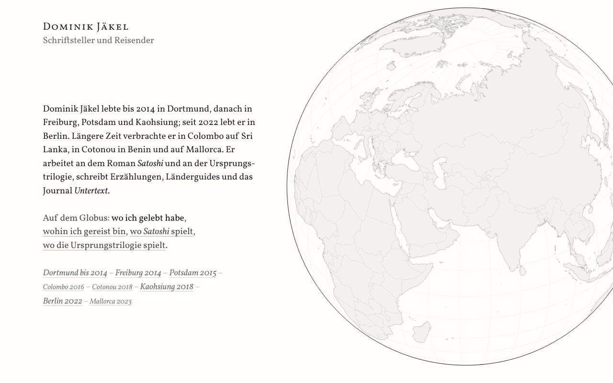
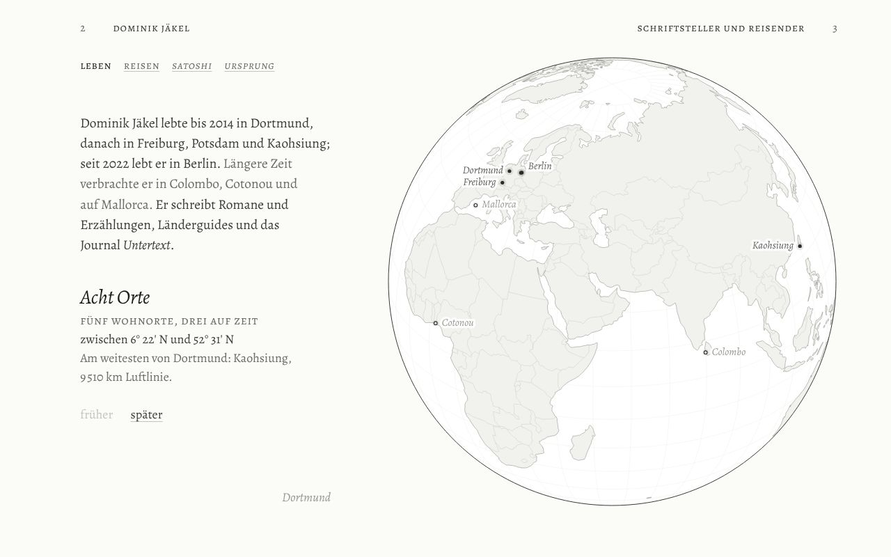
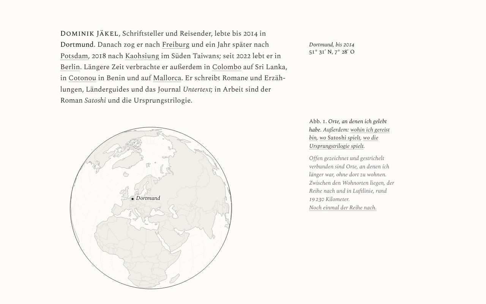

# Autorenwebsite Dominik Jäkel

Erste Entwürfe für eine persönliche Autorenwebsite: Journal, Länderguides, Bücher.

## Entwürfe ansehen

`entwuerfe/index.html` lokal im Browser öffnen. Von dort sind alle Entwürfe verlinkt:

| | Richtung | Idee |
|---|---|---|
| E1 | [Klappentext und Regal](entwuerfe/e1-klappentext.html) | Briefkopf und Kurzvita in Vollkorn, die Lebensstationen als Kolophonzeile mit springender Chronik. Darunter ein Regal aus den Goodreads-Daten, nach Erscheinungsjahr geordnet, der Nachttisch quer obenauf. |
| E2 | [Atlastafel und Zeitband](entwuerfe/e2-atlas.html) | Eine Doppelseite nach Schalansky in Alegreya: eine Tafel pro Station, daneben der Globus. Darunter alle Bücher als Striche auf einer Zeitachse von Gilgamesch bis Labatut. |
| E3 | [Buchseite und Register](entwuerfe/e3-marginalie.html) | Eine Buchseite mit Randspalte in Spectral, der Globus als Abbildung 1, die Orte als Randnotizen. Darunter ein laufendes Register nach Jahrzehnten. |
| A | [Untertext](entwuerfe/a-untertext.html) | Ein Blatt mit zwei Schichten. Unter jedem Text steht, worum es eigentlich ging; ein Schalter für UV-Licht macht die untere Schrift sichtbar. |
| B | [Nachtseite](entwuerfe/b-nachtseite.html) | Eine Nacht von der Dämmerung bis zum Morgengrauen, mit echtem Mondstand, Ortszeiten und dem Untertagebuch als Rubrik. |
| C | [Dominik Jäkel](entwuerfe/c-dominik-jaekel.html) | Der Name als Haus, das Journal heißt Untertext. Eine Atlasseite mit Länderregister, Aufbau eines Guides und Globus. |
| D | [Globus](entwuerfe/d-globus.html) | Weiß und Graphit. Zoombarer Globus mit 65 bereisten Ländern und Gebieten, Ebenen für Leben, den Roman Satoshi und die Ursprungstrilogie, darunter eine Bibliothek zum Herausziehen. |

In den Entwürfen A bis D lässt sich unten über „Name testen“ jeder Namenskandidat einsetzen, auch ein eigener. Die Übersicht enthält außerdem die Shortlist der Namen und eine Empfehlung.

Alle Texte sind Beispieltexte, die Formulare verschicken nichts. Jede Seite ist eine einzelne HTML-Datei ohne Build-Schritt; die Schriften kommen von Google Fonts. Die Entwürfe D und E1–E3 laden zusätzlich d3 und topojson-client von jsDelivr. E1–E3 teilen sich den Globus-Kern (`entwuerfe/globus/kern.js`), die Inhalte (`entwuerfe/globus/inhalt.js`) und die Bücher aus dem Goodreads-Export ohne private Notizen (`entwuerfe/daten/buecher.js`). Die Kartendaten liegen in `entwuerfe/daten/` (world-atlas, Natural Earth, gemeinfrei; England, Schottland, Wales und Nordirland daraus vereinfacht geteilt).

## Nächste Schritte

1. Namen festlegen. Danach Domains (.de und .com), Instagram-Namen und die Markenregister von DPMA und EUIPO prüfen.
2. Eine Richtung wählen oder mischen.
3. Inhalte sammeln: drei bis fünf echte Texte, ein Länderguide als Vorlage, Fotos, ein Text für „Über mich“.
4. Die echte Seite bauen: statischer Seitengenerator mit Markdown-Inhalten (zum Beispiel Astro), Deutsch und Englisch, Newsletter mit Double-Opt-in, Impressum und Datenschutz.
