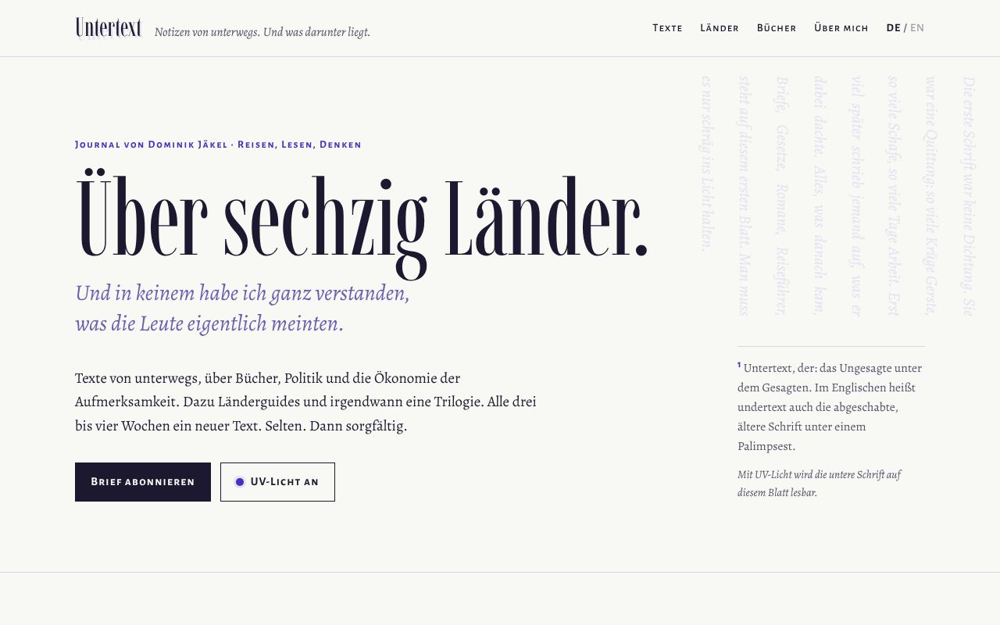
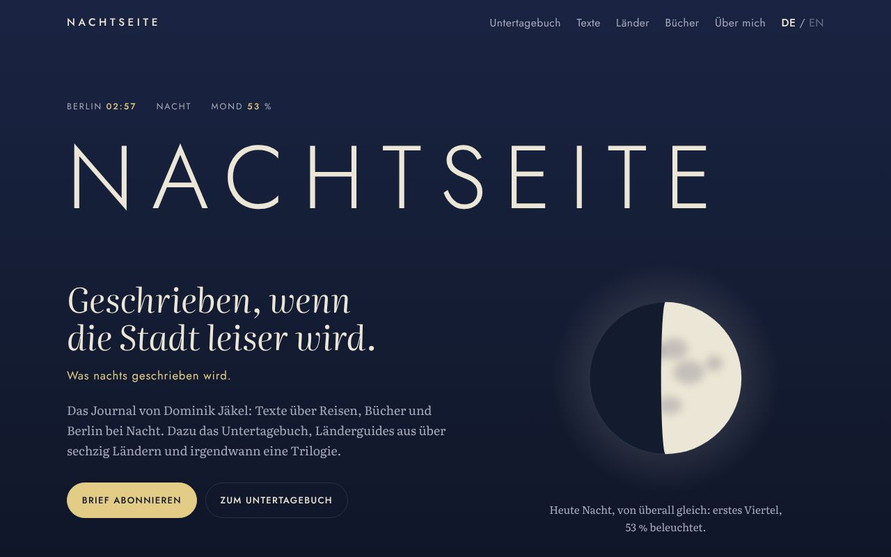
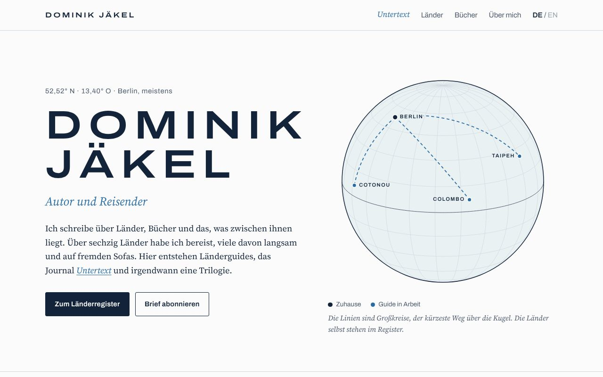
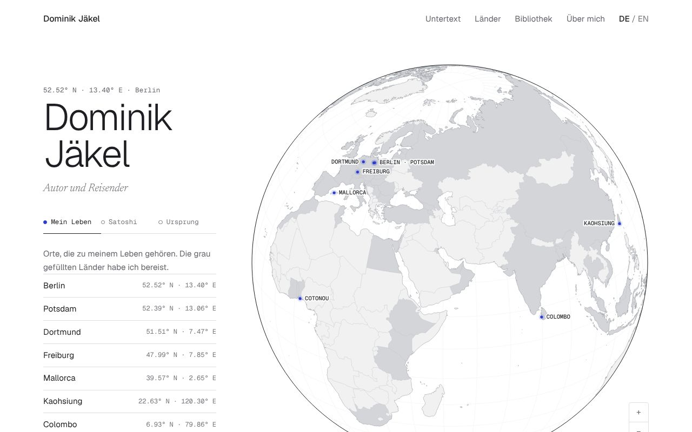

# Autorenwebsite Dominik Jäkel

Erste Entwürfe für eine persönliche Autorenwebsite: Journal, Länderguides, Bücher.

## Entwürfe ansehen

`entwuerfe/index.html` lokal im Browser öffnen. Von dort sind alle Entwürfe verlinkt:

| | Richtung | Idee |
|---|---|---|
| A | [Untertext](entwuerfe/a-untertext.html) | Ein Blatt mit zwei Schichten. Unter jedem Text steht, worum es eigentlich ging; ein Schalter für UV-Licht macht die untere Schrift sichtbar. |
| B | [Nachtseite](entwuerfe/b-nachtseite.html) | Eine Nacht von der Dämmerung bis zum Morgengrauen, mit echtem Mondstand, Ortszeiten und dem Untertagebuch als Rubrik. |
| C | [Dominik Jäkel](entwuerfe/c-dominik-jaekel.html) | Der Name als Haus, das Journal heißt Untertext. Eine Atlasseite mit Länderregister, Aufbau eines Guides und Globus. |
| D | [Globus](entwuerfe/d-globus.html) | Weiß und Graphit. Zoombarer Globus mit 65 bereisten Ländern und Gebieten, Ebenen für Leben, den Roman Satoshi und die Ursprungstrilogie, darunter eine Bibliothek zum Herausziehen. |

In jedem Entwurf lässt sich unten über „Name testen“ jeder Namenskandidat einsetzen, auch ein eigener. Die Übersicht enthält außerdem die Shortlist der Namen und eine Empfehlung.

Alle Texte sind Beispieltexte, die Formulare verschicken nichts. Jede Seite ist eine einzelne HTML-Datei ohne Build-Schritt; die Schriften kommen von Google Fonts. Entwurf D lädt zusätzlich d3 und topojson-client von jsDelivr; die Kartendaten liegen in `entwuerfe/daten/` (world-atlas, Natural Earth, gemeinfrei; England, Schottland, Wales und Nordirland daraus vereinfacht geteilt).

## Nächste Schritte

1. Namen festlegen. Danach Domains (.de und .com), Instagram-Namen und die Markenregister von DPMA und EUIPO prüfen.
2. Eine Richtung wählen oder mischen.
3. Inhalte sammeln: drei bis fünf echte Texte, ein Länderguide als Vorlage, Fotos, ein Text für „Über mich“.
4. Die echte Seite bauen: statischer Seitengenerator mit Markdown-Inhalten (zum Beispiel Astro), Deutsch und Englisch, Newsletter mit Double-Opt-in, Impressum und Datenschutz.
