# A und B im Vergleich: was sich geändert hat und warum

## Kurz vorweg

Deine Website gibt es in zwei Fassungen. A ist das bisherige Testsystem, B die neue Gestalt „Atlas“. In beiden stehen dieselben Texte, fast überall Wort für Wort, und dieselben Daten: Stationen, Bücher, Länder, Szenen. Die wenigen Ausnahmen beim Wortlaut stehen in einem eigenen Abschnitt am Ende. Was sich unterscheidet, ist nur die Form: Schrift, Farbe, Bewegung, Anordnung.

Das Dokument hat 29 nummerierte Elemente. Zu jedem gibt es Bilder von A und B, dann Vorher, Nachher, Warum, Vorteile, Nachteile, verworfene Alternativen, Sicherheit und meine Empfehlung für die Mischfassung. Die Tabelle „Auf einen Blick“ fasst alles zusammen. Am Ende stehen die Fragen, die nur du beantworten kannst.

Du kannst kurz antworten, etwa: „Nimm die Empfehlungen, außer 09 und 15“ oder „03, 10, 28 aus B, Rest wie A“.

Ein ehrlicher Hinweis: Als B den Wortlaut von A zurückbekam, kamen auch Dinge zurück, die B vorher bewusst weggelassen hatte. Dazu gehören die Tagline „Schriftsteller und Reisender“, das Regalbild der Startseite, die Zeile der Karteikarte, die Koordinaten, „Arbeitstitel“ und die Überschrift „Kontakt“. Die Bilder zeigen den heutigen Stand von B, also mit diesen Texten. Wo B vorher anders aussah, steht es dabei.

Die Grenzen: Dass etwas nach KI oder nach Designer aussieht, lässt sich nicht beweisen. Die Rangliste der KI-Merkmale (`docs/ki-merkmale.md`) stützt sich auf Kataloge, einige Auszählungen und viele Einschätzungen. Manches ist schlicht Geschmack. Das steht dann unter „Sicherheit“.

## Wie die Bilder entstanden sind

Beide Fassungen liefen über einen eigenen Server und wurden mit Playwright geöffnet, einem Programm, das einen Chrome fernsteuert. Desktop heißt 1440 × 900 Pixel, Telefon 390 × 844 mit doppelter Pixeldichte. „Doppelt vergrößert“ heißt gleiches Fenster, doppelte Pixeldichte. Von A zeigen die Bilder den Zustand nach dem Ende der Bewegung, nicht den Zustand mit reduzierter Bewegung: nach dem Einflug des ersten Satzes (etwa viereinhalb Sekunden) und, wo der Globus im Bild ist, nach dem Ende der Chronik (31 bis 40 Sekunden). Für Momentaufnahmen von Bewegung habe ich die Animation angehalten und auf eine bestimmte Zeit gestellt (02) oder in festen Abständen fotografiert (11, 14). Die Bilder von B stammen vom 21. Oktober 2026 zwischen 1:30 und 1:50 Uhr (UTC), die beiden Bilder des Fußes (20) von 2:15 Uhr, damit die neue Newsletter-Zeile zu sehen ist. Schriftproben, Farbtafeln und Gradleitern unter 01, 05 und 06 habe ich aus dem Quelltext und der Messung gesetzt, mit den Schriften, die die Fassung wirklich lädt. Sie gehören nicht zur Website. Für die Leseseite (27) habe ich beim Laden einen Probetext eingesetzt, weil es noch keine Erzählung gibt. Alle Zahlen sind im Browser gemessen und am Quelltext geprüft. Kleine Abweichungen von der Prüfung vom 20. Oktober (`docs/pruefung-website.md`) folgen aus dem geänderten Stand.

## Auf einen Blick

Die Rangnummern beziehen sich auf die Rangliste. Rang 1 ist das häufigste Merkmal. „Sicherheit“ heißt: hoch, wenn die Quellen sich einig sind und der Effekt klar ist, Geschmack, wenn es gute Gründe für beide Seiten gibt.

| Nr. | Element | A | B | KI-Merkmal (Rang) | Sicherheit | Empfehlung für die Mischfassung |
|---|---|---|---|---|---|---|
| 01 | Schriftfamilie | Vollkorn, Vollkorn SC, IM Fell, von Google | eine Baskervville, selbst ausgeliefert | 9, 31, 48 | Geschmack, beim Ausliefern hoch | Vollkorn behalten, selbst ausliefern |
| 02 | Der erste Satz | IM Fell, fliegt Wort für Wort ein | steht beim Laden, Textschrift | 25, 9, 31 | hoch (Bewegung), mittel (IM Fell) | aus B: stehend, in Vollkorn |
| 03 | Graue Kursive | Nebentexte klein, grau und kursiv | eine Stufe kleiner, aufrecht, Tinte | 24 (aus 8, 11, 3, 26) | hoch | Regel von B in A übernehmen |
| 04 | Kapitälchen-Labels | Überschriften, Name, Figuren, Kontinente | halbfett, normale Schreibung | 1 | hoch, Geschmack bei Figuren und Kontinenten | Überschriften aufrecht und größer, Figuren und Kontinente dürfen bleiben |
| 05 | Textfarben | sieben Töne, 16 feste Werte | eine Tinte, alles benannt | 29, 11, 50 | hoch, Geschmack bei eins oder zwei | Graphit und ein Grau für Zustände |
| 06 | Schriftgrade | zwölf Größen | drei Größen, festes Raster | 30, 49 | mittel | vier Größen auf der Skala von A |
| 07 | Unterstreichung | feiner, halb durchsichtiger Strich überall | Strich des Browsers, nur an Verweisen | 53 | mittel, Geschmack bei der Linie | Menge aus B, Linie ausprobieren |
| 08 | Farbwelt | Papierweiß, Graphit, Siena, Creme | Weiß, Tinte, Blau nur auf Karten | 2, 10 | hoch, Geschmack beim Blau | A ohne Siena und Creme, ohne Blau |
| 09 | Globus | schwebende Kugel, angeschnitten, Beige | Atlastafel im Rahmen, Blau, Schraffur | 27 schwach, 2, 10, 8 | Geschmack | Kugel von A mit vier kleinen Änderungen |
| 10 | Zoomen | stockt, etwa 11 Bilder je Sekunde | flüssig, 60 Bilder je Sekunde | keins (Technik) | hoch | Technik aus B (schon entschieden) |
| 11 | Chronik | läuft von selbst, 31 Sekunden | steht, „früher“ und „später“ | 25 nah, 56 | Geschmack | Chronik von A, flüssig, ohne Warten |
| 12 | Tafel an der Karte | unter dem Globus, grau, Kapitälchen | im Rahmen, Kartenzeichen, Tinte | 1, 24, 11, 26 | mittel | Tafel von A, Auszeichnung von B |
| 13 | Kartenwahl | Satz mit feinen Strichen | derselbe Satz, Wahl halbfett | 53 | Geschmack | A mit gewöhnlichem Strich |
| 14 | Übrige Bewegung | Heben, Überblenden, Mitschieben | nichts bewegt sich weich | 39, 6, 56 | mittel | keine Hebung, keine Überblendung, kein Mitschieben |
| 14b | Weg zu Aufenthalten | alle Stationen hintereinander | Abstecher hin und zurück | keins (Inhalt) | hoch, wenn es stimmt | aus B, wenn es stimmt |
| 15 | Aufbau der Startseite | Text links, Kugel rechts, Regal mit Karteikarte | gespiegelt, Rahmen, Strichzeichnung | 14, 27, 42, 52, 39 | Geschmack, mittel beim Beiwerk | Aufbau von A, Beiwerk weg |
| 16 | Kopf und Navigation | gesperrter Name, Tagline grau, Menü „Inhalt“ | eine Zeile, Tinte, Menü offen | 21, 1, 53, 11 | hoch (Tagline), mittel, Geschmack (Menü) | Briefkopf von A ohne Sperrung, ohne Tagline, Menü offen |
| 17 | „Was ich schreibe“ | Kapitälchen-Rubrik, feine Striche | halbfette Überschrift | 1, 35, 58 | hoch bei der Rubrik | ruhige Überschrift, Liste von A |
| 18 | *Satoshi* | Szenenliste mit Wiedergabe, Siena | Szenenliste ohne Wiedergabe, Doppelseite | 1, 10, 24, 8, 35, 56 | hoch, Geschmack bei der Doppelseite | Zeitleiste am Globus, Szene nach Klick (entschieden), Doppelseite |
| 19 | *Ursprung* | Ziffer im Rand, Siena, Kolumnentitel, Grenzen | Ziffer in der Zeile, Flüsse, keine Grenzen | 10, 55, 8, 24, 3, 60 | mittel | Globus von A ohne Grenzen, mit Flüssen |
| 20 | Fuß | „kontakt“ in Kapitälchen, grau | „Kontakt“ halbfett, Tinte | 1, 11, 60 | mittel | ohne „Kontakt“, Graphit |
| 21 | Regal | farbig, gestreut, Bleistift, Lesezeichen | Strichzeichnung mit Zeichen | 52, 57, 1, 39, 2 | mittel | Farben bleiben, Requisiten gehen |
| 22 | Buchkarte | Karteikarte in Karton, schwebt | Zeile unter dem Brett | 52, 26, 2, 24 | mittel | Zeile als Satz in Vollkorn |
| 23 | Zeitband | Startseite, Siena, schiebt sich mit | Bibliothek, Grau und Schwarz, steht | 42, 10, 24, 56 | Geschmack (Ort), hoch (Achse) | Startseite, ohne Mitschieben |
| 24 | Leseliste, Nachttisch | vorgezeichnete Umrisse, hellgrau | Liste in zwei Spalten | 52, 57, 24, 1, 28 | hoch (Liste), Geschmack (Stapel) | Liste aus B in Vollkorn |
| 25 | Länder | Kontinente in Kapitälchen, 75 Striche | Überschriften halbfett, ohne Strich | 53, 1, 11 | mittel, Geschmack bei Kontinenten | Register von A, Strich nur beim Zeigen |
| 26 | Vita | Stationen grau und kursiv, Foto klein | aufrecht, Tinte, Foto groß | 24, 8, 26, 30, 1, 7 | hoch, Geschmack beim Foto | Anordnung von A, Stationen wie B |
| 27 | Kleine Seiten | grau, kursiv, Kapitälchen, Siena | Tinte, halbfett, Sternchen links | 24, 11, 1, 10, 26 | mittel | Seiten von A in Graphit |
| 28 | Technik | Google Fonts, fremdes Netz, Kommentare | alles vom eigenen Server, ohne Kommentare | 48, 67 | hoch (Datenschutz) | aus B |

**So sähe die Mischfassung aus.** Die graue, kursive Nebenstimme verschwindet: Legenden, Koordinaten und Stationen stehen aufrecht in Graphit, eine Stufe kleiner als der Text (03). Die gesperrten Kapitälchen über den Abschnitten werden ruhige, aufrechte Überschriften in der Vollkorn (04). Der erste Satz steht beim Laden da, in der Vollkorn, und der Globus beginnt sofort (02). Alles andere behält die Anmutung von A: die Vollkorn, Papierweiß und Graphit, die große angeschnittene Kugel, die Chronik, das farbige Regal und das Zeitband auf der Startseite. Siena, Creme, Karton, Bleistiftstriche, Signaturen und das Heben unter der Maus fallen weg. Die Kugel zoomt flüssig wie in B und behält ihre Namen. *Satoshi* bekommt eine Zeitleiste unter dem Globus, deren Szenen man anklickt. Schriften und Bibliotheken kommen vom eigenen Server, und der ausgelieferte Quelltext erzählt nichts mehr über seine Entstehung.

## Die Elemente im Einzelnen

### 01. Schriftfamilie

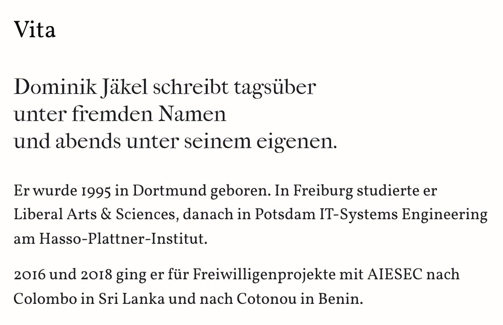
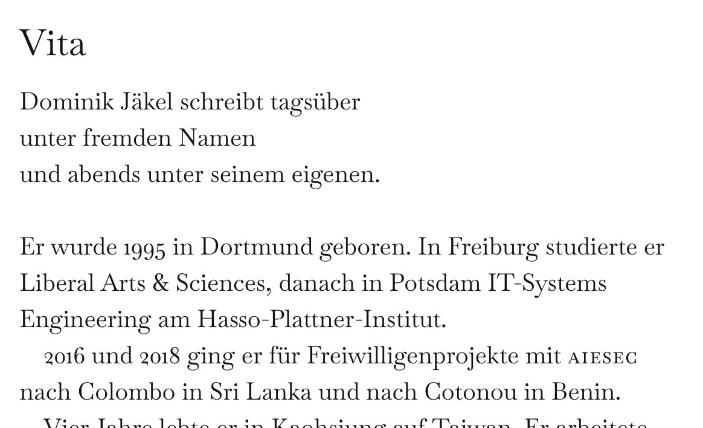
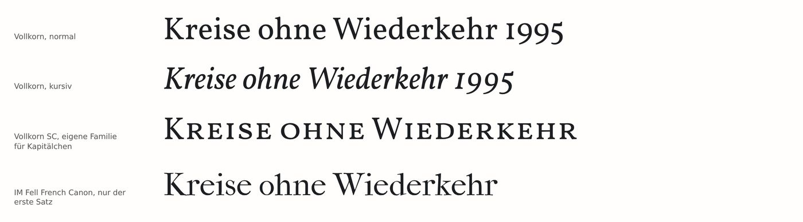
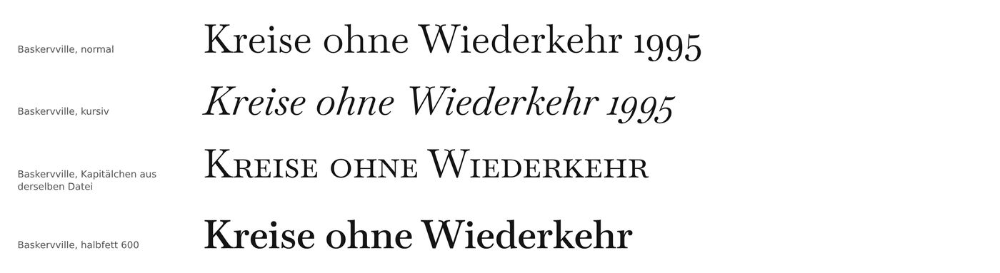

**Vorher (A).** Aller Text steht in der Vollkorn von Friedrich Althausen, einer Serifenschrift (Serifen sind die kleinen Füßchen an den Enden der Buchstaben), der Lesetext in 19 px. Sie ist kräftig und gleichmäßig, dicke und dünne Striche unterscheiden sich wenig. Für Kapitälchen (Großbuchstaben in der Höhe der Kleinbuchstaben) lädt A eine zweite Familie, die Vollkorn SC, für den ersten Satz eine dritte, die IM Fell French Canon. Alle drei kommen von Google Fonts, dabei geht die IP-Adresse jedes Besuchers an Google (28).

**Nachher (B).** Alles steht in der Baskervville des Atelier National de Recherche Typographique (ANRT) in Nancy, einer Neuzeichnung der Baskerville von 1757, der Lesetext in 20 px. Kapitälchen, Mediävalziffern (Ziffern mit Ober- und Unterlängen wie Kleinbuchstaben) und Ligaturen (verbundene Buchstabenpaare wie „fi“) stecken in derselben Datei. Die Haarstriche sind feiner, die Kursive geschwungener. B liefert die Schrift selbst aus, zwei WOFF2-Dateien (das übliche Format für Webschriften) mit 58 und 50 KB.

**Warum.** Rang 9, „Serife als Abkürzung zu ‚literarisch‘“, dazu Rang 31 (Schriften aus dem „geschmackvollen“ Gratisvorrat) und Rang 48 (Google Fonts per Link). Die Quellen nennen drei Ursachen. Das Lernmaterial: Bücher und Feuilletons sind in Serifen gesetzt, und impeccable hat gemessen, dass Claude bei Bücherthemen bei Cremegrund, großer Serife und kursiven Akzenten landet, „even when the assigned direction never asked for them“. Anthropics eigener Rat: 2025 empfahl er Fraunces, Playfair, Crimson Pro und Newsreader, 2026 „a characterful display face that’s used with restraint“, und der Leitfaden zu Opus 4.8 nennt Serifen für Überschriften als Claudes Hausstil. Und die Serife soll „menschlich“ wirken, WIRED nennt das „tasteslop“.

Die Vollkorn selbst ist kein starkes Zeichen. Sie steht auf keiner geprüften Liste, und der Schriftsteller Robin Sloan setzt seine Erzählungen in Vollkorn. Verräterisch ist in A die Kombination: eine Charakterschrift für eine einzige Zeile (IM Fell, 02), die Rang 9 als eigenes Muster beschreibt und die in Hallmarks Rezept „Almanac“ steht, dazu Kapitälchen als Überschriften (04) und Kursive als Nebenstimme (03). Bei einer Autorenseite fällt das auf, weil Claude genau hier von selbst zu dem Paket greift.

Auch die Baskervville ist eine Serife, Rang 9 bleibt, B führt das selbst als „bewusst KI-typisch“. Der Unterschied liegt im Gebrauch (eine Familie, keine Display-Schrift nur für große Zeilen) und in der Seltenheit: In 300 Probeseiten der Design Creativity Bench (15 Modelle mit je 20 Seiten) kommt Baskerville einmal vor, bei Opus 5.5 nie, Georgia auf 79 Seiten. Selbst ausgeliefert hat sie alle OpenType-Funktionen, also Zusatzfunktionen der Schriftdatei wie Kapitälchen. Der Vollkorn von Google (Version 5.001) fehlt die Funktion für Kapitälchen, das habe ich mit fontTools geprüft. Deshalb braucht A die Vollkorn SC.

**Vorteile.**

- Eine Schrift statt drei ergibt einen gleichmäßigen Grauwert, eine Textfläche, die aus der Entfernung gleich dunkel wirkt.
- Die Baskervville ist eine seltene Wahl, niemand erkennt sie als KI-Standard.
- Ohne Anfrage an Google wird die Seite rechtlich sicherer.
- Abkürzungen stehen in Kapitälchen aus derselben Datei („AIESEC“, „UdSSR“), A setzt sie in vollen Großbuchstaben.

**Nachteile und Risiken.**

- Die Schrift prägt die Anmutung mehr als jedes andere Element. Die Vollkorn ist wärmer und weicher, die Baskervville feiner, aber kühler und in 16 px etwas blass. Wenn du „Look und Feel“ von A lieber magst, ist die Schrift vermutlich ein großer Teil davon.
- Die Baskervville hat kein Griechisch. Für Verse aus der Ilias im Original bräuchte B eine zweite Schrift (vorgeschlagen, nicht geprüft: GFS Didot).
- Rang 9 bleibt in beiden Fassungen, der Abstand zum KI-Profil ist ein Grad.
- B hat die Schrift um Zeichen für Minute und Sekunde ergänzt. Das muss nach der Lizenz (SIL Open Font License) im Kolophon stehen, und das Minutenzeichen sieht aus wie ein gerader Apostroph („52° 31' N“).

**Verworfene Alternativen.** Libertinus erinnert an Wikipedia, ihre Webfassung hat weder Ligaturen noch Kapitälchen. Piazzolla ist robust, aber nicht elegant. Unter acht Kandidaten im Probedruck war die Baskervville die eleganteste. Die Schriften unter Rang 31 (Fraunces, Playfair, Cormorant, Lora, Crimson, Newsreader, EB Garamond) schieden aus. Die Prüfung von A hatte empfohlen, die Vollkorn zu behalten und nur selbst auszuliefern. Eine Groteske (Schrift ohne Serifen) für alles Funktionale, wie bei der Paris Review, wollte B nicht.

**Sicherheit.** Geschmack für die Schrift selbst, weil die Vollkorn auf keiner Liste steht. Hoch für das Selbstausliefern.

**Für die Mischfassung.** Mittelweg: die Vollkorn behalten und selbst ausliefern. Sie trägt viel von der Anmutung, die du an A magst, und ist für sich kein KI-Zeichen. Konkret: Vollkorn als WOFF2 in einen Ordner `schrift/`, kein Link zu Google mehr, Gestalter und Lizenz im Kolophon, Datenschutz angepasst (28). Die IM Fell entfällt (02), die Vollkorn SC braucht es nur, wenn Kapitälchen bleiben (04). Vorher prüfen, ob die vollständige Vollkorn aus dem Archiv des Gestalters die Kapitälchen als OpenType-Funktion enthält, dann reicht eine Datei (Frage 1).

### 02. Der erste Satz

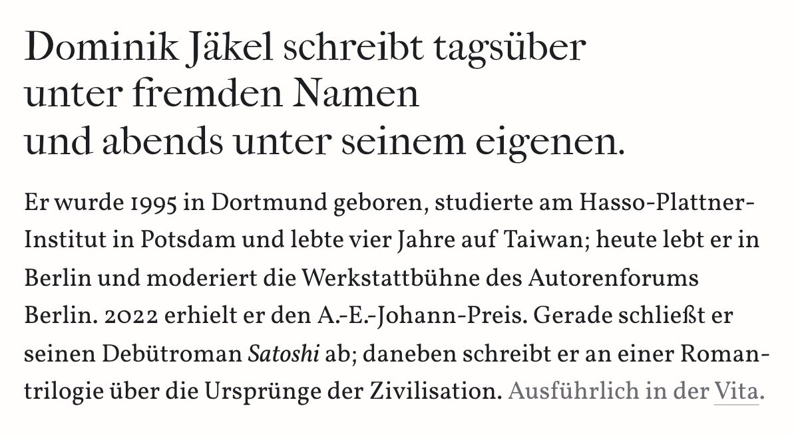
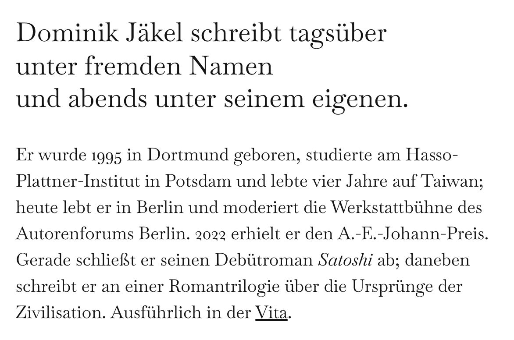
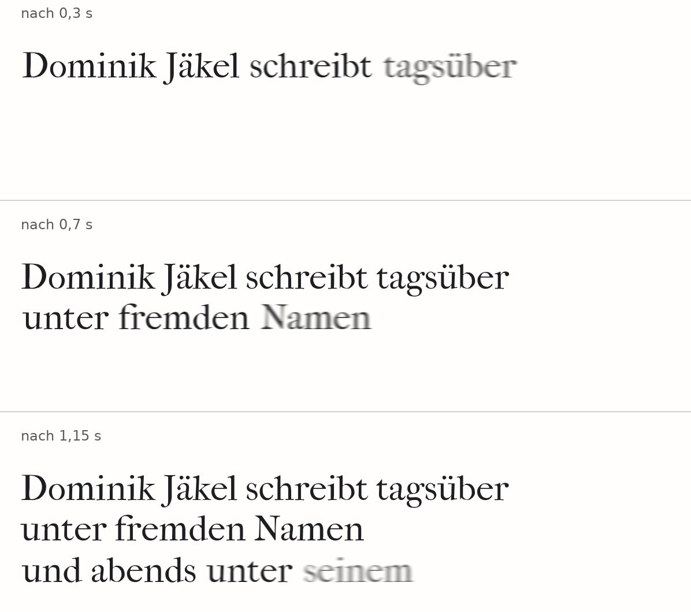

**Vorher (A).** „Dominik Jäkel schreibt tagsüber / unter fremden Namen / und abends unter seinem eigenen.“ steht in der IM Fell French Canon, 30,9 px, Graphit, in drei Zeilen. Die IM Fell ist Igino Marinis Nachzeichnung Oxforder Lettern aus dem 17. Jahrhundert, mit sichtbarem Abdruck von Blei und Tinte. Beim Laden bleibt der Platz leer, bis die Schriften da sind (höchstens 2,5 Sekunden). Dann gleitet jedes der zwölf Wörter einzeln von rechts herein, je 640 ms, 80 ms nach dem vorigen, mit 230 ms Pause zwischen den Zeilen und einer waagrechten Unschärfe, die beim Ankommen scharf wird. Nach etwa 1,8 Sekunden steht der Satz, erst dann beginnt die Chronik. Mit „Bewegung reduzieren“ im System steht er sofort da. Auf der Vita steht er ohne Bewegung in IM Fell. Du hast den Einflug selbst festgelegt (Commit e65dc13).

**Nachher (B).** Der Satz ist die Hauptüberschrift der Startseite, Baskervville, 30 px, Tinte, im selben Zeilenfall. Er steht beim Laden vollständig da, ohne Einflug, ohne zweite Schrift, ohne Skript. Auf der Vita steht er im Textgrad.

**Warum.** Rang 25, „Inszenierter Ladeauftritt“, dazu Rang 9 und 31. Der Einflug ist fast wörtlich Anthropics Rat von 2025: „one well-orchestrated page load with staggered reveals (animation-delay)“. Der heutige Leitfaden warnt vor solchen Einblendungen. Die IM Fell für eine einzige Zeile ist das Muster aus Rang 9 (siehe 01). Die Prüfung von A stufte den Einflug als „stark“ ein. Er ist das Erste, was ein Besucher sieht, und er macht den besten Satz der Seite zur Vorführung. Technisch steht auf langsamen Verbindungen zuerst eine leere Fläche, und die Chronik wartet.

**Vorteile.**

- Der Satz ist sofort lesbar, auch bei langsamer Verbindung und ohne JavaScript.
- Eine Schrift und ein Skript von rund 160 Zeilen weniger.
- Der Satz wirkt als Satz eines Schriftstellers, nicht als Effekt.
- Die eine Bewegung, die bleibt, ist die mit Inhalt: die Karte.

**Nachteile und Risiken.**

- Der Überraschungsmoment geht verloren, und mit ihm das Bild vom Setzer, der Lettern in den Winkelhaken schiebt. Du hast genau diesen Einstieg gewählt.
- Die IM Fell hat einen gedruckten, leicht unregelmäßigen Charakter, den keine Textschrift hat.
- In der Baskervville wirkt der Satz leichter und kühler.

**Verworfene Alternativen.** Die Prüfung schlug vor, den ganzen Satz in 200 ms ohne Staffel einzublenden. Das schwächt das Merkmal nur. Der stehende Satz in IM Fell löst Rang 25, lässt aber Rang 9 und 31. B wollte weder eine zweite Schrift noch einen Auftritt.

**Sicherheit.** Hoch für die Bewegung, weil sie Anthropics eigenes Rezept ist. Mittel für die IM Fell als ruhende Schrift.

**Für die Mischfassung.** Aus B übernehmen, dass der Satz beim Laden steht, aber in der Vollkorn: 28,5 px (der große Grad aus 06), Graphit, drei Glieder. Die Chronik beginnt dann sofort (11). Hängst du an der IM Fell, ist sie stehend das kleinere Übel als der Flug. Weil du den Einflug festgelegt hast, entscheidest du (Frage 2).

### 03. Graue Kursive für Beschriftungen, Koordinaten, Notizen und Bildunterschriften

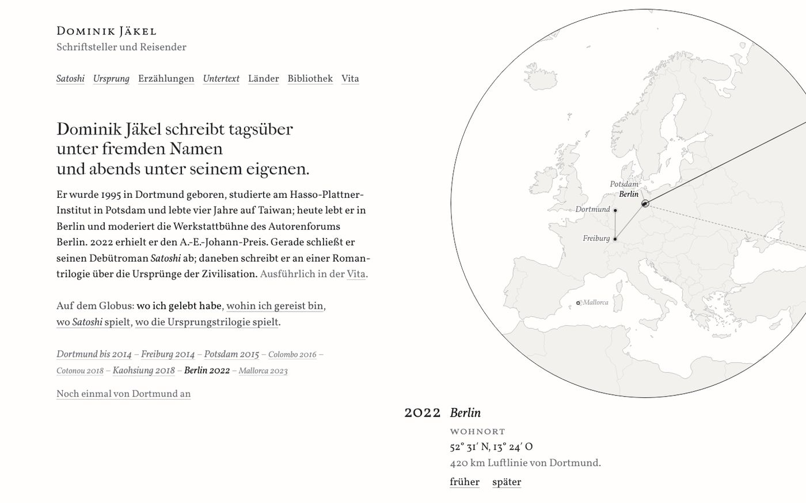
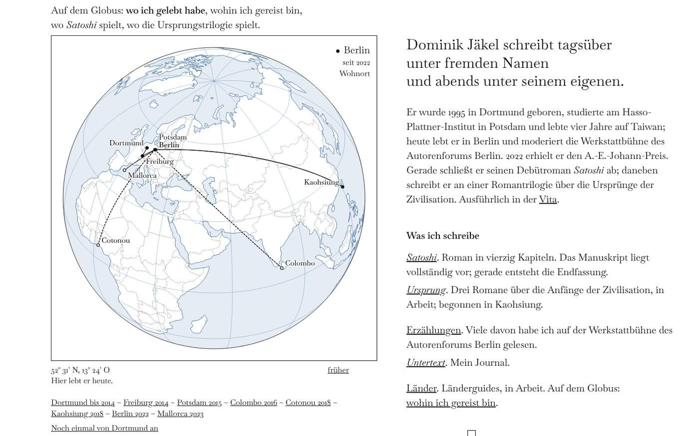
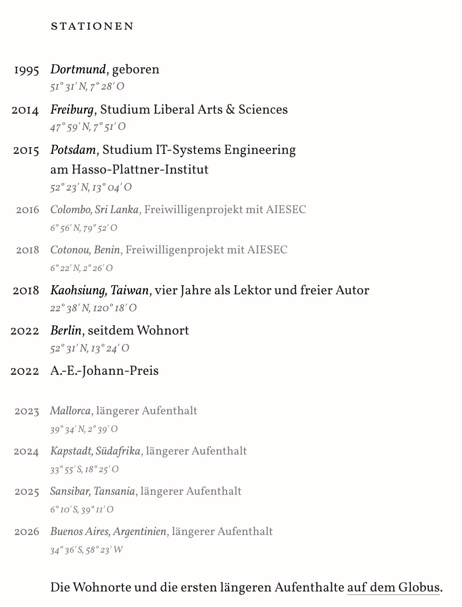
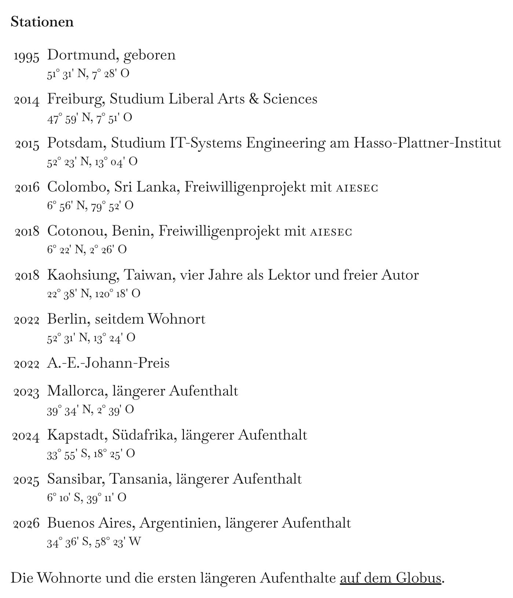
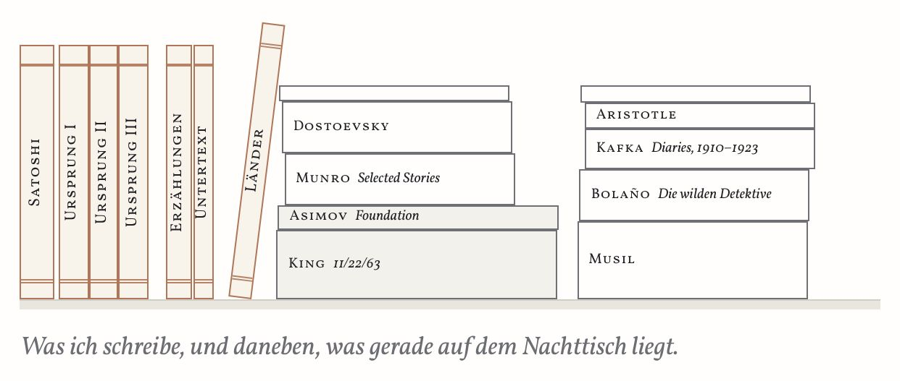
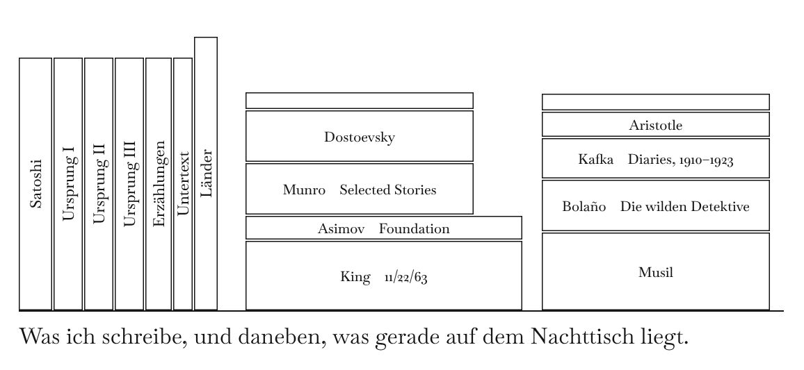

In A habe ich „Berlin 2022“ angeklickt, damit beide Tafeln Berlin zeigen.

**Vorher (A).** Neben dem Lesetext läuft eine zweite, leise Stimme, zugleich kleiner, grau und kursiv. Die Stationenzeile „Dortmund bis 2014 – Freiburg 2014 – …“ steht kursiv in 17,8 px und #6B6D72, die Nebenorte (Colombo, Cotonou, Mallorca) noch kleiner (15,3 px) und heller (#7C7E83), die Striche noch heller (#96989C). Auf der Tafel stehen „bis“ grau und kursiv, der Ort kursiv, „wohnort“ in grauen Kapitälchen, der Satz grau. Kursiv sind auch die Ortsnamen auf dem Globus, die graue Bildlegende am Regalbild, die Jahreszahlen am Zeitband, die Koordinaten der Vita und die Kapiteltage auf *Satoshi*. Gemessen sind im ersten Bildschirm der Startseite 15 % aller Zeichen grau und kursiv zugleich, auf dem Telefon 16 %, auf der Vita 15 %.

**Nachher (B).** Pro Textebene genau ein Unterscheidungsmittel. Nebentexte sind eine Stufe kleiner (16 statt 20 px), aufrecht, in derselben Tinte, unterschieden durch ihre Stellung unter oder neben dem Gegenstand. Ortsnamen stehen überall aufrecht. Kursiv sind nur Werktitel, Fremdwörter und Zitate. Seit dem Textabgleich stehen auch in B wieder Koordinaten auf Tafel und Vita, aufrecht und in Tinte. Gemessen: 0 % graue Zeichen.

**Warum.** Das hat dein Freund bemerkt, und er hat recht. Es ist Rang 24, „Graue Kursive als zweite Stimme“. Kein Katalog führt es wörtlich, es setzt sich aber aus vier gut belegten Merkmalen zusammen:

- **Rang 8, Kursive als Dekor.** Anthropic nennt „italic word-accents“ als Hausstil von Opus 4.8, Hallmark das kursive Akzentwort „among the most reliable AI tells“. A setzt die Kursive für Nebensachen, im Buchsatz ist sie für Werktitel, Fremdwörter und Betonung da.
- **Rang 11, grauer Nebentext.** Fast jedes generierte Layout bringt eine Farbe „muted“ mit, in der Komponentensammlung shadcn/ui steht unter jeder Überschrift `text-sm text-muted-foreground`. taste-skill: „A page set in soft grey reads unfinished“.
- **Rang 3, Metazeilen.** Opus 5.5 setzt auf 20 von 20 Probeseiten Zeilen wie „Roman · 2024 · 320 Seiten“. Die Stationenzeile ist dieselbe Form mit Strichen.
- **Rang 26, Mikro-Metadaten.** taste-skill verbietet „coordinates“ als Schmuck, die Liste beschreibt sie als „meist klein, grau, kursiv oder in Mono“.

Auf Produktseiten ist das Zusammentreffen selten (2 von 20 Seiten bei Opus 5.5), bei Buchthemen häufig. Anthropics Leitfaden vom Juni 2026 verlangte „a utility face for captions or data“. Bei Technikthemen wird daraus Monospace (Rang 13, Schreibmaschinenschrift), bei Buchthemen graue Kursive. Der Typograf Matthew Butterick rät, nie zwei Auszeichnungen zugleich zu verwenden. A verwendet drei für dieselbe Nachricht, „das ist Nebensache“, und das wirkt wie Ornament. Im gedruckten Buch gibt es keinen grauen Text. Die frühen Notizen dieses Projekts, vom selben Modell, haben genau dieses Mittel empfohlen. So beschreiben die Kataloge die dritte Welle: Der Rat gegen den alten Standard erzeugt den neuen. Jede Stelle ist für sich sauberer Buchsatz, erst die Häufung im ersten Bildschirm macht die Signatur.

**Vorteile.**

- Das Merkmal, das ein Leser von außen bemerkt hat, verschwindet ganz.
- Jeder Text in B hat 18,4 : 1. In A liegen Nebenorte, Striche und Leselistentitel unter dem Mindestwert (05).
- Wenn nur Werktitel kursiv sind, sieht man *Satoshi* und *Ursprung* sofort.
- Die Regel ist einfach und prüfbar.

**Nachteile und Risiken.**

- Die graue Kursive gibt A viel von seiner Weichheit, vom Gefühl einer Buchklappe. In einer Tinte wirkt die Seite dichter und härter.
- Legenden in voller Tinte konkurrieren mit dem Text, die Abstufung muss aus Größe und Abstand kommen.
- Koordinaten in Tinte ziehen mehr Blick auf sich. B hatte sie deshalb gestrichen, der Textabgleich brachte sie zurück.
- Die Stationenzeile verliert den gewollten Anklang an Joyces Unterschriftzeile.

**Verworfene Alternativen.** Nur das Grau entfernen ließe Rang 8, nur die Kursive Rang 11. Die Prüfung schlug vor, die Stationenzeile zu streichen oder aufrecht ans Ende der Vita zu setzen. Monospace für Daten wäre Rang 13.

**Sicherheit.** Hoch. Jeder Baustein ist belegt, die Messung eindeutig, und ein Leser hat das Merkmal von selbst bemerkt.

**Für die Mischfassung.** Mittelweg: die Regel aus B in die Gestalt von A.

- Legenden, Tafel, Stationenzeile und Koordinaten aufrecht in Graphit im Grad klein (15,4 px, 06).
- Nebenorte weder kleiner noch heller, „längerer Aufenthalt“ steht schon da.
- Ortsnamen aufrecht, auch auf dem Globus (heute `italic 15px "Vollkorn"` in `seite.js`).
- Kursiv nur für Werktitel, Fremdwörter und Zitate.
- Ein einziges Grau für echte Zustände wie das nicht verfügbare „früher“, mindestens 4,5 : 1 (05).
- Koordinaten nur an der Tafel am Globus (Frage 18).

So behält A seinen Ton und verliert das Merkmal, das dein Freund gesehen hat. Das ist nach meiner Einschätzung die wirksamste einzelne Änderung im Dokument.

### 04. Kapitälchen-Labels, gesperrter Name, Figurennamen und Kontinente

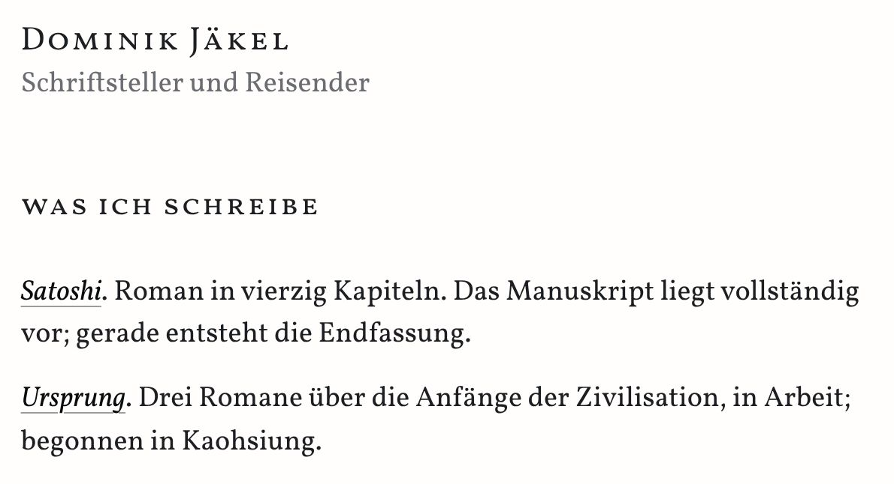
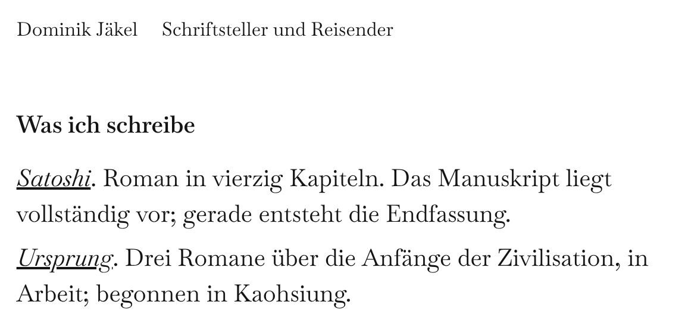
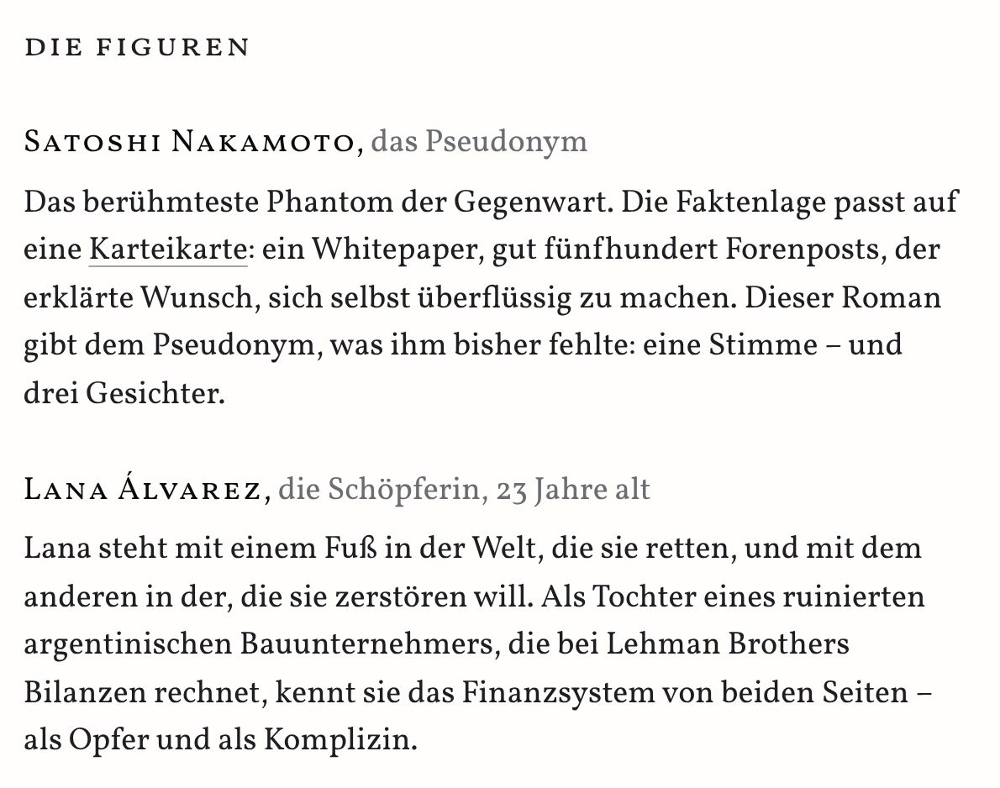
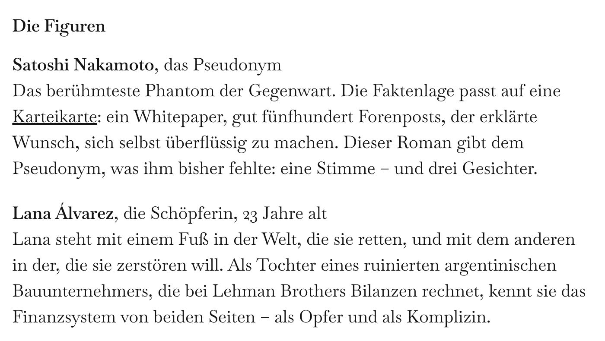
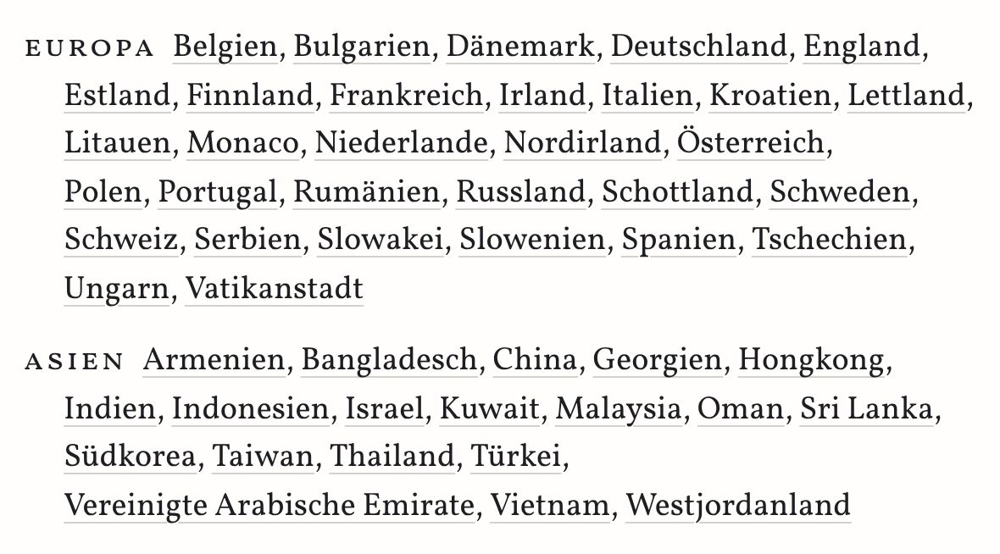
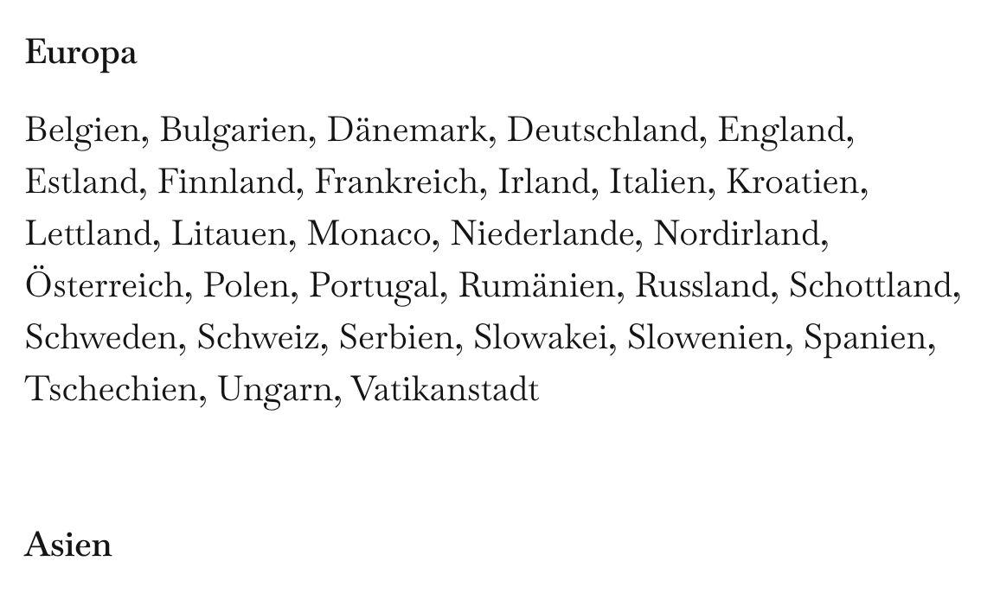

**Vorher (A).** Jede Abschnittsüberschrift steht in der Vollkorn SC, 20,2 px, ganz klein geschrieben und gesperrt um 0,06 em. Sperrung heißt mehr Abstand zwischen den Buchstaben, ein em ist so breit, wie die Schrift groß ist. So entstehen „was ich schreibe“, „kontakt“, auf *Satoshi* sieben Zeilen wie „klappentext“, auf der Vita „stationen“. Der Name im Kopf steht in Kapitälchen, 21,9 px, gesperrt um 0,07 em, wie ein Briefkopf. Figurennamen auf *Satoshi* und die Kontinente im Länderregister stehen ebenfalls in Kapitälchen.

**Nachher (B).** Keine Kapitälchen als Überschrift, Name oder Etikett. Überschriften stehen im Textgrad (20 px), aufrecht, normal geschrieben und halbfett (Gewicht 600, eine Stufe kräftiger als der Text). Halbfett bedeutet in B immer Orientierung: Überschrift, aktuelle Seite, gewählte Karte. Der Name steht im kleinen Grad (16 px) ohne Sperrung. Figurennamen sind halbfett, die Kontinente eigene halbfette Überschriften. Kapitälchen gibt es nur für Abkürzungen im Lauftext, wie es der Typograf Robert Bringhurst vorsieht.

**Warum.** Rang 1, „Gesperrte Versal- oder Kapitälchen-Labels über Abschnitten“, das häufigste Merkmal der Liste mit der stärksten Datenlage. Opus 5.5 hat auf 20 von 20 Probeseiten Regeln für gesperrte Großbuchstaben, ein Vergleichsmodell von OpenAI auf 8 von 20. Anthropics Leitfaden zählt zwei seiner drei häufigsten Erkennungszeichen hierher, „all caps for labels“ und „unnecessary typographic labels above content“. impeccable verbietet das Label auch in Kapitälchen („This one is a ban“). In Galerien gestalteter Seiten stehen winzige gesperrte Großbuchstaben auf 57 % der schwachen und 16 % der besten Seiten. Kapitälchen mildern den Eindruck, weil sie aus dem Buchsatz kommen. Verräterisch bleibt die Dichte von einem Label pro Abschnitt. Die Liste nennt als Beispiele ausgerechnet „klappentext“, „eckdaten“ und „stationen“.

Die vier Stellen sind nicht gleich stark. Die Abschnittsüberschriften sind das eigentliche Merkmal. Beim Namen ist die Sperrung das Problem und die Häufung mit den Überschriften. Ein Name ist aber kein Etikett, und Kapitälchen im Briefkopf sind eine alte Konvention (16). Figurennamen in Kapitälchen sind eine Buch- und Theaterkonvention, im Personenverzeichnis eines Dramas stehen sie oft so. Die Kontinente als Stichwort am Zeilenanfang sind Registersatz, die Prüfung von A wollte sie behalten. B hat sie gestrichen, um die Regel ohne Ausnahme zu halten.

**Vorteile.**

- Das häufigste KI-Merkmal verschwindet von allen elf Seiten.
- Normal geschriebene Überschriften lesen sich schneller.
- Eine Schriftdatei weniger, wenn keine Kapitälchen mehr nötig sind.

**Nachteile und Risiken.**

- Halbfette Überschriften wirken mehr nach Website als nach Buch. Die ruhige Eleganz der Kapitälchen gehört zur Anmutung von A.
- Halbfett ist sehr gewöhnlich. Es fällt nicht als KI auf, aber auch nicht als Handschrift.
- Halbfette Figurennamen sehen eher nach Formular aus als nach Personenverzeichnis.
- Mit eigenen Überschriften für die Kontinente passt das Länderregister nicht mehr auf einen Bildschirm.

**Verworfene Alternativen.** Die Prüfung von A schlug Überschriften aufrecht in der Vollkorn vor, normal geschrieben, eine Stufe größer (1,25 em), ohne Fettung, mit zwei Zeilen Abstand davor. Wo ein Abschnitt ohne Überschrift verständlich ist, sollte sie entfallen, etwa „Kontakt“. B wählte halbfett, damit Halbfett überall dasselbe bedeutet. Kursive Überschriften wären Rang 8.

**Sicherheit.** Hoch für Abschnittsüberschriften und die Sperrung des Namens. Geschmack für Figurennamen, Kontinente und die Frage, ob der Name ungesperrt in Kapitälchen bleiben darf.

**Für die Mischfassung.** Mittelweg:

- Abschnittsüberschriften wie von der Prüfung vorgeschlagen: aufrecht in der Vollkorn, normal geschrieben, ohne Sperrung und Fettung, 23,75 px (1,25 em, siehe 06), zwei Zeilen Abstand davor. Das bleibt so leise wie die Kapitälchen von A, ohne das Label-Muster.
- Den Namen im Kopf ohne Sperrung. Ich empfehle die gewöhnliche Vollkorn als sichere Wahl, Kapitälchen ohne Sperrung sind vertretbar (16, Frage 4).
- „wohnort“ auf der Tafel als normales Wort in Graphit (12).
- Figurennamen und Kontinente dürfen in Kapitälchen bleiben, ohne Sperrung. Das ist Buchsatz und passt zur Anmutung, die du magst (Frage 5).

### 05. Grautöne und Textfarben

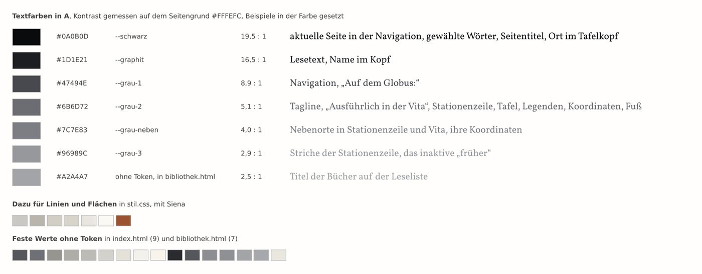
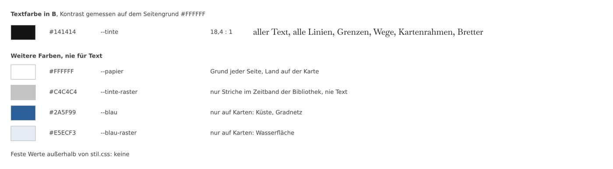
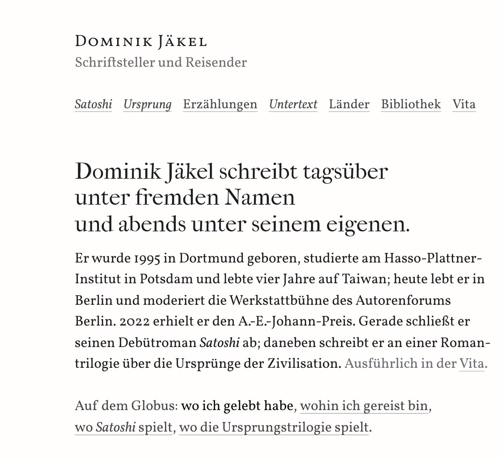
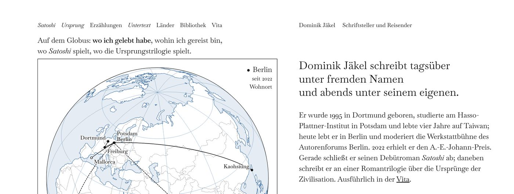

Ein **Token** ist ein benannter Wert im Stylesheet, etwa `--tinte: #141414`, wie eine Formatvorlage in Word: Ändert man sie, ändert sich jede Stelle. Ein fester Wert steht direkt an einer Stelle im Code, und nimmt die nächste Arbeitssitzung ein etwas anderes Grau, merkt es niemand.

**Vorher (A).** Sieben Textfarben, gemessen gegen den Grund #FFFEFC. Der Kontrast gibt an, wie stark sich Schrift und Grund in der Helligkeit unterscheiden. Die Richtlinien für barrierefreie Webinhalte (WCAG) verlangen für Text mindestens 4,5 : 1.

- #0A0B0D „schwarz“ (19,5 : 1): aktuelle Seite, gewählte Wörter, Seitentitel
- #1D1E21 „graphit“ (16,5 : 1): Lesetext
- #47494E „grau-1“ (8,9 : 1): Navigation, „Auf dem Globus:“
- #6B6D72 „grau-2“ (5,1 : 1): Tagline, Stationenzeile, Tafel, Legenden, Koordinaten, Fuß
- #7C7E83 „grau-neben“ (4,0 : 1): Nebenorte
- #96989C „grau-3“ (2,9 : 1): Striche, das inaktive „früher“
- #A2A4A7 ohne Token (2,5 : 1): Titel der Leseliste

Drei liegen unter dem Mindestkontrast. `stil.css` hat 14 Farbwerte, `index.html` 9 und `bibliothek.html` 7 feste Werte ohne Token, ohne die Verlagsfarben der Rücken. Im ersten Bildschirm der Startseite stehen sechs Textfarben, 24 % der Zeichen sind #6B6D72 oder heller. Derselbe eigene Buchrücken hat auf der Startseite #F8F4EC, in der Bibliothek #F6F2EA.

**Nachher (B).** Eine Textfarbe, `--tinte` #141414 (18,4 : 1 auf Weiß), für allen Text und alle Linien. Vier weitere Farben stehen nie in Text: Papier #FFFFFF, `--tinte-raster` #C4C4C4 für die Striche im Zeitband, Blau #2A5F99 und Hellblau #E5ECF3 nur auf Karten. Alle sind Token. Rang entsteht über Größe, Stellung und Halbfett, ein Bedienwort, das gerade nicht geht, wird ausgeblendet statt grau.

**Warum.** Rang 29, „Viele gleichrangige Grautöne“: Jede Arbeitssitzung bringt einen neuen Grauwert mit, designmd.me spricht von „five greys that arrived independently“. Rang 11, grauer Nebentext (03). Rang 50, „Design-Drift zwischen Unterseiten“, die avoid-ai-design als dringlichste Stufe einstuft: Die zwei Töne desselben Buchrückens sind genau das. Dazu kommt Lesbarkeit. Text unter 4,5 : 1 ist für viele Menschen schwer zu lesen, besonders auf dem Telefon in der Sonne. Bei einem Schriftsteller ist Text das Werk, und grauer Text sagt „das musst du nicht lesen“.

**Vorteile.**

- Jeder Text ist gut lesbar.
- Eine Änderung an einer Stelle ändert die ganze Website, Unterseiten laufen nicht mehr auseinander.
- Prüfbar: Ein Suchlauf nach Farbwerten außerhalb von `stil.css` muss leer sein.

**Nachteile und Risiken.**

- Die abgestuften Grautöne geben A Tiefe und Ruhe. B wirkt flacher und strenger.
- #141414 auf reinem Weiß ist härter als Graphit auf Papierweiß.
- Ohne Grau braucht B Halbfett für die Ordnung, und Halbfett ist lauter.
- Weglassen allein ergibt leicht „an empty page with good manners“, warnt die Liste.

**Verworfene Alternativen.** Die Prüfung von A schlug zwei Textfarben vor: Graphit für allen Text und #6B6D72 nur für Zustände. B ging auf eine. Die Palette nur in Token zu ordnen, hätte die Drift beseitigt, das Merkmal aber gelassen.

**Sicherheit.** Hoch für Token und Kontrast, das ist Handwerk und Barrierefreiheit. Geschmack bei eins oder zwei Textfarben.

**Für die Mischfassung.** Mittelweg nach der Prüfung. Graphit #1D1E21 für allen Text, #0A0B0D geht darin auf. Was A schwarz hervorhob (aktuelle Seite, gewählte Wörter), steht halbfett wie in B (07). Ein einziges Grau, #6B6D72, nur für echte Zustände. Die übrigen vier Grautöne entfallen. Alle Farben werden Token, die 16 festen Werte verschwinden, und ein Skript prüft vor jeder Abgabe. Linien und Flächen auf Karte und Regal sind keine Textfarben, für sie gilt: benannt und überall gleich. Graphit auf Papierweiß bleibt weicher als die Tinte von B.

### 06. Schriftgrade und Rhythmus

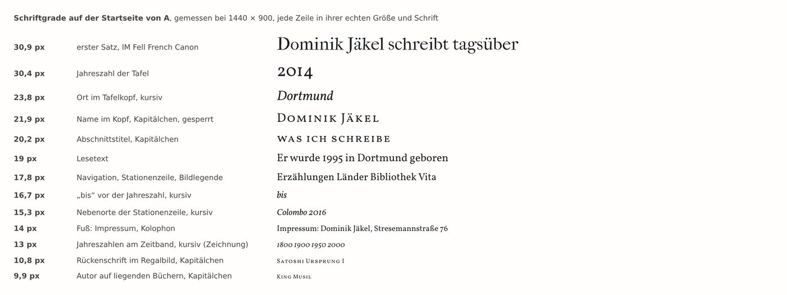
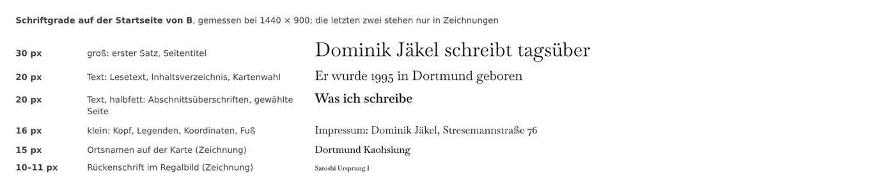

Den ersten Bildschirm der Vita zeigen die Bilder unter 26.

**Vorher (A).** Ein Schriftgrad ist eine Schriftgröße. Die Startseite von A hat zwölf: 30,9 px (erster Satz), 30,4 (Jahreszahl der Tafel), 23,8 (Ort der Tafel), 21,9 (Name), 20,2 (Abschnittstitel), 19 (Lesetext), 17,8 (Navigation, Stationenzeile, Legende), 16,7 („bis“), 15,3 (Nebenorte), 14 (Fuß), 10,8 und 9,9 (Rückenschrift), dazu 13 px am Zeitband. Erster Satz und Jahreszahl unterscheiden sich um einen halben Pixel. Die Vita hat elf Grade, fünf zwischen 13 und 16,6 px. A hat ein Zeilenraster von 28,5 px: Alle Zeilen und Abstände sollen Vielfache einer Grundzeile sein, wie die Linien auf Schreibpapier. Stationenzeile, Tafel und Fuß verlassen es mit eigenen Zeilenhöhen. Auf einem Raster aus Viertelzeilen beginnen auf der Startseite 11 von 20 Textblöcken, auf der Vita 20 von 26.

**Nachher (B).** Drei Grade: groß 30 px, Text 20 px, klein 16 px, auf dem Telefon 26, 18 und 15 px. Grundzeile 30 px, alle Abstände Vielfache einer Viertelzeile. Auf dem Raster liegen auf der Vita 28 von 28 Blöcken, auf der Startseite 20 von 24 (daneben nur die Legende unter der quadratischen Karte). Eigene Grade gibt es nur in Zeichnungen: 15 px für Ortsnamen, 10 bis 11 px für Rückenschrift.

**Warum.** Rang 30, „Zu viele Schriftgrößen“: Beim Generieren bekommt jedes Bauteil seine eigene Größe. Mehrere Kataloge führen das, Anthropic verlangt eine klare Skala, Bücher kommen mit zwei bis drei Graden aus. Als KI-Zeichen ist es schwächer, die Liste ordnet es bei Claude als „allgemein“ ein. Der Hauptgrund ist Ruhe. Dazu gehört Rang 49, gleichförmige Abstände: B verteilt Abstände nach Gewicht, zwischen Absätzen keinen, vor Überschriften zwei Zeilen, zwischen großen Teilen drei.

**Vorteile.**

- Die Seite wirkt ruhiger, das Auge ordnet nur drei Größen.
- Die Zeilen stehen in einem festen Rhythmus, auch neben der Karte.
- Neue Seiten brauchen keine neuen Größen.
- Mit 20 px liest sich die Baskervville etwa so groß wie die Vollkorn in 19 px.

**Nachteile und Risiken.**

- Es fehlen Zwischentöne. Der große Jahrgang an der Tafel oder der größere Name im Kopf geben A Charakter.
- Die Ordnung kommt über Halbfett und Abstand, das wirkt nüchterner.
- Auf dem Telefon liegen 15 und 18 px dicht beieinander.
- Zeichnungen brauchen trotzdem eigene Größen.

**Verworfene Alternativen.** Die Prüfung von A schlug drei Grade auf der Skala von A vor (19 px, 15,4 px, 28,5 px), an anderer Stelle aber Überschriften in 1,25 em (04). Das ergibt zusammen vier Grade, die Liste erlaubt bis zu fünf. Eine rechnerische Skala mit festem Faktor ergibt krumme Werte ohne Bezug zur Zeile.

**Sicherheit.** Mittel. Weniger Grade wirken ruhiger, als KI-Merkmal ist das schwach belegt.

**Für die Mischfassung.** Mittelweg: vier Grade auf der Skala von A. Damit passen die Empfehlungen unter 04, 12 und 16 zusammen.

- klein, 15,4 px: Legenden, Tafeldaten, Koordinaten, Stationenzeile, Fuß
- Text, 19 px: Lesetext, Navigation
- Überschrift, 23,75 px: Abschnittsüberschriften, Name im Kopf, Ort auf der Tafel
- groß, 28,5 px: erster Satz, Seitentitel, Jahrgang auf der Tafel

Die übrigen Zwischenstufen entfallen, die Zeilenhöhen werden Vielfache einer Viertelzeile. Die Rückenschrift bleibt eine Ausnahme, sie folgt aus der Breite des Rückens.

### 07. Unterstreichung der Verweise

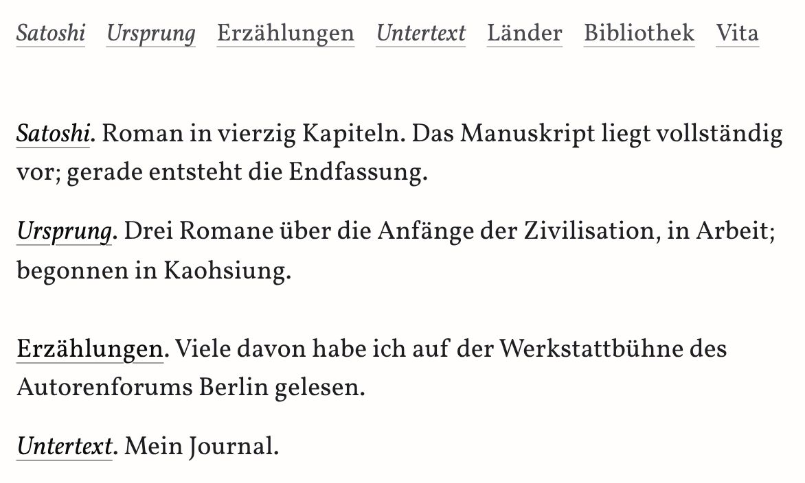
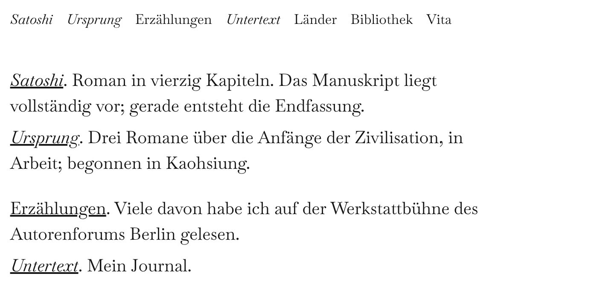
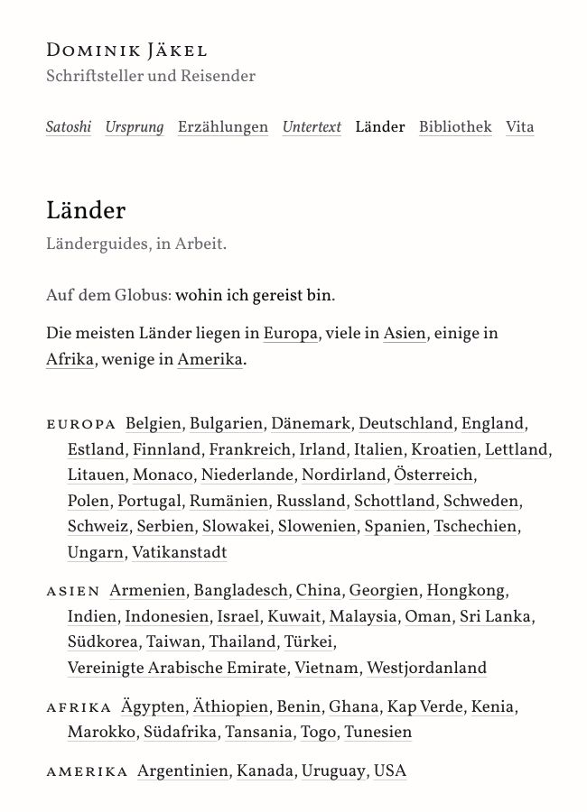
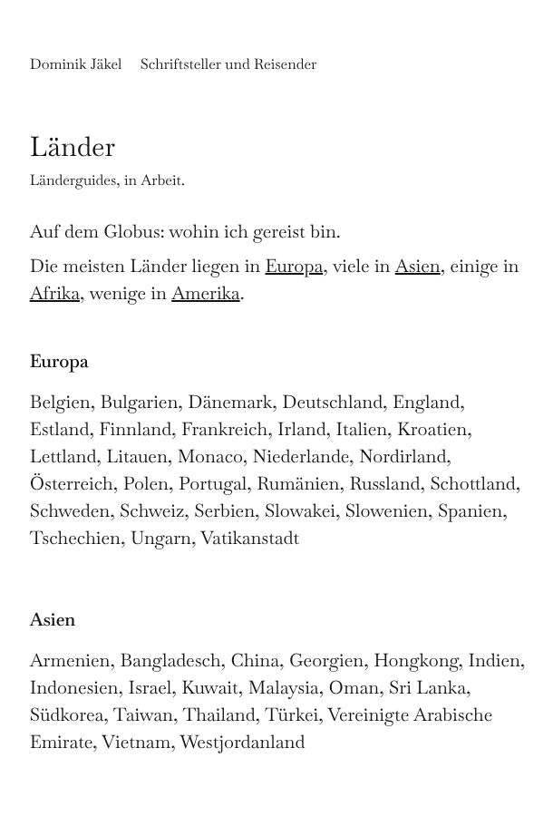

**Vorher (A).** Jeder Verweis und jedes Wort, das etwas tut, trägt dasselbe „feine“ Rezept: Strich 1 px, 0,2 em unter der Grundlinie, in 40 % der Schriftfarbe, also halb durchsichtig. Die Navigation ist grau mit 35 % Deckung, das Länderregister hat 20 %. Die aktuelle Seite steht schwarz ohne Strich. Im ersten Bildschirm der Startseite sind 19 Elemente unterstrichen, auf der Seite Länder 75.

**Nachher (B).** Unterstreichung im Werkszustand, also so, wie der Browser sie von sich aus zeichnet, in voller Tinte. Unterstrichen sind nur Verweise im Text, Bedienwörter und „früher“ und „später“. Navigation, Kartenwahl und Länderregister sind Auswahllisten ohne Strich. Unter der Maus erscheint er, gewählt steht ein Eintrag halbfett. Gemessen: 8 Striche im ersten Bildschirm der Startseite, 5 auf Länder.

**Warum.** Rang 53, „Unterstreichung als Zierde“. Die Liste beschreibt genau das Rezept von A als gängigen Schnipsel für „geschmackvolle“ Links. Kyle Chayka nennt im New Yorker „overzealous underlining“ unter den Zeichen des KI-Looks. Ist alles unterstrichen, zeigt der Strich nicht mehr, was ein Link ist, er wird zur Stimmung. Gegenmittel: unterstreichen, was im Text ein Link ist, die Navigation zeigt sich durch ihre Stellung. Der Gestalter Frank Chimero hat auf seiner Seite bewusst die Browserstandards stehen lassen, eine Geste, die ein Modell kaum wählt. Die Belege sind dünner als sonst („gelegentlich“, Chayka nur aus Suchzusammenfassungen). Ein Teil ist Bedienbarkeit: Links brauchen ein Zeichen, das ohne Farbe auskommt.

**Vorteile.**

- Ein Strich bedeutet eindeutig „hier kann man klicken“.
- Startseite und Länderregister werden ruhiger.
- Der Werkszustand passt sich jeder Schrift an.
- Die Navigation wirkt wie ein Inhaltsverzeichnis.

**Nachteile und Risiken.**

- Die Linie im Werkszustand ist dunkler, dicker und näher am Text, gröber als die feine Linie von A.
- Auf dem Telefon gibt es keine Maus. Dort sieht man dem Länderregister in B nicht an, dass man tippen kann.
- Eine Navigation ohne Strich erkennt man nur an ihrer Stellung, eine Spur weniger deutlich.

**Verworfene Alternativen.** Das feine Rezept sparsamer einsetzen ließe das Rezept. Striche überall nur unter der Maus ließe das Telefon ohne Hinweis. Links in einer Akzentfarbe wären Rang 10 oder 19.

**Sicherheit.** Mittel für die Menge, Geschmack für die Art der Linie.

**Für die Mischfassung.** Mittelweg: die Menge aus B, die Linie behutsam angepasst. Diese Regel gilt überall im Dokument, wo von Unterstreichung die Rede ist (13, 16, 17, 25).

- Navigation ohne Strich, in Graphit statt grau. Unter der Maus erscheint der Strich, die aktuelle Seite steht halbfett (A lädt die Vollkorn schon mit diesem Gewicht).
- Länderregister ohne Strich, mit Strich unter der Maus und beim Tastaturfokus (der Markierung, wo man mit der Tastatur steht). Auf Touchgeräten bleibt der Strich stehen, das lässt sich im Stylesheet eigens festlegen.
- Verweise im Text, die E-Mail-Adresse, „früher“ und „später“ und die vier Wörter der Kartenwahl bleiben unterstrichen (13).
- Für die Linie zwei Fassungen nebeneinander ausprobieren: den Werkszustand und eine Linie von 1 px in voller Graphitfarbe ohne eigenen Abstand. Beides ist weniger Rezept als die halbtransparente Linie (Frage 30).

### 08. Farbwelt

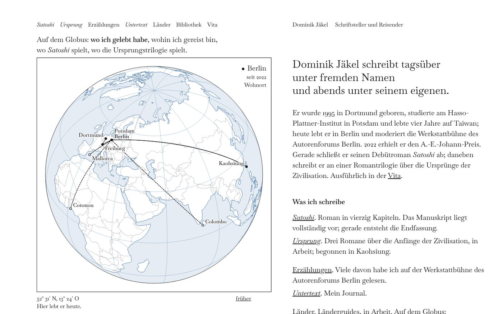

Siena, Karton und Creme am Regalbild zeigen die Bilder unter 15.

**Vorher (A).** Der Grund ist #FFFEFC, ein Weiß mit einem Hauch Gelb, kaum von reinem Weiß zu unterscheiden. Text steht in Graphit (#1D1E21), Nebentext und Linien in bis zu sieben Grautönen. Siena (#9B5230), ein gebranntes Rotbraun, ist die Akzentfarbe, die eine Farbe, die etwas hervorhebt. Sie bedeutet „eigenes Werk“: Titel von *Satoshi*, *Ursprung* und der Leseseite, Bandziffern, die Signatur „DJ 1“, Linien an den eigenen Rücken, die Umrisse der eigenen Werke im Zeitband, Weg und Punkte auf dem Globus bei *Satoshi* und *Ursprung*. Dazu kommen warme Flächen: Karteikarte in Karton (#FBF9F4), eigene Rücken in Creme (#F8F4EC), das Brett in Hellbeige (#E9E6E0), bereiste Länder in Beige (#DBD5CB).

**Nachher (B).** Fünf Farben. Reines Weiß, Tinte (#141414) für allen Text und alle Linien, Blau (#2A5F99) und Hellblau (#E5ECF3) nur auf Karten, ein helles Grau (#C4C4C4) nur für die Striche des Zeitbands. Kein Akzent für eigene Werke, man erkennt sie an Stellung und kursivem Titel. Farbe erscheint nie bei Links oder unter der Maus.

**Warum.** Hier treffen Rang 2 (warmer Creme- oder Papiergrund), Rang 9 (Serife) und Rang 10 (Terrakotta-, Rost- oder Siena-Akzent) zusammen, alle „sehr häufig“ und bei Claude belegt. Anthropic beschreibt die Mischung selbst. Der Leitfaden zu Opus 4.8 nennt als Hausstil „warm cream/off-white backgrounds (~#F4F1EA)“, Serifen und „a terracotta/amber accent“, für Opus 5.5 steht der Cremegrund unter den Mustern, die man verbieten soll. Es sind Anthropics eigene Farben: Markenfläche #faf9f5, Claudes Akzent #D97757, ein Terrakotta. Anthropics Gestaltungs-Skill schreibt, dieser Akzent wirke auf einer fremden Seite „as a tell“, wie ein Erkennungszeichen. Siena ist eine dunklere Spielart derselben Familie. Entstanden ist der Look aus Anthropics Rat von 2025 gegen die erste KI-Welle (Inter, Lila). Kyle Chayka beschreibt das Ergebnis im New Yorker: „Beige backgrounds, rust-red text“. Opus 5.5 legt auf 11 von 20 Produktseiten einen warmen hellen Grund an, Vergleichsmodelle von OpenAI und Google auf 3 und 0. Von 17 Opus-Seiten mit benanntem Akzent haben 6 einen Terrakotta-Ton, unter 246 Seiten menschlicher Gestalter eine einzige. Bücher sind genau das Thema, bei dem Claude in diese Farben rutscht.

A trifft das nur zum Teil, denn der Grund ist praktisch weiß. Die Prüfung stuft Siena als „stark“ ein, die Cremeflächen als „mittel“. Dass Siena genau eine Bedeutung hat, ist gutes Handwerk, die Farbfamilie bleibt aber erkennbar. Die frühen Projektnotizen, vom selben Modell, hatten Siena empfohlen. Auch das Blau von B steht der Liste nahe: Opus 5.5 wählt in 6 von 17 Fällen Blau oder Violett als Akzent (Rang 19, nah). B rechtfertigt es als zweite Druckfarbe jeder topografischen Karte.

**Vorteile.**

- Die Farbe verrät das Werkzeug nicht mehr, der stärkste Farbbefund der Prüfung entfällt.
- Aller Text steht in einer Farbe mit 18 : 1 Kontrast.
- Das Blau hat eine Herkunft, die Landkarte, und eine einzige Aufgabe.
- Fünf Farbwerte sind leichter zu pflegen als über zwanzig.

**Nachteile und Risiken.**

- Die Wärme von A geht verloren, B wirkt kühler, eher wie ein Fachbuch. Das ist ein großer Teil dessen, was du an A lieber magst.
- Eigene Werke springen nicht mehr ins Auge.
- Schwarz, Weiß und Blau sind selbst eine Gegenliste. Die Liste warnt, dass Verbote wie „kein Creme“ oft zur nächsten festen Palette führen.
- Das Blau macht die Karte technisch.

**Verworfene Alternativen.** Lapis für *Ursprung* und Königsblau für die eigene Arbeit verwarf die Jury, weil ein Akzent mit einer Bedeutung dasselbe Muster ist wie Siena. Ein Tintenblau (#23406E) war deshalb nur zweite Wahl. Bitcoin-Orange für *Satoshi* gehört zur Terrakotta-Familie. Ein dunkler Grund schied aus, ein gedrucktes Blatt hat keinen Nachtmodus.

**Sicherheit.** Hoch für Siena und die Cremeflächen, Geschmack für das Blau.

**Für die Mischfassung.** Mittelweg. Papierweiß und Graphit von A bleiben (#FFFEFC oder reines Weiß ist kaum sichtbar, Frage 30). Siena fällt überall weg, das gilt für alle Stellen unter 13, 18, 19, 21, 23 und 27. Eigene Werke erkennt man daran, dass sie zuerst stehen, und am kursiven Titel. Auf dem Globus laufen Weg und Punkte von *Satoshi* und *Ursprung* in Graphit. Die eigenen Rücken werden weiß mit Graphitlinie, das Brett eine dünne Linie, die Karteikarte eine Zeile (22). Die bereisten Länder bekommen ein kühles Hellgrau (etwa #D9DBDE, siehe 09). Das Blau von B übernehme ich nicht, es gehört zum Atlas-Look. So bleibt die helle, ruhige Anmutung von A, und das Farbpaar, an dem man Claude erkennt, ist weg (Frage 3).

### 09. Der Globus

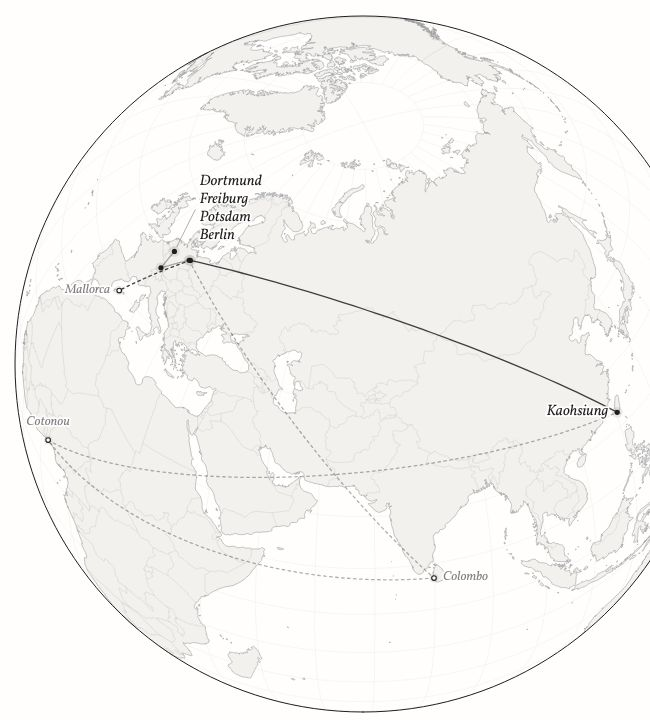
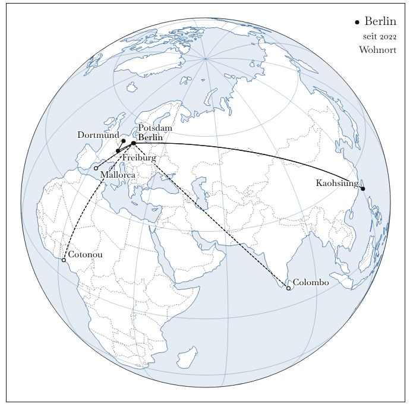
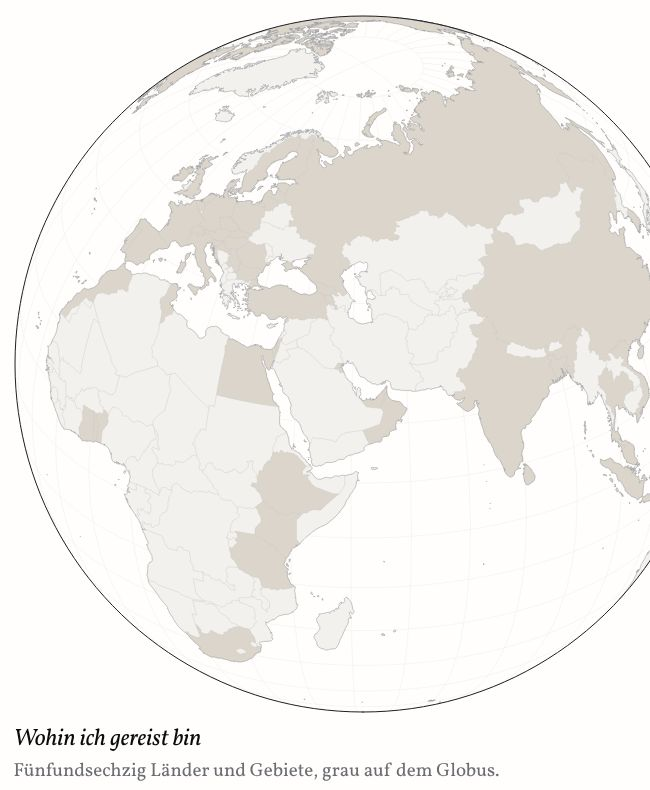
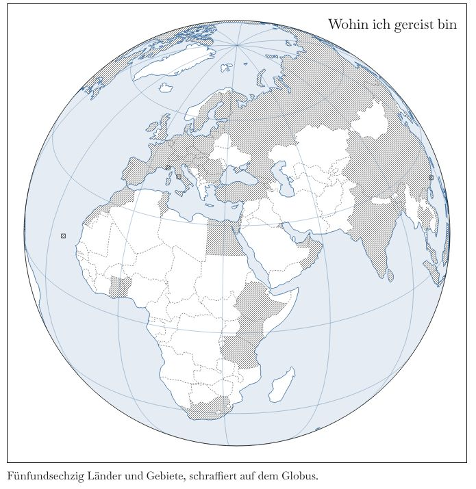

**Vorher (A).** Eine große Kugel ohne Rahmen, so hoch wie das Fenster (bei 1440 × 900 rund 700 px), am rechten Rand angeschnitten. Wasser papierweiß, Land warmes Hellgrau (#F2F1EE), bereiste Länder beige, Grenzen und Küsten hellgrau. Das Gradnetz (die Linien der Längen- und Breitengrade) steht nur im Überblick und kaum sichtbar. Weg und Punkte sind Graphit, bei den eigenen Werken Siena. Die Ortsnamen stehen kursiv auf einer zweiten Zeichenfläche, nahe Orte bilden einen Namensblock mit Führungslinie. Unter der Maus erscheint der Name eines Lands als kleiner kursiver Zettel.

**Nachher (B).** Ein Quadrat mit 1 px Rahmen, darin die Kugel mit einem leeren Ring von 24 px, gezeichnet wie eine topografische Karte im Zweifarbendruck: Wasser hellblau, Land weiß, Küste und Gradnetz blau, Grenzen schwarz gestrichelt. Bereiste Länder tragen eine Schraffur, feine parallele Striche im Winkel von 45 Grad. Ortsnamen stehen aufrecht und mit weißem Rand freigestellt. Auf *Ursprung* fließen Euphrat, Tigris, Jordan und Nil. Unter der Maus steht der Name des Lands auf dem Land selbst.

Beide Kugeln zeichnet `globus/kern.js`. Der Kern von B ist eine Kopie von A mit derselben Schnittstelle und denselben Daten, aber 703 statt 517 Zeilen. A kennt elf Farben, die jede Ebene überschreiben kann (so kommt Siena auf die Werke), B vier und eine Schraffur. B schneidet die Zeichnung selbst auf den Kreis zu, zeichnet alles Land als eine Fläche, setzt die Namen in jedem Bild und führt Abstecher (14b). Nur A hat den Länderzettel und ein Pendeln im Leerlauf, das überall ausgeschaltet ist.

**Warum.** Die Kugel bleibt in beiden Fassungen. Sie ist ein Prunkstück im Sinn von Rang 27, ein großes interaktives Element, um das die Seite gebaut ist. Die Liste verlangt dafür eine Aufgabe, die nur dieser Inhalt stellt, eigenen Bau, echte Daten und keine Dauerdrehung. Das erfüllt schon A, die Prüfung stuft den Globus als „schwach“ ein. Der Umbau in B hat zwei Gründe. Erstens die KI-Treffer an A: Beige (Rang 2), Siena (Rang 10) und kursive Ortsnamen (Rang 8). In der Kartografie stehen Ortsnamen aufrecht, kursiv sind Gewässer. Zweitens die Silhouette: Vier Seiten von A haben denselben ersten Bildschirm (Rang 14, nah, siehe 15). Die Jury wählte „Atlas“, weil man diesen Look nicht aus dem Wort „Autorenseite“ erraten kann, die Prüffrage von impeccable. B bringt eigene Nähen mit: Schraffur (Rang 57, nah), Blau (Rang 19, nah) und den Rahmen als Haarlinie (Rang 51).

**Vorteile.**

- Wasser und Land unterscheiden sich deutlich.
- Die Schraffur ist auch schwarzweiß und bei Farbsehschwäche erkennbar.
- Ortsnamen stehen aufrecht wie auf jeder Landkarte.
- Der Rahmen schneidet nichts ab.

**Nachteile und Risiken.**

- Rahmen, Ring, Blau, gestrichelte Grenzen und Schraffur wirken wie ein Fachatlas, nicht wie die ruhig schwebende Kugel von A.
- Große bereiste Flächen wie Russland, China oder Indien werden durch die Schraffur dunkel und unruhig.
- Der Rahmen ist ein Kasten auf einer Seite ohne Kästen.
- Der Kern ist ein Drittel länger.

**Verworfene Alternativen.** Ein eigener kleiner Zeichner der Richtung Atlas konnte weniger als der Kern von A. Gradzahlen im Ring und ein Maßstab wurden gebaut und als „Karte als Kostüm“ gestrichen, die Gewässernamen ausgeschaltet, weil A keine hat. Ein Fertigbaustein wie der drehende Magic-UI-Globus kam nie in Frage (Rang 27). Ein Scan deiner Rubbelkarte für die Seite Länder braucht dein Material.

**Sicherheit.** Geschmack. Beide Kugeln sind eigene Arbeit mit echten Daten, die Treffer an A sind klein und einzeln behebbar.

**Für die Mischfassung.** Bei A bleiben, mit vier kleinen Änderungen ohne Atlas-Look. Erstens die bereisten Länder in kühlem Hellgrau statt Beige. Das passt sogar besser zum Text von A, der schon heute „grau auf dem Globus“ sagt. Eine feine Schraffur in Graphit wäre die Alternative, dann muss dieser Satz angepasst werden (Frage 11). Zweitens Weg und Punkte überall in Graphit (08). Drittens die Ortsnamen aufrecht (03). Viertens der Weg mit Abstechern (14b). Dazu kommt die Technik aus 10. Rahmen, Ring, Blauplatte und gestrichelte Grenzen übernehme ich nicht.

### 10. Zoomen und Kartendetail

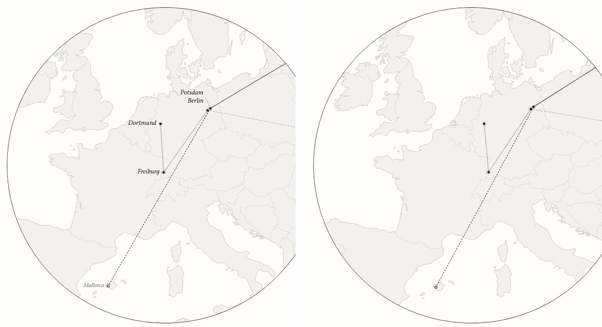
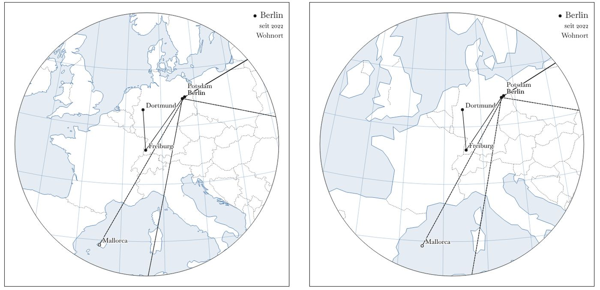
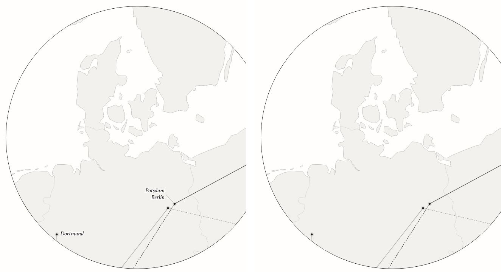
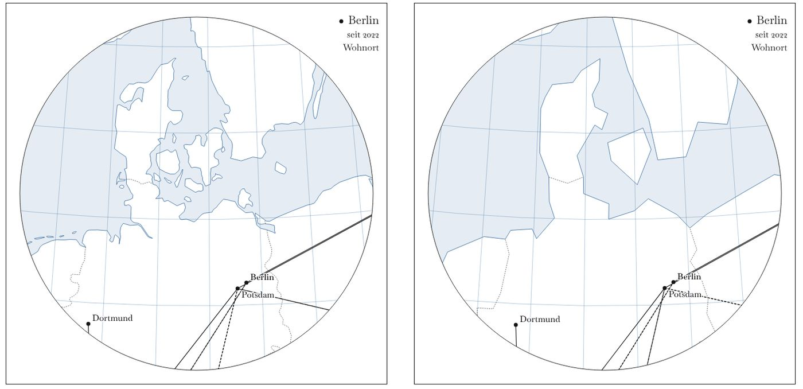
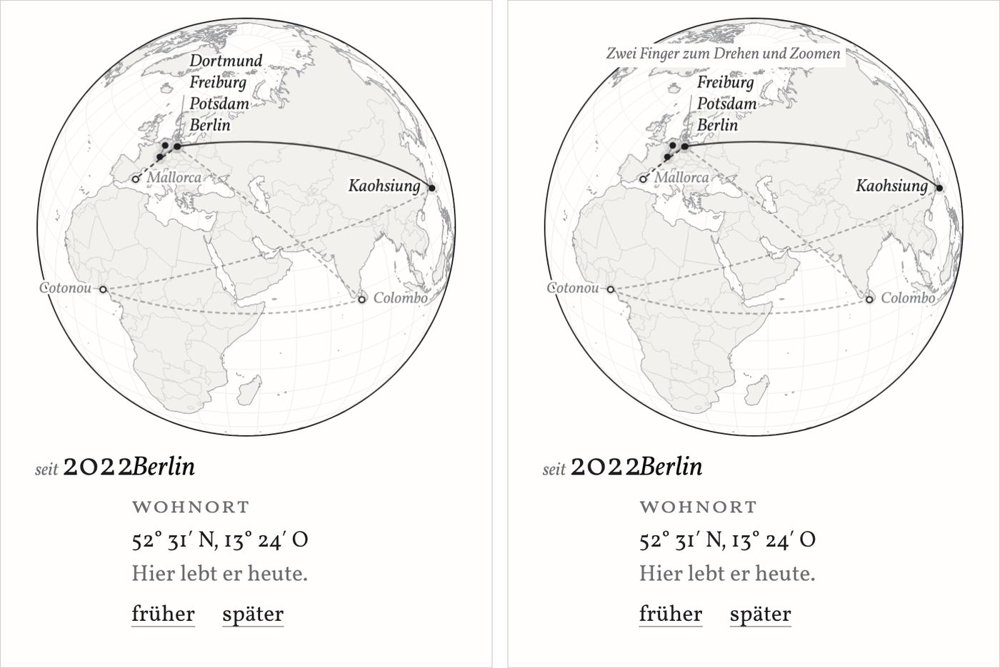
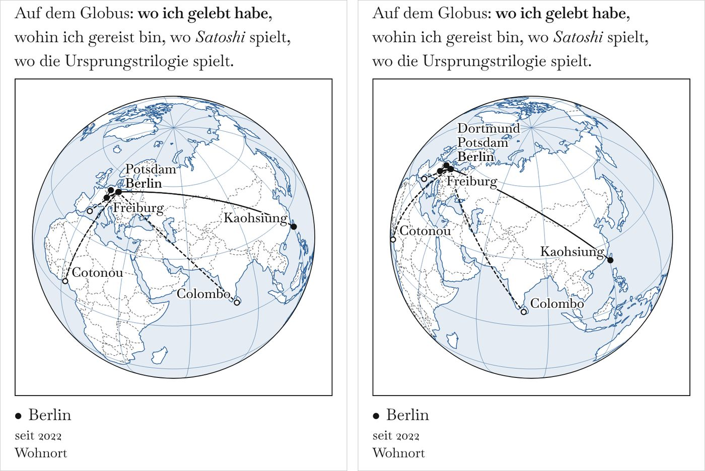

Du findest das Zoomen in B besser, das ist schon entschieden. Hier steht, woran es liegt: fast ganz an der Technik, denn die Bedienung ist am Rechner gleich.

**Vorher (A).** Strg oder ⌘ mit dem Mausrad zoomt von 0,9- bis 24-fach, Plus und Minus ebenso, Ziehen dreht. Auf dem Telefon scrollt ein Finger die Seite, auf der Kugel erscheint „Zwei Finger zum Drehen und Zoomen“. Ab 1,8-facher Vergrößerung zeichnet A die feinen Küsten auch in Bewegung. Die Ortsnamen verschwinden, solange sich die Kugel bewegt, das Gradnetz fehlt ab 2,2-fach. Ein Bild in Bewegung braucht dann rund 90 ms, das sind etwa elf Bilder je Sekunde. Flüssig wirkt eine Bewegung ab etwa 60.

**Nachher (B).** Am Rechner dieselben Gesten (1- bis 24-fach). Auf dem Telefon dreht ein Finger waagerecht die Kugel, senkrecht scrollt er die Seite, dazu erscheint wie in A der Hinweis auf zwei Finger. In Bewegung zeichnet B immer die groben Küsten, 0,22 Sekunden nach der letzten Bewegung einmal fein, und nur ab 1,8-fach. Die Namen bleiben stehen, das Gradnetz wird mit dem Zoom dichter. Ein Bild in Bewegung braucht 7 bis 16 ms, also 60 Bilder je Sekunde.

**Woran es liegt.** Beide haben dieselben Weltdaten von Natural Earth in zwei Maßstäben: grob (1 : 110 Millionen, 8 246 Punkte) und fein (1 : 50 Millionen, 80 617 Punkte, zehnmal so viel Arbeit je Bild). Welche gezeichnet wird, entscheidet je eine Zeile im Kern:

- A, Zeile 111: `const daten = () => (fein && (k > 1.8 || !bewegt)) ? fein : grob;`
- B, Zeile 120: `const daten = () => fein && k > 1.8 && !bewegt ? fein : grob;`

A zeichnet fein, sobald die Kugel stillsteht *oder* vergrößert ist. B nur, wenn sie stillsteht *und* vergrößert ist. Beim Zoomen ist die Kugel fast immer vergrößert, also rechnet A genau dann mit der feinen Karte, wenn es schnell gehen müsste. Über der Zeile in A steht der Kommentar „In Bewegung grob zeichnen, in Ruhe fein“, die Absicht war dieselbe, der Code tut etwas anderes. B hat das beim Bau bemerkt. Außerdem zeichnet A auch den Überblick in Ruhe fein, deshalb steht die Seite nach jedem Drehen einmal 0,2 Sekunden still.

Gemessen im Prüfbrowser ohne Grafikkarte über Berlin, Median (der mittlere Wert) aus 15 bis 20 Bildern, in Millisekunden. Für 60 Bilder je Sekunde bleiben 16,7 ms je Bild.

| Vergrößerung | A in Ruhe | A in Bewegung | B in Ruhe | B in Bewegung |
|---:|---:|---:|---:|---:|
| 1 (ganze Kugel) | 201 | 15 | 12 | 7 |
| 1,8 | 112 | 12 | 9 | 11 |
| 2,4 (Chronik in A) | 102 | 93 | 68 | 7 |
| 4 | 101 | 86 | 71 | 8 |
| 6 | 94 | 84 | 70 | 8 |
| 12 | 95 | 85 | 78 | 14 |
| 24 (Grenze) | 101 | 95 | 81 | 16 |

Der Flug von Berlin nach Paris bei sechsfacher Vergrößerung läuft in A mit 9 Bildern je Sekunde, in B mit 57. Der weite Flug von Paris nach Kaohsiung läuft mit 16 gegen 60. Eine Zoomgeste mit Strg und Mausrad zeigt A mit 20 Bildern je Sekunde und 64 Stockungen, B mit 61 und keiner. Ein aktueller Laptop rechnet schneller, das Verhältnis von etwa 1 : 10 bleibt, auch mit doppelter Pixeldichte. Zur Gegenprobe habe ich A im Prüfbrowser mit der Zeile aus B geladen, ohne eine Datei zu ändern: Dann braucht ein Bild in Bewegung 11 bis 21 ms statt rund 90, der Flug nach Paris läuft mit 31 statt 9 Bildern je Sekunde.

Weitere Unterschiede:

- **Namen.** A löscht sie in Bewegung und setzt sie zwei Bilder nach dem Anhalten neu, beim Zoomen sieht man Punkte ohne Namen. B setzt sie in jedem Bild, probiert dafür nur sechs Lagen um den Punkt statt der Namensblöcke von A.
- **Gradnetz.** In A fehlt es gezoomt, nur die Küste bewegt sich. In B laufen Linien alle 5, ab neunfach alle 2 Grad vorbei, man sieht, wohin die Karte fährt.
- **Ausschnitt.** In A fehlt gezoomt rechts ein Stück der Lupe, weil die Kugel angeschnitten ist.
- **Flüge.** A fliegt 0,9 bis 2,4 Sekunden und zeigt jede Station 2,4-fach. B fliegt immer eine Sekunde und zeigt Europa 3,6-fach, die Namen haben mehr Platz.
- **Gleich** sind Trackpad-Gesten und das Zoomen zur Mitte. Keine hat Trägheit, also kein Nachlaufen nach dem Loslassen.
- **Nebenwirkung.** Für seine ausgeschalteten Gewässernamen öffnet B die Zeichenfläche mit `willReadFrequently: true`. Dann rechnet Chrome ohne Grafikkarte, was B auf einem Rechner mit Grafikkarte etwas bremsen kann. Messen konnte ich das hier nicht.

**Warum.** Hier geht es um kein KI-Merkmal. Der Grund ist Technik und Bedienbarkeit. Eine Kugel, die beim Zoomen ruckelt und ihre Namen verliert, ist ein schwächeres Prunkstück. Dein Eindruck deckt sich mit der Messung.

**Vorteile.**

- 60 statt etwa 11 Bilder je Sekunde.
- Die Namen bleiben beim Zoomen stehen.
- Das Gradnetz zeigt Richtung und Tempo.
- Auf dem Telefon dreht ein Finger die Kugel.

**Nachteile und Risiken.**

- In Bewegung ist die Küste in B bei starker Vergrößerung grob, Mallorca verschwindet, Dänemark wird eckig. Nach dem Anhalten springt die Karte sichtbar auf fein.
- Dieses eine feine Bild dauert 70 bis 80 ms, wer genau dann weiterzieht, spürt ein Stocken.
- Ein schräger Wisch kann auf dem Telefon drehen statt scrollen.
- Dichte Gruppen von Namen setzt B weniger schön als A.

**Verworfene Alternativen.** Immer fein ist zu langsam, immer grob ab zweifach sichtbar falsch. Eigens vereinfachte Küsten je Zoomstufe wären schöner, kosten aber deutlich mehr Code. Eine Zeichnung über die Grafikkarte (WebGL) bräuchte eine fremde Bibliothek. Trägheit ist bei einer Karte, die man über Wörter steuert, entbehrlich.

**Sicherheit.** Hoch. Die Messung ist eindeutig und bestätigt deinen Eindruck.

**Für die Mischfassung.** Aus B, nur die Technik, alles ohne Atlas-Look. Schon entschieden.

1. Die Datenregel aus B, eine Zeile im Kern. Sie bringt den größten Teil des Gewinns.
2. Die Ortsnamen auch in Bewegung: schlichte Namen beim Bewegen, die Namensblöcke von A in Ruhe. Das ist der größte Umbau dieser Liste.
3. Das dichter werdende Gradnetz in sehr hellem Grau statt Blau.
4. Auf dem Telefon Drehen mit einem Finger waagerecht, etwa 20 Zeilen.
5. Feste Flugdauer von einer Sekunde, Europa 3,6-fach.
6. `willReadFrequently` nicht übernehmen.

Offen ist, ob die Kugel beim Zoomen angeschnitten bleiben darf. Der Anschnitt gehört zur Anmutung von A, kostet gezoomt aber ein Stück der Lupe (Frage 12).

### 11. Chronik

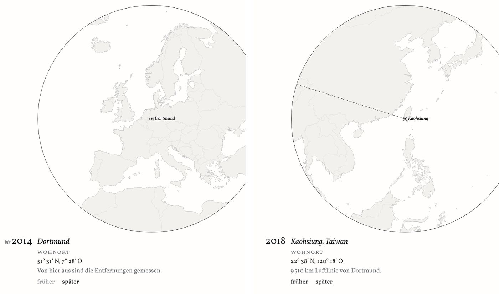
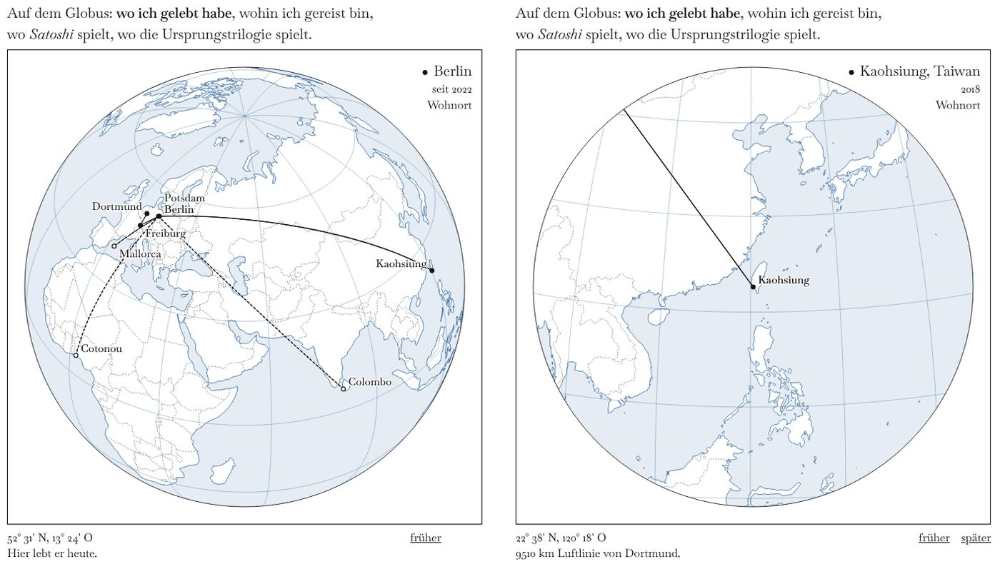
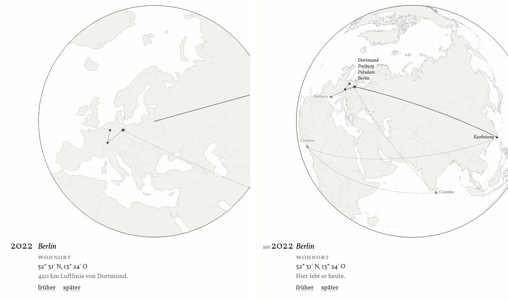

**Vorher (A).** Die Chronik läuft einmal von selbst. Sie wartet, bis der erste Satz eingeflogen ist, bis dahin ist die Kugel leer. Dann fliegt sie über acht Stationen, je 2,2 Sekunden Halt und 0,9 Sekunden Flug. Der Weg wächst mit, Namen, Tafel und Stationenzeile gehen mit, am Ende steht „seit 2022 Berlin … Hier lebt er heute.“ Dortmund ist nach 3,6 Sekunden erreicht, Kaohsiung nach 20, das Ende nach 31. Jeder Griff an die Kugel hält die Chronik an, dann steht der ganze Weg da. „Noch einmal von Dortmund an“ startet sie neu. Mit „früher“ und „später“ blättert man von Hand, der Weg wächst und schrumpft dabei.

**Nachher (B).** Nichts bewegt sich von selbst. Beim Laden steht der ganze Weg, Berlin ist halbfett, die Tafel zeigt Berlin. „Früher“ und „später“ gehen Station für Station, jeder Schritt ist ein Flug von einer Sekunde. Der Weg steht immer ganz. „Noch einmal von Dortmund an“ springt nur zur ersten Station, ohne Ablauf.

**Warum.** B hatte die Chronik zuerst behalten. Die Prüfung von B wendete ein, sie starte ohne Zutun und gebe der Startseite die Silhouette von A, darauf fiel sie weg. Die Ränge dazu sind Rang 25 (inszenierter Ladeauftritt, nah) und Rang 56 (Bewegung ohne Zutun). Die Belege sprechen aber eher für A. Die Liste nennt als Gegenmittel unter Rang 25 ausdrücklich „eine Karte, die einen Lebensweg nachzeichnet“, und ihre Regel 11 lautet: „Eine Bewegung, die etwas erzählt. Die springende Lebenschronik auf dem Globus.“ KI-typisch ist am Auftakt von A eher das Warten auf den einfliegenden Satz (02). Technisch läuft die Chronik von A bei 2,4-facher Vergrößerung, wo A auch im Flug fein zeichnet (10), gemessen mit 9 bis 11 Bildern je Sekunde.

**Vorteile.**

- Nichts bewegt sich ungefragt. Wer lesen will, liest.
- Niemand muss 31 Sekunden warten, um den ganzen Weg zu sehen.
- Der Leser bestimmt das Tempo, wie du es dir für *Satoshi* wünschst.

**Nachteile und Risiken.**

- Die Erzählung in Bewegung geht verloren, die eine Bewegung, die etwas über dein Leben zeigt. Sie macht A lebendig.
- Viele Besucher klicken nie auf das kleine „früher“ unter der Karte.
- Ohne wachsenden Weg sieht man nicht, in welcher Reihenfolge die Orte kamen. Der ganze Weg ist ein Knäuel über Europa.
- „Noch einmal von Dortmund an“ verspricht in B einen Ablauf, den es nicht gibt.

**Verworfene Alternativen.** Die Regeln von B sahen zuerst eine Chronik ohne Warten vor (Flüge von einer Sekunde, 2,6 Sekunden an jeder Station, Ende beim ersten Eingriff), der Code steckt noch im Kern von B. Möglich wäre eine Chronik nur auf Klick.

**Sicherheit.** Geschmack. Die Liste selbst empfiehlt eine solche Chronik, B hat sie aus Vorsicht gestrichen.

**Für die Mischfassung.** Bei A bleiben, mit drei Änderungen. Erstens die Datenregel aus 10, damit die Flüge flüssig laufen. Zweitens startet die Chronik ohne Warten, sobald die Kugel im Bild ist (02). Drittens zeigt sie Europa 3,6-fach und führt den Weg mit Abstechern (14b). Wer es ruhiger will, nimmt den Mittelweg: Beim Laden steht der ganze Weg wie in B, und die Chronik läuft erst auf „Noch einmal von Dortmund an“. Dann passt das Wort zu dem, was es tut (Frage 9).

### 12. Tafel, Legende und Zeichen an der Karte

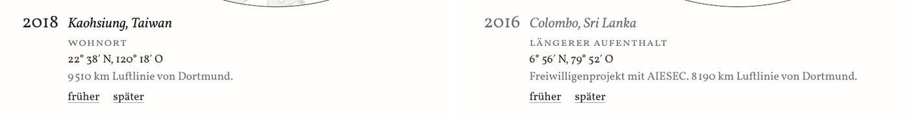
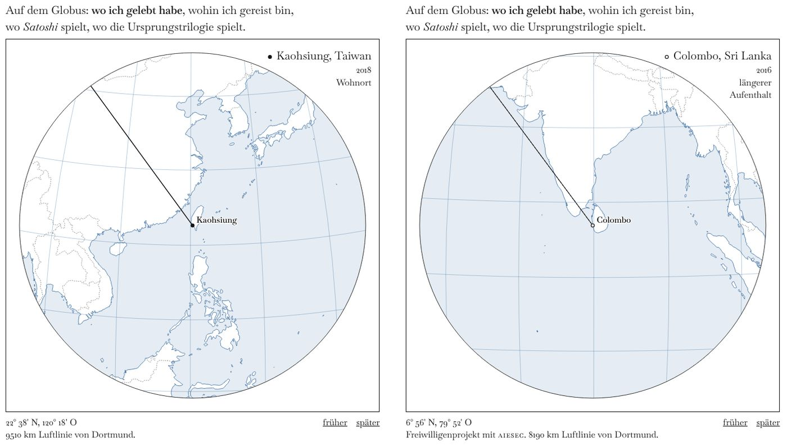
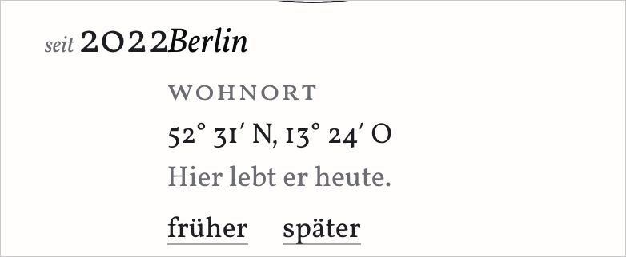
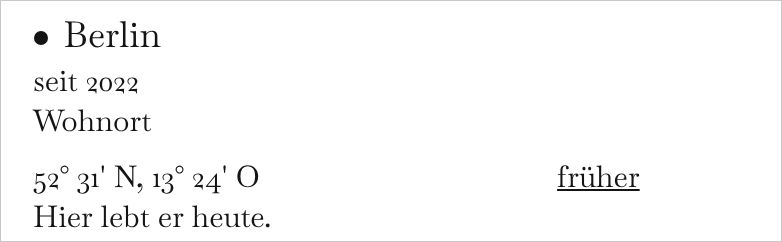

**Vorher (A).** Die Tafel steht unter dem Globus. Links hängt eine große Jahreszahl in Mediävalziffern, rechts davon der Ort kursiv in Schwarz („Kaohsiung, Taiwan“), darunter die Art in grauen Kapitälchen („WOHNORT“, „LÄNGERER AUFENTHALT“), die Koordinaten („22° 38′ N, 120° 18′ O“), ein grauer Satz („9 510 km Luftlinie von Dortmund.“) und „früher“ und „später“. Bei einem längeren Aufenthalt stehen Jahr und Ort grau. Eine Zeichenerklärung gibt es nicht. Auf dem Telefon stößt „seit 2022“ an „Berlin“.

**Nachher (B).** Der Kopf der Tafel steht oben rechts im Zwickel, der Ecke zwischen Kugel und Rahmen. Vor dem Ort steht das Kartenzeichen, ein gefüllter Punkt für einen Wohnort, ein offener Kreis für einen längeren Aufenthalt („● Kaohsiung, Taiwan“), darunter klein Jahr und Art. Unter dem Rahmen folgen Koordinaten und Luftlinie, rechts „früher“ und „später“. Alles aufrecht, in Tinte, im Wortlaut von A. Eine Zeichenerklärung unten links im Rahmen gab es bis zur Nacht auf den 21. Oktober, sie ist entfernt, weil A keine hat.

**Warum.** „wohnort“ in Kapitälchen ist Rang 1 (04). Kursiver Ort, graues Label und grauer Satz sind graue Kursive und grauer Nebentext (Rang 24 und 11, 03). Koordinaten und Luftlinie sind Mikro-Metadaten (Rang 26), Angaben, die nach Genauigkeit aussehen. Die Liste lässt Koordinaten aber dort gelten, „wo man mit ihnen etwas tut, etwa an einer echten Karte für den gerade gezeigten Ort“. Das ist hier der Fall. Die hängende Jahreszahl ist Rang 55, nur „gelegentlich“ und unter Gestaltern üblich. B hatte Koordinaten, Luftlinie und den Kopf der Tafel gestrichen, alles kam mit dem Textabgleich zurück.

**Vorteile.**

- Das Zeichen vor dem Namen verbindet Tafel und Karte, ohne Zeichenerklärung.
- Eine Farbe, gut lesbar, kein Label in Kapitälchen.
- Der Name steht im Bild der Karte, das Auge muss nicht springen.
- Auf dem Telefon stößt nichts aneinander.

**Nachteile und Risiken.**

- Die Angaben sind verteilt, in A stehen sie an einer Stelle.
- Die große Jahreszahl gibt der Chronik in A ihren Takt und ist aus der Ferne lesbar, in B ist das Jahr klein.
- Im Zwickel ist wenig Platz, bei *Ursprung* bricht „Trilogie, in Arbeit“ um.
- Den Zwickel hält eine eigene Rechnung frei, die aufwendig zu pflegen ist.

**Verworfene Alternativen.** Die Regeln von B sahen einen Kopf mit Land und Zeitraum vor („Taiwan, 2018–2022“) und die Zeile aus der Vita als Legende. Beides wich dem Wortlaut von A.

**Sicherheit.** Mittel. Label und graue Kursive sind gut belegt, die Lage der Tafel ist Geschmack.

**Für die Mischfassung.** Mittelweg. Die Tafel von A bleibt unter dem Globus, an einer Stelle, mit der großen Jahreszahl (28,5 px). Die Art („Wohnort“) steht normal geschrieben im Grad klein in Graphit, der Satz in Graphit, der Ort aufrecht im Grad der Überschriften (06). Aus B kommt das Kartenzeichen vor dem Ort („● Kaohsiung, Taiwan“, „○ Colombo, Sri Lanka“), damit erkennt man längere Aufenthalte ohne Grau. Auf dem Telefon wird die Spalte der Jahreszahl breiter, oder „seit“ steht über der Zahl. Die Koordinaten bleiben hier, weil sie an der Karte stehen, die Luftlinie sagt wenig und kann weg (Frage 18).

### 13. Kartenwahl

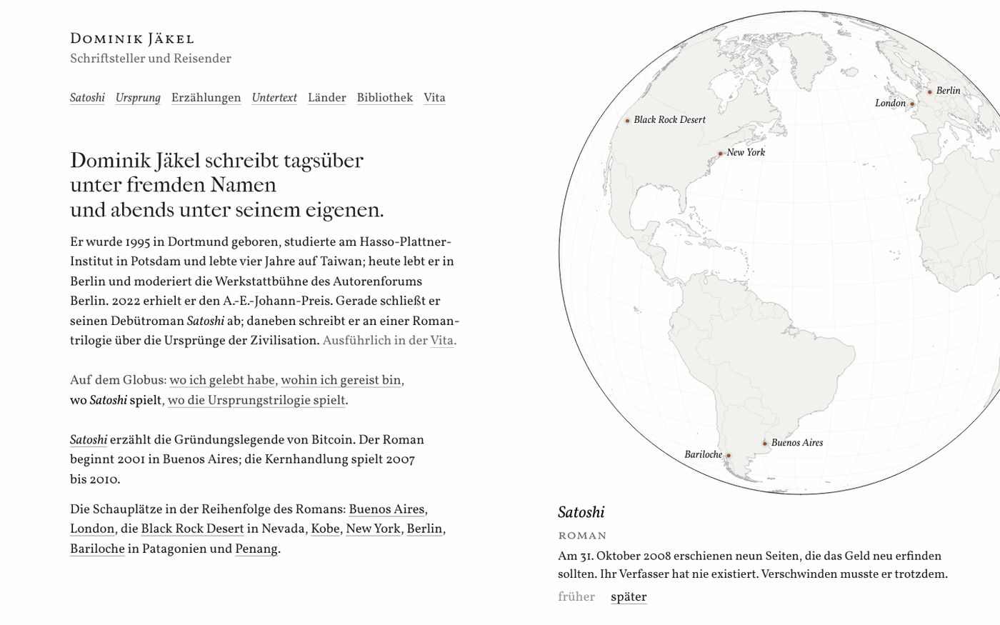
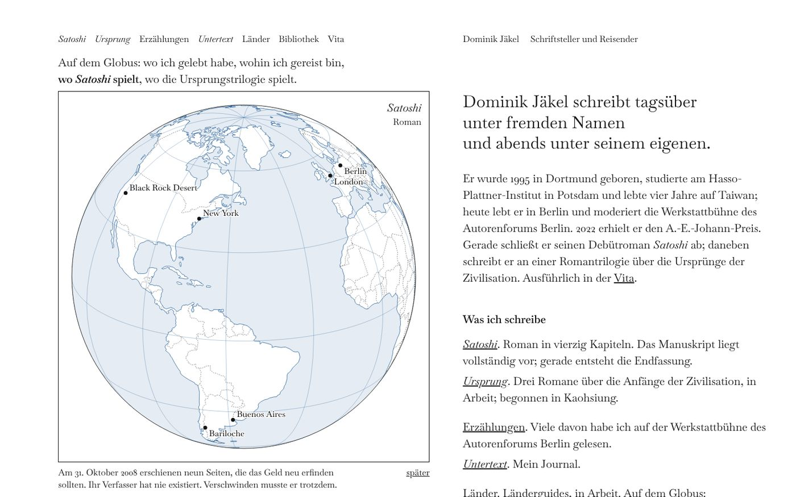

**Vorher (A).** Unter der Kurzvita steht: „Auf dem Globus: wo ich gelebt habe, wohin ich gereist bin, wo *Satoshi* spielt, wo die Ursprungstrilogie spielt.“ Der Satz ist dunkelgrau, die vier Ebenen sind Wörter mit der feinen Unterstreichung, die gewählte steht schwarz ohne Strich. Darunter folgt neben der Kugel der Text der Ebene: Stationenzeile, Kontinente, Schauplätze oder die drei Bände, mit Wörtern, die den Globus führen. Eine Wahl lässt die Kugel fliegen. *Satoshi* und *Ursprung* erscheinen in Siena, *Ursprung* startet eine langsame Chronik, bei der die Bände nacheinander einblenden (14). Auf dem Telefon stehen Satz und Text über der Kugel.

**Nachher (B).** Derselbe Satz steht über dem Rahmen, die Ebenen ohne Strich, die gewählte halbfett, unter der Maus ein Strich. Der Text der Ebene steht unter der Legende, am Desktop unterhalb des ersten Bildschirms. Eine Wahl zeigt den ersten Schritt ohne Chronik, alles in Schwarz. Früher stand hier in B eine Liste aus Substantiven („Wohnorte, Reisen, *Satoshi*, *Ursprung*“).

**Warum.** Rang 53 (Unterstreichung als Zierde, 07). Die Kartenwahl ist eine Auswahl, kein Link im Fließtext. Der Text trägt drei Merkmale aus dem Textbereich: die Doppelpunkt-Einleitung (Rang 32), die Formel „Auf dem Globus“, die mindestens fünfmal vorkommt (Rang 35), und den Wechsel von „er“ in der Kurzvita zu „ich“ (Rang 61). Das ist dein Wortlaut und bleibt in beiden Fassungen.

**Vorteile.**

- Weniger Striche im ersten Bildschirm.
- Die gewählte Ebene ist durch Halbfett deutlich.
- Die Wahl steht direkt an der Karte.

**Nachteile und Risiken.**

- Ohne Strich sieht man nicht, dass man klicken kann, auf dem Telefon gar nicht.
- Der Text der Ebene rutscht unter die Karte und aus dem ersten Bildschirm.
- Halbfett ist ein weiterer Schriftschnitt.

**Verworfene Alternativen.** Die Liste aus Substantiven fiel dem Textabgleich zum Opfer. Pillen oder Reiter, also abgerundete Knöpfe, standen nie zur Wahl (Rang 4). Ein Auswahlmenü hätte die vier Karten versteckt.

**Sicherheit.** Geschmack. Der Wortlaut ist gleich, es bleibt die Form.

**Für die Mischfassung.** Bei A bleiben, mit leiserer Form. Satz und Platz von A bleiben, auch der Text neben der Kugel. Die vier Wörter bleiben unterstrichen, mit der Linie aus 07 statt der halb durchsichtigen, denn ohne Strich sieht man nicht, dass man wählen kann. Die gewählte Ebene steht ohne Strich und halbfett. Der Satz steht in Graphit, Siena fällt weg (08). Die Textmerkmale bekommst du als Vorschlag (Frage 29).

### 14. Übrige Bewegung

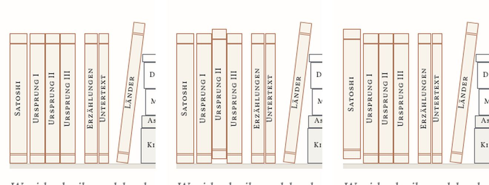

**Vorher (A).** Vier weitere Bewegungen.

- **Hover-Lift.** Hover heißt, die Maus steht über einem Element. Ein Rücken hebt sich dann in 0,2 Sekunden um 6 px, liegende Bücher rücken 6 bis 7 px zur Seite, auch ein Eintrag im Werkverzeichnis hebt den passenden Rücken.
- **Überblendung der Bände.** Auf der Ebene *Ursprung* blenden die Bände im Takt der Chronik nacheinander ein, Band I ist nach 2,9 Sekunden halb sichtbar, Band II nach 9 Sekunden fast ganz.
- **Kopplung an das Scrollen.** Auf *Satoshi* und *Ursprung* fliegt die Kugel zu dem, was man gerade liest. In der Bibliothek folgt eine haftende Zeitleiste dem Fach, haften heißt, sie bleibt beim Scrollen am Fensterrand stehen.
- **Mitschieben des Zeitbands.** Auf dem Telefon schiebt sich das Band beim senkrechten Scrollen von selbst seitlich mit (gemessen 0, 318, 660 px), bis man selbst wischt.

**Nachher (B).** Außer den Flügen bewegt sich nichts weich, es gibt keinen Übergang und kein Einblenden. Unter der Maus wird ein Rücken sofort schwarz mit weißer Schrift. Die Bände stehen sofort da. Die Kopplung an das Scrollen bleibt. Das Zeitband steht in der Bibliothek und bewegt sich nur unter dem Finger (23).

**Warum.** Der Hover-Lift ist Rang 39, das Muster aus dem Baukasten Tailwind, bei dem jedes Element unter der Maus ein paar Pixel steigt. Die Liste merkt an: „Ein Buch zieht man nach vorn aus dem Regal, nicht nach oben.“ Die Überblendung ist Einblenden (Rang 6). Anthropic schreibt seit September 2026, solche Auftritte „read as AI-generated“, in A ist sie an die Chronik gebunden, eine milde Form. Die Kopplung an das Scrollen ist Rang 56, vertretbar, wenn sie Inhalt abbildet und das Scrollen nicht entführt. Das Mitschieben nennt die Prüfung „eine milde Form von Scroll-Jacking“: Die Seite übernimmt das Scrollen und bewegt etwas, das der Leser nicht angefasst hat.

**Vorteile.**

- Nichts bewegt sich ohne Grund, wer *Ursprung* wählt, muss nicht warten.
- Auf dem Telefon bestimmt der Leser, welchen Teil des Zeitbands er sieht.
- Weniger Code, reduzierte Bewegung ist von selbst erfüllt.

**Nachteile und Risiken.**

- Die Rücken fühlen sich weniger wie Gegenstände an, das kleine Heben hat Charme.
- Das schwarze Füllen ist ein harter Zustand, der zur leisen Anmutung von A nicht passt.
- Das Mitschieben ist auf dem Telefon auch ein kleines Vergnügen.

**Verworfene Alternativen.** Die Prüfung schlug statt des Hebens eine dunklere Kante vor. Ein Ziehen nach vorn wäre wieder Bewegung. Den Schuber, der in 0,8 Sekunden aufgleitet, stellt B ebenfalls ruhig (21).

**Sicherheit.** Mittel. Hover-Lift und Mitschieben sind belegt, aber nicht auffällig.

**Für die Mischfassung.** Einzeln:

- **Hover-Lift:** Keine Bewegung, aber ein leiser Zustand: Der Rücken bekommt eine Kante in Graphit, und der Name erscheint wie in A. Das schwarze Füllen ist für A zu hart. Das gilt für Regalbild (15) und Bibliothek (21).
- **Überblendung:** aus B, die Bände stehen sofort da.
- **Kopplung an das Scrollen:** bei A bleiben, *Satoshi* ändert sich ohnehin (18).
- **Mitschieben:** weglassen (23).

### 14b. Weg zu den längeren Aufenthalten

Dieser Unterschied fehlte in der ersten Liste. Er betrifft den Inhalt, nicht die Form.

**Vorher (A).** A zieht den Weg in der Reihenfolge der Stationen: Dortmund, Freiburg, Potsdam, Colombo, Cotonou, Kaohsiung, Berlin, Mallorca. Die Strecken zu und von längeren Aufenthalten sind gestrichelt. Auf der Karte steht also eine Reise von Colombo nach Cotonou und eine von Cotonou nach Kaohsiung.

**Nachher (B).** Ein längerer Aufenthalt ist ein Abstecher vom Wohnort davor, hin und zurück, gestrichelt: Potsdam nach Colombo und zurück, Potsdam nach Cotonou und zurück, Berlin nach Mallorca und zurück. Der durchgezogene Weg verbindet nur die Wohnorte.

**Warum.** Kein KI-Merkmal. Die Prüfung „Form und Funktion“ fand „einen Weg, den es nicht gab“, damals in B, als B noch den Weg von A zeichnete. B hat das im Kern gelöst (Funktion `routeBauen`), A hat den Fehler noch.

**Vorteile.**

- Die Karte behauptet keine Reisen, die vermutlich nicht stattgefunden haben.
- Der durchgezogene Weg zeigt klar, wo du gewohnt hast.

**Nachteile und Risiken.**

- Hin und zurück liegen auf derselben Linie und wirken stellenweise durchgezogen (Berlin nach Mallorca).
- Bist du etwa von Colombo direkt nach Cotonou gegangen, ist B falsch und A richtig.

**Verworfene Alternativen.** Längere Aufenthalte ganz ohne Linie, nur als offene Kreise. Dann fehlte die Zuordnung zum Wohnort.

**Sicherheit.** Hoch, wenn die Annahme stimmt. Das kannst nur du sagen.

**Für die Mischfassung.** Aus B übernehmen, wenn die Abstecher so stimmen (Frage 10). Der Code ist eine kleine Funktion im Kern und ändert nichts am Aussehen von A. Die Linie bleibt in Graphit und gestrichelt.

### 15. Aufbau der Startseite

Den ersten Bildschirm beider Startseiten zeigen die Bilder unter 08.

**Vorher (A).** Links eine Textspalte von gut 560 px mit Kopf, erstem Satz, Kurzvita, „Auf dem Globus: …“ und Stationen. Rechts der Globus vom oberen Fensterrand bis über den rechten Rand hinaus, angeschnitten, seine Größe folgt der Fensterhöhe, darunter die Tafel. Weiter unten „Was ich schreibe“ mit Werkverzeichnis und Regalbild, „Was ich gelesen habe“ mit dem Zeitband, der Fuß. Die Seite ist 2780 px hoch. Das Regalbild zeigt deine Werke als Rücken in warmem Weiß mit Siena-Linien und zwei feinen Bünden (Querlinien wie auf einem gebundenen Rücken), daneben die Bücher vom Nachttisch. Unter der Maus hebt sich ein Rücken um 6 px. Ein Klick öffnet eine Karteikarte im Format A6 quer in Kartonfarbe, mit Signatur „DJ 1“ und „zurücklegen“.

**Nachher (B).** Am Desktop gespiegelt wie die linke Seite eines aufgeschlagenen Atlas: die Karte links am Außensteg (dem äußeren Rand einer Buchseite), der Text rechts am Bund (dem inneren Rand). Die Karte sitzt in einem Quadrat von 672 px, nicht angeschnitten. Rechts stehen Name, erster Satz, Kurzvita und „Was ich schreibe“. Das Regalbild ist eine Strichzeichnung mit 1 px Kontur (Umrisslinie), ohne Siena und ohne Heben, die Karteikarte eine Zeile unter dem Brett. „Was ich gelesen habe“ ist ein Satz mit Verweis, das Zeitband steht in der Bibliothek. Keine Chronik. Die Seite ist 1890 px hoch. In der Fassung, die du zuerst gesehen hast, fehlten Kopf, Regalbild und Karteikarte ganz.

**Warum.** Erstens die Silhouette, die Umrissform einer stark verkleinerten Seite. Die Prüfung von A fand vier Seiten mit demselben Umriss: Text links, angeschnittener Globus rechts in Fensterhöhe. Das berührt Rang 27 (bei A schwach, 09), Rang 14 und Rang 42, vorgefertigte Seitenfolgen und Bildschirme in Fensterhöhe. Die Spiegelung soll A von sich selbst und vom üblichen „Text links, Bild rechts“ unterscheiden. Gemessen ist das nicht, der Silhouettentest gegen fünf andere Autorenseiten fehlt. Zweitens das Beiwerk am Regalbild: Rang 52 sind nachgebaute Papiergegenstände wie Karteikarten, Signaturen und Kartonränder. Hallmark und Goodspeed sehen darin eine Mode, die Modelle von selbst wählen, wenn sie „Buch“ hören. Dazu kommen Siena (Rang 10), warme Flächen (Rang 2), das Heben (Rang 39) und die Bildlegende „Was ich schreibe, und daneben, was gerade auf dem Nachttisch liegt.“, die die Überschrift wiederholt (Rang 33). Drittens die Chronik (11).

**Vorteile.** B hat einen eigenen Umriss. Die Startseite ist ein Drittel kürzer, deine Werke stehen am Desktop im ersten Bildschirm. Nichts bewegt sich, bevor man klickt. Das Regalbild behält seine echten Maße und verliert nur die Kulisse.

**Nachteile und Risiken.** Wir lesen von links oben. In B steht dort die Karte, dein erster Satz kommt an zweiter Stelle, dein Name ist ein kleines Wort am rechten Rand. Die Karte im Rahmen wirkt wie eine Abbildung im Lehrbuch, die große angeschnittene Kugel ist ein großer Teil des Charmes von A. Das Regalbild als Strichzeichnung wirkt wie ein Bauplan. Die freigehaltene Zeile der Karteikarte lässt unter dem Regalbild eine Lücke von gut 150 px. Und das Zeitband fehlt auf der Startseite.

**Verworfene Alternativen.** Die Richtung „Verlag“ behielt den Aufbau von A, die Jury fand sie zu sehr wie eine bereinigte A. Die Regeln von B strichen das Regalbild der Startseite, der Textabgleich brachte es zurück. Ein Foto deines echten Nachttischs wäre die stärkste Lösung.

**Sicherheit.** Geschmack bei der Spiegelung, für sie gibt es nur ein ungemessenes Argument. Mittel beim Beiwerk.

**Für die Mischfassung.** Mittelweg. Der Aufbau von A bleibt: Text links, Globus rechts und angeschnitten, das Zeitband auf der Startseite (23). Du magst diese Anmutung, und der Nutzen der Spiegelung ist unbelegt (Frage 13). Am Regalbild bleibt die Form, das Beiwerk geht: die eigenen Rücken weiß mit Graphitlinie (08), keine Bünde, liegende Bücher ohne Kartonfläche, statt des Hebens eine dunkle Kante (14), keine Bildlegende. Die Karteikarte wird ein Satz unter dem Brett (22). Den Silhouettentest sollten wir vor dem Abschluss nachholen, mit fünf Autorenseiten, die du kennst (Frage 28).

### 16. Kopf und Navigation

**Vorher (A).** Der Name steht in Kapitälchen der Vollkorn SC, 21,9 px, gesperrt um 0,07 em. Darunter „Schriftsteller und Reisender“ in Grau (19 px), eine Zeile tiefer die Navigation in 17,8 px, dunkelgrau, fein unterstrichen. Die Werktitel stehen kursiv, die aktuelle Seite schwarz ohne Strich. Auf dem Telefon klappt die Navigation hinter „Inhalt“ zusammen, ein Tipp öffnet sie, ein Tipp daneben oder Escape schließt sie.

**Nachher (B).** Der ganze Kopf ist eine Zeile im kleinen Grad (16 px, Telefon 15 px), alles in Tinte. Der Name hat keine Kapitälchen und keine Sperrung, „Schriftsteller und Reisender“ folgt in derselben Zeile (in deiner ersten Fassung von B fehlte es). Die Navigation steht ohne Strich, unterstrichen unter der Maus, die aktuelle Seite halbfett, die Werktitel kursiv. Auf dem Telefon steht sie offen in zwei Zeilen, ohne Schalter.

**Warum.**

- Die Zeile unter dem Namen ist eine Tagline, eine Werbezeile, die eine Rolle behauptet. Das ist Rang 21, die Liste nennt als Beispiel fast wörtlich „Autor und Reisender“. Das Gegenmittel ist der erste Satz, der den Beruf schon nennt. Die frühen Notizen hatten die Zeile gestrichen, ob du sie später gewünscht hast, geht aus ihnen nicht hervor. A trägt sie auf allen elf Seiten, in Grau (Rang 11).
- Kapitälchen und Sperrung gehören zu Rang 1 (04). Ehrlich gesagt ist ein Name kein Etikett, Kapitälchen im Briefkopf sind eine alte Konvention, und Bringhurst empfiehlt bei Kapitälchen sogar leichte Sperrung. Verdächtig wird es erst in der Häufung mit den Kapitälchen-Überschriften.
- Die feine Unterstreichung ist Rang 53 (07).
- Der Schalter „Inhalt“ ist kein KI-Merkmal. B lässt ihn aus Gründen der Bedienung weg: Sieben Wörter passen in zwei Zeilen, und was offen dasteht, findet man ohne Tipp.

**Vorteile.** Ohne Tagline sagt der Kopf nur, was stimmt, und der erste Satz bekommt seine Aufgabe zurück. Eine Farbe und eine Größe machen den Kopf ruhig. Auf dem Telefon sieht man die ganze Website sofort.

**Nachteile und Risiken.** Dein Name schrumpft auf 16 px. Für einen Autor ist der Name die Marke, und der Briefkopf in Kapitälchen trägt viel von der Eleganz von A. Das Halbfett der aktuellen Seite wirkt in der Baskervville hart. Ohne Strich erkennen manche die Navigation auf dem Telefon schlechter. Die offene Navigation kostet dort dauerhaft zwei Zeilen.

**Verworfene Alternativen.** Den Kopf der Startseite ganz weglassen und das Inhaltsverzeichnis zur Navigation machen, so war deine erste Fassung von B. Ein Menüsymbol mit drei Strichen wäre ein Icon (Rang 22) und versteckt ebenso. Ein großes Logo wäre lauter.

**Sicherheit.** Hoch bei der Tagline, mittel bei Sperrung und Strich, Geschmack beim Menü und bei Kapitälchen ohne Sperrung.

**Für die Mischfassung.** Mittelweg. Den Briefkopf von A in seiner Stellung behalten, im Grad der Überschriften (23,75 statt 21,9 px, 06), den Namen ohne Sperrung, am sichersten in der gewöhnlichen Vollkorn (Frage 4). Die Tagline streichen, das entscheidest du (Frage 7). Die Navigation in Graphit, in Ruhe ohne Strich, beim Zeigen unterstrichen, die aktuelle Seite halbfett (07), die Werktitel kursiv. Auf dem Telefon aus B: die Navigation offen in zwei Zeilen, ohne „Inhalt“ (Frage 8).

### 17. Inhaltsverzeichnis der Startseite („Was ich schreibe“)

**Vorher (A).** Über dem Abschnitt steht „was ich schreibe“ in gesperrten Kapitälchen, 20 px. Darunter fünf Einträge in drei Gruppen: die beiden Romane, Erzählungen und *Untertext*, dann Länder. Jeder Eintrag hat die Form „Titel. Satz.“, der Titel ist ein fein unterstrichener Verweis. Rechts daneben, an der Kante des Globus, steht das Regalbild. Am Desktop liegt der Abschnitt unter dem ersten Bildschirm.

**Nachher (B).** „Was ich schreibe“ steht aufrecht, normal geschrieben, halbfett, 20 px. Die Einträge sind dieselben, zwischen Einträgen steht eine Viertelzeile Abstand, zwischen Gruppen eine Dreiviertelzeile. Die Verweise tragen die dickere Unterstreichung des Browsers. Das Regalbild steht darunter, danach „Was ich gelesen habe“ mit einem Satz. Am Desktop steht der Abschnitt im ersten Bildschirm. In deiner ersten Fassung von B gab es keine Überschrift, das Verzeichnis war die Navigation der Startseite.

**Warum.** Rang 1, die Kapitälchen-Zeile über einem Abschnitt (04). Dazu Rang 35, wiederkehrende Formeln: Die Prüfung von A zählt die w-Sätze als Etikett („Was ich schreibe“, „Was ich gelesen habe“, „wo ich gelebt habe“) zu Claudes Mikrotexten. In beiden Fassungen stehen außerdem zwei Semikolons in den Einträgen („liegt vollständig vor; gerade entsteht …“), Rang 58, das Semikolon als Ersatz für zwei Sätze. Beides sind Textfragen.

**Vorteile.** Die Überschrift ordnet, ohne wie ein Etikett auszusehen. Am Desktop sieht man deine Werke ohne Scrollen. Die ungleichen Abstände zeigen die Gruppen ohne Linien.

**Nachteile und Risiken.** Halbfett in Textgröße wirkt schwerer und sachlicher, eher wie ein Bericht. Die kräftige Standardunterstreichung macht fünf Titel sehr laut. In B rückt das Regalbild unter die Liste und macht die Spalte lang.

**Verworfene Alternativen.** Das Verzeichnis als einzige Navigation der Startseite kam mit dem Textabgleich nicht wieder. Ganz ohne Überschrift wäre möglich, die Liste versteht man auch so. Nummern vor den Einträgen schieden aus, die Reihenfolge ist keine Reihe (Rang 23).

**Sicherheit.** Hoch beim Kapitälchen-Etikett, Geschmack beim Rest.

**Für die Mischfassung.** Mittelweg. Werkverzeichnis und Regalbild daneben wie in A. Die Überschrift wird eine ruhige Überschrift wie unter 04: aufrecht, normal geschrieben, 1,25 em, Graphit, ohne Sperrung. Ob sie „Was ich schreibe“ heißt, „Werke“ oder entfällt, entscheidest du (Frage 6). Die Verweise tragen die Linie nach 07. Die Semikolons legen wir dir als Textvorschlag vor (Frage 29).

### 18. Satoshi-Seite

**Vorher (A).** Links stehen der Titel in Siena, die graue Unterzeile und dein Anfang („Am 31. Oktober 2008 …“). Darunter „der roman der reihe nach“ in Kapitälchen, „Szene für Szene, von Buenos Aires an“ und die zehn Szenen, das Jahr grau im linken Rand, der Ort kursiv und unterstrichen, Zusätze wie „, Nevada“ grau. Rechts haftet der Globus mit Wegen in Siena. Erreicht eine Szene die Leselinie, eine gedachte Linie bei 45 % der Fensterhöhe, fliegt er an ihren Ort. „Szene für Szene“ spielt alle Szenen nacheinander ab, rund eine Minute, das Wort heißt dann „anhalten“. Unter den Szenen folgt eine Lücke von 558 px, damit auch die letzte die Leselinie erreicht. Unten Klappentext und Eckdaten, dann einspaltig „gebaut wie ein protokoll“ mit den Kapiteltagen (Jahr grau im Rand, Tag grau und kursiv), „die figuren“ (Namen in gesperrten Kapitälchen, Rolle grau), „die frage hinter dem roman“ und „wie er gemacht ist“, rechts daneben alles leer. „Karteikarte“ bei Satoshi Nakamoto öffnet einen Kasten in Karton. Die Seite ist 6681 px hoch. Auf dem Telefon haftet der Globus als Band über den Szenen.

**Nachher (B).** Titel in Tinte, „Der Roman der Reihe nach“ halbfett. Die Szenen sind eine Auswahlliste: das Jahr in eigener Spalte in Versalziffern (Ziffern in Höhe der Großbuchstaben), nur wo es wechselt, der Ort aufrecht, gewählt halbfett. Die Karte steht rechts in einem Rahmen von 480 px, haftet und folgt der Leselinie. „Szene für Szene, von Buenos Aires an“ führt nur zur ersten Szene. Unten eine Doppelseite: links Klappentext, Bau, Frage und „Wie er gemacht ist“, rechts Eckdaten, Kapiteltage als Register in drei Spalten mit gleich breiten Ziffern und die Figuren als Personenverzeichnis, Name halbfett. Absätze ohne Abstand mit Einzug. „Karteikarte“ öffnet eine Zeile. Die Seite ist rund 5150 px hoch. Auf dem Telefon steht die Karte über den Szenen und haftet nicht.

**Warum.**

- Kapitälchen-Zeilen über jedem Abschnitt sind Rang 1, die Liste nennt als Beispiele genau „klappentext“ und „eckdaten“ (04).
- Der Titel in Siena ist Rang 10 (08), Grau und Kursiv bei Tagen, Rollen und Zusätzen Rang 24 (03), kursive Ortsnamen Rang 8.
- Die hängenden Jahre sind Rang 55, hier aber eine echte Chronologie, also Registersatz. Beide behalten eine Jahresspalte.
- Die Wiedergabe ist eine zweite Bewegung neben dem Lesen, die eigenen Regeln erlaubten nur eine. Ihre Bauart kehrt dreimal wieder, mit „Ort für Ort, von Göbekli Tepe an“ und „Noch einmal von Dortmund an“ (Rang 35).
- Die Doppelseite hat keinen KI-Grund. Die Formprüfung von B fand das rechte Feld leer, große leere Flächen zwischen gleich gewichteten Blöcken nennt die Liste unter Rang 49.
- Auf dem Telefon nimmt eine haftende Karte ein Drittel des Bildschirms, ein Grund der Bedienung.

**Dein Wunsch, schon entschieden.** Die Szenen stehen nicht als Liste da, ihr Text erscheint erst nach einem Klick, der Klappentext steht direkt unter dem Globus, und durch die Zeitleiste kann man sich klicken. Damit fallen die Szenenliste beider Fassungen weg, die Leselinie, die Lücke und das haftende Band auf dem Telefon. Das löst nebenbei die Kopplung an das Scrollen (Rang 56), die zweite Bewegung und die wiederholte Formel.

**Vorteile.** B zeigt die Szenen ohne graue Kursive, mit lesbaren Jahren. Die Doppelseite nutzt die leere rechte Hälfte, die Seite wird ein Viertel kürzer. Das Register ordnet Datum und Ereignis, ohne ein Satzzeichen in deinen Wortlaut zu setzen. Das Personenverzeichnis ist eine echte Buchform.

**Nachteile und Risiken.** Die Doppelseite legt Texte nebeneinander, die man nacheinander liest, nicht jeder weiß, wo er weiterliest. Halbfette Namen wirken in der Baskervville schwer. Ohne Siena verliert der Titel sein Zeichen „das ist mein Werk“. Die kleine Karte im Rahmen ist weniger eindrucksvoll als der Globus von A, und auf dem Telefon sieht man in B beim Lesen keine Karte. „Szene für Szene“ verspricht in B mehr, als es tut.

**Verworfene Alternativen.** B setzte die Szenen zuerst als Fließtext mit eigenen Texten aus dem Exposé, der Textabgleich brachte die Form von A zurück. Eine Zeitachse im Maßstab der Jahre habe ich verworfen, weil vier der zehn Szenen 2007 spielen und aufeinanderlägen.

**Sicherheit.** Hoch bei Kapitälchen-Rubriken und Siena-Titel, Geschmack bei der Doppelseite.

**Für die Mischfassung.** Grundlage A, umgebaut nach deinem Wunsch. Am Desktop sähe das so aus:

| Linke Spalte | Rechte Spalte |
|---|---|
| Briefkopf und Navigation wie A | Globus wie A, groß und angeschnitten, in Ruhe der ganze Weg |
| *Satoshi*, Unterzeile, „Am 31. Oktober 2008 …“ | |
| Klappentext, beginnt neben dem Globus | Zeitleiste: „2001 Buenos Aires, 2007 London, Black Rock Desert …“ in drei Zeilen, dazu „früher“ und „später“ |
| Klappentext läuft weiter | Tafel: in Ruhe „Von Buenos Aires bis Penang“, nach einem Klick auf Kobe „2007 Kobe“ und der Text der Szene |
| Gebaut wie ein Protokoll | Eckdaten |
| Die Frage hinter dem Roman | Kapiteltage als Register |
| Wie er gemacht ist | Die Figuren als Personenverzeichnis |

- *Der Globus* bleibt in der Form von A, zeigt in Ruhe den ganzen Weg, haftet nicht und folgt nicht dem Scrollen.
- *Die Zeitleiste* steht direkt unter dem Globus: die zehn Szenen in der Reihenfolge des Romans, das Jahr nur vor dem ersten Ort seines Jahres, getrennt durch Abstand. Ortsnamen aufrecht in Graphit, gewählt halbfett, Strich nach 07. Temple City und die Anden kommen als zwei weitere Wörter dazu.
- *Die Tafel* zeigt in Ruhe „Von Buenos Aires bis Penang“ und die Zeile zu Prolog, Kernhandlung und Epilog. Erst nach einem Klick Jahr, Ort und Text der Szene, und der Globus fliegt dorthin.
- *Für Vorleseprogramme*, die blinden Menschen die Seite vorlesen, ist jede Szene ein Knopf („Kobe, 2007“), die Tafel sagt ihren Text an.
- *Der Klappentext* beginnt am Desktop links gleich unter dem Anfang, neben dem Globus, und läuft unter ihm weiter. Auf dem Telefon steht er wörtlich direkt unter Globus, Zeitleiste und Tafel. Soll er auch am Desktop wörtlich unter dem Globus stehen, müsste der Globus über die ganze Breite gehen und würde zum großen Kopfbild aus Rang 14. Ich rate davon ab (Frage 15).
- *Darunter* die Doppelseite aus B in der Vollkorn, sonst bliebe die rechte Hälfte über drei Bildschirme leer (Frage 16). Kapiteltage als Register in Graphit, Figuren mit Namen in Kapitälchen ohne Sperrung (04) und Rollen in Graphit.
- *Rubriken* als ruhige Überschriften (04), *der Titel* in Graphit (08).
- *Die Wiedergabe* entfällt, sie ist das Gegenteil von dem, was du willst.
- *„Karteikarte“* bei Satoshi Nakamoto zeigt die Angaben als Satz unter dem Absatz (22).

### 19. Ursprung-Seite

**Vorher (A).** Titel in Siena, graue Unterzeile, Einleitung. Darunter die Orte als Zeile nach Joyce, der seine Romane mit Orten und Jahren unterschrieb: kursiv, grau, die Orte als unterstrichene Wörter. „Ort für Ort, von Göbekli Tepe an“ lässt den Globus langsam von Ort zu Ort fliegen. Bei jedem Band hängt die römische Ziffer in Siena im Rand, der Titel steht kursiv in 24 px, bei Band II und III folgt „Arbeitstitel“ klein und grau in derselben Zeile. Ortzeile und Koordinaten sind grau, die Zeile aus dem Exposé kursiv wie ein Zitat. Der Globus haftet rechts, zeigt heutige Grenzen und fliegt zum Ort des Bands, den man liest. Auf dem Telefon klappt er die Orte von selbst nacheinander auf, und oben steht ein lebender Kolumnentitel, im Buch die Zeile über dem Text, die das Kapitel nennt.

**Nachher (B).** Titel in Tinte, Ortszeile aufrecht im kleinen Grad. „Ort für Ort“ führt nur zum ersten Ort. Die Bandüberschrift ist halbfett, Ziffer und Titel in einer Zeile („I    Kreise ohne Wiederkehr“), „Arbeitstitel“ in einer eigenen Zeile darunter, die Zeile aus dem Exposé aufrecht. Die Karte in einem Rahmen von 480 px blickt fest auf alle vier Orte und bewegt sich beim Lesen nicht, nur der Ort des Bands wird halbfett. Euphrat, Tigris, Schatt al-Arab, Jordan und Nil fließen blau, heutige Grenzen fehlen. Auf dem Telefon klappt nichts von selbst auf, es gibt keinen Kolumnentitel, „zurück“ führt von der Karte an die Stelle im Band.

**Warum.**

- Siena bei Titel und Ziffern ist Rang 10.
- Die Ziffer im Rand ist Rang 55. Hallmark nennt das hängende Randlabel „the single most reliable templated-editorial tell“, das verlässlichste Zeichen einer Vorlage im Zeitschriftenstil.
- Die kursive Überschrift ist Rang 8. Ein Werktitel, der allein eine Überschrift bildet, steht aufrecht.
- Die Ortszeile ist graue Kursive (Rang 24), eine Kette wie die Mittelpunktzeile (Rang 3) und eine Buchkonvention als Kulisse (Rang 60): Joyces Zeile ist eine Unterschrift am Buchende, hier dient sie als Bedienung.
- „Arbeitstitel“ in Grau ist Rang 11, die Koordinaten unter jedem Band Rang 26.
- Die Flüsse sind Inhalt. Mesopotamien heißt „Land zwischen den Flüssen“, Uruk lag am Euphrat, und heutige Grenzen um 8000 v. Chr. sind ein Anachronismus.
- Aufklappen von selbst und Wiedergabe sind Bewegung ohne Klick (nahe Rang 25 und 56), der Kolumnentitel ist Rang 60.

**Vorteile.** Die Flüsse zeigen, wo die Bände spielen, Göbekli Tepe zwischen den Oberläufen von Euphrat und Tigris, Uruk am unteren Euphrat, Jerusalem nahe dem Jordan. Die Bandüberschrift ist eine klare Zeile. Alle Angaben sind gleich gut lesbar. Auf dem Telefon bewegt sich nichts von selbst.

**Nachteile und Risiken.** Die blaue Karte wirkt technischer und kühler, der feste Ausschnitt zeigt nur die Region. Weil sie beim Lesen stillsteht, geht das Erlebnis verloren, dass das Lesen die Trilogie aufklappt. „Arbeitstitel“ in eigener Zeile liest sich wie ein Untertitel, die Zeile aus dem Exposé aufrecht nicht mehr wie ein Zitat. In Band I bricht B „Die Geburt der organisierten Religion und“ auffällig früh um, vermutlich wegen `text-wrap: pretty`, einer Einstellung gegen kurze Schlusszeilen. Auf dem Telefon fehlt die Orientierung, in welchem Band man liest.

**Verworfene Alternativen.** „(AT)“, dein Kürzel aus dem Exposé, stand zuerst in B. Gewässernamen in Blau und Kursiv wären kartografisch richtig, A hat sie nicht. Bände nacheinander einzublenden schied aus (Rang 6).

**Sicherheit.** Mittel. Bei Randziffer, Siena und grauer Kursive sind sich die Quellen einig, Flüsse und Grenzen sind Inhalt, ob die Karte beim Lesen fliegt, ist Geschmack.

**Für die Mischfassung.** Mittelweg. Der Globus von A, hier ohne heutige Grenzen und mit den Flüssen aus B als feine Linien in der Farbe der Küsten. Die Bandziffer in die Titelzeile, in Graphit („Band I. Kreise ohne Wiederkehr“ oder „I  Kreise ohne Wiederkehr“), der Titel aufrecht. „Arbeitstitel“ bleibt hinter dem Titel wie in A, in Graphit und eine Stufe kleiner. Die Ortszeile aufrecht in Graphit, wenn sie bleibt, denn jeder Band nennt seinen Ort (Frage 17). Koordinaten nur an der Tafel (Frage 18). Die Leselinie darf den Globus führen, sie bildet ab, was man liest. Aufklappen von selbst, „Ort für Ort“ und der Kolumnentitel entfallen.

### 20. Fuß, Kontakt, Kolophon, Newsletter

**Vorher (A).** Unter dem Inhalt steht „kontakt“ in Kapitälchen, darunter „Anfragen zu Lesungen und zu den Romanen:“ mit der E-Mail-Adresse in 19 px. Seit dem 21. Oktober folgt die Newsletter-Zeile „Eine E-Mail, wenn ein Buch erscheint oder eine Lesung ansteht:“ mit einem Feld, das nur ein Strich ist, und dem Wort „Eintragen“, klein und grau. Dann in 14 px und Grau „Impressum: Dominik Jäkel, Stresemannstraße 76, 10963 Berlin“ und „Datenschutz“. Zwei Zeilen tiefer das Kolophon, die Angabe über Schrift und Herkunft wie am Ende eines Buchs, ebenfalls klein und grau: „Website gesetzt aus der Vollkorn von Friedrich Althausen, der erste Satz aus der IM Fell French Canon von Igino Marini. Küsten und Grenzen nach Natural Earth.“

**Nachher (B).** „Kontakt“ halbfett in Textgröße, die E-Mail-Zeile in 20 px, Newsletter-Zeile, Impressum und Kolophon im kleinen Grad (16 px), alles in Tinte. Das Feld ist ein Strich in Tinte ohne Rahmen und Rundung. Das Kolophon nennt die Baskervville. Auf der Startseite steht der Fuß wegen der Spiegelung rechts. In beiden Fassungen schickt „Eintragen“ noch nichts ab, es gibt noch keinen Dienst, und zeigt „Danke. Im Testsystem wird noch nichts verschickt.“ Eine Zeile für Profile in sozialen Netzen ist vorbereitet und bleibt verborgen, solange sie leer ist.

**Warum.** „kontakt“ ist Rang 1, ein Etikett über einem Abschnitt, der ohne Überschrift verständlich ist, die E-Mail-Adresse spricht für sich. Grau bei Impressum und Kolophon ist Rang 11. Das Kolophon „Gesetzt aus …“ ist Rang 60, Claude ergänzt solche Zeilen gern von selbst. Es ist zugleich eine echte Konvention unter Gestaltern, etwa bei Robin Sloan, und du hast es gewünscht (Commit 8b57842). Das Gegenmittel der Liste: behalten, wenn es eine Quellenangabe ist, in Textfarbe. Auf allen elf Seiten wertete es die Prüfung von B als wiederholte Formel (Rang 35). Für die Newsletter-Zeile gilt: kein Knopf in Pillenform (Rang 4), keine Floskel wie „Bleib auf dem Laufenden“ (Rang 21). Beide Fassungen halten sich daran.

**Vorteile.** In B ist der Fuß so gut lesbar wie der Text. Das Kolophon ist eine Quellenangabe in Tinte.

**Nachteile und Risiken.** Die halbfette Überschrift macht den Fuß schwerer als nötig. In A tritt der Fuß leise zurück, das passt zur Anmutung, die du magst. 16 px in Tinte wirken für Impressum und Kolophon fast so laut wie der Text. Auf der Startseite von B steht der Fuß rechts, sonst links. Das Feld der Newsletter-Zeile rutscht in B am Desktop in eine eigene Zeile.

**Verworfene Alternativen.** Anschrift und Kolophon nur im Impressum, wie in der ersten Fassung von B. Die Adresse als Knopf „Kontakt aufnehmen“ wäre eine Floskel (Rang 12).

**Sicherheit.** Mittel. Etikett und Grau sind gut belegt, der Fuß wird aber spät gesehen.

**Für die Mischfassung.** Mittelweg. Den Fuß von A behalten, ohne die Zeile „kontakt“, die E-Mail-Zeile steht als erste (Frage 6). Newsletter-Zeile, Impressum, Datenschutz und Kolophon in Graphit im Grad klein (15,4 px, 06). Das Feld bleibt ein schlichter Strich, „Eintragen“ ein Wort mit konkretem Verb, ohne gerundete Ecken. Das Kolophon bleibt im Fuß, weil du es gewünscht hast, soll es nur einmal stehen, gehört es ins Impressum (Frage 24). Ob die E-Mail auch neue Einträge in *Untertext* ankündigt, ist Frage 23.

### 21. Regal

**Vorher (A).** Jedes Buch ist ein farbiger Rücken, die Breite aus der Seitenzahl, die Höhe aus der Bindung. Die Farbe kommt aus einer geschätzten Verlagsfamilie (Penguin Classics schwarz, Suhrkamp in sieben Pastelltönen, Reclam gelb, dazu „Leinen“ und „Creme“), zusammen 38 Töne. Den Ton, eine Streuung der Breite um 6 %, Lücken und drei oder vier schräg lehnende Bücher bestimmt ein Hash, eine Rechnung, die aus dem Titel eine feste, zufällig wirkende Zahl macht. Dazu kommt Beiwerk: ein Bleistiftstrich unten auf dem Rücken für ein Lieblingsbuch (1 × 6 px, zu 32 % deckend), zwei für mehrmals gelesen, ein Lesezeichen in nicht zu Ende gelesenen Büchern, Buchstützen aus Metall und Regalschilder in grauen Kapitälchen („von gilgamesch bis zur jahrhundertwende“). Unter der Maus steigt ein Rücken (14). Oben stehen die eigenen Werke mit Mustern in Siena nach der Insel-Bücherei, die Trilogie in einem Schuber, aus dem die Bände in 0,8 Sekunden gleiten. Über den Brettern haftet eine Zeitleiste in grauer Kursive.

**Nachher (B).** Eine Strichzeichnung: weiße Rücken mit 1 px Kontur, das Brett eine Linie, dieselben Maße ohne Hash, ohne Lücken, Lehnen und Stützen. Vier gezeichnete Zeichen tragen die Leseart: ein Punkt über dem Fuß (Lieblingsbuch), ein Strich über dem Kopf (mehrmals gelesen), ein gestrichelter Umriss (nicht zu Ende gelesen), ein gepunkteter (nur in Auszügen, etwa Ilias und Odyssee). Der Name des Fachs steht klein und normal geschrieben unter dem Brett. Zeigen und Wahl kehren den Rücken um, schwarz mit weißer Schrift. Die Zeitleiste heißt Standortregister und steht aufrecht in Tinte. Oben liegt *Satoshi* als Manuskript, so breit wie ein A4-Blatt quer und so hoch wie 364 Blatt. Den Schuber hat B seit dem Textabgleich wieder, ohne Bewegung.

**Warum.** Das Regal selbst ist kein KI-Merkmal, die Prüfung nennt es nach dem Globus das eigenständigste Element, weil die Maße echte Daten sind. Das Beiwerk ist es. Rang 52 beschreibt fast wörtlich „Regale aus CSS-Brettern, Buchrücken und Lesebändchen“. Anthropics Rat und taste-skill empfehlen Requisiten aus der Welt des Gegenstands, deshalb tauchen sie bei Claude auf. Die Bleistiftstriche sind zusätzlich Rang 57, simulierte Handarbeit, die eine Seite „menschlich“ machen soll. Die Schilder sind Rang 1, die Zeitleiste mit Strichen Rang 3, das Steigen Rang 39, „Leinen“ und „Creme“ Rang 2 und 29. Und die Farben sind erfunden, niemand hat die Umschläge angesehen. B hat sich die Regel gegeben, nichts zu erfinden, auch keine Streuung per Zufall. Das ist eine Frage der Ehrlichkeit, in der Rangliste steht es nicht. Die frühen Notizen dieses Projekts haben jedes dieser Teile empfohlen.

**Vorteile.**

- Jedes Zeichen hat eine Bedeutung und ist zu sehen. Den Punkt erkennt man sofort, den Bleistiftstrich muss man suchen.
- Was das Regal zeigt, steht so in den Daten.
- Die Bibliothek verliert zwei Bewegungen und fast alle Grautöne.
- Das Manuskript aus 364 Blatt ist ein wahres Detail.

**Nachteile und Risiken.**

- Das Regal verliert seine Wärme. Die farbigen Rücken machen A zu einer Bibliothek, in der man stöbern möchte, B sieht bei über 500 Rücken aus wie ein Strichcode. Hier liegt vermutlich viel von dem, was du an A lieber magst.
- Die Rückenschrift ist in beiden sehr klein (6,5 bis 10 px), in B ohne Farbfläche noch zarter.
- Lesezeichen und Schuber haben Witz.

**Verworfene Alternativen.** Ein Foto deines echten Regals wäre am stärksten, das Gegenmittel zu Rang 52. Die Prüfung schlug vor, die Verlagsfarben zu behalten und nur das Beiwerk zu streichen, B verwarf das, weil die Farben geschätzt sind. Die Richtung „Werkstatt“ färbte nach Leseart, mit schwarzen Lieblingsbüchern, das wurde schwer.

**Sicherheit.** Mittel. Hoch bei den Schildern, mittel bei Bleistift, Lesezeichen und Schuber (Rang 52 und 57 sind „gelegentlich“ und geschätzt), Geschmack bei den Farben.

**Für die Mischfassung.** Mittelweg nach dem Vorschlag der Prüfung. Das farbige Regal von A bleibt. Der Hash wählt nur noch den Ton innerhalb einer Familie, sonst stünden alle Suhrkamp-Bände gleich. Streuung, Lücken und lehnende Bücher fallen weg. Die Bleistiftstriche werden die Zeichen von B in der Schriftfarbe des Rückens, mit kleiner Zeichenerklärung. Statt des Lesezeichens empfehle ich die gestrichelte Kante, das Lesezeichen wäre das eine Requisit, das ich notfalls behalte (Frage 20). Die Buchstützen fallen weg. Die Schilder behalten ihren Wortlaut, aufrecht in Graphit im Grad klein. Unter der Maus bekommt der Rücken eine Graphitkante (14). Der Schuber öffnet ohne Gleiten. Ob neben *Satoshi* auch Band I als fertiges Manuskript im Regal steht, ist Frage 21. Mit Siena (08) fallen auch die Insel-Muster, die eigenen Rücken werden weiß mit Graphitlinie. Die Zeitleiste steht aufrecht in Graphit, die aktuelle Zeit halbfett, die Wörter durch Abstand getrennt.

### 22. Buchzeile und Buchkarte

Die Empfehlung gilt für alle Karteikarten der Website: Bibliothek, Regalbild der Startseite (15), Zeitband (23) und *Satoshi* (18).

**Vorher (A).** Beim Zeigen steht der Name über dem Rücken: „Mann, *Buddenbrooks*, 1901“. Ein Klick öffnet eine Karteikarte im Format A6 quer, 384 px breit, in Kartonfarbe (#FBF9F4) mit feinem Rand. Im Kopf stehen die Signatur „B 1901“ (Buchstabe des Fachs und Jahr) und „zurücklegen“, darunter der Titel groß, der Untertitel grau und kursiv, der Autor, zwei graue Zeilen mit Jahr, Verlag und Seitenzahl. Die Karte schwebt über dem Buch und deckt die Nachbarn zu, auf dem Telefon liegt sie als Blatt am unteren Rand.

**Nachher (B).** Keine Karte. Beim Zeigen steht die Buchzeile unter dem Brett. Ein Klick kehrt den Rücken um und setzt alle Felder der Karte in dieselbe Zeile, nur durch Abstand getrennt: „B 1901 *Buddenbrooks* The Decline of a Family Thomas Mann Zuerst erschienen 1901. Everyman’s Library, 731 Seiten. zurücklegen“. Die Zeile hält ihre Höhe frei, auf dem Telefon bricht sie in vier Zeilen um. Die Regeln von B wollten einen Satz ohne Signatur und ohne „zurücklegen“, der Textabgleich brachte die Felder zurück.

**Warum.** Die Karteikarte ist Rang 52 in Reinform. Die Liste beschreibt Inhalte, die „als Karteikarte, Tafel, Zettel … inszeniert“ werden, „mit Kartonrand, Signatur und Inventarnummer“. Die Signatur ist zugleich Rang 26, taste-skill verbietet solche Inventarzeichen, weil sie nichts mitteilen. Der Karton ist Rang 2, Grau und Kursiv sind Rang 24, „zurücklegen“ zählt die Prüfung zu den inszenierten Rubriknamen (Rang 28). Für einen Autor ist der Zettelkasten das naheliegende Bild, genau deshalb wählt ein Modell ihn. Dass die Karte Nachbarn verdeckt, ist eine Frage der Bedienung.

**Vorteile.**

- Nichts deckt das Regal zu, auf dem Telefon verdeckt kein Blatt ein Drittel des Bildschirms.
- Die Angabe erscheint immer an derselben Stelle.
- Die erfundene Signatur kann entfallen, sobald die Zeile ein Satz ist.

**Nachteile und Risiken.**

- Die Karte von A liest sich gut. Die Feldzeile von B ist schwer zu lesen, „B 1901“ am Anfang versteht niemand, und sie sieht selbst nach einer Metazeile aus (Rang 3).
- Unter jedem Brett bleibt Platz für die längste Angabe frei, auf dem Telefon entstehen große Lücken.
- Es fehlt der kleine Moment, in dem man eine Karte in die Hand nimmt.

**Verworfene Alternativen.** Die Prüfung schlug eine weiße Karte mit Graphitlinie vor, ohne Signatur, mit „schließen“. B verwarf das, weil auch sie ein Kasten über dem Inhalt bleibt (Rang 5, Karten für alles). Die Richtung „Atlas“ hatte eine Katalogkarte mit Bibliothekszeichen („Ilias / Homer. – 560 S.“), Kostüm für Leser, die es nicht brauchen (Rang 60).

**Sicherheit.** Mittel. Signatur und Karton sind eindeutig Requisiten, die Belege für Rang 52 sind Einschätzungen.

**Für die Mischfassung.** Mittelweg. Das Prinzip aus B, die Zeile aber als Satz in der Vollkorn: „Thomas Mann, *Buddenbrooks*. Zuerst erschienen 1901. Everyman’s Library, 731 Seiten.“ Ohne Signatur und „zurücklegen“, ein zweiter Klick oder Escape legt die Wahl zurück. Ein Satz ist kürzer als die Feldzeile, die freigehaltene Lücke wird kleiner. Beim Zeigen genügt der kurze Name wie in A. Willst du die Karte behalten, dann weiß mit Graphitlinie, ohne Signatur, mit „schließen“ (Frage 19).

### 23. Zeitband

**Vorher (A).** Das Zeitband steht auf der Startseite unter „was ich gelesen habe“. Jedes Buch ist ein senkrechter Strich an seinem Erscheinungsjahr, so breit wie sein Rücken und so hoch wie das Buch, die frühen Jahrhunderte gestaucht. Lieblingsbücher stehen dunkel, die übrigen in warmem Grau, nicht zu Ende gelesene halb so hoch, wiedergelesene mit einem Strich darüber, was du gerade liest, liegt quer. Die eigenen Werke stehen rechts als Umrisse in Siena. Darunter zwei Reihen für Kindheit und Jugend und für das, was noch wartet. Die Jahreszahlen sind grau, kursiv, 13 px. Ein Klick öffnet die Karteikarte. Auf dem Telefon ist das Band gut doppelt so breit wie der Bildschirm und wandert beim Scrollen von selbst von Gilgamesch zum Eigenen, bis man es anfasst.

**Nachher (B).** Derselbe Rechenweg, aber in der Bibliothek über dem Regal, die Startseite verweist dorthin. Striche neutral grau (#C4C4C4), Lieblingsbücher schwarz, eigene Werke als schwarze Umrisse, Jahreszahlen aufrecht und schwarz. Ein Klick springt zum Rücken im Regal. Auf dem Telefon ist das Band 1000 px breit, steht beim Laden am rechten Ende und bewegt sich nur unter dem Finger. Den Ort hat der Auftrag für den Textabgleich festgelegt. Davor hatte B das Band eine Runde lang ganz gestrichen. Ob du es dort oder auf der Startseite willst, ist offen.

**Warum.** Das Zeitband selbst ist kein KI-Merkmal, kein Katalog kennt diese Form. B hat vier Dinge aus anderen Gründen geändert. Der Ort: Die Startseite von A folgt der Reihe Vita, Werke, Bücher, Kontakt (Rang 42, schwach), und in der Bibliothek erklären sich Band und Regal gegenseitig. Die Farben: Siena und warme Grautöne (Rang 10, 2, 29). Die Achse in grauer Kursive (Rang 24). Das Mitschieben (Rang 56, siehe 14). Der Vorspann mit fünf Gliedern, Semikolons und „Eine Auswahl, längst nicht alles.“ berührt Rang 33, 58, 59 und 35, das ist eine Textfrage.

**Vorteile.**

- In der Bibliothek führt jeder Strich zu seinem Buch.
- Die Startseite wird kürzer, mit nur einer großen Abbildung.
- Auf dem Telefon bewegt sich nichts von selbst.
- Aufrechte Jahreszahlen lesen sich besser als graue kursive in 13 px.

**Nachteile und Risiken.**

- Auf der Startseite war das Band nach dem Globus das eigenständigste Bild. Wer die Bibliothek nicht öffnet, sieht es in B nie, der Moment „das alles hat er gelesen“ fehlt.
- In Grau und Schwarz liest es sich wie ein Strichcode, das hatte die Formprüfung von B bemängelt.
- Das Mitschieben ist auf dem Telefon auch ein kleines Vergnügen.
- Der Sprung ins Regal reißt einen aus dem Band.

**Verworfene Alternativen.** Das Band ganz streichen. Oder auf der Startseite unter dem Blatt, ohne Überschrift, mit „Bibliothek“ als Verweis, so sehen es die Regeln von B vor, falls du es dort willst.

**Sicherheit.** Geschmack beim Ort, mittel beim Mitschieben, hoch bei der grauen Kursive der Achse (03).

**Für die Mischfassung.** Mittelweg. Das Band bleibt auf der Startseite von A, dort ist es ein Stück Gestalt, das man sonst nirgends sieht (Frage 14). Die Farben von A bleiben, die eigenen Werke werden Umrisse in Graphit (08). Die Jahreszahlen stehen aufrecht in Graphit im Grad klein. Auf dem Telefon schiebt sich das Band nicht mehr mit und steht beim Laden am rechten Ende, beim Neuesten. Ein Klick zeigt die Angaben als Satz wie unter 22, dazu ein Verweis „Bibliothek“. Den Vorspann kürzt du selbst, die Prüfung schlägt einen Satz und eine gezeichnete Zeichenerklärung vor (Frage 29).

### 24. Leseliste und Stapel „gerade gelesen“

**Vorher (A).** Die 75 Bücher, die noch warten, stehen am Ende des Regals als leere Rücken, deren Umrisse wie mit Bleistift vorgezeichnet aussehen: vier einzelne Striche, die an den Ecken überstehen. Auf jedem Rücken steht nur der Nachname, kursiv in hellem Grau (#A2A4A7). Den Titel sieht man erst beim Zeigen oder auf der Karteikarte. Die zehn Bücher, die du gerade liest, liegen oben in zwei farbigen Stapeln, jedes per Hash um 2 bis 6 px versetzt, damit der Stapel gelegt aussieht. Beim Zeigen rückt ein Buch 7 px zur Seite. Darunter steht „auf dem nachttisch“ in Kapitälchen.

**Nachher (B).** Unter „Was noch wartet“ steht ein Register, ein Verzeichnis wie hinten im Buch: ein Eintrag je Zeile („Fjodor Dostojewski, *Weiße Nächte*“), am Desktop in zwei Spalten, nach dem Erscheinungsjahr geordnet. Jeder Eintrag lässt sich zeigen und wählen wie ein Rücken. Der Nachttisch besteht aus Umrissen, bündig gestapelt, das größte Buch zuunterst. Darunter steht „Auf dem Nachttisch“ aufrecht und klein. Die Regeln von B hatten dafür deinen Regalnamen bei Goodreads vorgesehen, „Lese ich gerade“, der Textabgleich brachte das Wort von A zurück.

**Warum.** Die vorgezeichneten Umrisse sind Rang 52 und Rang 57, ein nachgebauter Gegenstand mit simulierter Handarbeit („Geisterreihe“ in synthese.md). Der zweite Grund ist Lesbarkeit: Das helle Grau hat 2,5 : 1, gefordert sind 4,5 : 1. Dazu kommt Rang 24. Vor allem zeigt A die Liste gar nicht als Liste: Man sieht 75 Nachnamen und muss jeden einzeln anfassen, um das Buch zu erfahren. Beim Stapel ist der Versatz erfunden, das Rücken ist Rang 39, das Schild in Kapitälchen Rang 1. „Auf dem Nachttisch“ führt die Liste unter Rang 28 ausdrücklich als deutsches Beispiel für inszenierte Rubriknamen.

**Vorteile.**

- Die ganze Leseliste ist lesbar, durchsuchbar (Strg+F findet jeden Titel) und für Vorleseprogramme zugänglich.
- Jeder Text hat ausreichend Kontrast.
- Nichts ist nachgezeichnet oder gestreut.

**Nachteile und Risiken.**

- Das Bild der leeren Plätze, die auf ihre Bücher warten, geht verloren. Es ist eine poetische Idee, die zu einem Schriftsteller passt.
- Die Liste ist am Desktop gut 1500 px lang, die Bibliothek endet mit einem Block, der wie ein Literaturverzeichnis aussieht.
- Der Stapel aus Umrissen wirkt steif, sehr dünne Bücher tragen nur winzige Schrift.

**Verworfene Alternativen.** Die Prüfung schlug einen aufklappbaren Satz mit allen Titeln vor, das versteckt die Liste wieder. Die Leseliste nur im Zeitband reicht nicht, dort sieht man keine Titel.

**Sicherheit.** Hoch für die Liste, der Kontrast ist gemessen. Geschmack beim Stapel.

**Für die Mischfassung.** Die Leseliste aus B, in der Typografie von A: Vollkorn, Graphit, zwei Spalten, Werktitel kursiv. Beim Nachttisch ein Mittelweg: die farbigen Stapel von A, aber bündig ohne Versatz und ohne Rücken beim Zeigen, das Schild aufrecht. Ob es „Auf dem Nachttisch“ oder „Lese ich gerade“ heißt, entscheidest du nach dem Wort, das du selbst benutzt (Frage 22).

### 25. Länder-Seite

**Vorher (A).** Ein Absatz je Kontinent mit hängendem Einzug: vorn der Kontinent als Stichwort in Kapitälchen („europa“), dahinter die Länder alphabetisch, durch Kommas getrennt. Jeder Name ist ein Knopf, der den Globus dreht, und trägt die feine Unterstreichung in 20 % der Textfarbe. Im ersten Bildschirm sind 75 Elemente unterstrichen, alle vier Kontinente passen hinein. „Länderguides, in Arbeit.“ steht grau unter dem Titel. Rechts steht der Globus in Fensterhöhe, angeschnitten, die bereisten Länder beige.

**Nachher (B).** Jeder Kontinent hat eine halbfette Überschrift, darunter die Länder im Fließsatz ohne Strich. Beim Zeigen wird ein Name unterstrichen, das gewählte Land steht halbfett. Eine winzige Sperrung gleicht die Mehrbreite des Halbfetten aus, damit nichts neu umbricht. USA steht in Kapitälchen. Im ersten Bildschirm stehen nur Europa und Asien. Die Karte steht im Rahmen mit Schraffur (09) und haftet am Desktop.

**Warum.** Die 75 Striche sind Rang 53 (07). Ist alles unterstrichen, zeigt der Strich nicht mehr, was ein Link ist. Die Belege sind dünn, die Dichte hier ist extrem. Die Kapitälchen der Kontinente sind Rang 1, hier ist B strenger als die Prüfung, die das Stichwort am Absatzanfang als Registersatz behalten wollte (04). Das graue „in Arbeit“ ist Rang 11 und Rang 35, die Formel steht auf der Website mindestens siebenmal.

**Vorteile.**

- Das Register liest sich ruhig, man erfasst auf einen Blick, wo du warst.
- Gezeigtes und Gewähltes sieht man sofort.
- Die Unterstreichung behält ihre Bedeutung für echte Verweise.

**Nachteile und Risiken.**

- Dass man die Namen anklicken kann, sieht man erst beim Zeigen, auf dem Telefon gar nicht.
- Mit Überschriften wird das Register länger und wirkt wie ein Dokument.
- Vier halbfette Überschriften sind mehr Gewicht, als der Inhalt braucht.

**Verworfene Alternativen.** Das feine Rezept behalten und nur heller setzen, das bliebe bei 75 Strichen. Gar keine Auszeichnung, nur der Mauszeiger, das wäre auf dem Telefon unsichtbar.

**Sicherheit.** Mittel für die Striche, Geschmack für die Kapitälchen der Kontinente.

**Für die Mischfassung.** Mittelweg. Das kompakte Register von A bleibt, mit den Kontinenten als Stichwort in Kapitälchen (Frage 5). Die Namen verlieren ihren Strich nach der Regel unter 07: Strich beim Zeigen und beim Fokus, auf Touchgeräten bleibt er stehen. Das gewählte Land steht halbfett. Die Kontinente im Satz darüber („in Europa, viele in Asien …“) bleiben unterstrichen. „Länderguides, in Arbeit.“ steht in Graphit. Die Kugel folgt 09.

### 26. Vita

**Vorher (A).** Die Seite ist wie eine Buchklappe gesetzt. Links Titel, dein erster Satz in IM Fell und sechs Absätze mit halber Zeile Abstand. Rechts „stationen“ in Kapitälchen und zwölf Einträge: die Jahreszahl hängt im Steg (dem weißen Rand zwischen den Spalten), der Ort steht kursiv, darunter die Koordinaten klein, kursiv und grau. Die sechs Nebenorte (Colombo, Cotonou, Mallorca, Kapstadt, Sansibar, Buenos Aires) stehen kleiner und heller (4,0 : 1). Das Bootsfoto steht am Fuß der rechten Spalte, 285 px breit, auf dem Telefon direkt unter dem Titel.

**Nachher (B).** Erster Satz in der Textschrift im normalen Grad. Absätze ohne Abstand, ab dem zweiten mit Einzug wie im Buch, AIESEC in Kapitälchen. Rechts „Stationen“ halbfett, die Jahreszahlen rechtsbündig in eigener Spalte, alle Orte aufrecht, die Nebenorte so groß und dunkel wie die Wohnorte, „längerer Aufenthalt“ sagt den Unterschied. Die Koordinaten stehen seit dem Textabgleich wieder da, klein und aufrecht in Schwarz. Das Foto ist 550 px breit und steht unter den Stationen, auf dem Telefon erst nach dem ganzen Text. Nach der Korrekturrunde stand es noch oben, der Textabgleich hat es verschoben.

**Warum.** Die Vita hat mit der Startseite die meiste graue Kursive, 15 % der Zeichen im ersten Bildschirm (Rang 24, siehe 03). Kursive Ortsnamen sind Rang 8. Koordinaten auf einer Seite ohne Karte sind Rang 26, man kann mit ihnen nichts tun. Die Nebenorte liegen unter dem Mindestkontrast. Dazu kommen elf Schriftgrade (Rang 30), mehrere Grautöne (Rang 29) und die Kapitälchen-Überschrift (Rang 1). Die hängende Jahreszahl behalten beide, die Stationen sind eine echte Chronologie. Das größere Foto folgt Rang 7: Generierte Seiten haben zu wenige echte Bilder, also soll das eine Gewicht bekommen.

**Vorteile.**

- Eine Stimme, jede Station gleich gut lesbar, kein Text unter dem Mindestkontrast.
- Das größere Foto zeigt dich deutlicher.
- AIESEC in Kapitälchen ist ein Detail, das nur jemand vom Fach setzt.

**Nachteile und Risiken.**

- Auf dem Telefon sieht man in B dein Gesicht erst im dritten Bildschirm, für eine Vita ist A besser.
- Die Abstufung zwischen Wohnorten und Aufenthalten ist nur noch ein Wort.
- Absätze ohne Abstand machen die lange Vita am Bildschirm zu einem dichten Block.
- Der erste Satz im normalen Grad verliert seinen Auftritt.
- B behält die Koordinaten, löst Rang 26 hier also nicht.

**Verworfene Alternativen.** Die Prüfung wollte die Koordinaten streichen. B hatte zwischendurch die ganze Stationenliste gestrichen, weil sie deinen Text wiederholt. Beides kam mit dem Textabgleich zurück.

**Sicherheit.** Hoch für graue Kursive und Kontrast, mittel für die Koordinaten, Geschmack für die Größe des Fotos.

**Für die Mischfassung.** Mittelweg. Die Anordnung von A bleibt, auch das Foto oben auf dem Telefon, der erste Satz in der Vollkorn (02). Von B kommen die Stationen: Orte aufrecht, Nebenorte gleich groß und dunkel, Jahreszahlen in Graphit. Die Koordinaten würde ich streichen, sonst aufrecht in Graphit im Grad klein (Frage 18). „Stationen“ wird eine ruhige Überschrift (04). Die Absätze behalten den halben Zeilenabstand. Das Foto würde ich etwas größer setzen, etwa halb so breit wie die Textspalte (Frage 26).

### 27. Lesen, Erzählungen, Untertext, Impressum und Datenschutz

Für die Leseseite habe ich einen Probetext eingesetzt, weil es noch keine Erzählung gibt.

**Vorher (A).** Auf der Leseseite steht der Titel in Siena, Untertitel, Ort und Datum grau, die Koordinaten klein, kursiv und grau. Ein Szenenwechsel ist eine Zeile mit drei grauen Sternchen in der Mitte, mit je einer Zeile Luft. Die Notiz am Ende ist grau und kursiv. Auf den leeren Seiten Erzählungen und *Untertext* steht „Noch steht hier keine.“ grau. Impressum und Datenschutz haben Überschriften in Kapitälchen („angaben gemäß § 5 ddg“), der Entwurfsvermerk ist grau und kursiv. Vor jedem Recht im Datenschutz steht ein grauer Halbgeviertstrich (der kurze Gedankenstrich), dahinter „(Art. 15 DSGVO)“ in Grau.

**Nachher (B).** Alles in Tinte, Ort, Datum und Koordinaten klein und aufrecht. Der Szenenwechsel sind dieselben drei Sternchen, aber linksbündig und ohne zusätzlichen Abstand. Halbfette Überschriften, Abkürzungen wie DDG und DSGVO in Kapitälchen, der Entwurfsvermerk aufrecht. Im Datenschutz folgen die Absätze ohne Abstand mit Einzug, die Rechte stehen eingezogen ohne Strich, und weil die Artikelangaben nicht getrennt werden dürfen, bricht der erste Eintrag um. Die Abschnitte zu Schriften und Bibliotheken sind neu gefasst (28).

**Warum.** Im Kleinen wiederholt sich, was die großen Seiten prägt: graue Kursive (Rang 24), grauer Nebentext (Rang 11), Kapitälchen-Überschriften (Rang 1), Siena (Rang 10), Koordinaten unter einer Erzählung (Rang 26). Die drei Sternchen sind eine echte Buchkonvention, B setzt sie nur wegen der eigenen Regel, nichts zu zentrieren, nach links. Kapitälchen für Abkürzungen nennt die Liste selbst als Gegenmittel. Bei Rechtstexten kommt hinzu: Wer ein Impressum liest, sucht etwas, eine Textfarbe hilft dabei.

**Vorteile.**

- Die Rechtstexte lesen sich in einer Farbe ruhiger.
- Der Titel einer Erzählung steht ohnehin groß oben, er braucht keine Sonderfarbe.
- Kapitälchen bei Abkürzungen sind ein feines Detail aus dem Buchsatz.

**Nachteile und Risiken.**

- Der Szenenwechsel in B ist leicht zu übersehen und sieht aus wie eine verirrte Zeile.
- Absätze ohne Abstand machen die Datenschutzerklärung dichter.
- Ohne Strich sieht die Liste der Rechte weniger nach Liste aus, der umbrochene erste Eintrag liest sich wie zwei.
- Kapitälchen bei „DSGVO“ wirken auf manche wie Kleinbuchstaben.

**Verworfene Alternativen.** Nur eine Leerzeile als Szenenwechsel, wie B sie zuerst hatte, ist am Bildschirm nicht von einem Fehler zu unterscheiden. Zentrierte Sternchen in Schwarz verbot die eigene Regel.

**Sicherheit.** Mittel, hier stehen nur wenige Zeichen. Geschmack beim Szenenwechsel.

**Für die Mischfassung.** Mittelweg. Die Seiten von A bleiben, die Überschriften folgen 04. Vermerk, Notiz, Ort, Datum und Artikelangaben stehen aufrecht in Graphit im Grad klein, der Titel der Leseseite in Graphit (08). Die Koordinaten unter einer Erzählung fallen weg. Der Szenenwechsel bleibt in der Mitte mit Luft, in Graphit. Die Rechte behalten den Halbgeviertstrich, eine übliche deutsche Listenform, nur nicht grau. Kapitälchen für Abkürzungen kann A mit der Vollkorn SC übernehmen (Frage 30). Datenschutz siehe 28.

### 28. Technik und Datenschutz

**Vorher (A).** Jede Seite holt Vollkorn und Vollkorn SC von Google Fonts, Startseite und Vita auch die IM Fell. Die vier Seiten mit Globus laden die Programmbibliotheken d3 und topojson-client von jsDelivr, einem CDN, also einem fremden Netz von Servern, das Dateien für viele Websites ausliefert. Über alle elf Seiten habe ich 55 Anfragen an fremde Server gezählt: 11 an fonts.googleapis.com, 36 an fonts.gstatic.com, 8 an cdn.jsdelivr.net. Der Bau von A, das Skript, das vor dem Veröffentlichen die ausgelieferten Dateien macht, kopiert alles Byte für Byte. Damit gehen die Kommentare mit, Notizen im Quelltext, die der Browser überliest und die jeder per Rechtsklick sehen kann. Das ist rund ein Fünftel des Umfangs, etwa 86 KB, fast alles ganze deutsche Sätze, etwa „Der erste Satz der Vita als Einstieg, in drei Gliedern; das Skript gleich darunter setzt ihn und spielt ihn einmal ab“.

**Nachher (B).** B liefert die Baskervville (zwei WOFF2-Dateien, 108 KB) und Kopien von d3 und topojson-client mit ihren Lizenzen selbst aus. Beim Laden aller elf Seiten geht keine Anfrage an einen fremden Server. Der Bau entfernt alle Kommentare aus HTML, CSS und den eigenen Skripten und prüft, dass keiner übrig ist. Die Arbeitsdateien behalten sie.

**Was ein Besucher merkt.** Meist nichts. Der frühere Vorteil von Google Fonts, dass der Browser die Schrift von anderen Seiten schon kennt, ist seit 2021 weg, weil Chrome, Firefox und Safari für jede Website einen eigenen Zwischenspeicher halten. Einen Unterschied sieht nur, wer die fremden Server nicht erreicht: mit einem strengen Blocker, in manchen Firmennetzen, bei einer Störung oder in China. Dann zeigt A eine Ersatzschrift und auf vier Seiten statt des Globus „Der Globus lässt sich gerade nicht laden.“ B sieht aus wie sonst.

**Warum.** Der Hauptgrund ist Datenschutz. Bindet eine Seite Google Fonts per Link ein, schickt der Browser die IP-Adresse an Google, bevor der Besucher zustimmen kann. Das Landgericht München I sah darin am 20. Januar 2022 eine Verletzung des Persönlichkeitsrechts und sprach 100 € Schadensersatz zu (Az. 3 O 17493/20), danach kam eine Abmahnwelle. Bei jsDelivr können die Daten auch im Vereinigten Königreich und in den USA verarbeitet werden. A muss beides in zwei langen Abschnitten erklären. Als KI-Merkmal ist Google Fonts per Link (Rang 48) „häufig“, aber nicht belegt. Die erzählenden Kommentare sind Rang 67, die Begleitstudie zur Reddit-Auswertung nennt „narrating comments“ als Merkmal generierten Codes, die Beleglage ist dünn. Die Prüfung: „Wer den Quelltext öffnet, erkennt die Herkunft in Sekunden.“ Das tun Journalisten, Agenturen, Verlage und Seiten wie isthatvibecoded.com. Fingerabdrücke von Generatoren (Rang 68) und Baukästen im Werkszustand (Rang 15) haben beide Fassungen nicht. Es bleibt der Hinweis auf claude.ai als Hoster im Datenschutz, in der Testphase wahr und nötig.

**Vorteile.**

- Kein Besucher wird ungefragt an Google oder jsDelivr gemeldet, die Datenschutzerklärung wird kürzer.
- Die Seite sieht überall gleich aus, auch hinter Blockern.
- Der ausgelieferte Quelltext erzählt nichts über seine Entstehung.
- Am Aussehen ändert sich nichts.

**Nachteile und Risiken.**

- Einmal Arbeit: die Schriftdateien holen, am besten vom Original, damit Kapitälchen und Mediävalziffern erhalten bleiben. Die SIL Open Font License erlaubt das Selbstausliefern.
- Updates von d3 kommen nicht mehr von selbst, hier eher ein Vorteil.
- Der Bau muss vor jeder Veröffentlichung laufen, sonst gehen die Kommentare wieder mit.

**Verworfene Alternativen.** Google Fonts mit Einwilligung bringt einen Banner auf eine Autorenseite. Ein Spiegel wie Bunny Fonts bleibt ein fremder Server. Den Code zusätzlich unleserlich zu machen, erschwert nur die Fehlersuche.

**Sicherheit.** Hoch für Datenschutz und Zuverlässigkeit, mittel für den KI-Effekt.

**Für die Mischfassung.** Aus B übernehmen: die Schriften als WOFF2 mit Lizenz in einen eigenen Ordner (01), d3 und topojson-client als lokale Kopien, den Bau von B (`werkzeuge/artefakt.py`) für A anpassen, die Abschnitte „Schriften“ und „Programmbibliotheken“ im Datenschutz neu fassen, im Kolophon Schrift und Lizenz nennen. Du und deine Besucher sehen davon nichts.

## Was in B bewusst KI-typisch bleibt

Grundlage ist `docs/website-b-begruendung.md` vom 20. Oktober, also vor dem Textabgleich. Seitdem kamen einige Merkmale mit dem Wortlaut von A zurück, das steht jeweils dabei. Gezählt hatte die Begründung im ersten Bildschirm: Startseite am Desktop 4 Merkmale in B gegen 17 in A, auf dem Telefon 1 gegen 13, Vita 1 gegen 11, Bibliothek 4 bis 5 gegen 11. Seit dem Textabgleich kommen in B Rang 21, 26, 35 und stellenweise 52 wieder dazu.

- **Rang 9, Serife.** Siehe 01.
- **Rang 27, Prunkstück, die Kugel.** Siehe 09.
- **Rang 7, gezeichnet statt fotografiert.** Karte, Regal und Zeitband sind Zeichnungen aus Code, es gibt ein einziges Foto. B behält das, weil Daten die Geometrie tragen und ein erfundenes Bild schlimmer wäre (Rang 44). Vorteil: Nichts ist Kulisse. Nachteil: Die Seite bleibt bildarm, ablösen können das nur deine Fotos (Frage 28).
- **Rang 51, Haarlinien.** Linien von 1 px an Kartenrahmen, Kugelrand, Brettern, Achsen und unter dem haftenden Register. Jede trennt etwas, das Abstand nicht trennen kann, zwischen Textabschnitten gibt es keine. Vorteil: Ordnung ohne Flächen. Nachteil: Der Kartenrahmen ist ein Kasten, und viele feine Linien wirken schnell wie ein Zeitungskostüm (09).
- **Rang 14 und 42, Text neben Bild.** Siehe 15.
- **Rang 56, an das Scrollen gekoppelt.** Siehe 14 und 18.
- **Rang 53, Unterstreichung.** Siehe 07.
- **Rang 26, Mikro-Metadaten.** Nach der Korrektur sollten nur Angaben bleiben, die eine Frage beantworten, etwa das Jahr unter einem Brett. Koordinaten, Luftlinie, Gradring und Maßstab waren gestrichen. Mit dem Textabgleich kamen Koordinaten und Luftlinie zurück, B trägt Rang 26 jetzt wie A (12, 26).
- **Rang 55, Jahresspalte.** Kapiteltage und Stationen, siehe 18 und 26.
- **Rang 1, Kapitälchen.** Nur noch für Abkürzungen im Lauftext, nach Bringhurst. Die gesperrten Ozeannamen der Karte sind mit den Gewässernamen ausgeschaltet. Siehe 04 und 27.
- **Rang 52, nah, gezeichneter Gegenstand.** Rücken und Manuskript als Umriss. Mit dem Textabgleich kamen Schuber, Signatur und „zurücklegen“ zurück. Siehe 21 und 22.
- **Rang 57, nah, Schraffur.** Siehe 09.
- **Rang 19, nah, Blau.** Siehe 08.
- **Rang 46, teilweise, englische Titel.** B hatte 76 Werke, die zuerst auf Deutsch erschienen sind, mit dem Originaltitel gesetzt und deutsche Namensformen eingeführt (Aristoteles, Mark Aurel). Der Textabgleich brachte die Titel der Daten zurück, also die der gelesenen Ausgaben. Beide Fassungen sind jetzt gleich (Frage 27).
- **Rang 42 und 60, Exposé-Gliederung und Kolophon.** *Satoshi* folgt der Gliederung deines Exposés, weil die Seite sich auch an Verlage richtet (18). Das Kolophon stand nach der Korrektur nur im Impressum, jetzt wieder im Fuß jeder Seite (20).
- **Rang 16, 17, 32, 34, 36, 37, 58, Textmerkmale.** Dreierreihen, „Nicht ein einzelner Skandal, sondern …“, Doppelpunkte, Halbgeviertstriche als Einschub, Semikolons. Sie bleiben, weil es deine Texte sind. Vorteil: Nichts wird ohne dich umgeschrieben. Nachteil: Ein aufmerksamer Leser erkennt einige davon als typische Muster (Frage 29).
- **Rang 35, wiederholte Formeln.** Mit dem Wortlaut von A kamen „in Arbeit“, „Auf dem Globus“ und „Noch einmal von … an“ zurück (13, 17, 25).
- **Rang 61, Wechsel der Erzählperson.** „er“ in der Kurzvita, „ich“ in Kartenwahl und Bibliothek, wie in A (13). Im Datenschutz verlangt die Form die erste Person.
- **Rang 21, Tagline.** Kam mit dem Textabgleich zurück (16).
- **Rang 68, nah, Spuren des Werkzeugs.** Der Hinweis auf claude.ai und Anthropic als Hoster im Datenschutz. Er ist in der Testphase wahr und nötig und wird vor dem Start durch den echten Hoster ersetzt (28).
- **Rang 15 und 66, Code-Reflexe und Werkszustand.** `text-wrap: pretty` und `balance`, `clamp()`, `svh`, die Bildlaufleiste im Werkszustand. Unsichtbare, gewöhnliche Werkzeuge, die die Seite besser setzen. Nachteil: `text-wrap: pretty` bricht in Band I von *Ursprung* auffällig früh um (19).
- **Rang 23, Nummern.** „Band I, II, III“ ist eine echte Reihe, es gibt keine 01, 02, 03.
- **Rang 38, Zählung als Satz.** B zählte die Länder in einem Satz mit Zahlen. Jetzt steht dort der Satz von A ohne Zahlen je Kontinent.

## Wo B beim Wortlaut von A abweicht

Der Textabgleich hat B auf den Wortlaut von A zurückgesetzt. Diese Stellen sind geblieben, weil der Satz von A in B sachlich falsch wäre oder weil es das Bedienelement nur in einer Fassung gibt. Zitate sind gekürzt, wo „…“ steht.

| Seite | A | B | Grund |
|---|---|---|---|
| alle elf, Kolophon | „Website gesetzt aus der Vollkorn von Friedrich Althausen, der erste Satz aus der IM Fell French Canon von Igino Marini. Küsten und Grenzen nach Natural Earth.“ | „Website gesetzt aus der Baskervville des Atelier National de Recherche Typographique. Küsten und Grenzen nach Natural Earth.“ | B nutzt keine der beiden Schriften. |
| Datenschutz, Überschrift | „Schriften von Google Fonts“ | „Schriften“ | B lädt keine Schrift von Google. |
| Datenschutz, Schriften | „… lädt Ihr Browser derzeit von Servern von Google Fonts, einem Dienst der Google Ireland Limited … Eine Übermittlung in die USA ist dabei nicht ausgeschlossen …“ | „Die Schriften der Website (Baskervville) lädt Ihr Browser derzeit vom Server des Hosters. Dabei erhält der Hoster Ihre IP-Adresse …“ | Nur Schrift, Anbieter und Empfänger geändert. Der Satz zu den USA betrifft nur Google. |
| Datenschutz, Schriften | „Für die endgültige Website werden die Schriften auf dem eigenen Server liegen. Dann gelangen beim Laden der Schriften keine Daten mehr an Google.“ | nur der erste Satz | Der zweite setzt voraus, dass heute Daten an Google gehen. |
| Datenschutz, Überschrift | „Programmbibliotheken von jsDelivr“ | „Programmbibliotheken“ | B lädt d3 und topojson-client vom eigenen Server. |
| Datenschutz, Bibliotheken | „… vom Dienst jsDelivr der Volentio JSD Limited … über ein weltweites Netz von Servern … im Vereinigten Königreich … und in den USA …“ | „… vom Server des Hosters. Der Hoster liefert die Dateien aus und erhält dabei Ihre IP-Adresse …“ | Nur Anbieter und Empfänger geändert. |
| Startseite (Reisen), Länder | „Fünfundsechzig Länder und Gebiete, grau auf dem Globus.“, Vorlesetext „… in Grau“ | „… schraffiert auf dem Globus.“, „… in Schraffur“ | B schraffiert die Länder. |
| Bibliothek, Zeichenerklärung | „Ein Bleistiftstrich unten auf dem Rücken: eines meiner liebsten. Zwei Striche: … Ein Lesezeichen steckt in den Büchern, …“ | „Ein Punkt unten auf dem Rücken: … Ein Strich über dem Rücken: … Gestrichelt sind die Bücher, …“ | B zeichnet andere Zeichen (21). |
| Bibliothek, unter dem Zeitband | „Dieselben Bücher stehen auf der Startseite auf einer Zeitachse.“ | „Dieselben Bücher stehen oben auf einer Zeitachse.“ | Das Zeitband steht in B in der Bibliothek (23). |
| Startseite ohne Globus | „… Die Orte stehen im Text und auf der Tafel, mit ihren Koordinaten.“ | „… Die Orte stehen in der Vita, mit ihren Koordinaten.“ | Ohne Kugel baut B weder Tafel noch Text. |
| alle elf, Telefon | Schalter „Inhalt“ | kein Schalter | B hat kein Menü, die Navigation steht offen (16). |
| *Satoshi* | „anhalten“, „weiter mit …“ | fehlen | Sie bedienen nur die Wiedergabe, die B nicht hat (18). |

**Wörter, die in B mehr versprechen, als sie tun.** Sie stehen im Wortlaut von A da, aber B hat den Ablauf nicht, den sie ankündigen.

| Seite | Wort | in A | in B |
|---|---|---|---|
| Startseite | „Noch einmal von Dortmund an“ | startet die Chronik neu | springt zur ersten Station |
| Startseite | „Noch einmal von Göbekli Tepe an“ | startet die Chronik der Trilogie | springt zum ersten Ort |
| *Satoshi* | „Szene für Szene, von Buenos Aires an“ | spielt alle Szenen ab | springt zur ersten Szene, dann „Noch einmal von Buenos Aires an“ |
| *Ursprung* | „Ort für Ort, von Göbekli Tepe an“ | fliegt alle Orte ab | springt zum ersten Ort |
| *Satoshi*, Startseite, Bibliothek | „Karteikarte“, „zurücklegen“, „Zu jedem Rücken gibt es eine Karteikarte.“ | öffnet und schließt eine Karte | zeigt eine Zeile, es gibt keine Karte |

**Nur Anordnung, kein neuer Text.** Auf einigen schmalen Rücken steht in B andere oder keine Schrift (bei 1440 px 7 von 556), die vorgelesenen Jahre der Bretter weichen ab, weil die Bretter anders umbrechen, „Was noch wartet“ steht als Register, vierstellige Zahlen stehen ohne schmales Leerzeichen („8190 km“). Neue Wörter entstehen dabei nicht.

## Was du entscheiden musst

**Schon entschieden.** A ist die Grundlage, mit seiner Anmutung. Das Zoomen kommt aus B (10). Auf *Satoshi* stehen die Szenen nicht als Liste, ihr Text erscheint erst nach einem Klick, der Klappentext steht unter dem Globus, durch die Zeitleiste kann man sich klicken (18). Gebaut wird erst nach deinem Go.

1. **Schrift (01).** Vollkorn behalten, selbst ausgeliefert, oder Baskervville aus B? Empfehlung: Vollkorn. Sie trägt die Anmutung, die du an A magst, und steht auf keiner Liste.
2. **Erster Satz (02).** Einflug behalten, stehend in IM Fell, oder stehend in Vollkorn? Und die IM Fell auf der Vita behalten? Empfehlung: stehend in Vollkorn, auf beiden Seiten. Der Einflug ist das stärkste Einzelmerkmal des ersten Bildschirms.
3. **Siena (08).** Bleibt Siena als Farbe der eigenen Werke, nur am Titel, oder fällt es ganz? Empfehlung: ganz weg. Es gehört zur Familie von Anthropics eigener Markenfarbe.
4. **Name im Kopf (04, 16).** Gewöhnliche Vollkorn oder Kapitälchen, beides ohne Sperrung? Empfehlung: gewöhnliche Vollkorn als sichere Wahl. Kapitälchen sind vertretbar, das ist Geschmack.
5. **Kapitälchen für Figuren und Kontinente (04, 18, 25).** Bleiben sie (ohne Sperrung), werden sie halbfett wie in B oder normal? Empfehlung: bleiben. Personenverzeichnis und Register sind Buchsatz.
6. **Überschriften im Wortlaut (17, 20).** Heißt es „Was ich schreibe“, „Werke“ oder gar nichts? Darf „Kontakt“ über der E-Mail-Adresse wegfallen? Empfehlung: „Kontakt“ weg, den Rest entscheidest du nach Klang.
7. **Tagline (16).** Bleibt „Schriftsteller und Reisender“ unter dem Namen? War sie dein Wunsch? Empfehlung: streichen, der erste Satz sagt es besser.
8. **Menü auf dem Telefon (16).** Schalter „Inhalt“ wie in A oder die Navigation offen in zwei Zeilen wie in B? Empfehlung: offen.
9. **Chronik (11).** Läuft sie beim Laden von selbst (flüssig, ohne Warten) oder steht der ganze Weg und sie läuft erst auf „Noch einmal von Dortmund an“? Empfehlung: von selbst, wie in A. Die Liste empfiehlt genau diese Bewegung.
10. **Abstecher (14b).** Bist du von Potsdam nach Colombo und Cotonou gereist und zurück, und von Berlin nach Mallorca und zurück? Oder direkt weiter, wie A es zeichnet? Empfehlung: Abstecher aus B, wenn es so war.
11. **Bereiste Länder (09).** Kühles Hellgrau oder feine Schraffur in Graphit? Empfehlung: Hellgrau. Es passt zum Satz von A, „grau auf dem Globus“.
12. **Anschnitt beim Zoomen (10).** Bleibt die Kugel auch gezoomt am Fensterrand angeschnitten, oder rückt sie dann ganz ins Bild? Empfehlung: Anschnitt in Ruhe behalten, beim Zoomen ausprobieren. Das ist Geschmack.
13. **Spiegelung (15).** Startseite wie A (Text links) oder gespiegelt wie B (Karte links)? Empfehlung: wie A.
14. **Ort des Zeitbands (23).** Startseite wie A, Bibliothek wie B oder beides? Empfehlung: Startseite, mit Verweis auf die Bibliothek.
15. **Klappentext auf *Satoshi* (18).** Beginnt er am Desktop in der linken Spalte neben dem Globus, oder geht der Globus über die ganze Breite, damit der Klappentext wörtlich darunter steht? Empfehlung: neben dem Globus. Ein Globus über die ganze Breite ist das große Kopfbild aus Rang 14. Auf dem Telefon steht der Klappentext ohnehin direkt darunter.
16. **Doppelseite auf *Satoshi* (18).** Eckdaten, Kapiteltage und Figuren rechts neben dem Text wie in B, oder einspaltig wie in A? Empfehlung: Doppelseite, sonst bleibt die rechte Hälfte über drei Bildschirme leer.
17. **Ursprung (19).** Bleibt die Ortszeile nach Joyce (aufrecht)? „Arbeitstitel“ oder dein „(AT)“? Klickt man sich wie auf *Satoshi* durch, ohne „Ort für Ort“? Empfehlung: Ortszeile streichen, „Arbeitstitel“ in derselben Zeile wie A, klicken statt Wiedergabe.
18. **Koordinaten und Luftlinie (03, 12, 19, 26, 27).** Überall wie in A, nur an der Tafel am Globus, oder ganz weg? Empfehlung: Koordinaten nur an der Tafel, die Luftlinie ganz weg. Das ist Frage 21.5 der Regeln von B.
19. **Karteikarte (22).** Ein Satz in der Zeile unter dem Brett oder eine schlichte weiße Karte mit „schließen“? Empfehlung: der Satz.
20. **Regal (21).** Lesezeichen behalten oder gestrichelte Kante? Insel-Muster der eigenen Rücken in Graphit behalten oder weglassen? Empfehlung: gestrichelte Kante, Muster weglassen. Beides ist Geschmack.
21. ***Kreise ohne Wiederkehr* im Regal.** Das Exposé nennt 417 Normseiten, fertiggestellt, die Website sagt für die ganze Trilogie „in Arbeit“. Soll Band I wie *Satoshi* als Manuskript im Regal stehen, der Schuber mit allen drei Bänden wie in A, oder nur *Satoshi*? Empfehlung: Was fertig ist, steht im Regal, also *Satoshi* und Band I. Die Bände II und III kommen dazu, wenn sie fertig sind. Dann sollte der Text „in Arbeit“ für Band I angepasst werden.
22. **Rubriknamen (24).** „Auf dem Nachttisch“ oder „Lese ich gerade“? Sind „Kindheit und Jugend“ und „Was noch wartet“ deine Wörter? Empfehlung: das Wort, das du selbst benutzt.
23. **Newsletter auch für *Untertext* (20).** Die Zeile lautet „Eine E-Mail, wenn ein Buch erscheint oder eine Lesung ansteht“. Soll die E-Mail auch neue Einträge im Journal ankündigen, und soll auf der Seite *Untertext* ein eigener Satz dazu stehen? Empfehlung: entscheiden, sobald es Einträge gibt. Bis dahin bleibt der Satz, wie er ist.
24. **Kolophon (20).** Im Fuß jeder Seite oder einmal im Impressum? Empfehlung: im Fuß, wie du es gewünscht hast, in Graphit.
25. **Erzählungen und *Untertext* in der Navigation.** Stehen sie schon da, solange die Seiten leer sind, oder erst ab dem ersten Text? Empfehlung: erst ab dem ersten Text. Eine leere Seite verspricht etwas, das noch fehlt.
26. **Vita (26).** Das Foto etwas größer, etwa halb so breit wie die Textspalte? Empfehlung: ja, auf dem Telefon bleibt es oben. Das ist Geschmack.
27. **Deutsche Titel.** Welche Bücher deutschsprachiger Autoren hast du auf Deutsch gelesen? Dort sollte der deutsche Titel stehen, bei Preußler sofort. Das ist Frage 21.10 der Regeln von B.
28. **Fotos und Material.** Wer hat das Bootsfoto gemacht, und soll die Fotografin oder der Fotograf genannt werden? Gibt es Fotos vom Manuskriptstapel, von Lesungen, einen Scan der Rubbelkarte, eine Leseprobe aus *Satoshi*, Lesetermine? Und welche fünf Autorenseiten kennst du für den Silhouettentest? Empfehlung: Nennung ja, und jedes echte Bild ersetzt eine Zeichnung, die sonst nach Vorlage aussieht.
29. **Textvorschläge.** Willst du ein getrenntes Blatt zu den Textmerkmalen? Darauf stünden die Semikolons, „Auf dem Globus“ mit Doppelpunkt, die w-Sätze als Etikett, „in Arbeit“, der Vorspann der Bibliothek, „Karteikarte“ ohne Karte, der fast leere Satz zu den Schriften im Datenschutz und die Frage, ob „Nicht ein einzelner Skandal, sondern …“ von dir stammt. Empfehlung: ja, geändert wird nur, was du freigibst.
30. **Kleine Geschmacksfragen.** Die Linie der Unterstreichung, Werkszustand oder 1 px Graphit (07). Papierweiß oder reines Weiß (08). Kapitälchen für Abkürzungen wie AIESEC (27). Empfehlung: nach Ansicht zweier Proben entscheiden, keine davon ist ein KI-Merkmal.

Aus Abschnitt 21 der Regeln von B sind vier Fragen erledigt: Die Textbausteine (21.2) und „(AT)“ und „364 Normseiten“ auf der Startseite (21.3) entfallen mit dem Textabgleich, „Vergleichstitel“ (21.8) steht nicht in A und ist entfernt. Das Kolophon nennt keine Rubbelkarte mehr (21.12).
