# Wie die Seiten beim Laden erscheinen: fünf Varianten und eine Empfehlung

**Entschieden (24. Oktober): Variante 2 „Globus zuletzt“ im Tempo „gelassen“, eingebaut.** Dominik: „Nimm gelassen und bau es ein.“ Gleich danach: „Und Globus muss mitwandern bei Gelassen. Und zwar relativ weit mitwandern, das bitte nicht vergessen etc ...“ Eingebaut auf der Startseite, auf *Satoshi* und auf *Ursprünge*, Länder ist ausgenommen; die Zahlen sind die von T2 unten (`FOLGE` in `website-c/seite.js`, Einflug in `index.html` und `satoshi.html`). Mit eingebaut ist Dominiks letzte Änderung am Buch auf *Satoshi* am Desktop: ohne Symbole, zu, ein Klick schlägt es auf (V82); es blendet weiter in 1,4 s ein. Der Globus der Startseite klebt und wandert während seiner Blende und danach genau so weit wie vorher, in allen acht gemessenen Größen auf den Pixel (1440 × 900: 656 px), mit 3 z Halt über dem Zeitband (V78). Gerechnet vom Beginn des Einflugs trifft die Folge die Tabelle auf wenige Millisekunden; lokal malt die Startseite ihr erstes Bild oft 0,5 bis 0,8 s später, dann liegt alles um so viel später, wie schon vorher. Anders als in der Tabelle: *Satoshi* fliegt auf dem Telefon seit V79 ein, dort kommt der Globus nach dem Lesen des ersten Satzes (rund 3,1 bis 4,3 s, Bewegung 5,9 s, statt 2,07 bis 3,27 und 4,87 s). Auf *Ursprünge* blendet die Figur in einem Zug ein, sobald die feine Karte steht (V81); der Lesehalt an Göbekli Tepe beginnt mit dem Einspieler, das erste Gleiten nach Uruk kommt darum nach 11,8 statt 7,8 s. Nach dem Code-Review korrigiert: die Rückkehr aus dem Zurück-Cache (alles steht sofort, die Bewegung 0,8 s danach) und Klicks auf das noch unsichtbare Regal. Die Vorgabe steht als V83 in `docs/dominik-vorgaben.md`, die Einzelheiten im Änderungsprotokoll (24. Oktober); was Dominik noch entscheiden kann, steht dort unter „Offen“.

Stand 23. Oktober 2026. Anlass ist Dominiks Eindruck, dass das Auge am Desktop auf der Startseite und auf *Satoshi* beim Laden überfordert ist, auf *Ursprünge* etwas weniger, und sein Bauchgefühl, dass der Globus als Letztes kommen sollte.

**Kurz gesagt.** Der externe Gestalter bestätigt Dominiks Eindruck: Heute fallen in die erste Lesesekunde drei Dinge zugleich, der einfliegende Satz, das Hineinplatzen von Globus, Regal und Tafel, und auf *Satoshi* schon der Beginn der Globusbewegung. Wann der Globus hineinplatzt, entscheidet heute der Zufall der Rechnerlast (zwischen 0,6 und 1,2 Sekunden), nicht die Gestaltung. Gute Redaktions- und Buchseiten lassen den Text sofort stehen und zeigen große Karten still; wenn sich eine Karte bewegt, dann später oder erst, wenn der Leser etwas tut. Empfohlen und als Testlink gebaut ist Variante 2 „Globus zuletzt“: Erst steht der Satz allein, dann kommt leise das Regal oder das Buch, der Globus als Letztes, und er beginnt sich eine Sekunde danach zu bewegen. Es bewegt sich nie mehr als eine Sache zugleich, und jede Handlung des Lesers lässt sofort alles erscheinen. Die stärkste Gegenrede spricht für Variante 1: Alles bleibt sofort da, nur die Bewegung wartet; das ist die Praxis der Redaktionen und die kürzeste Wartezeit. Darin gehen die Urteile auseinander: Gestalter und Prüfer aus Dominiks Sicht setzen Variante 2 an die Spitze, der Prüfer für Nutzbarkeit Variante 1, weil man bei Variante 2 auf jeder Seite rund 3 Sekunden auf den Globus wartet. Variante 2 berührt das KI-Merkmal „inszenierter Ladeauftritt“ (Rang 25 in `ki-merkmale.md`) stärker als Variante 1; vertretbar ist das nur, weil es bei zwei leisen Stufen bleibt, nur über die Deckkraft, ohne Gleiten.

## Das Tempo (24. Oktober)

Dominik hat Variante 2 angenommen und dann gefragt:

> „Zu Globus zuletzt. Ich bin bei dir. Aber ist es nicht etwas zu schnell? Das alles einfliegt und erscheint? Also können wir nicht noch etwas warten? Was ist die ideale Zeit zum Einfliegen? Und zum Erscheinen?“
>
> Kurz danach: „Ich meine nur, dass es dann noch etwas mehr künstlerische Eleganz bekommt, wenn es langsamer geschieht“

**Die Antwort.** Ja, bisher ist es zu schnell. Der Satz der Startseite huscht in 0,9 Sekunden herein, jedes Wort ist nach 44 Millisekunden ganz da. Regal und Globus erscheinen, bevor man den Satz zu Ende gelesen hat; auf *Satoshi* fliegt sogar die Kugel schon los. Elegant wird es durch langsame Gesten, nicht durch langes Warten.

- **Einfliegen:** Jedes Wort wird in 0,42 Sekunden satt und gleitet dabei 0,8 Sekunden an seinen Platz. Von Wort zu Wort vergehen 75 Millisekunden (*Satoshi* 55), zwischen zwei Zeilen oder Sätzen 0,22 Sekunden. So baut sich der Satz Zeile für Zeile auf, wie Verse. Der Satz der Startseite steht nach 2 Sekunden still, der Aufhänger von *Satoshi* nach 2,5 Sekunden; lesen kann man beide schon knapp eine halbe Sekunde früher. Die Unschärfe fällt weg. Langsamer sollte es nicht werden: Dann zerfällt der Satz in einzelne Wörter, die man mitzählt, und wirkt vorgeführt.
- **Erscheinen:** Das Regal in 1,2 Sekunden, Buch und Globus in 1,4 Sekunden. Nur über die Deckkraft und mit weichem Anfang; das Buch behält seinen kleinen Weg von rechts. Unter einer halben Sekunde ploppt es auf. Ab etwa 2 Sekunden steht der Globus lange halb durchsichtig da, als lade er noch.
- **Warten:** Wichtiger als die Dauer ist der Zeitpunkt. Nach dem Satz bleibt gut eine Sekunde Stille. Das Regal ist zur Hälfte da, wenn man den Satz gelesen hat, nach gut 3 Sekunden. Der Globus beginnt, wenn das Regal fast steht, und steht nach 5 Sekunden. Die Kugel bewegt sich nach 6,6 Sekunden, wenn man sie 1,6 Sekunden still gesehen hat. Auf *Satoshi* kommt das Buch zum Ende des ersten Satzes, und die Kugel bewegt sich nach 7,1 Sekunden, wenn der ganze Aufhänger gelesen ist.
- **Seiten ohne Einflug** (*Ursprünge*, *Satoshi* auf dem Telefon): Der Globus beginnt 1,8 Sekunden nach dem ersten Bild und steht nach gut 3 Sekunden.
- **Grenze nach oben:** Am Desktop steht nach gut 5 Sekunden alles (*Satoshi* 5,5). Länger wirkt die leere rechte Hälfte wie „lädt noch“, und auch die Richtlinien ziehen dort die Grenze.

**Woher die Zahlen kommen.** Verlage, Literaturhäuser und Typografie-Studios hat der Proxy gesperrt; ihre Werte fehlen. „Quelltext“ heißt selbst gelesen, „nur Suche“ heißt aus einer Suchzusammenfassung.

- Lesen: Erwachsene lesen still rund 240 bis 260 Wörter in der Minute ([Brysbaert 2019](https://doi.org/10.1016/j.jml.2019.104047), nur Suche). Für Deutsch ist mit 230 gerechnet, abgeleitet aus Messungen beim lauten Lesen (Hahn u. a. 2006, Altpeter u. a. 2015, nur Suche). Dann ist der Satz der Startseite (12 Wörter) in 3,1 Sekunden gelesen, der Aufhänger von *Satoshi* (22 Wörter) in 5,7 Sekunden.
- Langsames Einblenden zieht den Blick kaum vom Lesen ab (Simons u. a. 2000, McCrickard u. a. 2003, NotiFade 2023; nur Suche). Der Beginn einer Bewegung zieht ihn sehr wohl, am stärksten rechts neben Text (Abrams und Christ 2003, Simola u. a. 2011; nur Suche). Darum erscheint alles still und langsam, und die Kugel bewegt sich erst nach dem Satz.
- Zeitlupe lässt etwas edler wirken, in 12 Versuchen mit über 27 000 Teilnehmern; der Eindruck bricht bei Unschärfe und Stocken ein ([Jung und Dubois 2023](https://knowledge.insead.edu/marketing/how-slow-motion-video-ads-make-products-more-luxurious), nur Suche). Zeitlupe kann aber auch gemacht wirken, weil das Gezeigte dann absichtsvoll erscheint (Yin, Jia und Zheng 2021, nur Suche). Dort liegt die Grenze zum KI-Merkmal „inszenierter Ladeauftritt“ (Rang 25).
- Je größer die Fläche, desto länger die Blende ([Material 3](https://github.com/androidx/androidx/blob/androidx-main/compose/material3/material3/src/commonMain/kotlin/androidx/compose/material3/tokens/MotionTokens.kt), Quelltext). IBM Carbon unterscheidet schnelle Bewegung für die Arbeit von ausdrucksvoller Bewegung für bedeutende Momente, etwa das Öffnen einer neuen Seite (Quelltext).
- Kunstvolle Seiten blenden Zeilen in 0,6 bis 1 Sekunde ein und öffnen Bilder in 1,1 bis 1,6 Sekunden (Auswertung von 99 Awwwards-Seiten, nicht nachgeprüft). [antfu.me](https://github.com/antfu/antfu.me/blob/main/pages/posts/sliding-enter-animation.md) nimmt 1 Sekunde je Block und nennt das „elegant“ (Quelltext).
- Nach rund 1 Sekunde Leere wandert der Blick, Laden soll unter 5 Sekunden bleiben ([RAIL](https://web.dev/articles/rail), Quelltext). Was länger als 5 Sekunden von selbst läuft, braucht „anhalten“ ([WCAG 2.2.2](https://www.w3.org/WAI/WCAG22/Understanding/pause-stop-hide), Quelltext); der Globus hat das.

**Die vier Fassungen.** Gebaut sind drei Tempi, dazu zum Vergleich Variante 2, wie sie am 23. Oktober gebaut wurde („bisher“). Der Code ist in den drei Tempi gleich, nur die Zahlen unterscheiden sich. Bei „Von Wort zu Wort“ und „Atem im Satz“ gilt die erste Zahl für die Startseite, die zweite für *Satoshi*.

| | bisher | T1 „ruhig“ | T2 „gelassen“ | T3 „langsam“ |
|---|---|---|---|---|
| Wort satt / gleitet | 0,04 / 0,36 s | 0,3 / 0,6 s | 0,42 / 0,8 s | 0,56 / 1,0 s |
| Von Wort zu Wort | 40 / 28 ms | 55 / 40 ms | 75 / 55 ms | 100 / 72 ms |
| Atem im Satz | 0,1 / 0,07 s | 0,15 s | 0,22 s | 0,3 s |
| Unschärfe | ja | nein | nein | nein |
| Stille nach dem Satz | 0,4 s | 0,8 s | 0,8 s; Regal oder Buch halb da, wenn der Satz gelesen ist | 1,2 s; erst nach dem Lesen |
| Regal erscheint in | 0,4 s | 0,9 s | 1,2 s | 1,6 s |
| Buch erscheint in | 1,0 s | 1,1 s | 1,4 s | 1,8 s |
| Globus erscheint in | 0,7 s | 1,1 s | 1,4 s | 2,0 s |
| Stille vor Bewegung | 1,0 s | 1,3 s | 1,6 s | 2,4 s |

Zeitpunkte in Sekunden ab dem Aufruf, Median aus fünf Läufen. Desktop 1440 × 900, Telefon 393 Pixel breit. Bei 230 Wörtern in der Minute ist der Satz der Startseite bei 3,3 Sekunden gelesen, auf *Satoshi* der erste Satz des Aufhängers bei 3,6 und der ganze Aufhänger bei 5,9 Sekunden, auf *Ursprünge* Titel und Unterzeile bei 2,7 Sekunden.

| | bisher | T1 „ruhig“ | T2 „gelassen“ | T3 „langsam“ |
|---|---|---|---|---|
| **Startseite** | | | | |
| Satz still | 1,05 | 1,48 | 1,99 | 2,58 |
| Regal | 1,75–2,15 | 2,05–2,95 | 2,74–3,94 | 3,38–4,97 |
| Globus | 2,48–3,18 | 2,69–3,79 | 3,59–4,99 | 4,51–6,51 |
| Bewegung | 4,60 | 5,07 | 6,57 | 8,90 |
| Telefon: Globus | 1,49–2,19 | 2,06–2,96 | 2,74–3,94 | 3,41–5,01 |
| Telefon: Bewegung | 3,46 | 4,25 | 5,54 | 7,41 |
| ***Satoshi*** | | | | |
| Aufhänger still | 1,16 | 1,88 | 2,48 | 3,04 |
| Buch | 1,69–2,69 | 2,45–3,55 | 3,10–4,50 | 3,85–5,65 |
| Globus | 3,01–3,71 | 3,21–4,31 | 4,08–5,49 | 5,11–7,11 |
| Bewegung | 4,73 | 5,61 | 7,08 | 9,50 |
| Telefon: Globus | 1,73–2,43 | 2,08–2,98 | 2,07–3,27 (3,29–4,49) | 3,94–5,54 |
| Telefon: Bewegung | 3,45 | 4,27 | 4,87 (6,08) | 7,93 |
| ***Ursprünge*** | | | | |
| Globus | 1,52–2,22 | 1,90–3,00 | 1,94–3,34 (2,15–3,56) | 2,70–4,70 |
| Bewegung | 3,28 | 4,29 | 4,94 (5,15) | 7,09 |
| Telefon: Globus | 1,51–2,21 | 1,90–2,80 | 1,91–3,11 (2,23–3,44) | 2,69–4,29 |
| Telefon: Bewegung | 3,28 | 4,09 | 4,70 (5,02) | 6,69 |

T2 auf *Satoshi* am Telefon und auf *Ursprünge* ist feinjustiert gemessen (siehe unten); in Klammern die Werte vor der Feinjustierung. Alle übrigen Werte von T2 hat die Feinjustierung nicht verändert (nachgemessen). Auf schwachen Geräten (Rechenleistung auf ein Viertel gedrosselt) beginnt die Bewegung der Startseite in T2 nach 7,1 bis 7,8 Sekunden, bisher erst nach 8,1 bis 8,8 Sekunden: Die Pausen hängen jetzt an festen Zeitpunkten und warten nicht mehr, bis das Skript fertig ist.

**Was die Prüfer sagen.** Drei unabhängige Prüfer haben alle vier Fassungen selbst geladen, Bild für Bild angesehen und gemessen. Noten von 1 bis 10.

| Platz | Prüfer aus Dominiks Sicht | Externer Gestalter | Prüfer Nutzbarkeit |
|---|---|---|---|
| 1 | T2 „gelassen“ (8) | T2 „gelassen“ (8) | T1 „ruhig“ (8) |
| 2 | T1 „ruhig“ (6) | T1 „ruhig“ (6,5) | T2 „gelassen“ (7) |
| 3 | T3 „langsam“ (5) | T3 „langsam“ (5) | bisher (5) |
| 4 | bisher (4) | bisher (4,5) | T3 „langsam“ (3) |

- Einig sind sich alle drei beim Einflug von T2: so, nicht langsamer. T3 kippt: Bei 100 Millisekunden von Wort zu Wort werden die Wörter zählbar, der Globus steht 2 Sekunden halb durchsichtig da, und die Kugel bewegt sich erst nach 9 Sekunden. Bisher ist der Einflug ein Wischen, und das erste Wort „Dominik“ bleibt bis zu einer Sekunde verwischt stehen, weil die Unschärfe einfriert, solange die Seite rechnet.
- Uneinig sind sie beim Warten. Der Gestalter und der Prüfer aus Dominiks Sicht nehmen T2, weil nur dort der Satz seine Lesezeit bekommt und sich die Kugel erst danach bewegt. Der Prüfer für Nutzbarkeit nimmt T1, weil bei T2 erst nach gut 5 Sekunden alles steht und die rechte Hälfte bis 4 Sekunden leer wirkt; er rät zu den Gesten von T2 mit kürzeren Pausen.
- Einig sind sich alle drei über die Schwachstelle von T2: Auf Seiten ohne Einflug kam der Globus zu spät, am deutlichsten auf *Satoshi* am Telefon nach 3,3 Sekunden, sonst überall nach 2 bis 3 Sekunden. Dort wartete die Folge auf das Lesen von Titel und Unterzeile.

**Feinjustiert.** Wo nichts einfliegt, wartet die Folge nicht mehr auf das Lesen. Der Globus beginnt dort 1,8 Sekunden nach dem ersten Bild. Vorgeschlagen waren „höchstens 2,7 Sekunden“, 1,6 Sekunden und „knapp 2 Sekunden“; 1,8 liegt dazwischen und ergibt sich aus den Zahlen, die schon da sind: erstes Bild, 1 Sekunde für den Text, 0,8 Sekunden Stille. Das betrifft *Ursprünge* und *Satoshi* auf dem Telefon; die Startseite und *Satoshi* am Desktop bleiben, wie sie waren. Nicht übernommen ist, worin die Prüfer uneins waren: das Regal in 1,4 statt 1,2 Sekunden (Dominiks Sicht), der Globus in 1,7 statt 1,4 Sekunden (Gestalter), kürzere Pausen und kein Warten auf das Lesen (Nutzbarkeit).

**Empfehlung.** T2 „gelassen“ mit dieser Feinjustierung. Wirkt es beim zehnten Laden lang, zuerst die Stille vor der Bewegung von 1,6 auf 1,2 Sekunden kürzen; das schlagen der Prüfer aus Dominiks Sicht und der Prüfer für Nutzbarkeit beide vor. Soll noch mehr gewartet werden, beginnen Regal und Buch erst, wenn der Satz gelesen ist, statt dann schon halb da zu sein; die Kugel bewegt sich dann nach gut 7 Sekunden. Wirkt T2 insgesamt zu lang, ist T1 der Rückfall. T3 ist nur die Gegenprobe, um zu spüren, wo es kippt. Das Buch auf *Satoshi* erscheint in T2 wieder in 1,4 Sekunden wie in V77; Punkt 6 unten entfällt damit. Die offenen Punkte 1 bis 5 unter „Was vor einer Übernahme von Variante 2 noch zu tun wäre“ sind in allen drei Tempi schon gebaut: Der erste Klick bedient die Kugel, die Pausen hängen an festen Zeitpunkten, weitere Seiten desselben Besuchs zeigen eine kürzere Folge, nach der Zurück-Taste steht alles sofort, Länder ist ausgenommen, und die Vorausrechnung für den Schluss des Einspielers liegt in der Blende des Globus. Dort warten Klicks auf der Startseite noch bis zu einer knappen Sekunde; der Prüfer für Nutzbarkeit rät, die Rechnung zu stückeln.

**Einstellbar.** Das Tempo ist ein einstellbarer Wert, kein Umbau. Alle Zeiten der Folge stehen an einer Stelle, in `FOLGE` in `seite.js`. Dauer, Abstand und Atem des Einflugs stehen in `index.html` und `satoshi.html`, die Dauer des Buchs in `satoshi.html`. Ein anderes Tempo heißt: andere Zahlen eintragen.

**Gegentesten.** [Vergleichsseite der Tempi](https://claude.ai/artifact/PvLz9bNgYi75444Yhf6R9d), mit allen vier Fassungen, je Startseite, *Satoshi* und *Ursprünge*. Am besten am Desktop öffnen und jede Seite von dort aus aufrufen oder neu laden. Wer innerhalb einer Fassung weiterklickt, sieht ab der zweiten Seite eine kürzere Folge; nach der Zurück-Taste steht alles sofort.

**Ursprünge.** Hier ist nur bewertet, wann Text und Globus erscheinen, nicht das Heranfliegen an Göbekli Tepe; das prüft ein eigener Lauf. Fällt das Heranfliegen weg, bleiben die Zeiten des Erscheinens gleich, nur die Bewegung entfällt.

**Vor einer Übernahme.** Die Fassungen beruhen auf dem Stand vor dem letzten Bau von Version C (Commit c81b474). Dort fliegt der Aufhänger von *Satoshi* auch auf dem Telefon ein, und die Startseite wartet länger auf die Schrift des Satzes. Nach der Übernahme sind die Zeiten neu zu messen.

## Begriffe

- **Einflug:** Der große erste Satz der Startseite und der Aufhänger von *Satoshi* erscheinen Wort für Wort, leicht unscharf, und werden scharf.
- **Einspieler:** Der Globus fliegt von selbst die erste Station an (Startseite: Dortmund, *Satoshi*: Buenos Aires, *Ursprünge*: Göbekli Tepe) und erzählt danach weiter.
- **Deckkraft:** Wie durchsichtig etwas ist. „Nur über die Deckkraft einblenden“ heißt: Es wird sichtbar, ohne sich zu bewegen oder zu wachsen.
- **Sprung:** Ein Teil der Seite rutscht weg, weil oben etwas nachträglich Platz braucht. Gemessen als Verschiebungswert (CLS); 0 heißt, nichts springt.
- **Textmoment:** Der Zeitpunkt, ab dem der erste Satz steht. Auf Seiten ohne Einflug: erstes Bild plus 1 Sekunde.

## Testlinks

- Die empfohlene Variante 2 ist als ganze Website gebaut: [Globus zuletzt](https://claude.ai/artifact/YNHCYoruZSVqHntS3BRSgQ). Die fünf Varianten zum Gegentesten liegen auf einer [eigenen Vergleichsseite](https://claude.ai/artifact/LdXQjJubBA6uogxtngZ9un), je Variante mit Startseite, *Satoshi* und *Ursprünge*. Version C heute: [Testlink](https://claude.ai/artifact/AnmtFCzJT8c4Q7rCgZrQFq).
- Die Varianten beruhen auf dem Stand vor dem mitwandernden Globus und vor dem neuen Buch auf dem Telefon; beides steht in Version C und kommt bei der Übernahme dazu.
- Am besten am Desktop öffnen und jede Seite mehrmals neu laden.

## Wie andere Seiten das machen

Der Proxy hat die meisten Seiten gesperrt. Wo „Quelltext“ steht, wurde der offene Code der Seite gelesen; „nur Suche“ heißt, die Angabe stammt aus einer Suchzusammenfassung.

- [IBM Carbon, Choreografie](https://carbondesignsystem.com/elements/motion/choreography/) (Quelltext): Beim Laden erst das Stabile, dann Text und Bilder, „animierte Datengrafiken“ zuletzt. Die ganze Folge dauert dort aber höchstens 0,5 Sekunden.
- [Maggie Appleton](https://maggieappleton.com) (Quelltext): Titel, Unterzeile, dann der Rest als ein Block; nach 0,45 Sekunden steht alles.
- [The Pudding](https://pudding.cool) (Quelltext): Alles steht sofort, nur eine kleine Zeile bewegt sich. Globen und Karten bewegen sich erst auf Klick oder beim Rollen.
- Guardian, Reuters Graphics, Republik, Art Institute of Chicago, Standard Ebooks (Quelltext): Überschrift und Hauptbild ohne Einblenden, Platz reserviert, nichts springt. Der Ortsglobus von Reuters dreht sich nur auf Zutun (750 ms).
- [GitHub, wie der Globus gebaut ist](https://github.blog/engineering/engineering-principles/how-we-built-the-github-globe/) und [Stripe, Globus](https://stripe.com/blog/globe) (nur Suche): Produktseiten, deren Globus von selbst läuft. Genau das ist das Muster hinter dem KI-Merkmal „Prunkstück-Widget“ (Rang 27).
- [Craig Mod über „Snow Fall“](https://craigmod.com/essays/far_beyond_snowfall) (nur Suche): Viele bewegte Schichten überdecken das Lesen.
- [NN/g, Text-Animationen beim Rollen bremsen Leser](https://www.nngroup.com/articles/scroll-animations/) (nur Suche): Einblenden über 0,5 Sekunden wirkt langsam.
- [Apple, Richtlinien zur Bewegung](https://developer.apple.com/design/human-interface-guidelines/motion) (gelesen): Bewegung am Rand des Blickfelds fällt besonders auf; niemand soll auf eine Animation warten müssen.
- Forschung (nur Suche): Der Beginn einer Bewegung zieht den Blick an, eine laufende kaum (Abrams und Christ 2003). Bewegte Elemente rechts neben einem Text stören das Lesen am stärksten (Simola u. a. 2011). Am Desktop steht der Globus genau dort.

## Heute

Gemessen in der Seite selbst, 5 Läufe je Seite, Median, Desktop 1440 Pixel breit. Der Rechner war belastet; die Abstände stimmen, die genauen Zeiten streuen.

| Zeit | Startseite |
|---|---|
| 0,13 s | Kopf, Navigation, Kurzvita stehen. Der Satz beginnt einzufliegen. |
| 0,6–1,0 s | Globus, Regal, Tafel „bis 2014 Dortmund“ und Steuerzeile erscheinen gleichzeitig, während der Satz noch fliegt. Dabei springt die Seite (0,07). |
| 1,04 s | Der Satz steht. |
| 1,6 s | Der Einspieler beginnt, mitten in der Lesezeit des Satzes. |
| 2,2–3,1 s | Ring um die Kugel, feine Karte blendet ein. |

| Zeit | *Satoshi* |
|---|---|
| 0,32 s | Kopf, Titel; der Aufhänger beginnt einzufliegen. |
| 0,3–0,6 s | Globus, Tafel mit Szenentext, Steuerzeile. |
| 0,77 s | Der Einspieler beginnt, während der Aufhänger noch fliegt. |
| 1,3 s | Der Aufhänger steht. |
| 2,1–3,5 s | Das Inhaltsbuch blendet ein, fast gleichzeitig mit der Landung in Buenos Aires. |

| Zeit | *Ursprünge* |
|---|---|
| 0,1–0,2 s | Text, Globus und Tafel praktisch zugleich, kein Einflug. |
| 0,78 s | Der Einspieler beginnt, während man die Überschrift liest. |

Auf dem Telefon steht der Globus unter dem Text, aber zu 55 bis 87 Prozent im ersten Bildschirm; sein Einspieler beginnt dort nach 0,7 bis 1,5 Sekunden. Sprünge gibt es heute auch auf Bibliothek (bis 0,28) und Länder (0,015 bis 0,06).

## Die Varianten

Alle Varianten außer Variante 0 beseitigen die Sprünge (Startseite, Bibliothek, Länder). Texte sind überall gleich. Bei reduzierter Bewegung (Systemeinstellung „Bewegung reduzieren“) steht in allen Varianten alles sofort, und der Globus spielt nichts ab. Tastatur und Vorleseprogramme erreichen in allen Varianten alles ab dem ersten Bild.

### 0. So lassen

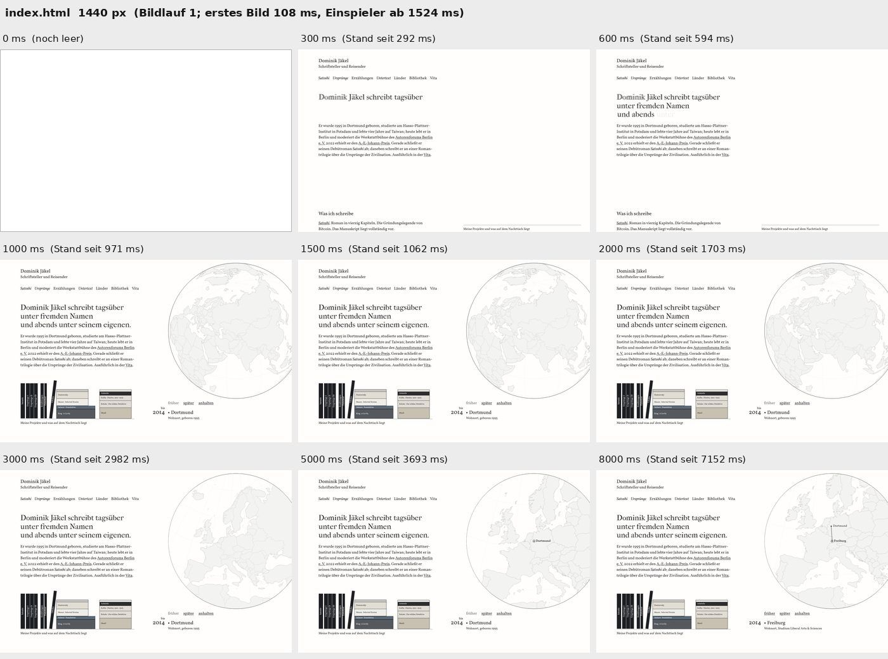
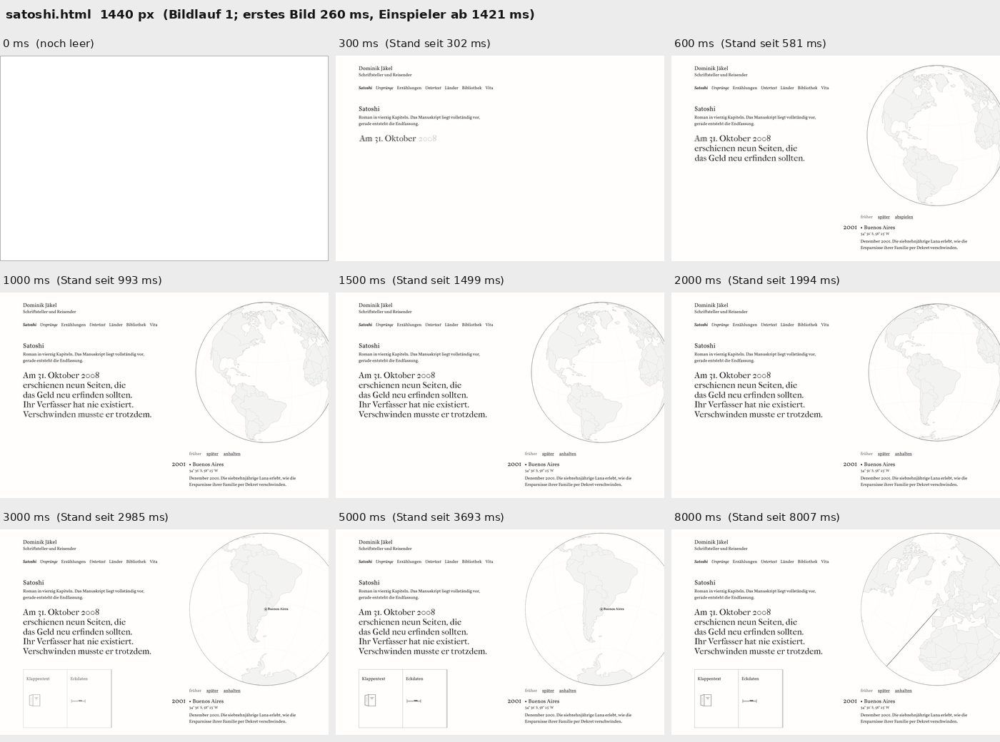

**Ablauf.** Wie oben unter „Heute“.

**Vorteile.**

- Keine Inszenierung; nach gut 1 Sekunde steht alles.
- Der Globus zeigt früh, dass er erzählt.
- Kein Eingriff, kein Risiko.

**Nachteile.**

- Bis zu fünf Bereiche ändern sich innerhalb einer halben Sekunde.
- Der Zeitpunkt hängt vom Rechner ab, nicht von der Gestaltung.
- Die Bewegung beginnt mitten im Lesen (*Satoshi* sogar mitten im Einflug).
- Die Seite springt auf Startseite, Bibliothek und Länder.

### 1. Nur die Bewegung wartet

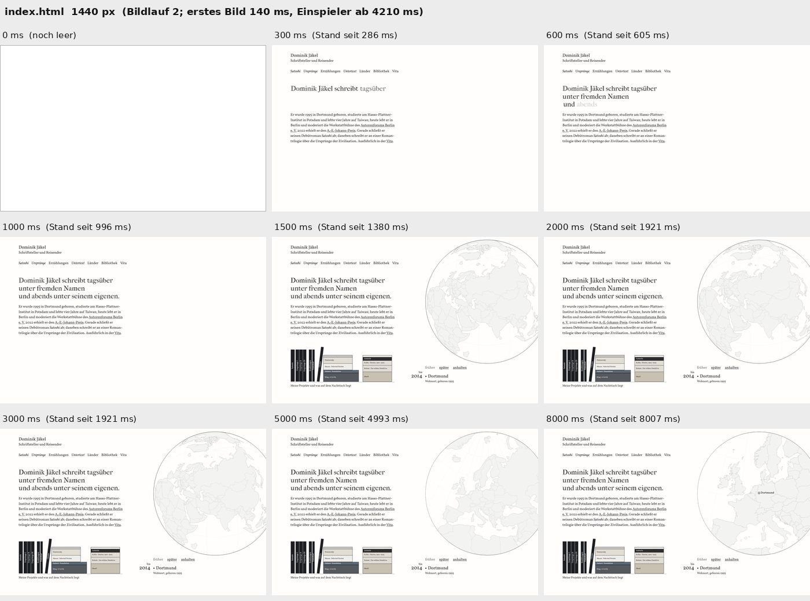
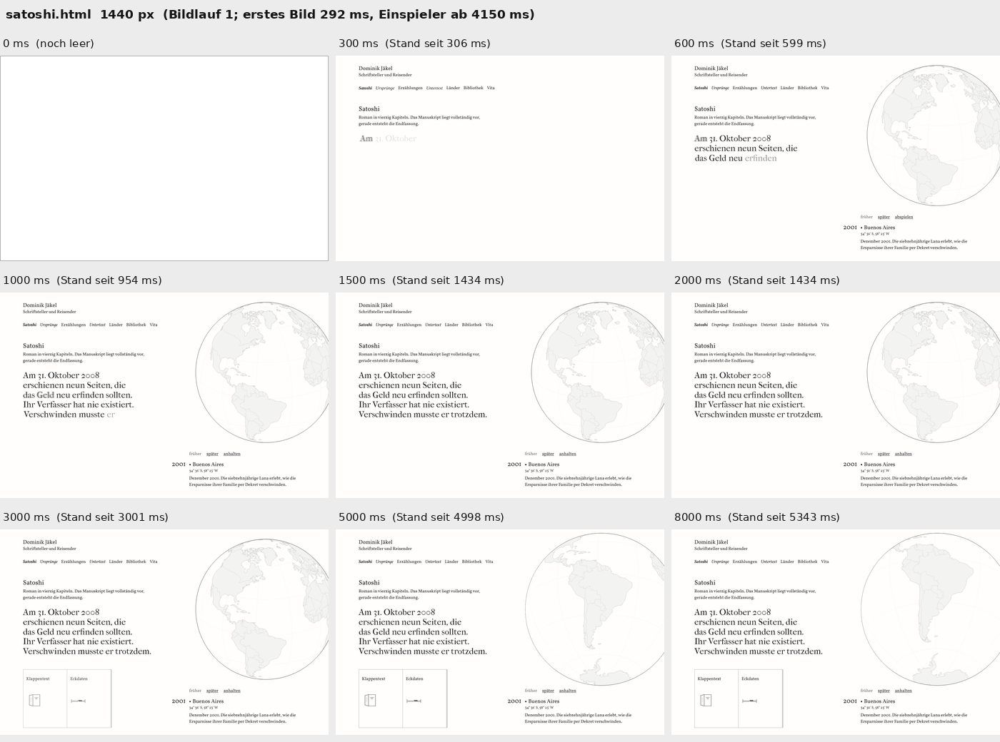

**Ablauf.** Nichts wird eingeblendet. Was das Skript zeichnet, erscheint auf einmal an einem freigehaltenen Platz. Startseite: Globus, Regal und Tafel um 0,7 Sekunden, Einspieler bei 4,1 bis 4,4 Sekunden. *Satoshi*: Globus ab 0,3 Sekunden, Buch 2,1 bis 3,5 Sekunden, Einspieler bei 4,1 Sekunden. *Ursprünge*: Einspieler bei 3,5 Sekunden. Wer klickt, tippt oder rollt, startet die Bewegung sofort.

**Vorteile.**

- Kleinster Eingriff, kürzeste Wartezeit (alles steht nach rund 0,5 bis 1 Sekunde, auch auf schwachen Geräten).
- Der stärkste Blickfänger, der Beginn der Bewegung, fällt nicht mehr ins Lesen.
- So machen es Redaktionen. Kaum Berührung mit Rang 25 und 27.

**Nachteile.**

- Der Globus platzt weiter mitten in den fliegenden Satz, auf der Startseite zusammen mit Regal und Tafel. Dominiks „auch der Globus“ ist nicht erfüllt.
- Gut 3 Sekunden lang steht „anhalten“ unter einer stillen Kugel.

### 2. Globus zuletzt

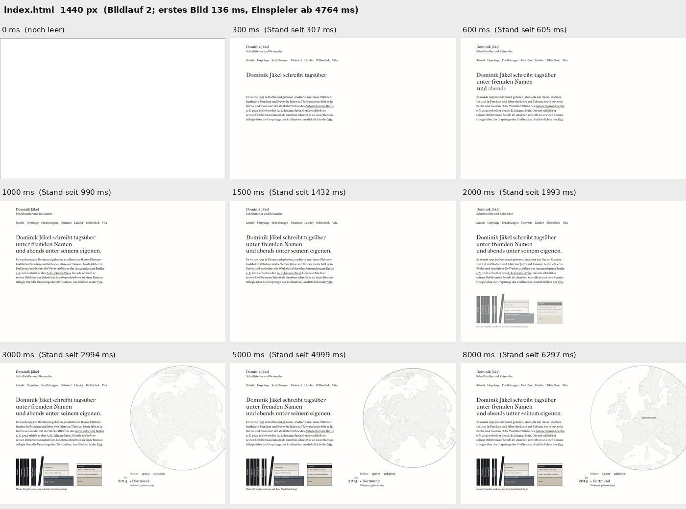
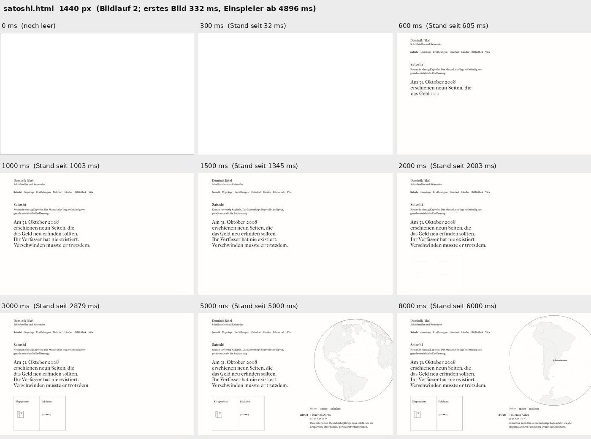
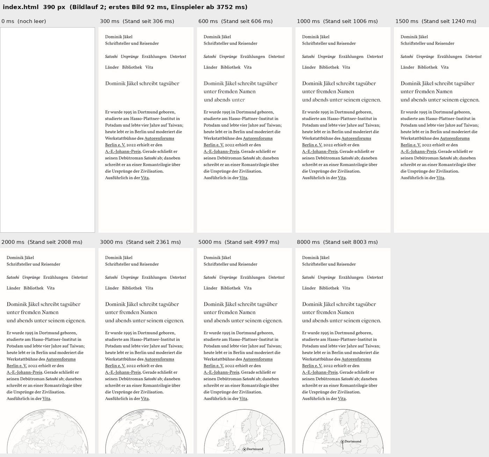
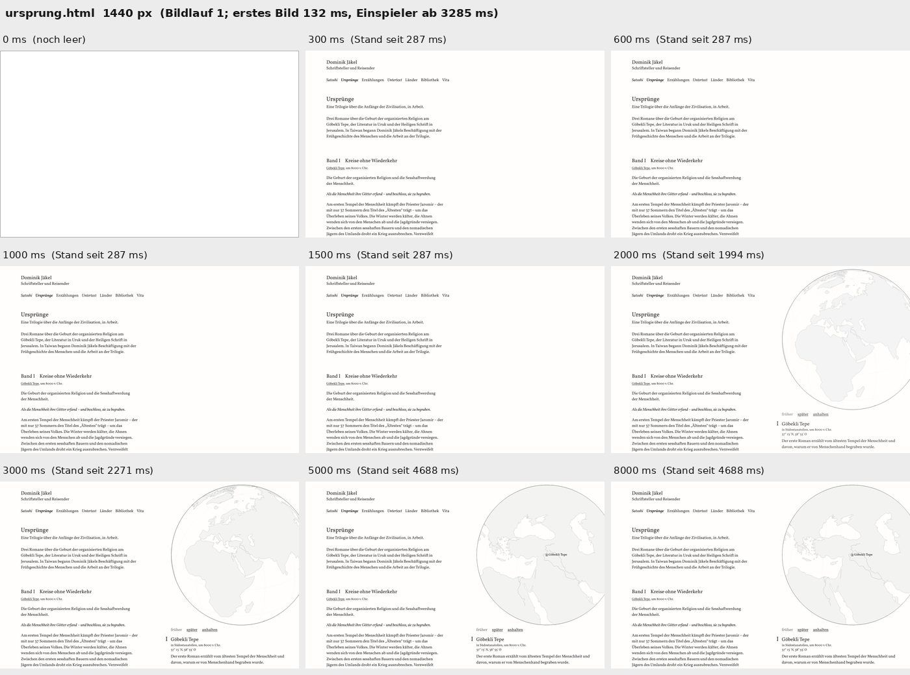

**Ablauf.** Nach dem Textmoment 0,4 Sekunden Pause, dann das Regal (Startseite) oder das Inhaltsbuch (*Satoshi*), 0,3 Sekunden Pause, dann der Globus mit Tafel und Steuerzeile in 0,7 Sekunden, nur über die Deckkraft. Eine Sekunde später beginnt der Einspieler. Startseite: Regal 1,7 bis 2,3 Sekunden, Globus 2,5 bis 3,3 Sekunden, Einspieler 4,6 bis 4,8 Sekunden. *Satoshi*: Buch 1,8 bis 2,8 Sekunden (kürzer als bisher: 0,5 Sekunden Pause und 1,0 Sekunden statt 0,8 und 1,4), Globus 3,1 bis 3,9 Sekunden, Einspieler 4,9 Sekunden. *Ursprünge* und Länder: Globus 1,5 bis 2,2 Sekunden, Einspieler auf *Ursprünge* 3,3 Sekunden. Telefon: Was unter dem ersten Bildschirm liegt, steht sofort; der Globus kommt bei rund 1,6 bis 2,3 Sekunden. Jede Handlung (Taste, Klick, Rollen, Fokus) zeigt sofort alles. Sicherheitsnetz: Nach 5 Sekunden steht alles, ohne Skript nach 6 Sekunden.

**Vorteile.**

- Erfüllt Dominiks Bauchgefühl wörtlich: Text zuerst, der Globus zuletzt.
- In allen Läufen dieselbe Reihenfolge, unabhängig von der Rechnerlast; nie bewegen sich zwei Dinge zugleich.
- Aus zufälligem Hineinplatzen wird ein gewählter, leiser Zeitpunkt. Kein Zoom, kein Hineindrehen, also kein Prunkstück-Auftritt (Rang 27).
- Der Satz hat die erste Bühne für sich.

**Nachteile.**

- Wartezeit: Bis alles steht, vergehen am Desktop rund 3 Sekunden (Startseite) bzw. 3,7 Sekunden (*Satoshi*), heute gut 1 Sekunde. Die rechte Hälfte ist so lange leeres Papier und kann wie „lädt noch“ wirken.
- Die Folge läuft bei jedem Besuch, auch nach der Zurück-Taste. Auf schwachen Geräten kommt der Globus erst nach rund 6 Sekunden, weil die Pausen erst nach dem Skript beginnen.
- Berührt Rang 25 stärker als Variante 1. Darf nicht um weitere Stufen oder um Gleiten wachsen.
- Der erste Klick auf den leeren Globusplatz zeigt nur alles an, erst der zweite bedient die Kugel.
- Das kürzere Buch auf *Satoshi* braucht Dominiks Ja (Vorgabe V77).

### 3. Die Karte füllt sich

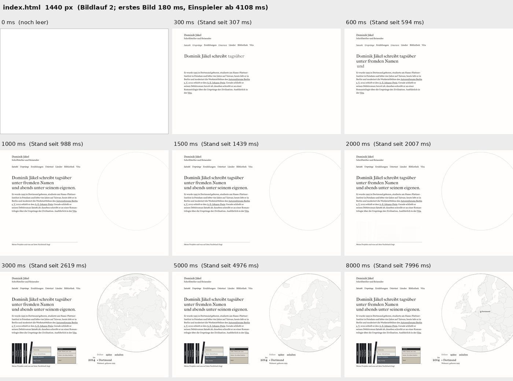
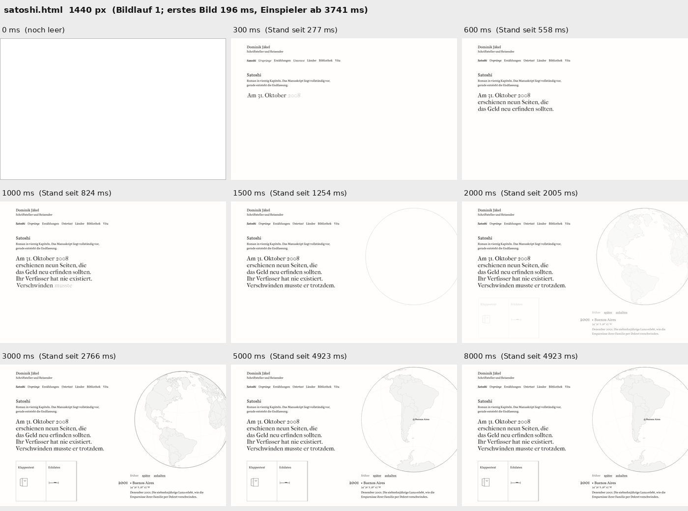

**Ablauf.** Ein blasser Kugelumriss und auf der Startseite das leere Regalbrett halten den Platz. 0,3 Sekunden nach dem Textmoment füllen sich Karte, Tafel, Steuerzeile und Regal oder Buch in einem einzigen Schritt (0,6 Sekunden, nur Deckkraft). Eine Sekunde danach der Einspieler. Startseite: Füllen 1,6 bis 2,2 Sekunden, Einspieler 3,6 Sekunden. *Satoshi*: 1,6 bis 2,6 Sekunden, Einspieler 3,6 Sekunden. *Ursprünge*: 1,4 bis 2,0 Sekunden, Einspieler 3,05 Sekunden.

**Vorteile.**

- Schneller fertig als Variante 2; die rechte Hälfte ist nie ganz leer.
- Ein einziger Schritt statt einer Folge.

**Nachteile.**

- Kreis und leeres Brett wirken wie ein Ladeplatzhalter.
- Am Desktop erscheint der Umriss der Startseite schon während des Einflugs.
- Der Globus kommt nicht allein als Letztes, auf *Satoshi* zugleich mit dem Buch.
- Technisch am heikelsten (der Umriss muss auf den halben Pixel zur Kugel passen).

### 4. Bewegung erst auf Zutun

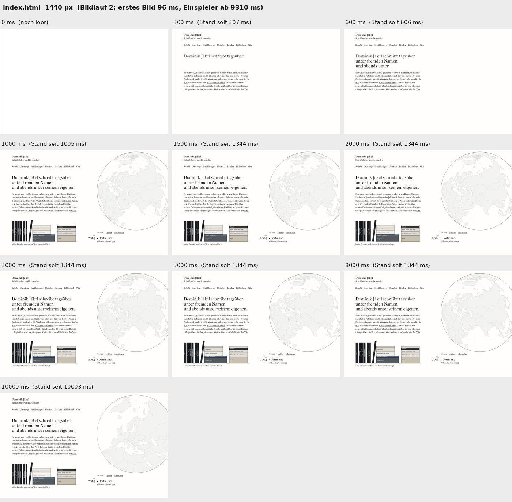
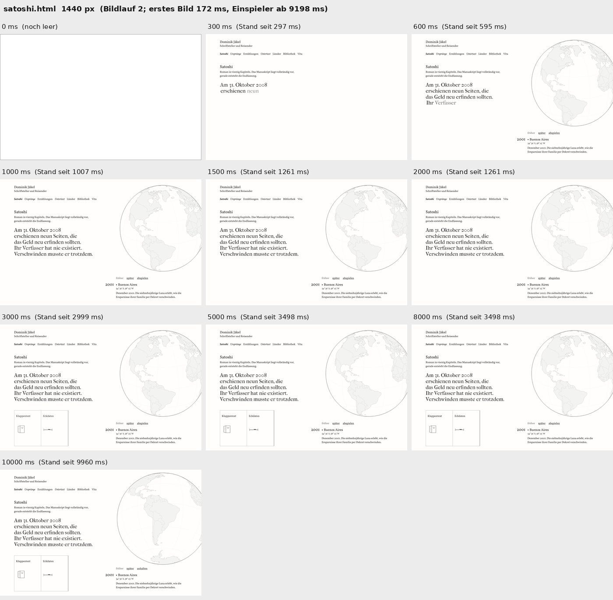

**Ablauf.** Wie Variante 1, alles steht ohne Einblenden. Der Globus bewegt sich erst, wenn der Leser etwas tut (Zeiger über der Kugel, Rollen, Taste, Klick), frühestens nach dem Textmoment, spätestens nach rund 9 Sekunden. Bis dahin steht „abspielen“ in der Steuerzeile.

**Vorteile.**

- Am wenigsten ungefragte Bewegung; so machen es Guardian, Reuters und Pudding.
- „abspielen“ steht ehrlich da, solange die Kugel still ist.

**Nachteile.**

- Nicht vorhersagbar: Eine Mausbewegung über der Kugel startet sie mitten in der Kurzvita; wer still liest, bekommt den Start nach 9 Sekunden am Rand des Blickfelds.
- Der Globus platzt weiter in den Satz.
- Widerspricht Dominiks Vorgabe, dass der Globus von selbst losspringt (V22).

## Rangfolgen der Urteile

Drei unabhängige Prüfer haben alle Varianten selbst geladen und gemessen. Noten von 1 bis 10.

| Platz | Prüfer aus Dominiks Sicht | Externer Gestalter | Prüfer Nutzbarkeit |
|---|---|---|---|
| 1 | 2. Globus zuletzt (8) | 2. Globus zuletzt (8) | 1. Nur die Bewegung wartet (8) |
| 2 | 3. Karte füllt sich (7) | 1. Nur die Bewegung wartet (6,5) | 2. Globus zuletzt (6,5) |
| 3 | 1. Nur die Bewegung wartet (5) | 3. Karte füllt sich (5) | 3. Karte füllt sich (5,5) |
| 4 | 4. Auf Zutun (4) | 4. Auf Zutun (4,5) | 0. So lassen (5) |
| 5 | 0. So lassen (3) | 0. So lassen (3) | 4. Auf Zutun (4) |

Einig sind sich alle drei: „So lassen“ ist nicht gut zu begründen, weil der heutige Ablauf zufällig ist, und die Sprünge gehören in jedem Fall weg. Uneinig sind sie bei der Wartezeit: Gestalter und Prüfer aus Dominiks Sicht nehmen rund 3 Sekunden für die ruhige Reihenfolge in Kauf, der Prüfer für Nutzbarkeit nicht. Wenn Dominik beim Gegentesten die leere rechte Hälfte stört, empfiehlt der Gestalter Variante 1, nicht Variante 3.

## Was vor einer Übernahme von Variante 2 noch zu tun wäre

1. Den ersten Klick auf den noch unsichtbaren Globus an die Kugel durchreichen.
2. Die Pausen an feste Zeitpunkte nach dem Textmoment binden, damit schwache Geräte nicht länger warten als heute.
3. Bei Seitenwechseln innerhalb der Website und nach der Zurück-Taste die Folge stark verkürzen oder weglassen (ohne Browserspeicher, also im Einklang mit der Datenschutzerklärung).
4. Länder ausnehmen: Dort ist der Globus der Inhalt, und es gibt keinen Einflug, der Ruhe bräuchte.
5. Die Vorausrechnung für den Schluss des Einspielers in die stille Pause legen, damit die Bewegung wirklich eine Sekunde nach dem Globus beginnt (heute 1,5 Sekunden auf der Startseite).
6. Dominik fragen, ob das Buch auf *Satoshi* kürzer einblenden darf (0,5 und 1,0 statt 0,8 und 1,4 Sekunden).
7. In `dominik-vorgaben.md` eintragen, dass die Zusage „der Einflug blockiert den Globus nicht“ durch seinen Wunsch vom 23. Oktober ersetzt ist, und `gestaltung-website-c.md` 7.1 und 7.2 neu fassen.

Stand 24. Oktober: erledigt. Punkt 6 entfiel (das Buch erscheint in T2 wieder in 1,4 s wie in V77), Punkt 7 steht in V83 und V13 und in 7.1 und 7.2 von `gestaltung-website-c.md`.
