# Satoshi: das Inhaltsverzeichnis als Buch

Stand: 23. Oktober 2026. Gilt für Version C (`website-c/satoshi.html`), nur für das Inhaltsverzeichnis im ersten Bildschirm. Grundlage ist deine Klarstellung:

> „Also das Buch soll einfach ein Inhaltsverzeichnis, Sprungmarker sein. … Man springt von dort wie in einem Inhaltsverzeichnis zu den einzelnen Elementen der Satoshi-Seite.“

## Kurz gesagt

Die Recherche ist recht eindeutig. Gute Buch- und Autorenseiten setzen ihr Inhaltsverzeichnis als schlichten Text im Wortlaut der Überschriften, und nachgeahmtes Umblättern gilt im Netz seit Jahren als Effekt, dessen Reiz sich schnell abnutzt. Ich empfehle **Variante 4, das kleine Buch, das sich öffnet**. Es ist dein „aufklappbares Buch“, der *Satoshi*-Band aus dem Regal der Bibliothek, und nach einem Klick stehen alle sechs Einträge zugleich da. Zweite Wahl ist **Variante 2, die aufgeschlagene Doppelseite**: Sie bewegt sich nicht, ist typografisch die ruhigste und technisch ohne Risiko. Das größte Risiko für den Livegang morgen liegt auf dem Telefon. Dort ist das Verzeichnis in allen fünf Varianten unsichtbar, solange der Einspieler läuft (der Rundflug der Kugel über die Schauplätze, rund eine Minute) und nachdem jemand auf „später“ getippt hat, bis die Seite neu geladen wird. Das zweite Risiko: Die Drehung des Deckels in Variante 4 ist nur in Chrome geprüft, noch nicht auf einem iPhone. Bei den drei Urteilen liegen der Blick mit deinen Augen und der technische Blick auf Variante 4; der gestalterische Blick setzt Variante 2 vorn, weil sie ein Buch setzt, statt eines zu bauen. Einig sind sich alle drei, dass die Varianten 3 und 5 als Verzeichnis zu viel verstecken.

**Was für alle fünf gilt**

- Auf dem Testlink führt die erste Seite „Varianten für *Satoshi*“ zu allen fünf Fassungen und zu *Satoshi* heute.
- Die Einträge sind genau die sechs Überschriften der Seite. Ein Klick, ein Tipp oder die Eingabetaste springt zum Abschnitt, danach liegt der Tastaturfokus (die Stelle, an der die Tastatur gerade arbeitet) auf dessen Überschrift. Es gibt keine neuen Wörter, keine Auszüge und keine Seitenzahlen.
- Der Aufhänger („Am 31. Oktober 2008 …“) ist wieder so groß wie in Option B: 38 px bei 1440 × 900, 31 px bei 1280 × 800. Er wächst nicht mehr mit der Fensterhöhe. „Klappentext“ steht am Desktop überall an derselben Stelle wie heute.
- Am Desktop steht das Verzeichnis in der weißen Fläche unter dem Aufhänger, auf dem Telefon unter dem Globus in der freien Fläche unter „Die Schauplätze“. Diese Fläche hält die Tafel (der Text unter der Kugel) für ihre längste Szene frei, damit beim Abspielen nichts springt.
- Wer die Bewegung im System abgeschaltet hat („Bewegung reduzieren“), sieht jeden Wechsel sofort und ohne Drehung. Mit der Tastatur erreicht man alle sechs Einträge. Ein Vorleseprogramm (die Software, die Blinden die Seite vorliest) hört eine Liste mit sechs Verweisen. Ohne JavaScript steht eine schlichte Liste da.
- Ich habe heute alle fünf im Testbau geprüft, bei 1440 × 900 und auf dem Telefon bei 390 × 844: Jede lädt ohne Fehler, blättert oder öffnet sich, und jeder Sprung landet an der richtigen Überschrift.

Die Bilder zeigen jeweils den ersten Bildschirm bei 1440 × 900, vier Sekunden nach dem Laden, und das Telefon bei 390 × 844 in Ruhe. Bei den Varianten 3 bis 5 zeigt ein drittes Bild einen weiteren Zustand.

## Die fünf Varianten

### 1. Inhaltsseite im Buchsatz

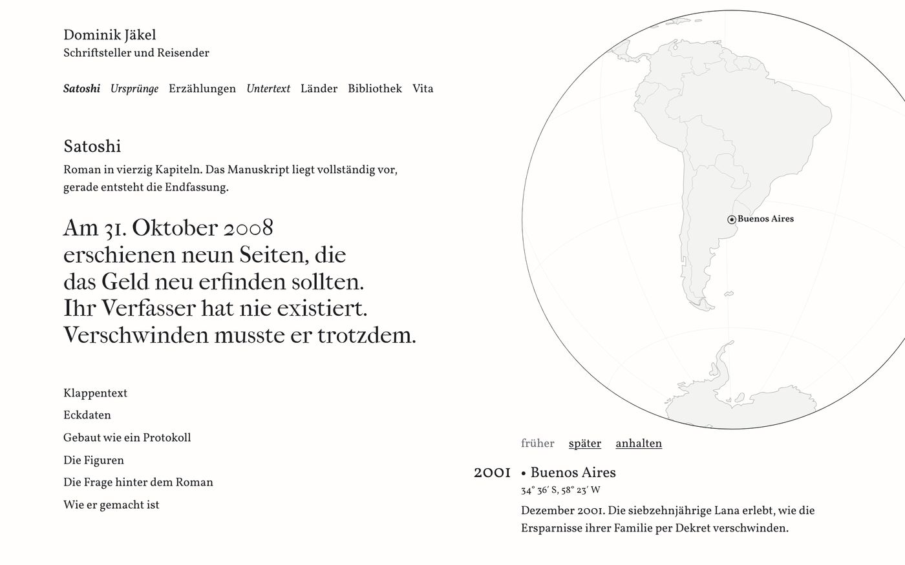
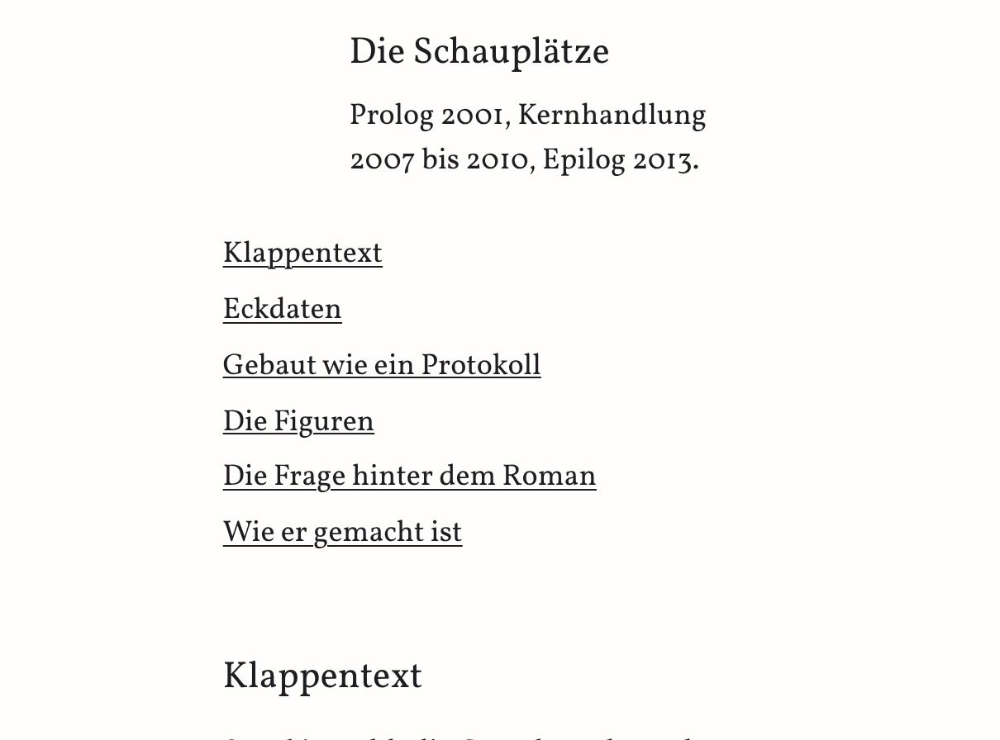

**Was sie tut.** Die sechs Überschriften stehen untereinander wie auf der Inhaltsseite eines gedruckten Romans, im Lesegrad (19 px), in Tinte, ohne Nummern und ohne Punkte. Nichts bewegt sich.

**Vorteile.** Ehrlich und klar. Sie ist die stabilste und zugänglichste Fassung, und als einzige hat sie auf dem Telefon die empfohlenen 44 px Trefferfläche (die Fläche, die ein Finger treffen muss). Tastatur und Vorleseprogramm folgen genau der Reihenfolge der Seite.

**Nachteile.** Ein Buch ist hier nicht zu sehen. Es ist die Liste, die du schon kennst („7 und 1“), nur größer. Auf dem Telefon wirken die sechs unterstrichenen Zeilen wie ein Block von Verweisen, und die Seite wird bei 390 px Breite um 39 px länger.

**Aufwand.** Klein. Eine Liste und einige Zeilen Stil, rund eine Stunde mit Prüfung. Danach ist nichts zu pflegen.

### 2. Aufgeschlagene Doppelseite

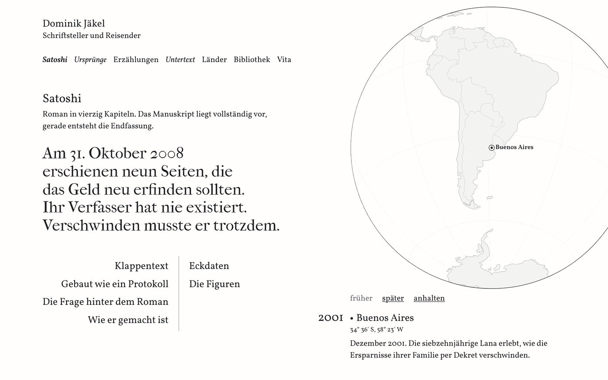
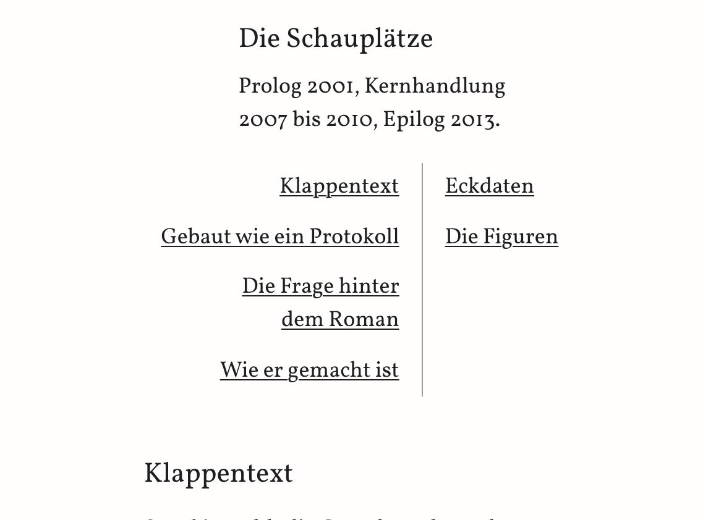

**Was sie tut.** Das Verzeichnis als aufgeschlagenes Buch, nur aus Satz und einem Falz (der Mittellinie eines aufgeschlagenen Buchs). Links stehen die vier Abschnitte, die weiter unten links stehen, rechtsbündig an den Falz geschoben. Rechts stehen Eckdaten und Die Figuren. Am Desktop sind die Einträge so groß wie die Überschriften, zu denen sie führen. Alle sechs sind sofort zu sehen. Nichts bewegt sich.

**Vorteile.** Typografisch die stärkste Fassung am Desktop: ruhig, literarisch, gesetzt statt gebaut. Der Falz ist so hell wie die Küsten auf der Kugel und die einzige Linie. Technisch die robusteste Fassung mit Buchbezug: kein Skript, keine Drehung, nichts, was in Safari anders laufen könnte.

**Nachteile.** Es blättert nichts, und das Buch erkennt nur, wer den Falz als Buchmitte liest. Die Reihenfolge links, dann rechts, entspricht nicht der Folge der Seite; auf dem Telefon, wo darunter alles in einer Spalte steht, ist sie sogar falsch. Die linke Seite ist vier Zeilen hoch, die rechte zwei, darum liest man es leicht als Tabelle. Auf dem Telefon wird die Seite um 13 px länger.

**Aufwand.** Klein. Ein CSS-Raster und eine Linie, rund eine Stunde. Will man die Folge richtigstellen (drei links, drei rechts), kommt eine halbe Stunde dazu.

### 3. Doppelseiten zum Durchklicken

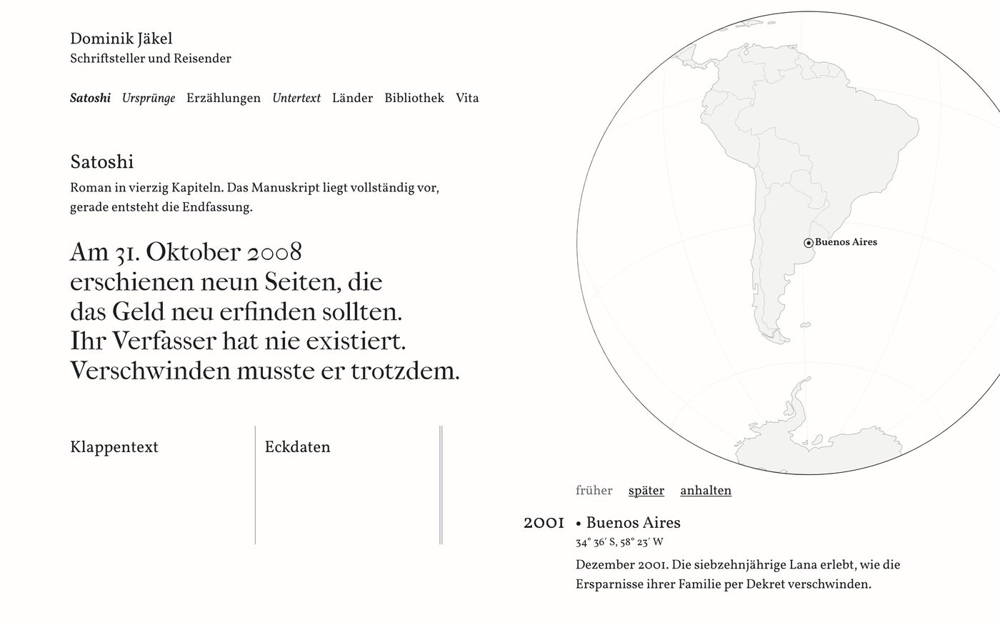
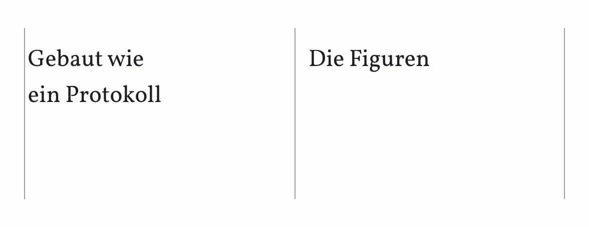
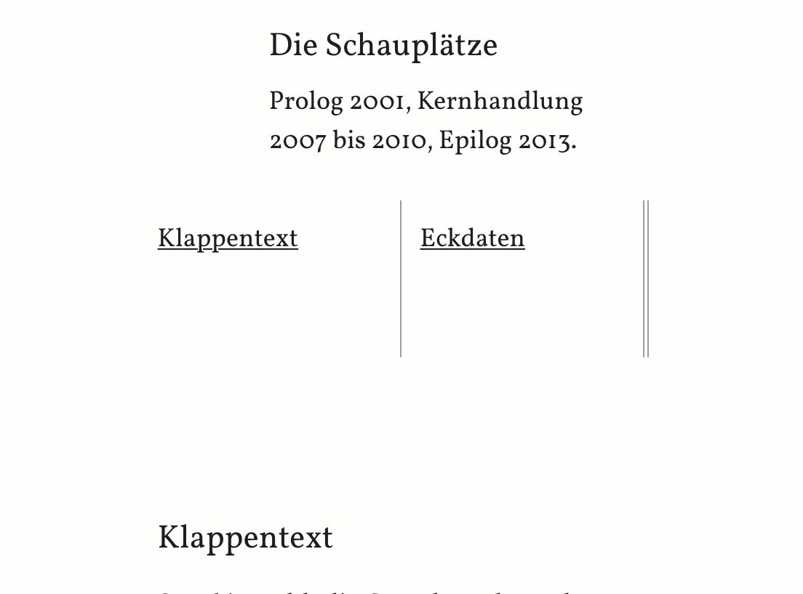

**Was sie tut.** Jede Überschrift steht allein auf einer Seite, je zwei bilden eine Doppelseite. Man klickt auf die rechte Hälfte, wischt oder drückt die Pfeiltasten und kommt zur nächsten, insgesamt drei. Der Wechsel ist ein flaches Gleiten, kein Umschlagen.

**Vorteile.** Das Blättern ist echtes Rollen des Browsers, darum funktionieren Wischen, Tastatur und Vorleseprogramm von selbst. Auf dem Telefon passt es ohne Zuwachs in die freie Fläche.

**Nachteile.** Es sieht weder wie ein Buch aus, noch blättert es wie eins. Zu sehen sind zwei Fächer mit grauen Linien, und die doppelten Striche am Rand wirken wie eine Bildlaufleiste. Immer sind nur zwei von sechs Einträgen sichtbar, vier stecken hinter Klicks. Das ist der Haupteinwand gegen Karussells (Bildstreifen, die man durchklickt), und ein Verzeichnis lebt vom Überblick. Auf dem Telefon bleiben darunter rund 110 px weiß. Wischen mit dem Trackpad am Mac ist nicht verlässlich geprüft.

**Aufwand.** Mittel. Rund 70 Zeilen mehr als Variante 1, vor allem Skript für den Stand des Streifens, Pfeiltasten und Klicks, dazu Tests in Safari. Wenig Gewinn für die Pflege, die es braucht.

### 4. Das kleine Buch, das sich öffnet (empfohlen)

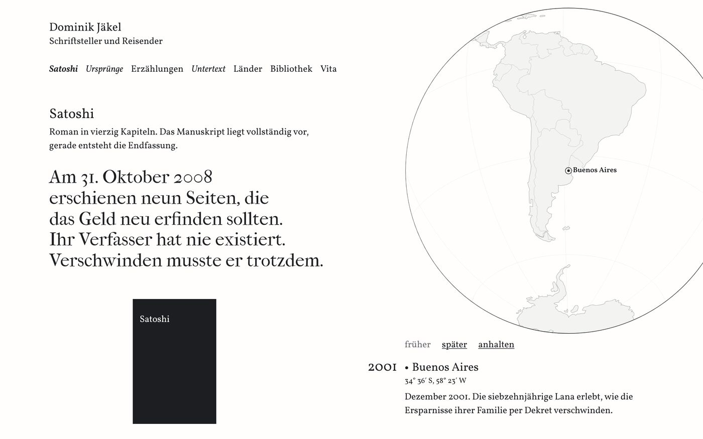
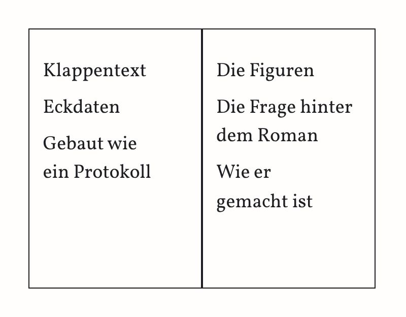
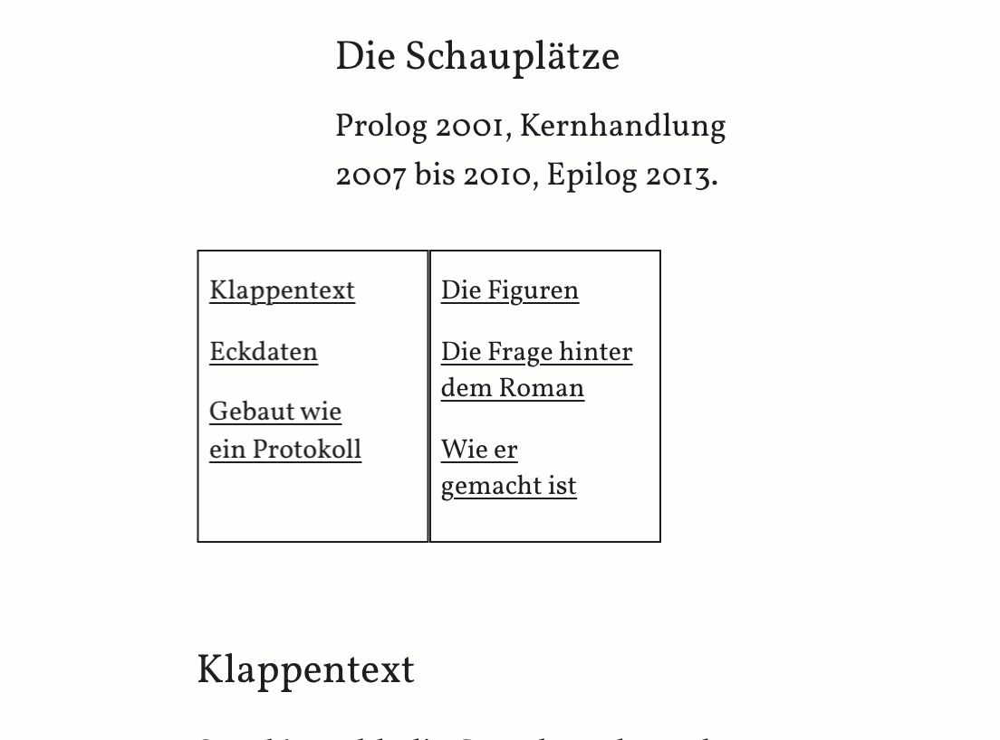

**Was sie tut.** In der weißen Fläche liegt der *Satoshi*-Band aus dem Regal der Bibliothek: Tinte, der Titel in Papier, so hoch wie sein Rücken dort. Ein Klick auf den Deckel oder der erste Druck auf die Tabulatortaste schlägt ihn auf. Der Deckel dreht sich einmal um den Falz nach links, in 0,4 s. Innen steht das ganze Verzeichnis, drei Einträge links, drei rechts. Danach bleibt das Buch offen. Es öffnet sich nie von selbst.

**Vorteile.** Du erkennst darin sofort deine Idee, und offen ist es das, was du verlangt hast: ein Inhaltsverzeichnis mit allen sechs Sprungmarken zugleich. Verspielt, aber nicht süß; die Bewegung läuft einmal und nur, wenn man es will. Das Buch ist kein erfundener Gegenstand, sondern derselbe Band wie im Regal, mit seinen echten Maßen. Technisch wenig Mechanik: eine Drehung im Stil, zwei Ereignisse im Skript, ein Zustand (offen oder zu), rund 40 Zeilen mehr als Variante 1. In allen Größen von 1024 bis 2560 px Breite und auf dem Telefon von 320 bis 430 px passt es in die Fläche, ohne dass etwas verrutscht.

**Nachteile.** Geschlossen ist es ein schwerer schwarzer Block, und er steht eingerückt statt an der Kante des Aufhängers (gut zu sehen im ersten Bild). Beim Laden zeigt das Verzeichnis noch nichts. Offen wirken die Rahmen in Tinte und der doppelt dicke Falz eher wie eine Tabelle als wie Papier. Auf dem Telefon und bei 1280 × 800 steht der Text klein (15 px), „Wie er / gemacht ist“ bricht unschön um, und die Trefferflächen sind nur 21 px hoch. Mit der Tastatur ist der Fokusrahmen in den ersten 0,2 s nicht zu sehen, weil die Innenseite noch abgewandt ist. Unter den KI-Merkmalen ist Rang 52 (nachgebaute Papiergegenstände) das Hauptrisiko; dagegen stehen die echten Maße und die eine Stelle.

**Aufwand.** Mittel. Die Fassung steht. Für den Livegang würde ich vier Dinge nachziehen, zusammen zwei bis drei Stunden: das Buch an die Kante des Aufhängers rücken, die Rahmen heller zeichnen, die Trefferflächen auf dem Telefon auf 44 px bringen und beim ersten Tab ohne Drehung öffnen. Dazu einmal auf einem echten iPhone tippen.

### 5. Das Buch zum Umblättern

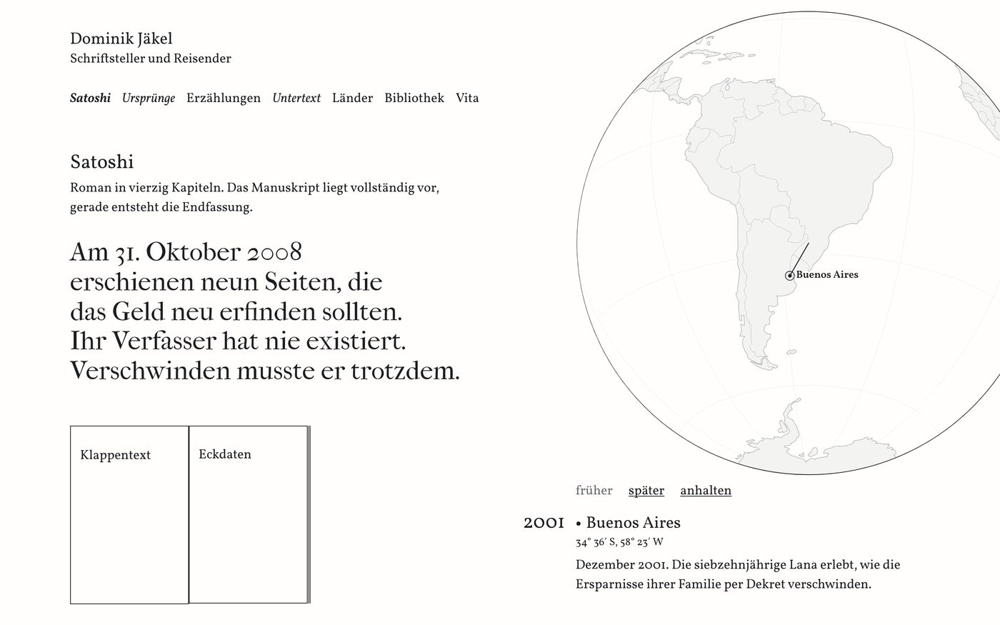
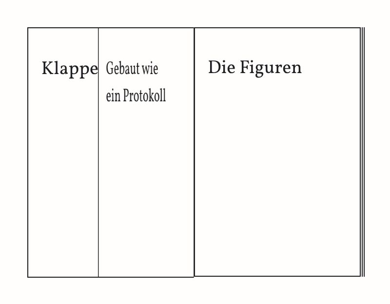
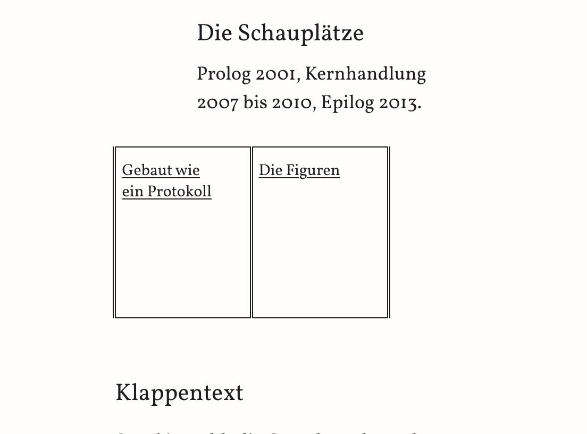

**Was sie tut.** Dasselbe kleine Buch wie in Variante 4, aber jede Seite trägt genau einen Eintrag, wie ein Zwischentitel. Man schlägt den Deckel und dann zwei Blätter um, mit Klick, Wischen oder Pfeiltasten. Jedes Blatt dreht sich steif, ohne Wölbung und ohne Schatten. Am Rand zeigen feine Striche, wie viele Blätter noch auf jeder Seite liegen.

**Vorteile.** Hier wird dein Wort „durchblättern“ am wörtlichsten eingelöst, und das Umschlagen macht im ersten Moment die meiste Freude. Technisch ist es sorgfältig gebaut: Kein Blatt scheint durch, der Fokus der Tastatur folgt dem Blättern, und ohne Bewegung wechselt die Seite sofort.

**Nachteile.** Als Verzeichnis taugt es am wenigsten. Geschlossen zeigt es nichts, offen zwei von sechs Einträgen, alle erst nach drei Wenden. Wer zu „Die Figuren“ will, muss erst blättern. Die Seiten mit je einem Wort sind zu drei Vierteln leer. Neben der Kugel ist es ein zweites Spielzeug im ersten Bildschirm, und der Reiz nutzt sich beim zweiten Besuch ab. Während der Drehung ist der Text unscharf. Es hat den meisten Code der fünf, und die Drehung mehrerer Blätter ist in Safari nicht geprüft.

**Aufwand.** Hoch. Rund 120 Zeilen mehr als Variante 1, dreimal so viel wie Variante 4: Stand, Reihenfolge der Blätter, Wischen und Verzögerungen. Jede spätere Änderung an Einträgen oder Größen berührt diese Logik. Für morgen würde ich es nicht nehmen.

## Was vor dem Livegang offen ist

- **Telefon: Verzeichnis unsichtbar.** In allen fünf Varianten tritt das Verzeichnis zurück, solange die Tafel eine Szene zeigt. Beim Laden läuft der Einspieler; ich habe heute bei 390 × 844 gemessen, dass das Buch erst nach 56 s erscheint, sobald die Kugel im Bild ist. In meinem Test beendete ein Tipp oder ein kurzes Wischen auf die Kugel den Einspieler auf dem Telefon nicht. Nach einem Tipp auf „später“ bleibt es weg, bis die Seite neu geladen wird. In dieser Zeit erreichen es auch Tastatur und Vorleseprogramm nicht. Zwei Wege: Die Tafel kehrt in Ruhe zurück, sobald die Kugel aus dem Bild gerollt ist; oder das Buch steht immer sichtbar direkt unter der Tafel, das kostet rund 160 px Seite. Das solltest du entscheiden.
- **Tastatur am Desktop.** Das Verzeichnis steht im Aufbau der Seite nach der Kugel. Man braucht darum 13 Tabulatorschritte über Kugel und Steuerzeile, bis man im Verzeichnis ist, obwohl es sichtbar links oben steht.
- **iPhone.** Die Drehung von Variante 4 und 5 ist nur in Chrome geprüft. Vor dem Livegang einmal auf einem echten iPhone den Deckel und alle sechs Einträge antippen, mit und ohne „Bewegung reduzieren“.
- **Arbeitskopie.** In `website-c/satoshi.html` steht schon ein anderes, nicht eingechecktes Buch eines anderen Arbeitsgangs, mit einem Knopf „zuschlagen“. Vor der Übernahme klären, welches gilt.

## Die drei Urteile

Drei getrennte Prüfungen haben die fünf gebauten Varianten bewertet: eine mit deinen Augen (trifft es, was du wolltest?), eine gestalterische und eine technische. In Klammern die Note von 10.

| Rang | Mit deinen Augen | Gestaltung | Technik |
|---|---|---|---|
| 1 | 4. Das kleine Buch (8) | 2. Doppelseite (7,5) | 4. Das kleine Buch (7,5) |
| 2 | 5. Zum Umblättern (7) | 4. Das kleine Buch (6,5) | 2. Doppelseite (7,5) |
| 3 | 2. Doppelseite (6,5) | 1. Inhaltsseite (6) | 1. Inhaltsseite (7) |
| 4 | 1. Inhaltsseite (4,5) | 5. Zum Umblättern (4,5) | 5. Zum Umblättern (5,5) |
| 5 | 3. Zum Durchklicken (4) | 3. Zum Durchklicken (3,5) | 3. Zum Durchklicken (5) |
