# *Satoshi* am Desktop: Optionen für den Raum neben der Kugel

Stand: 22. Oktober 2026. Gilt für Version C (`website-c/satoshi.html` und `website-c/ursprung.html`). Grundlage ist deine Rückmeldung zu Runde 5:

> „Ich würde doch wieder zur Vorgängerversion. Du hast den Klappentext jetzt hochgezogen. Vielleicht kannst du es auch nochmal anders spacen. Also ich glaube, wenn da etwas Leerraum ist, ist es kein Problem …“
>
> „Am 31. Oktober 2008 erschienen neun Seiten, die das Geld neu erfinden sollten. Ihr Verfasser hat nie existiert. Verschwinden musste er trotzdem. (Vielleicht könnte das auch einfach größer sein und einfliegen?)“
>
> „Vorher war es einfach etwas eleganter … ich weiß nicht, nur der Leerraum hat etwas gestört. Kannst du mir nochmal ein paar andere Optionen geben, wie man den Leerraum sinnvoll füllen könnte, UX-technisch?“

## Meine Empfehlung

Ich empfehle **B**: die Lage aus Runde 4 und dein Aufhänger groß in der IM Fell French Canon, einfliegend wie der erste Satz der Startseite. Das ist dein eigener Vorschlag und bleibt der Fassung, die du eleganter fandest, am nächsten, weil nichts Neues auf die Seite kommt. Der große Satz hält der Kugel das Gewicht, und der Raum unter ihm (bei 1440 × 900 rund 340 px) ist kaum größer als der unter dem ersten Satz der Startseite (rund 310 px), er gehört damit zum Rhythmus der ganzen Website. Den Einflug würde ich auf die Startseite und *Satoshi* beschränken, die Seite, auf der Agenturen und Verlage über einen Link im Exposé zuerst landen können, und ihn auf die rund 1 s der Startseite straffen (in B dauert er 1,3 s, weil der Aufhänger 21 statt 12 Wörter hat). Dass der Aufhänger größer ist als der Titel, halte ich für richtig: Der Titel steht weiter zuerst und in der Navigation, und der Satz ist das, was man von dieser Seite behalten soll. Zweite Wahl ist **C**, falls dich der Raum auch in B noch stört: Der gekürzte Absatz füllt die Spalte bis rund 700 px und bringt die Frage des Romans schon in den ersten Bildschirm, dafür wird es dichter, und dein Absatz steht je nach Breite in zwei Fassungen. A verlegt den Leerraum nur zwischen Titel und Aufhänger (bei 1920 × 1080 rund 600 px), D, E und F füllen ihn mit Dingen, die weiter unten besser stehen, und F bricht bei 1280 bis 1440 px die Navigation in zwei Zeilen. Auf den *Ursprüngen* würde ich die Kugel **haften lassen**. Dort gehört jeder Band zu einem Ort, und die Leselinie führt die Kugel beim Lesen von Göbekli Tepe bis Jerusalem; auf *Satoshi* hängen Klappentext und Figuren an keinem Ort, darum steht die Kugel dort zu Recht still. Ohne Haften wäre rechts ab Band II die ganze Spalte leer, also genau die Art Leerraum, die dich auf *Satoshi* stört.

Unten stehen sechs Möglichkeiten (A bis F), jede mit Bildern, dazu der heutige Stand zum Vergleich. Am Ende geht es um deine Frage zu den *Ursprüngen*: Die Kugel wandert dort mit, und auch dazu gibt es Bilder von beiden Fassungen.

**Was für alle Optionen gilt**

- Es geht nur um die breite Ansicht mit zwei Spalten (ab rund 1000 px Fensterbreite). **Auf dem Telefon bleibt alles, wie es ist.** Das habe ich bei 390 × 844 nachgemessen: A, D, E und F sind dort Bildpunkt für Bildpunkt gleich wie heute. Bei B und C weicht der Aufhänger um Bruchteile eines Bildpunkts ab, weil er in einzelne Wörter zerlegt ist; die Zeilen brechen gleich, und er fliegt dort nicht.
- Kein Wort ist geändert. Texte sind nur verschoben oder in der Größe verändert. Einzige Ausnahme ist C, das deinen gekürzten Absatz „Wer war Satoshi Nakamoto wirklich? …“ aus Runde 5 wieder verwendet.
- Alle Optionen gehen auf die Lage aus Runde 4 zurück: Der Klappentext beginnt erst unter der Kugel, links, auf einer Höhe mit dem Abschnitt rechts (den Eckdaten, in E den Figuren). Außer in C steht dann auch der volle Absatz „Doch mit welcher Konsequenz? Wer war Satoshi Nakamoto wirklich? …“ wieder an seinem Platz unter „Die Frage hinter dem Roman“, und der gekürzte oben fällt weg. Die Texte sind die von heute (Runde 5 und 6), nur die Anordnung ist die von Runde 4.
- Die Bilder zeigen den ersten Bildschirm bei 1440 × 900, dieselbe Seite eine Bildschirmhöhe weiter unten, und den ersten Bildschirm bei 1280 × 800 und 1920 × 1080. Die Kugel steht überall vier Sekunden nach dem Laden, mitten im Einspieler bei der ersten Szene (Buenos Aires, 2001).

---

### Jetzt. Runde 5 und 6, zum Vergleich

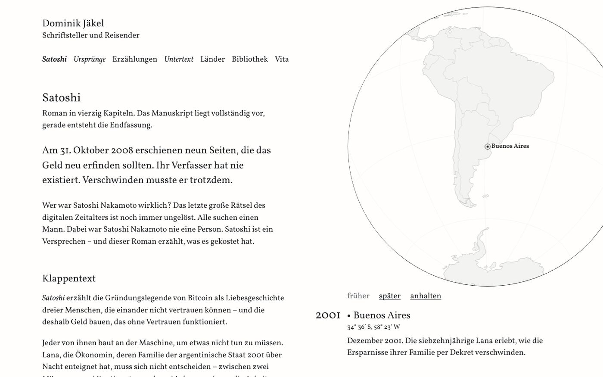
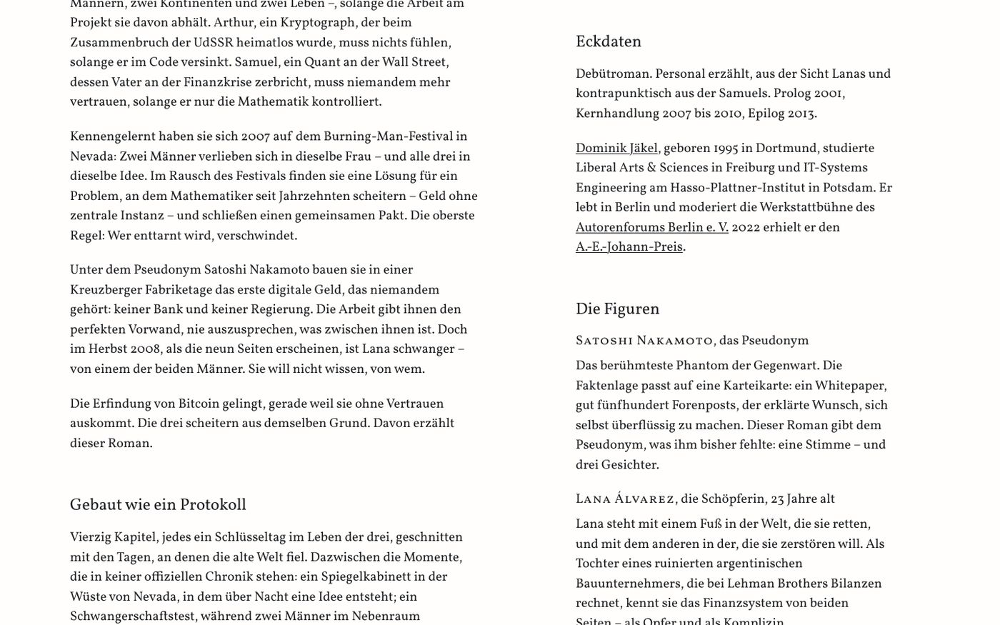
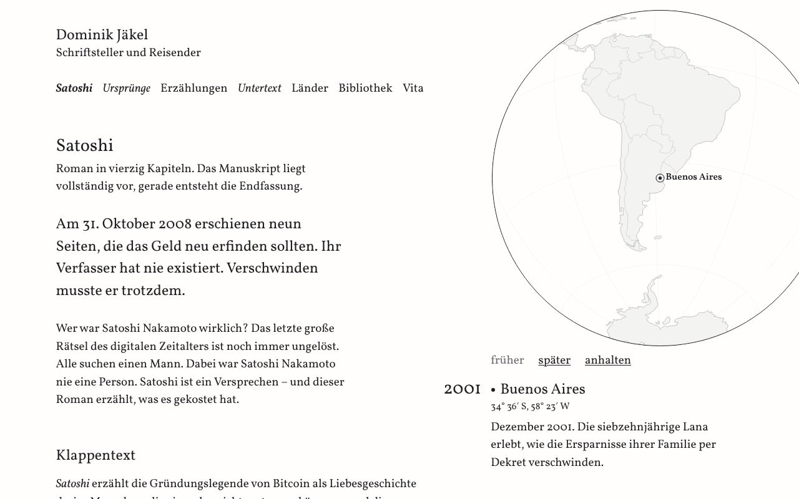
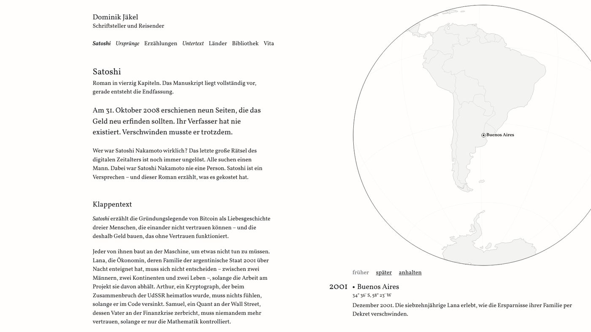

Links stehen Titel, Aufhänger, der gekürzte Absatz und gleich danach der Klappentext. Es gibt keine Lücke mehr, aber links läuft der Lesetext schon neben der Kugel los, während rechts noch Kugel und Tafel stehen. Das ist die Lage, die du „hochgezogen“ genannt hast.

### A. Wie vorher, besser gespaced

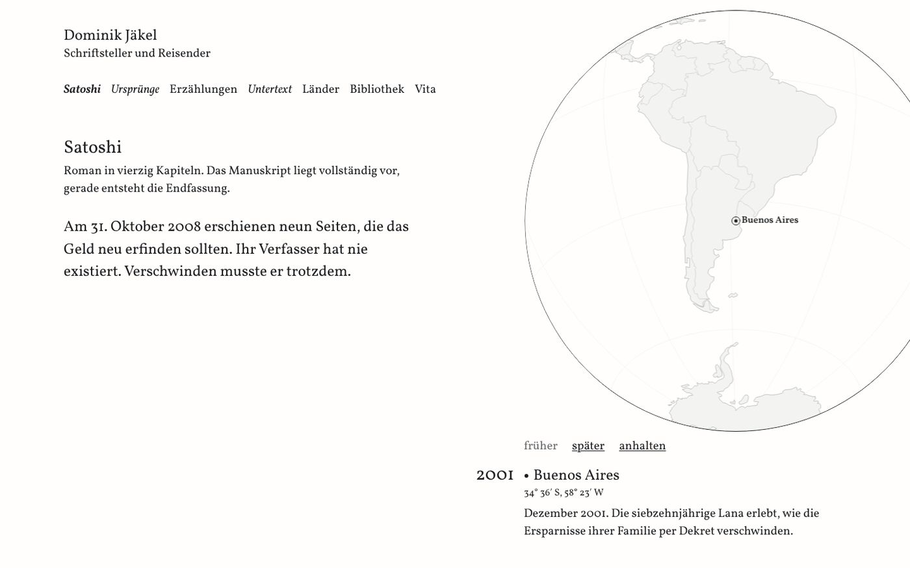
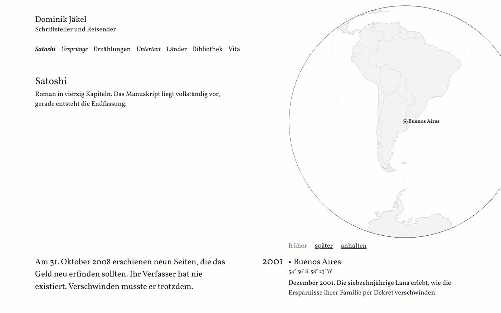

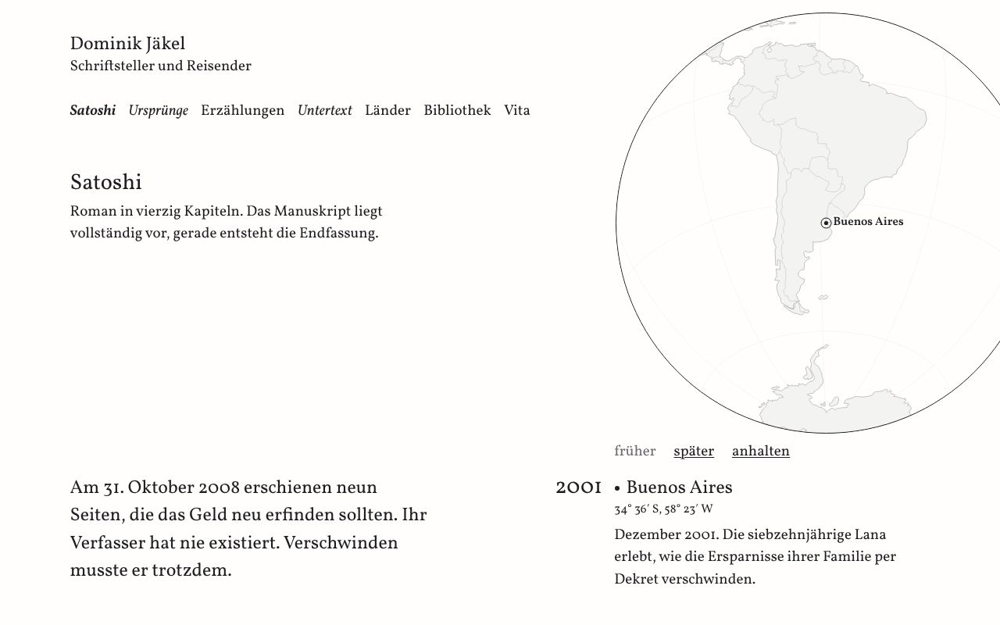
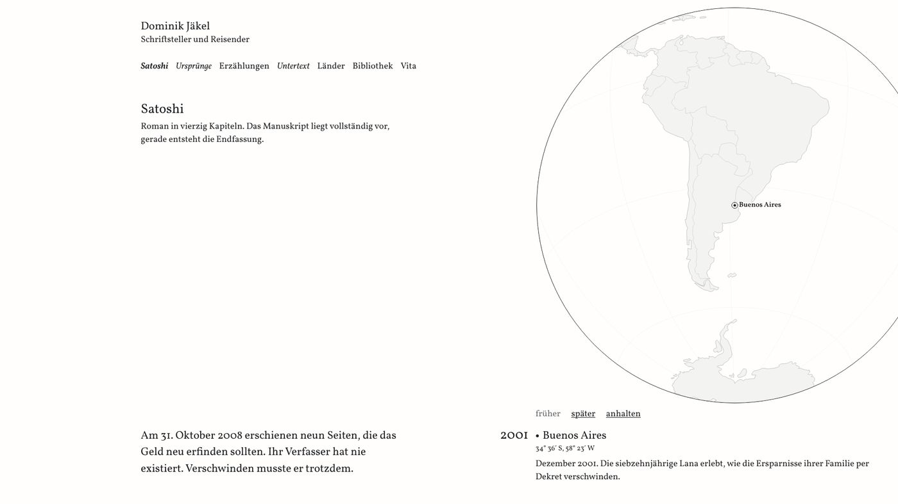

**Was sich ändert.** Die Lage von Runde 4, mit einer Änderung: Der Aufhänger rückt nach unten. Seine erste Zeile steht auf derselben Linie wie die Kopfzeile der Tafel („2001 • Buenos Aires“); beide haben denselben Schriftgrad, die Grundlinien liegen genau übereinander. Oben bleiben Titel und Unterzeile. Der freie Raum liegt jetzt zwischen Titel und Aufhänger und ist auf allen Seiten gefasst: oben der Titel, unten der Aufhänger, rechts die Kugel. Unten im ersten Bildschirm stehen Aufhänger und Tafel als ein Band nebeneinander, darunter folgt der Klappentext wie in Runde 4. Das gilt für jede Breite mit zwei Spalten, weil die Lage aus denselben Maßen kommt wie die Kugel.

**Dafür.** Am nächsten an der Fassung, die du eleganter fandest. Der Leerraum wirkt gewollt, wie auf einer Titelseite, und nicht wie etwas, das fehlt. Der Aufhänger führt unmittelbar in den Klappentext. Nichts Neues kommt auf die Seite.

**Dagegen.** Der Raum bleibt leer, er ist nur anders verteilt (bei 1440 × 900 rund 400 px zwischen Unterzeile und Aufhänger, bei 1920 × 1080 rund 600 px). Titel und Aufhänger sind getrennt; wer nur oben liest, sieht den Aufhänger erst beim zweiten Blick. Bei 1280 × 800 steht der Aufhänger sehr weit unten im Bild. In der Entwurfsseite springt der Aufhänger beim Laden einmal um rund 160 px nach unten, sobald die Tafel ihren Text bekommt (bei 1440 × 900 gemessen); im Bau müsste die Höhe der Tafel vorher reserviert werden.

**Aufwand.** Klein. Zwei Regeln im Stil der Seite, dazu die Regeln und der Absatz aus Runde 5 entfernen. Etwa eine halbe Stunde mit Prüfung.

### B. Aufhänger groß und einfliegend

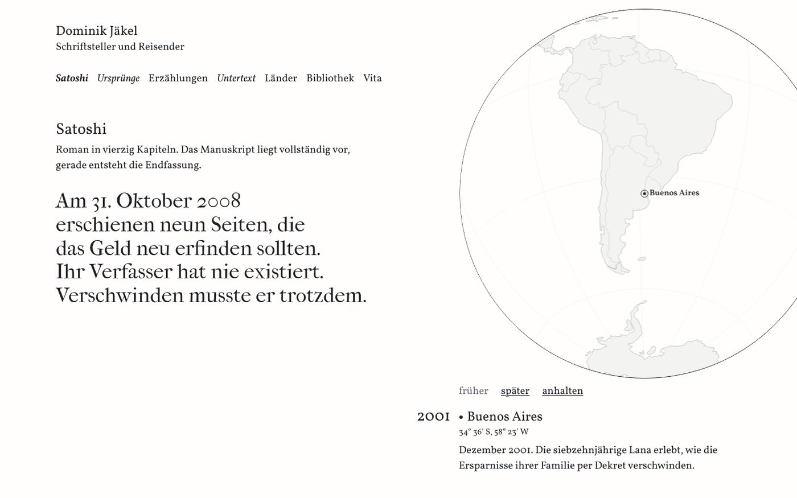
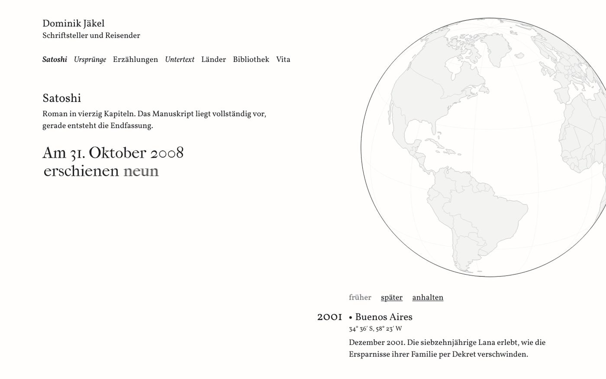
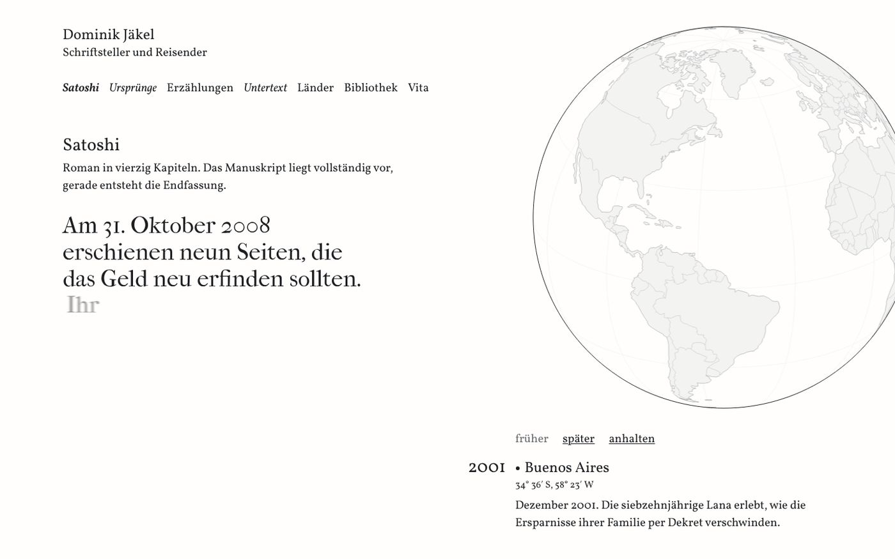
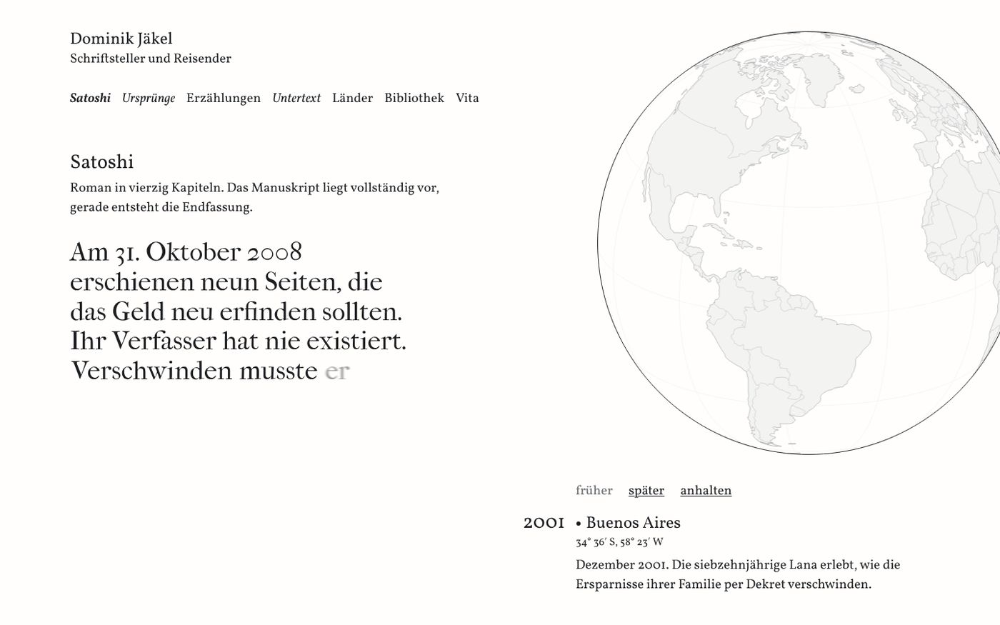

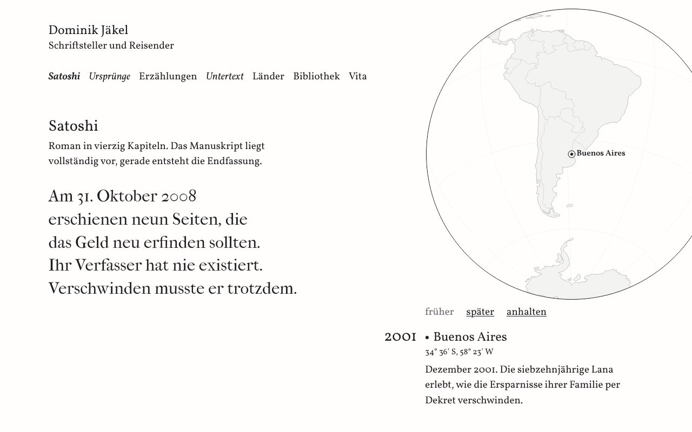
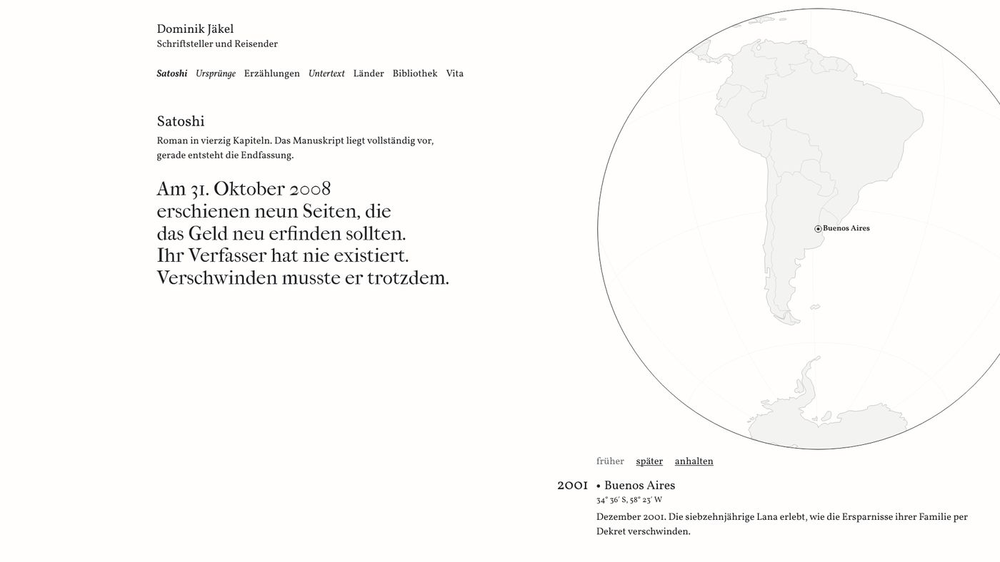

**Was sich ändert.** Der Aufhänger steht wie der erste Satz der Startseite: IM Fell French Canon, 38 px, Zeilenabstand wie dort 42,75 px (anderthalb Zeilen des Lesetexts). Jeder der drei Sätze beginnt eine neue Zeile, der erste ist ausgeglichen umbrochen. Beim Laden fliegt er Wort für Wort von rechts ein, mit derselben Mechanik und demselben Takt wie auf der Startseite (Weg 0,2 em, je Wort 0,36 s, leichte waagrechte Unschärfe, die beim Ankommen vergeht). Er braucht rund 1,3 s und wartet höchstens 0,6 s auf seine Schrift. Bei reduzierter Bewegung steht er sofort da, Vorleseprogramme lesen ihn als einen Satz. Der Platz ist von Anfang an reserviert, nichts springt. Passen die beiden kurzen Sätze nicht in eine Zeile, wird die Schrift kleiner, aber nicht unter 28,5 px; bei 1280 × 800 sind es 31 px, so wie auf der Startseite bei dieser Breite. Darunter folgt der Klappentext wie in Runde 4. In den drei Bildern vom Einflug ist nur der Aufhänger angehalten, die Kugel steht darin noch im Überblick. Beim echten Laden beginnt ihr erster Flug noch während des Einflugs, beide Bewegungen laufen also kurz gleichzeitig, wie auf der Startseite.

**Dafür.** Genau dein Vorschlag „größer und einfliegen“. Der Aufhänger wird zum Bild des ersten Bildschirms und steht auf Augenhöhe mit der Kugel. Startseite und *Satoshi* sprechen dieselbe Sprache: Auf beiden kommt der erste Satz einmal herein. Der Leerraum wird kleiner (bei 1440 × 900 endet der Aufhänger bei 556 statt 449 px).

**Dagegen.** Der Leerraum ist nicht weg: Unten links bleiben bei 1440 × 900 rund 340 px frei, bei 1920 × 1080 gut 500 px. Der Aufhänger ist größer als der Titel „Satoshi“; die Rangfolge kippt, der Titel wirkt daneben fast wie eine Rubrik. Eine zweite Bewegung beim Laden, gleichzeitig mit dem Einspieler der Kugel. Der Einflug ist auf der Startseite das Erkennungszeichen; zweimal verliert er etwas davon. Er dauert hier 1,3 s, auf der Startseite 0,9 s, weil der Aufhänger 21 statt 12 Wörter hat.

**Aufwand.** Mittel. Den Einflug der Startseite nicht kopieren, sondern als gemeinsame Funktion nach `seite.js` holen, dazu Stil und Vorladen der Schrift. Rund ein bis zwei Stunden mit Prüfung aller Breiten, reduzierter Bewegung und Vorleseprogramm.

### C. Aufhänger groß plus Frage

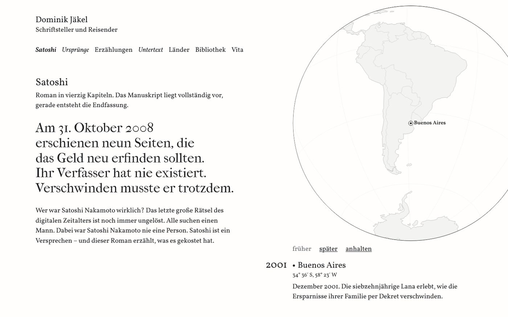
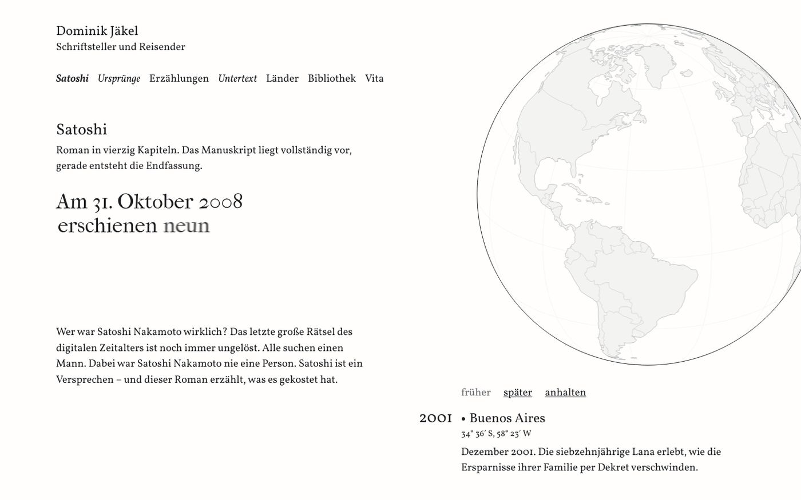
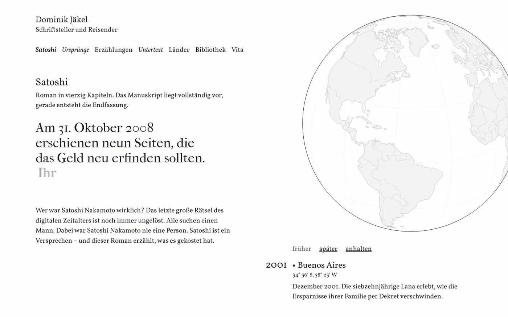
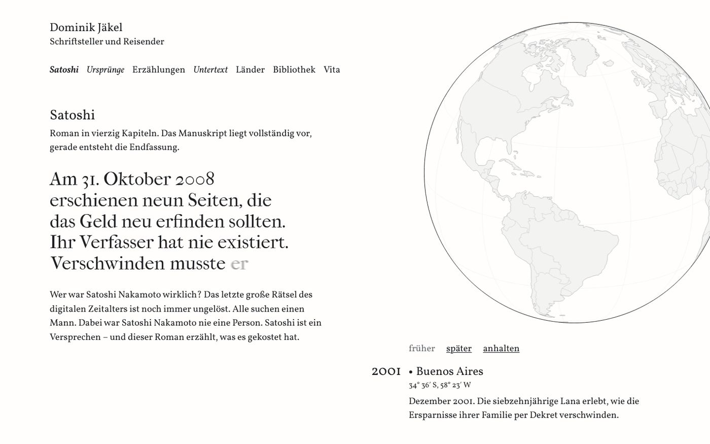
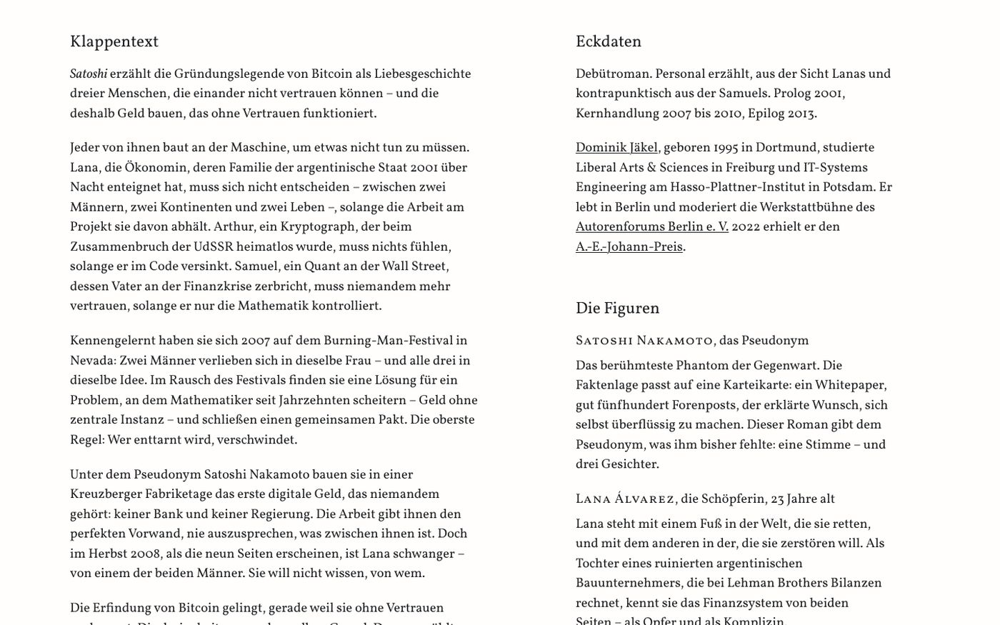
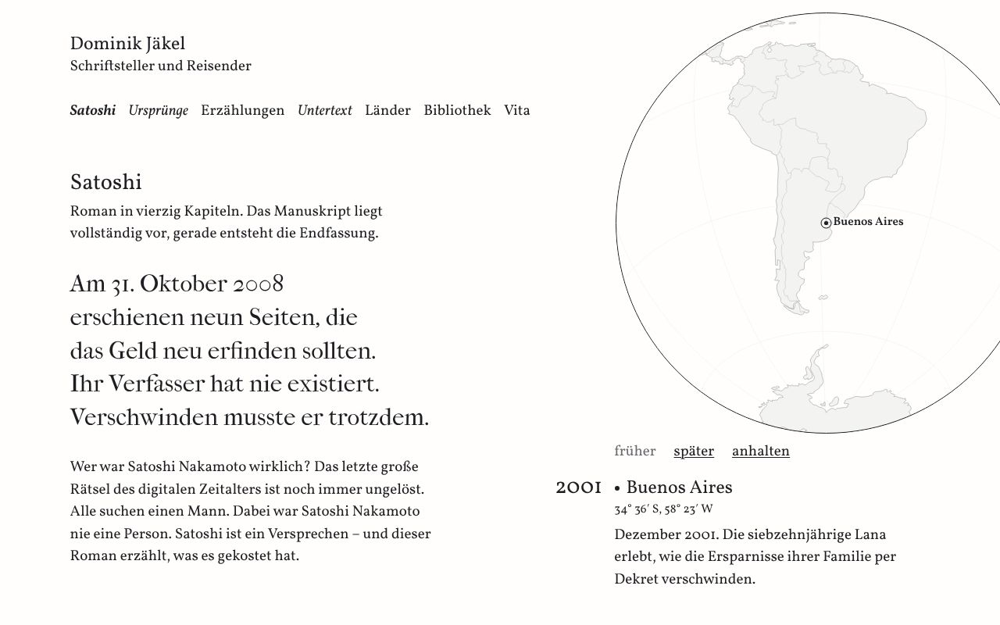
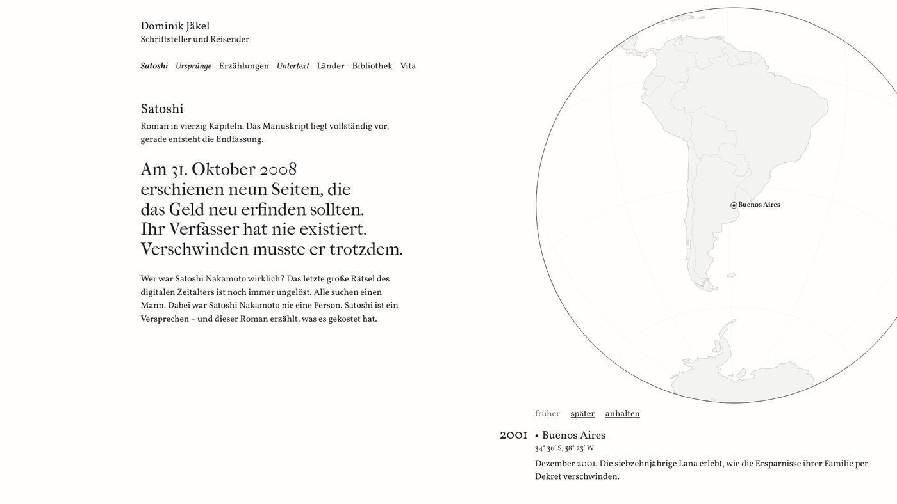

**Was sich ändert.** Wie B, dazu unter dem Aufhänger dein gekürzter Absatz aus Runde 5 („Wer war Satoshi Nakamoto wirklich? …“) im Grad Text, eine Zeile Abstand. Er steht still, nur der Aufhänger fliegt. Wie heute fehlt dafür der volle Absatz unter „Die Frage hinter dem Roman“, damit er nicht doppelt steht. Der Klappentext beginnt unter der Kugel wie in Runde 4.

**Dafür.** Der erste Bildschirm erzählt eine kleine Geschichte: das Ereignis (groß), dann die Frage (leise). Der Leerraum wird deutlich kleiner (bei 1440 × 900 endet die linke Spalte bei 698 px, unten links bleiben rund 200 px im Bild frei). Groß und klein nebeneinander geben eine klare Rangfolge innerhalb der linken Spalte.

**Dagegen.** Die Nachteile von B (Rangfolge zum Titel, zweite Bewegung) bleiben. Der Absatz steht weiter getrennt von „Die Frage hinter dem Roman“, wo er herkommt. Bei 1920 × 1080 bleiben unten links rund 380 px frei. Bei 1280 × 800 ist die linke Spalte bis kurz vor den Rand gefüllt und wirkt dichter als die rechte.

**Aufwand.** Wie B. Die Regeln für den gekürzten Absatz gibt es schon.

### D. Kapiteltage neben dem Globus

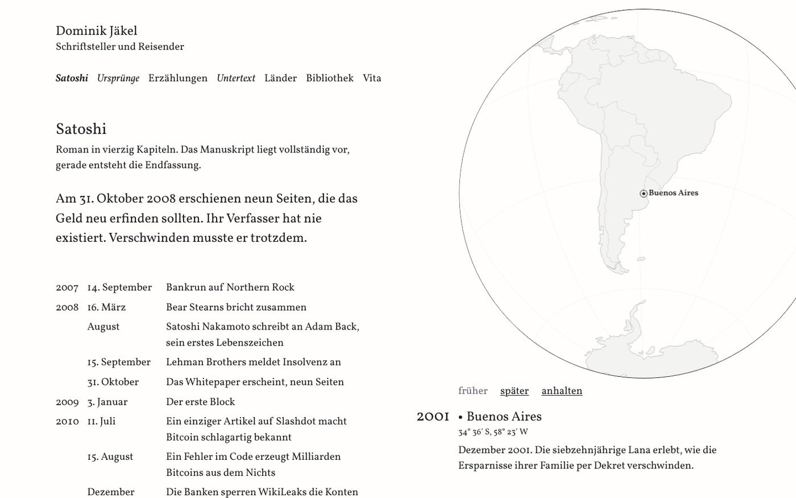
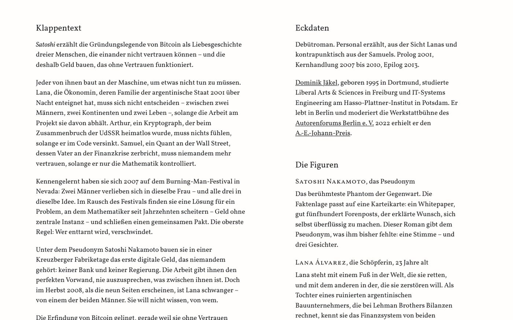
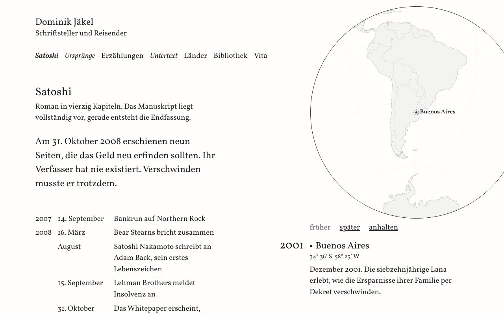
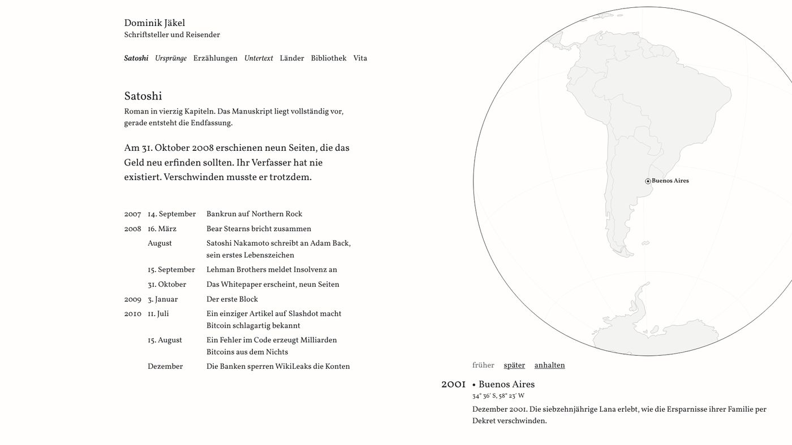

**Was sich ändert.** Die Liste der Kapiteltage (2007 Bankrun auf Northern Rock bis 2010 WikiLeaks) steht in der linken Spalte unter dem Aufhänger, zwei Zeilen Abstand, ohne eigene Überschrift. Unter „Gebaut wie ein Protokoll“ bleibt dann nur der Absatz. Schmaler als zwei Spalten steht sie wie heute an ihrem Platz. Grad und Raster der Liste sind unverändert.

**Dafür.** Der Raum ist bei 1440 × 900 ganz gefüllt, und zwar mit etwas, das zum Bild daneben passt: Daten neben der Karte, eine Chronik neben den Schauplätzen. Die Liste ist schnell zu überfliegen und macht schon im ersten Bildschirm klar, worum es geht (Finanzkrise, Whitepaper, erster Block). Sie wirkt ruhig, weil sie ein festes Raster hat.

**Dagegen.** Ohne Überschrift fehlt der Liste der Zusammenhang; der Satz „geschnitten mit den Tagen, an denen die alte Welt fiel“ steht weiter unten, getrennt von ihr. Neben der Tafel stehen zwei Zeitachsen: die Jahre der Szenen auf der Tafel (2001, 2007 …) und die Jahre der Weltereignisse in der Liste. Man könnte erwarten, dass ein Klick auf einen Tag die Kugel bewegt. Bei 1280 × 800 ist die Spalte schmal, die Liste reicht bis 1112 px, und der Klappentext rückt um gut 300 px nach unten. Eine Stufe kleiner gesetzt (Grad klein) wäre sie kompakter; das habe ich nicht gebaut.

**Aufwand.** Klein. Die Liste steht zweimal im Text, je nach Breite ist eine verborgen (so wie heute der gekürzte Absatz), oder ein paar Zeilen Skript setzen sie um. Eine halbe bis dreiviertel Stunde.

### E. Eckdaten neben dem Globus

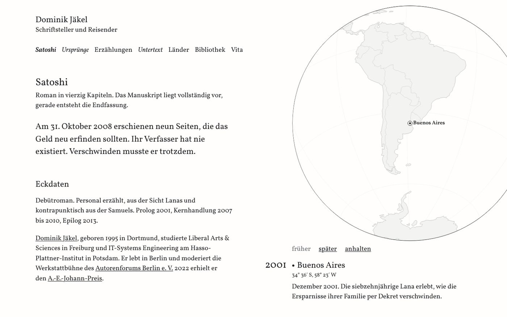
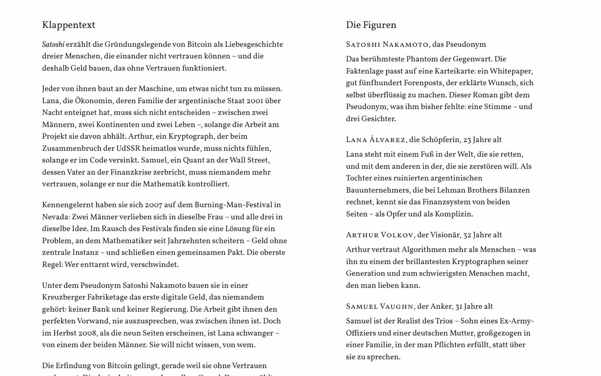
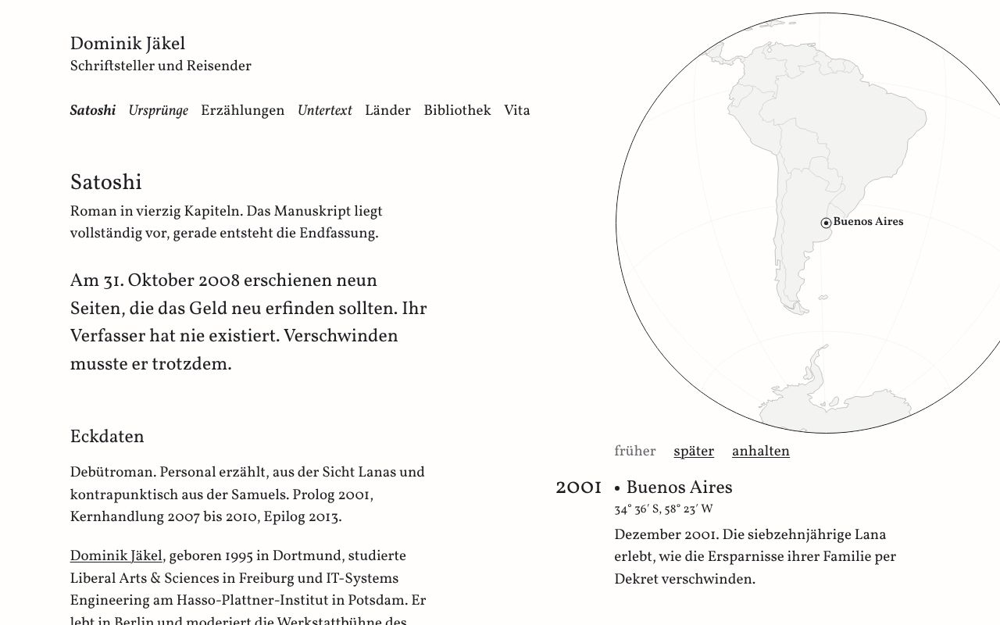
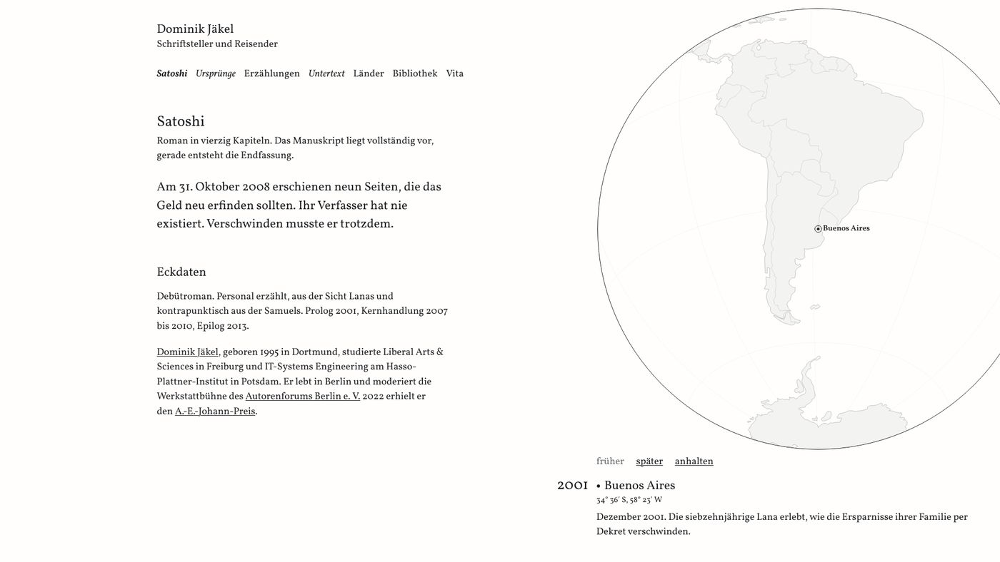

**Was sich ändert.** Der Abschnitt „Eckdaten“ (Debütroman, Erzählweise, Zeitraum, dazu deine Kurzvita) wandert aus der rechten Spalte unter der Kugel in die linke Spalte unter den Aufhänger, im Abstand zwischen zwei Abschnitten. Rechts unter der Kugel beginnen dann die Figuren neben dem Klappentext. Schmaler als zwei Spalten bleibt die Reihenfolge wie heute.

**Dafür.** Das, was eine Agentur oder ein Verlag zuerst wissen will, steht im ersten Bildschirm: Debüt, Perspektive, Zeitraum, wer du bist, der Preis. Das entspricht dem Aufbau eines Exposés. Der Raum ist bei 1440 × 900 gut gefüllt (bis 805 px), unten bleibt ein ruhiger Rand. Es kommt nichts Neues hinzu, nur ein Abschnitt zieht um, und die Doppelseite darunter wird klarer: links der Roman, rechts die Figuren.

**Dagegen.** Sachliche Angaben direkt nach dem Aufhänger nehmen ihm etwas von seiner Wirkung; die Stimmung wechselt von Erzählung zu Datenblatt. Die Vita steht damit sehr weit oben auf einer Seite, die vom Roman handeln soll. Bei 1280 × 800 rückt der Klappentext um gut 80 px nach unten, bei 1920 × 1080 bleiben unten links rund 270 px frei.

**Aufwand.** Klein, wie D. Etwa eine halbe Stunde.

### F. Größerer Globus, Tafel links

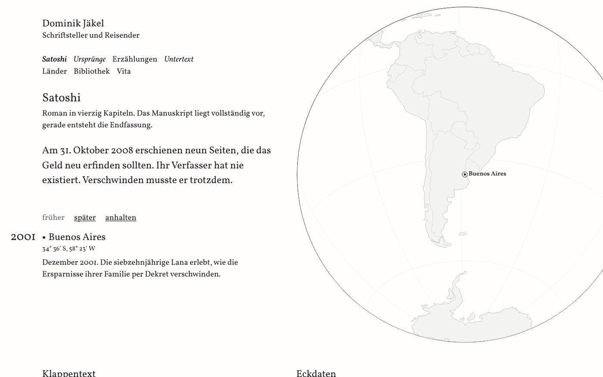
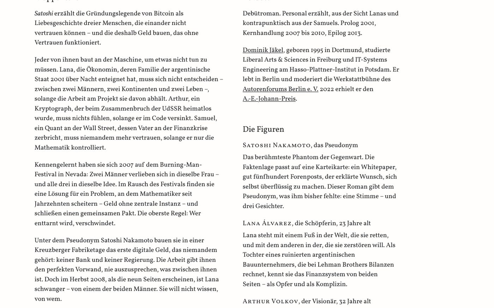
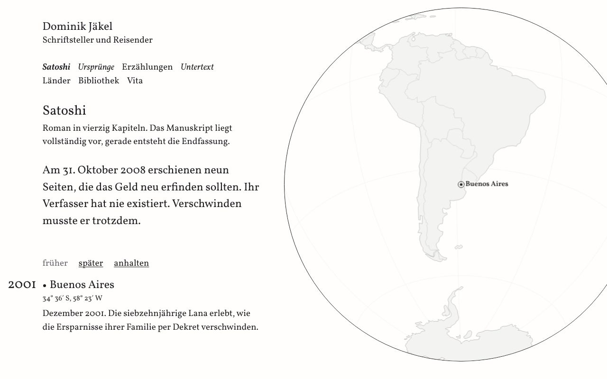
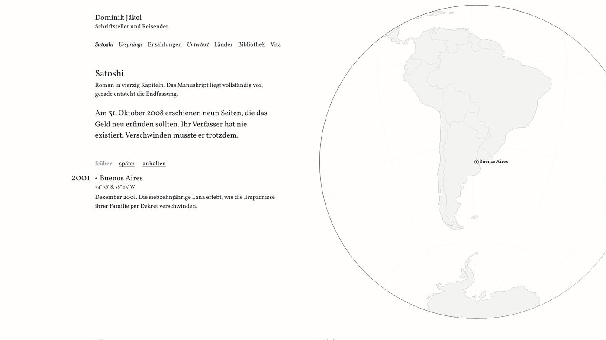

**Was sich ändert.** Eine breitere Spalte für die Kugel allein bringt nichts: Die Kugel ist heute bei allen drei Größen von der Höhe begrenzt, weil unter ihr Steuerzeile und Tafel in den ersten Bildschirm passen müssen. Größer würde sie nur, wenn die Tafel unter den Bildschirmrand rutscht, und links würde die Lücke dann noch höher. Deshalb habe ich F so gebaut: Steuerzeile und Tafel (früher, später, anhalten, Jahr, Ort, Szenentext) stehen links unter dem Aufhänger, die Jahreszahl hängt in den linken Rand, der Ort steht bündig mit dem Aufhänger. Die Kugel bekommt die ganze Fensterhöhe. Bei 1440 × 900 wird sie 805 statt 672 px groß, bei 1280 × 800 750 statt 543 px, bei 1920 × 1080 1000 statt 852 px. Schmaler als zwei Spalten bleibt alles, wie es ist.

**Dafür.** Die Kugel wird das große Bild der Seite. Der Raum unter dem Aufhänger füllt sich mit etwas Lebendigem: Während der Einspieler läuft, wechselt dort der Szenentext. Aufhänger und erste Szene („Dezember 2001. Die siebzehnjährige Lana …“) stehen untereinander und lesen sich wie ein Anfang. Die Bedienung liegt näher am Text, den man ohnehin liest.

**Dagegen.** Die Tafel steht weit weg von den Orten auf der Kugel; heute liest man Ort und Szene direkt unter der Karte. Auf allen anderen Globusseiten steht die Tafel unter der Kugel, hier wäre sie die Ausnahme. Links bewegt sich etwas neben dem Text, während man den Aufhänger liest. Die Navigation bricht bei 1280 und 1440 in zwei Zeilen (auch bei 1366, bei 1600 nicht mehr), weil die Kugel weiter nach links reicht. Die Jahreszahl der Tafel rückt bei diesen Breiten bis auf 16 px an den Fensterrand, und zwischen Text und Kugel bleiben nur rund 45 px. Bei 1440 × 900 liegen die Überschriften „Klappentext“ und „Eckdaten“ genau an der Bildschirmkante, bei 1920 × 1080 bleibt unter der Tafel wieder Leerraum (die Kugel ist dort höher als die linke Spalte). Die Tafel hält ihre Höhe für die längste Szene, darum steht unter kurzen Szenen ein Rest frei.

**Aufwand.** Mittel bis groß. Steuerzeile und Tafel beim Wechsel der Breite umsetzen, Formel für die Größe der Kugel, Navigation, Hinweise der Kugel prüfen. Zwei bis drei Stunden.

---

## Ursprünge: Kugel haftet oder steht

Ja, das ist Absicht und so seit dem ersten Bau von C (und schon in A): Am Desktop haftet die Kugel neben den Bänden. Liest man weiter, fliegt sie zum Ort des Bands, dessen Überschrift die Leselinie erreicht (45 % der Fensterhöhe), und die Tafel zeigt Band, Ort und Zeit. Auf *Satoshi* haftet die Kugel in C nicht, dort steht sie oben fest. Auf dem Telefon haftet sie auch auf den *Ursprüngen* nicht. Die Bilder zeigen 1440 × 900 an drei Stellen beim Lesen: Band I, Band II, Band III. Die Variante ohne Haften habe ich zum Vergleich gebaut (U), mit denselben Stellen.

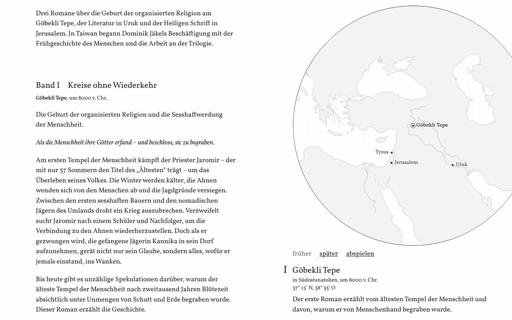
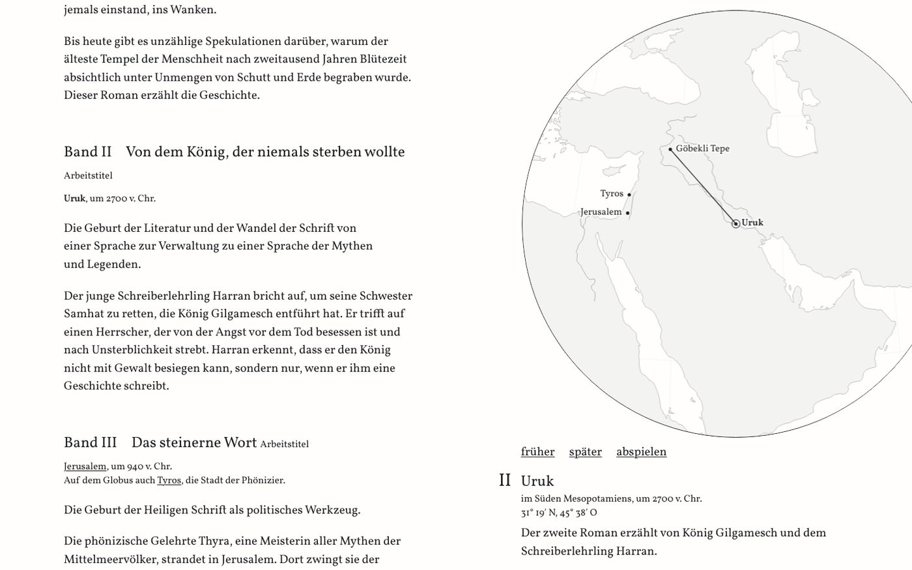
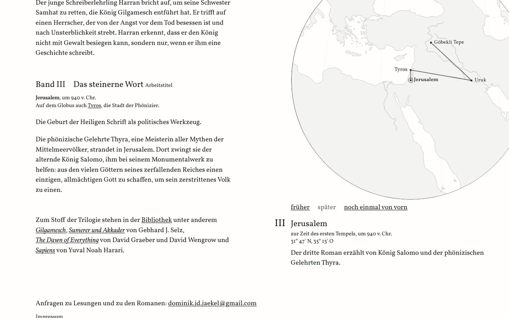
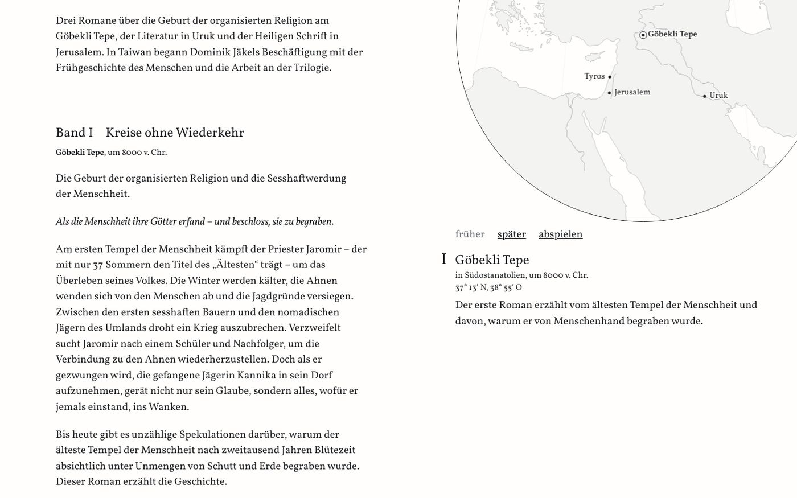
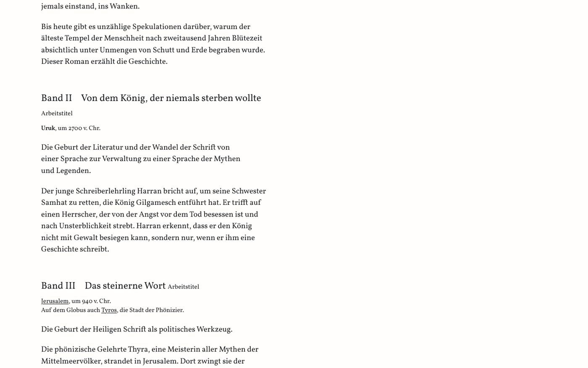
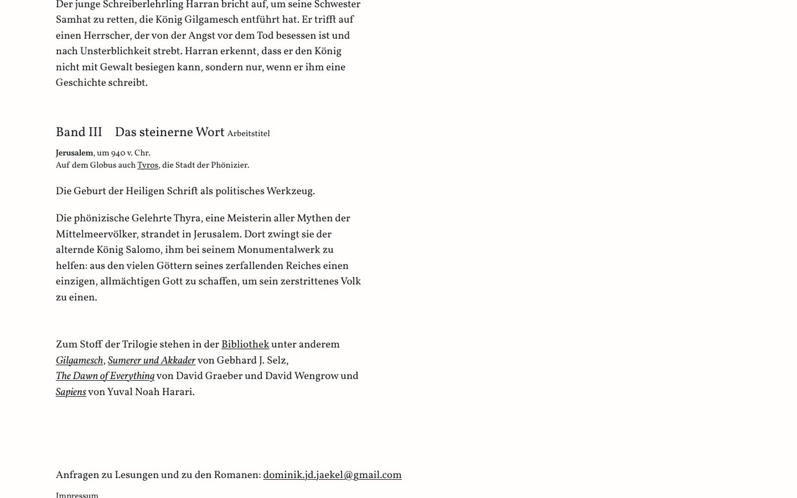

**Kugel haftet (heute).**

- Dafür: Karte und Text gehören zusammen; man sieht beim Lesen, wo man ist, und wie die Linie von Band zu Band weiterwandert. Das ist die eigentliche Idee der Seite (die Trilogie entfaltet sich). Rechts entsteht beim Lesen keine leere Fläche.
- Dagegen: Etwas bewegt sich, während man liest, und die Seite verhält sich anders als *Satoshi*. Am Ende der Bände schiebt sich die Kugel mit nach oben aus dem Bild (drittes Bild), das sieht kurz unruhig aus.

**Kugel steht (U).**

- Dafür: Ruhiger und genauso wie auf *Satoshi*: oben die Kugel als Bild, darunter wird gelesen. Nichts bewegt sich neben dem Text.
- Dagegen: Ab Band I ist die Kugel schon zur Hälfte aus dem Bild, ab Band II steht rechts eine leere Spalte über die ganze Seite, also genau die Art Leerraum, die dich bei *Satoshi* stört. Die Leselinie wäre sinnlos; heute fliegt die Kugel in dieser Variante unsichtbar mit (in den Bildern ist der Ort in der Ortszeile halbfett gesetzt, obwohl man die Kugel nicht sieht). Man müsste sie abschalten und den Orten in den Bänden das Verhalten vom Telefon geben (ein Klick holt die Kugel ins Bild, „zurück“ führt an die Stelle im Text).
- Aufwand für U: klein für das Abschalten des Haftens (eine Regel), etwa eine Stunde mit Leselinie und Telefonverhalten der Orte.

---

## Für die Umsetzung

Die Optionen sind als eigene Seiten gebaut, nur zum Ansehen, nicht in `website-c/`:

- Ordner: `/tmp/claude-0/-home-user-Autorenwebsite/f47320ed-8ba8-501b-b8f6-90b4eb6d5a1c/scratchpad/optionen/basis/` (eine Kopie von `website-c/` vom 22. Oktober), darin `satoshi-a.html` bis `satoshi-f.html`, `satoshi-r4lage.html` (Runde 4 mit heutigen Texten) und `ursprung-statisch.html`.
- Gebaut werden sie aus der heutigen `satoshi.html` und `ursprung.html` mit `/tmp/claude-0/-home-user-Autorenwebsite/f47320ed-8ba8-501b-b8f6-90b4eb6d5a1c/scratchpad/optionen/bauen.py`. Jede Option hängt ihren Stil als eigenen, kommentierten Block an das Ende des Seitenstils.
- Ansehen: `python3 -m http.server --directory /tmp/claude-0/-home-user-Autorenwebsite/f47320ed-8ba8-501b-b8f6-90b4eb6d5a1c/scratchpad/optionen/basis 9940`, dann `http://localhost:9940/satoshi-a.html` und so weiter.
- Die Bilder liegen in `docs/optionen/`, JPEG, höchstens 1400 px breit.
