# Startseite: Abstände und Gliederung

Stand: 22. Oktober 2026, abends. Grundlage ist Version C beim Stand `3b9454d` (Regler nur für gelesene Bücher).

## Meine Empfehlung

Ich empfehle Variante 1 ohne ihren Umbau des ersten Bildschirms, ergänzt um zwei Teile aus Variante 2: die Legende unter dem Zeitband und den Fuß auf den zwei Spalten des ersten Bildschirms. Variante 1 räumt die Abstände auf, die nach Rechnung aussehen, und gibt dem Werkverzeichnis mit dem hängenden Einzug die Form eines Registers im Buch, ohne eine Tabelle daraus zu machen; so bleibt die Seite am nächsten an A. Die Legende unter dem Band löst die Folge „Überschrift, Erklärsatz, Bauteil, Verweis“ auf, das deutlichste Schablonenmuster unter dem Globus, und der zweispaltige Fuß schließt die Seite mit dem Raster, mit dem sie beginnt.

Den Umbau des ersten Bildschirms lasse ich weg, weil er die leere Fläche links nur teilt (bei 1440 px 159 und 257 px statt 29 und 380 px), bei 1920 × 1080 die Wahl der Ebene 360 px von der Kurzvita trennt und den Text der Ebene *Satoshi* unter den ersten Bildschirm schiebt. Das Register aus Variante 2 übernehme ich nicht, weil eine eigene Spalte aus Titeln mit Punkt genau das hängende Randlabel ist, das Rang 55 als verlässlichstes Zeichen schablonenhafter Editorial-Seiten führt, und Variante 3 entfernt sich mit Spitzmarken in Überschriftgröße und einem Werkverzeichnis als Fließtext am weitesten von A. Zweite Wahl ist Variante 2 als Ganzes: Sie gliedert am stärksten, wirkt aber eher nach Katalog, und die Buchzeile des Regalbilds endet dort nur 16 px über dem Band.

Die Kombination liegt als `index-empfehlung.html` neben den Varianten (Bilder am Ende) und enthält dieselben Wörter wie heute, ohne Fehlermeldung bei 1280, 1440, 1920 und 390 px Breite; die längste Buchzeile endet 44 px über dem Band, und die Seite ist am Desktop 221 px kürzer. Der Einbau kostet rund 35 Zeilen in `stil.css`, zwei kleine Eingriffe in `index.html` (die beiden letzten Gruppen des Verzeichnisses zusammenlegen, den Absatz „Von Gilgamesch bis Labatut …“ hinter das Band stellen), knapp 40 Zeilen Skript in `seite.js` für die Namen der Reihen und den Neubau beider Fassungen. Die Risiken: Dein Absatz zum Band steht dann eine Stufe kleiner und erst nach dem Band, der Fuß gilt in `stil.css` für alle Seiten und muss dort geprüft oder auf die Startseite beschränkt werden (er läuft auf allen, hat aber auf Seiten ohne Globus rechts keine Kante, an der er steht), und der Sprung bei 1280 × 800 in der Ebene *Satoshi* (91 px) bleibt wie heute. Meinte Michael vor allem den ersten Bildschirm, hilft keine der Varianten ganz, denn die leere Fläche links neben der Tafel bleibt in allen.

---

Michael hat vor allem auf die Startseite geschaut und geschrieben: „Die Textabstände und Gliederung hat noch Rest-AI-Vibe.“ Ich habe die Startseite deshalb bei 1440 × 900 und bei 390 × 844 von oben bis zum Fuß vermessen: jeden senkrechten Abstand zwischen zwei Blöcken, die Überschriften, die Muster der Listen und Absätze, die Ausrichtung und die Zeilenlängen. Danach habe ich drei Varianten der Startseite gebaut.

Die Varianten ändern nur Abstände, Gruppen, die Form der Überschriften und die Anordnung. Kein Wort ist neu, keins fehlt. Das habe ich geprüft: Jede Variante enthält genau dieselben Wörter wie heute. Globus, Ebenen, Zeitband, Regalbild und Fuß funktionieren in allen drei, ohne Fehlermeldung im Browser, auf dem Desktop und auf dem Telefon. Variante 2 und 3 ändern dabei die Reihenfolge im Quelltext: In Variante 2 steht die Legende hinter dem Band, in Variante 3 die Überschrift „Was ich schreibe“ hinter dem Regalbild. Die Empfehlung steht oben, ihre Bilder am Ende. Zusätzlich zu 1440 × 900 und 390 × 844 sind die Varianten bei 1280 × 800 und 1920 × 1080 geprüft.

Zu den Bildern: Sie sind in Chromium mit „reduzierter Bewegung“ aufgenommen. So zeigt der Globus überall denselben Stand, und der erste Satz steht schon. Eine Zeile (z) ist 28,5 px am Desktop und 27 px auf dem Telefon. Alle eingestellten Abstände sind Vielfache einer Viertelzeile. Zwischen zwei sichtbaren Kanten gemessen ergeben sich trotzdem krumme Werte wie 65, 88 oder 115 px, weil freigehaltene Zeilen und niedrige Striche dazukommen (Punkt 3).

---

## Was nach KI wirkt

Kurz vorweg: Schriftgrößen, Zeilenlängen und Farben sind in Ordnung (siehe unten). Der Eindruck entsteht an sechs Stellen, und zwar unter dem ersten Bildschirm stärker als darin.

**1. Jeder Teil ist gleich gebaut und gleich weit vom nächsten entfernt.**
Unter dem Globus folgen „Was ich schreibe“, „Mein digitales Bücherregal“ und der Fuß. Vor jedem stehen genau drei Zeilen Luft, am Desktop dreimal 86 px, auf dem Telefon dreimal 81 px. Jeder Teil beginnt gleich: Überschrift in 23,75 px, eine halbe Zeile, dann der Inhalt. Auch der Fuß sieht dadurch aus wie ein weiterer Abschnitt. Dass hier die Seite endet, sieht man ihm nicht an.
`ki-merkmale.md` führt das unter Rang 49 („Alle Abschnitte mit demselben padding-block“, „Ein Abstandswert für alles ersetzt die Gewichtung der Inhalte“) und Rang 42 (die Schablonenfolge, auf Autorenseiten „Über mich, Bücher, Termine, Newsletter, Kontakt“).
Ein Gestalter stuft nach Gewicht. Was zusammengehört, rückt zusammen. Das Ende der Seite bekommt deutlich mehr Luft als ein Wechsel des Themas. Resilient Web Design arbeitet mit zwei Werten im Verhältnis 1 zu 3, Tufte setzt vor eine Überschrift anderthalbmal so viel Raum wie danach (`referenzen-c.md`, Abschnitt 5, Punkt 8 und 10).

**2. Sieben Abstände, die man kaum auseinanderhält.**
Auf der Startseite kommen 0, 7, 14, 21, 28,5, 57 und 85,5 px vor, also 0, ¼, ½, ¾, 1, 2 und 3 Zeilen. Die drei kleinen Stufen liegen je 7 px auseinander. Zwischen Überschrift und Inhalt steht ½ Zeile, zwischen zwei Einträgen ¼, vor „Die ganze Bibliothek“ ¾, zwischen den Gruppen eine ganze. Das Auge sieht „etwas Abstand“ und „etwas mehr“, aber keine Regel. Gerade das wirkt gerechnet.
Das ist Rang 49, dazu das Gegenstück bei den Schriftgrößen, Rang 30 („Jede Komponente bekommt ihre eigene Größe, niemand legt eine Skala fest“). Du hast „ungleiche Abstände“ selbst zu den Mikromarkern gezählt (V03). Das Raster aus R9 war richtig, weil es freie Werte wie 36 px beendet hat. Dass eine einzige Seite alle sechs Stufen benutzt, ist das Problem.
Die gemessenen Vorbilder kommen mit zwei oder drei Werten aus: Tufte 21 und 31,5 px, brandur 24, 30 und 4 px, Resilient Web Design 60 und 180 px.

**3. Leerräume, die niemand gesetzt hat.**
- **Neben der Tafel.** In der Ebene Leben endet die linke Spalte mit „Leben Reisen Satoshi Ursprünge“ bei 591 px. „Was ich schreibe“ beginnt erst bei 971 px. Dazwischen liegen 380 px ohne Text, gut 13 Zeilen. Im ersten Bildschirm ist das untere Drittel links leer (591 bis 900 px). Seit die Ebene Leben keinen eigenen Text mehr hat (21. Oktober), füllt nichts diesen Platz.
- **Am Zeitband.** Unter „früher, später“ hält die Buchzeile ihren Platz frei. Danach kommt noch eine Zeile Abstand und dann erst der Name der Reihe. Bis zur ersten Reihe sind es 65 px am Desktop und 115 px auf dem Telefon. Auf dem Telefon ist das mehr als vor einer Überschrift (81 px).
- **Am Regalbild auf dem Telefon.** Die Überschrift steht 13 px über dem Bild. Unter dem Brett folgen 88 px bis zum Verzeichnis: zwei freigehaltene Zeilen für die Buchzeile und eine Zeile Abstand.

Innen mehr Luft als außen dreht die Gliederung um. Das Auge liest eine Lücke als Grenze und trennt, was zusammengehört. Rang 49 nennt genau das: „sehr große leere Flächen zwischen gleich gewichteten Blöcken“. Ein Gestalter lässt einen freigehaltenen Platz als den Abstand zählen, den es dort ohnehin braucht, oder stellt die Dinge so, dass eine Lücke eine Kante hat.

**4. Zwei Namen schweben zwischen den Reihen.**
„die wichtigsten aus Kindheit und Jugend“ und „was noch wartet“ stehen eine Zeile unter der Reihe davor und 7 px über ihrer eigenen. Die Striche ihrer Reihe beginnen aber erst weit rechts, 529 und 414 px vom linken Rand des Bands, und sie sind niedriger als die Fläche, die das Band für sie freihält. Bei „was noch wartet“ liegen über dem Namen 28,5 px bis zur Reihe davor. Unter ihm sind es 7 px bis zur Fläche seiner Reihe, deren höchster Strich 12 px tiefer beginnt, die meisten noch tiefer. Der Name steht also etwa gleich weit von beiden Reihen entfernt. Er sieht aus wie eine kleine Zwischenüberschrift, die keiner Reihe gehört.
Das ist die Dichte kleiner Beschriftungen über Inhalt, die Rang 1 und Rang 33 beschreiben. Die Wörter sind deine (V47) und bleiben. Es geht nur um ihren Platz. Auf einer Karte steht ein Name in der leeren Fläche auf der Linie dessen, was er benennt.

**5. Das Werkverzeichnis liest sich wie eine Begriffsliste.**
Fünf Einträge, alle nach dem Muster „Titel. Satz.“, alle gleich gewichtet, in Gruppen zu zwei, zwei und einem. Am Zeilenanfang steht fünfmal ein unterstrichenes Wort mit Punkt. „Untertext. Mein Journal.“ hat dasselbe Gewicht wie *Satoshi*, und „Länder“ steht allein in seiner Gruppe. So sehen Funktionslisten und Glossare auf generierten Seiten aus (Rang 32, Titelmuster „Name: Erklärung“, verwandt mit Rang 3).
R12 in `referenzen-c.md` stellt den Titel über seinen Satz, Craig Mod beginnt mit den Büchern. Ein hängender Titel in eigener Spalte ist nach Rang 55 dort echte Buchkonvention, wo der Inhalt ein Register oder Werkverzeichnis ist. Das ist er hier.

**6. Überschrift, Erklärsatz, Bauteil, Verweis.**
„Mein digitales Bücherregal“ ist gebaut wie ein Block einer Produktseite. Erst die Überschrift, dann ein Absatz, der das Bauteil erklärt („Jeder Strich ist so breit wie der Rücken des Buchs …“), dann das Bauteil, darunter der Verweis „Die ganze Bibliothek“. Der Absatz ist in Wahrheit eine Zeichenerklärung. Im Buch steht sie unter oder neben der Abbildung, eine Stufe kleiner (R10, Tufte, Resilient Web Design). Rang 42 beschreibt die Schablone, Rang 33 sagt, wofür eine Zeichenerklärung da ist: für Kodierungen, die man nicht erraten kann. Das trifft hier zu. Also stimmt der Text, nur sein Platz ist der einer Einleitung.

### Was nicht die Ursache ist

- **Schriftgrade.** Im ersten Bildschirm stehen fünf: 38 px (erster Satz), 28,5 (Jahr an der Tafel), 23,75 (Name, Ort an der Tafel), 19 (Text), 15,4 px (klein). Das ist die Grenze aus R1, nicht mehr.
- **Zeilenlängen.** Kurzvita 66 Zeichen je Zeile, der Absatz am Zeitband 65, das Werkverzeichnis gut 50, auf dem Telefon 36. Das liegt im Bereich der Vorbilder (R2).
- **Zahl der Überschriften.** Unter dem Kopf gibt es nur zwei, das ist wenig. Auffällig ist, dass beide gleich gebaut sind.
- **Ausrichtung.** Alles steht links an einer Kante (101 px), rechts gibt die Kante der Kugel eine zweite (829 px). Das Raster ist gut. Unter dem Globus nutzt es nur das Regalbild.

### Gemessen: heute und die Varianten

Desktop, 1440 × 900, Ebene Leben:

| Stelle | heute | Variante 1 | Variante 2 | Variante 3 | Empfehlung |
|---|---|---|---|---|---|
| Kurzvita bis Wahl der Ebene | 29 px (1 z) | 159 px (5,6 z) | 29 px (1 z) | 29 px (1 z) | 29 px (1 z) |
| leere linke Spalte bis zum nächsten Teil | 380 px (13,3 z) | 257 px (9 z) | 380 px (13,3 z) | 376 px (13,2 z) | 380 px (13,3 z) |
| Tafel bis zum nächsten Teil | 86 px (3 z) | 93 px (3,3 z) | 86 px (3 z) | 82 px (2,9 z) | 86 px (3 z) |
| Überschrift bis Inhalt (Werk) | 14 px (½ z) | 7 px (¼ z) | 7 px (¼ z) | in derselben Zeile | 7 px (¼ z) |
| Einträge einer Gruppe | 7 px (¼ z) | 0 | 7 px (¼ z) | im selben Absatz | 0 |
| Gruppen des Verzeichnisses | 29 px (1 z) | 29 px (1 z) | 29 px (1 z) | 21 px (¾ z) | 29 px (1 z) |
| Werk bis Lektüre | 86 px (3 z) | 86 px (3 z) | 57 px (2 z) | 53 px (1,9 z) | 86 px (3 z) |
| Überschrift bis Absatz oder Band (Lektüre) | 14 px (½ z) | 7 px (¼ z) | 14 px (½ z) | in derselben Zeile | 14 px (½ z) |
| „früher, später“ bis zur ersten Reihe | 65 px (2,3 z) | 36 px (1,3 z) | 36 px (1,3 z) | 36 px (1,3 z) | 36 px (1,3 z) |
| Reihe bis Reihe | 29 px (1 z) | 29 px (1 z) | 29 px (1 z) | 29 px (1 z) | 29 px (1 z) |
| Lektüre bis Fuß | 86 px (3 z) | 143 px (5 z) | 114 px (4 z) | 114 px (4 z) | 114 px (4 z) |
| Höhe der Seite | 2475 px | 2418 px | 2247 px | 2261 px | 2254 px |

Bei 1920 × 1080 steht die Wahl der Ebene heute und in Variante 2, 3 und der Empfehlung 29 px unter der Kurzvita, in Variante 1 360 px (12,6 z). Bei 1280 × 800 bleibt sie in allen Fassungen direkt unter der Kurzvita.

Telefon, 390 × 844:

| Stelle | heute | Variante 1 | Variante 2 | Variante 3 | Empfehlung |
|---|---|---|---|---|---|
| Tafel bis zum nächsten Teil | 81 px (3 z) | 81 px (3 z) | 81 px (3 z) | 78 px (2,9 z) | 81 px (3 z) |
| Brett bis Verzeichnis | 88 px | 61 px | 61 px | Regal steht unter dem Text | 61 px |
| Werk bis Lektüre | 81 px (3 z) | 81 px (3 z) | 54 px (2 z) | 85 px, davon 2 z freigehalten | 81 px (3 z) |
| „früher, später“ bis zur ersten Reihe | 115 px (4,3 z) | 88 px (3,3 z) | 88 px (3,3 z) | 88 px (3,3 z) | 88 px (3,3 z) |
| Lektüre bis Fuß | 81 px (3 z) | 135 px (5 z) | 108 px (4 z) | 108 px (4 z) | 108 px (4 z) |
| Höhe der Seite | 3338 px | 3297 px | 3277 px | 3128 px | 3149 px |

---

## Heute

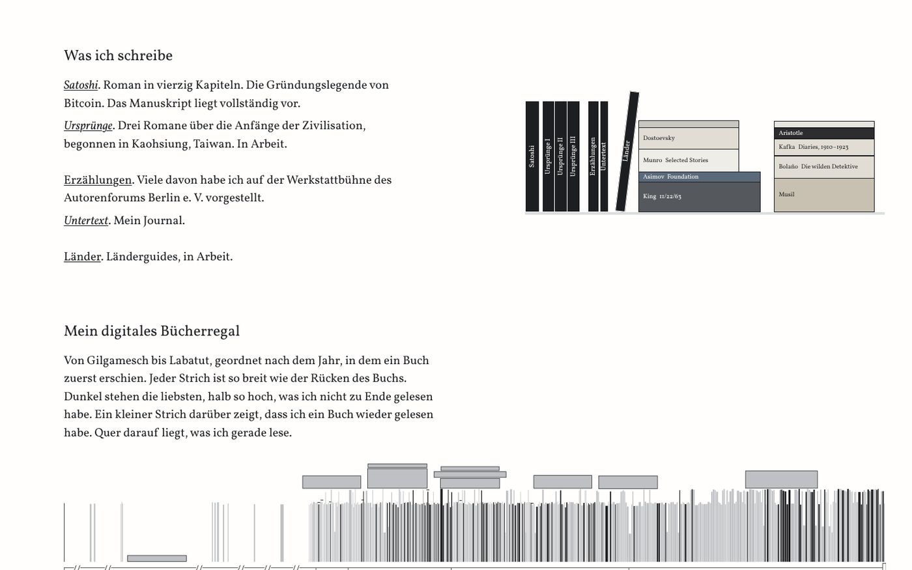
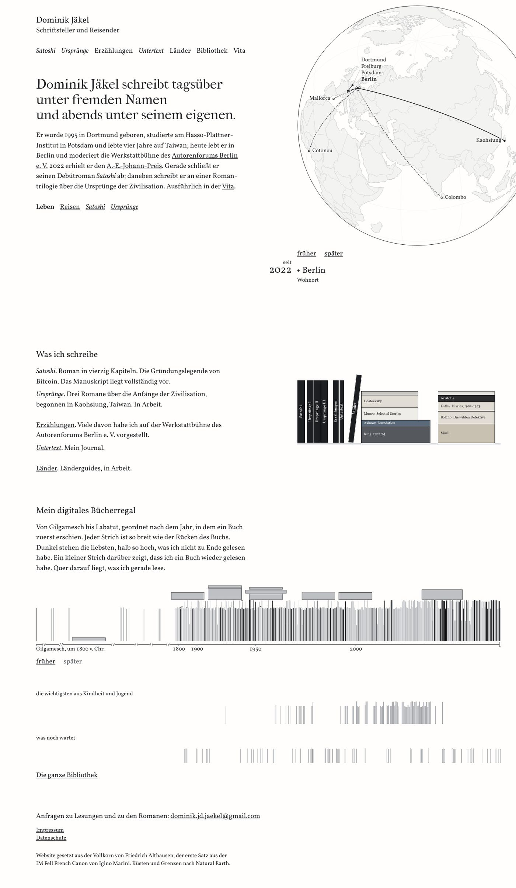
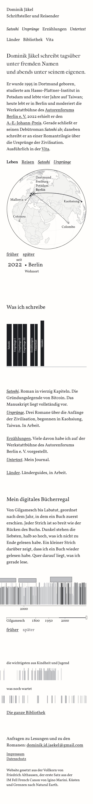

---

## Die drei Varianten

**In allen drei gleich.** Diese Änderungen lösen Punkt 3 und 4 und lassen sich mit jeder Variante verbinden:

- Die Namen der zwei Reihen stehen am Desktop in ihrer Reihe, links auf der Grundlinie der Striche, dort, wo die Reihe noch leer ist. Gemessen bei 1280, 1440 und 1920 px Breite beginnen die Striche erst nach 402 bis 577 px, der längere Name braucht 270 px. Kommt einmal ein sehr altes Buch dazu und der Platz reicht nicht, stellt ein kleines Skript den Namen von selbst wieder über die Reihe. Auf dem Telefon steht der Name wie heute über der Reihe, aber dicht darüber.
- Die freigehaltene Buchzeile unter „früher, später“ zählt als Abstand zur ersten Reihe. Auf dem Telefon bleiben dort drei Zeilen frei, weil fast drei Viertel der Buchsätze in dieser Breite drei Zeilen lang sind (459 von 631, 51 sogar vier). Ohne diesen Platz würde die Seite bei jedem Tipp springen.
- Das Werkverzeichnis hat zwei Gruppen: die Romane und das Übrige. „Länder“ steht nicht mehr allein.
- Vor dem Fuß ist mehr Luft als zwischen den Teilen, damit er als Ende gelesen wird.

Die Varianten liegen als `index-1.html`, `index-2.html` und `index-3.html` neben einer festen Kopie von C in `/tmp/claude-0/-home-user-Autorenwebsite/f47320ed-8ba8-501b-b8f6-90b4eb6d5a1c/scratchpad/rhythmus/basis/website-c/`. Gebaut werden sie mit `bauen.py` im Ordner `rhythmus/werkzeuge/` daneben, die Stile stehen in `gemeinsam.css`, `v1.css`, `v2.css` und `v3.css`. `stil.css` und die anderen Seiten sind unverändert. Die empfohlene Kombination liegt als `index-empfehlung.html` daneben (Abschnitt am Ende).

### 1. Rhythmus

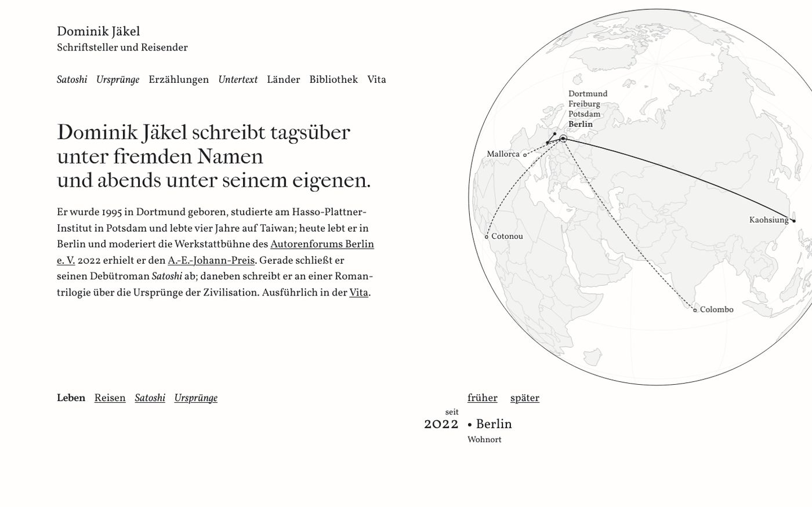
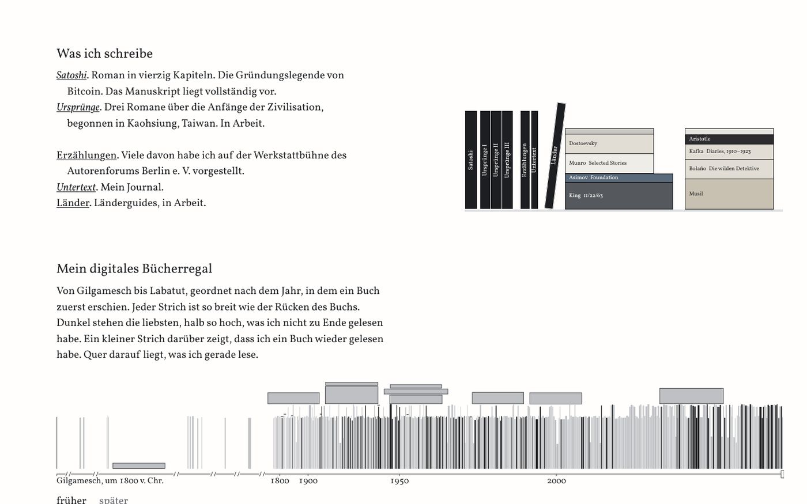
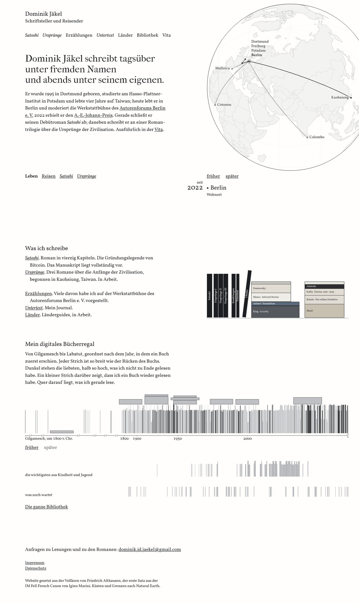
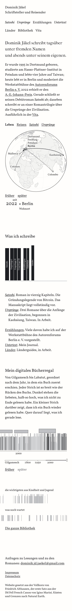
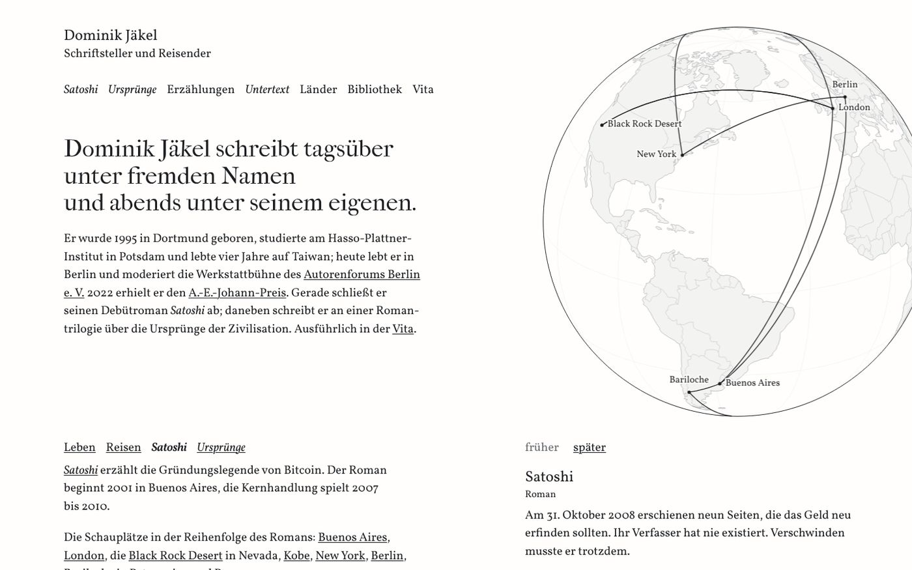

**Was sich ändert.** Derselbe Aufbau, dieselben Überschriften an derselben Stelle. Unter dem Globus gibt es nur noch vier Abstände, und jeder hat eine Bedeutung: 0 oder ¼ Zeile innerhalb eines Ganzen, eine Zeile zwischen Gruppen, drei Zeilen zwischen den Teilen, fünf vor dem Fuß.

- Im ersten Bildschirm rückt „Leben Reisen Satoshi Ursprünge“ auf die Linie von „früher, später“ unter der Kugel, von 563 auf 693 px. Beides bedient den Globus und liest sich jetzt als eine Zeile über die ganze Breite. Der Text der Ebenen Reisen, *Satoshi* und *Ursprünge* steht dann links neben der Tafel. Die leere Fläche unter der Wahl schrumpft von 380 auf 257 px, dafür entstehen 159 px zwischen Kurzvita und Wahl. Zusammen ist die linke Spalte in der Ebene Leben nicht weniger leer als heute (416 statt 409 px), die Lücke ist nur geteilt.
- Damit die Seite beim Wechsel der Ebene nicht springt, hält die linke Spalte die Höhe des längsten Ebenentexts. Das behebt nebenbei einen Sprung, den es heute gibt: Bei 1280 × 800 rutscht „Was ich schreibe“ heute in der Ebene *Satoshi* um 91 px nach unten. In Variante 1 bleibt es in allen Ebenen stehen.
- Im Werkverzeichnis stehen die Einträge einer Gruppe ohne Abstand untereinander. Jeder beginnt mit hängendem Einzug, wie ein Eintrag im Register eines Buchs.
- Das Brett des Regalbilds steht auf der Unterkante des Verzeichnisses, auf der Zeile von „Länder“. Die Buchzeile nach einem Klick erscheint darunter im Abstand zum nächsten Teil und schiebt nichts.
- Die Überschriften stehen ¼ statt ½ Zeile über ihrem Inhalt.
- Der Fuß steht fünf Zeilen tiefer, darin je eine Zeile zwischen Anfragen, Impressum und Kolophon.

**Vorteile**
- Am nächsten an heute und an A. Wer die Seite kennt, findet alles an seinem Platz.
- Die Abstände folgen einer Regel, die man sieht: eng, Absatz, Teil, Schluss.
- Der erste Bildschirm bekommt bei 1440 × 900 eine waagrechte Linie, die Text und Kugel verbindet.
- Die Seite springt beim Wechsel der Ebene nicht mehr, geprüft bei 1024, 1280, 1440 und 1920 px Breite. Heute springt sie nur bei 1280 × 800 (in *Satoshi* 91 px, in *Ursprünge* 13 px), bei 1440 und 1920 px steht „Was ich schreibe“ schon heute in allen Ebenen fest.

**Nachteile**
- Die Gliederung bleibt die alte: zwei gleich gebaute Teile mit eigener Überschriftzeile. Gegen Punkt 1, 5 und 6 hilft Variante 1 nur zum Teil.
- Zwischen Kurzvita und der Wahl der Ebene stehen jetzt 159 px. Wer die Wahl direkt unter dem Text erwartet, sucht sie einen Moment.
- In der Ebene *Satoshi* rückt deren Text tiefer. Bei 1440 × 900 läuft der zweite Absatz unter den Rand des ersten Bildschirms (Bild oben), bei 1920 × 1080 ebenso (der Text endet bei 1122 px).
- Bei 1920 × 1080 steht die Wahl der Ebene 360 px unter der Kurzvita, gut zwölf Zeilen. Dort gehört sie sichtbar nicht mehr zu dem Text, über dem sie bisher stand (Bild unten).
- Bei 1280 × 800 ist die Kurzvita länger als der Weg bis zur Linie unter der Kugel. Dort steht die Wahl wie heute direkt unter der Kurzvita, und der freigehaltene Platz für den längsten Ebenentext vergrößert die Lücke vor „Was ich schreibe“ (934 statt 871 px).
- Dafür braucht es ein kleines zusätzliches Skript, das die Ebenentexte misst.

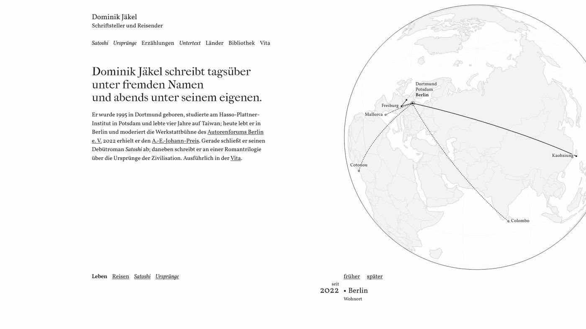

### 2. Register

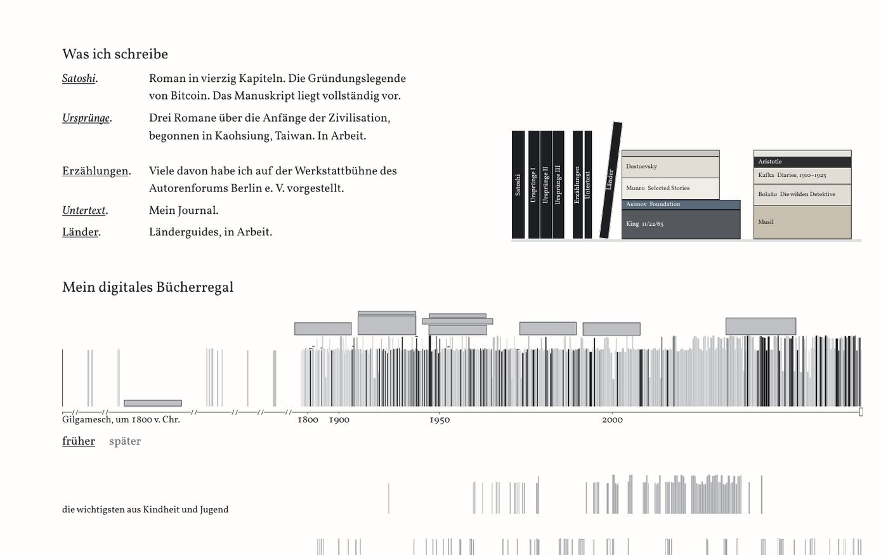
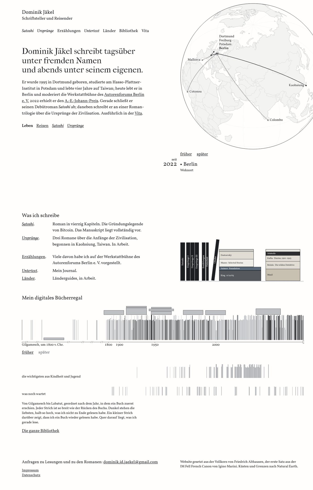
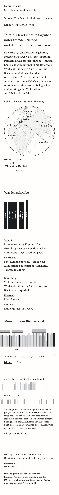

**Was sich ändert.** Der erste Bildschirm bleibt wie heute. Darunter steht alles auf den zwei Spalten, die der erste Bildschirm vorgibt: links die Textspalte, rechts die Kante der Kugel.

- Das Werkverzeichnis wird ein echtes Register. Am Desktop hängen die Titel in einer eigenen Spalte, die Angabe beginnt für alle Einträge an derselben Kante, wie die Jahre der Stationen in der Vita und an der Tafel. Auf dem Telefon steht der Titel auf eigener Zeile und die Angabe darunter, wie in einer Verlagsliste.
- Das Regalbild steht wie in Variante 1 mit dem Brett auf der letzten Zeile des Registers. Nach einem Klick steht die Buchzeile rechts in derselben Spalte, neben der Überschrift „Mein digitales Bücherregal“.
- Werk und Lektüre rücken zusammen, zwei Zeilen statt drei. Das Regalbild mit deinen Büchern und dem Nachttisch wird so zum Gelenk zwischen beiden Teilen.
- Das Zeitband wird eine Abbildung mit Legende. Unter der Überschrift folgt sofort das Band. Der Absatz „Von Gilgamesch bis Labatut …“ steht unter den Reihen, eine Stufe kleiner (15,4 px), in der Satzbreite, danach „Die ganze Bibliothek“.
- Der Fuß steht vier Zeilen tiefer und am Desktop auf denselben zwei Spalten: links Anfragen, Impressum und Datenschutz, rechts an der Kante der Kugel das Kolophon.

**Vorteile**
- Die stärkste Antwort auf Punkt 5. Ein Werkverzeichnis darf aussehen wie eines, die Titel lassen sich von oben nach unten überfliegen.
- Die Legende steht dort, wo man sie im Buch sucht. Die Folge „Überschrift, Erklärsatz, Bauteil“ ist weg (Punkt 6).
- Das Raster des ersten Bildschirms trägt jetzt die ganze Seite, bis in den Fuß.
- Die Seite wird am Desktop 228 px kürzer.

**Nachteile**
- Die Spalte der Angaben ist schmaler. Beim Eintrag zu *Satoshi* stehen 49 statt 54 Zeichen in einer Zeile.
- Titel mit Punkt in einer eigenen Spalte haben etwas von einem Katalog. Das kann steif wirken, und „nicht steif“ ist eine deiner Vorgaben (M9). Rang 55 warnt vor hängenden Marken außerhalb echter Register. Hier ist es ein Register, aber nicht jeder Leser macht den Unterschied.
- Die Legende ist kleiner und kommt nach dem Band. Wer die Seite zum ersten Mal sieht, sieht die Striche, bevor er erfährt, was sie bedeuten.
- Die Buchzeile des Regalbilds hat bis zum Band wenig Platz. Die längsten Sätze zu den eigenen Werken und zum Nachttisch haben drei Zeilen (bei 1280 px die *Erzählungen*, bei 1440 px Camus). Sie enden 16 px über den quer liegenden Büchern im Band, bei 1920 px 43 px darüber. Sie passen, rücken aber sichtbar an das Band heran. Ein vierzeiliger würde es überdecken.
- Auf dem Telefon steht jeder Titel mit seinem Punkt allein auf einer Zeile („*Satoshi*.“). Das liest sich eher wie eine Begriffsliste als wie ein Verlagsprogramm.
- Der leere Platz neben der Tafel im ersten Bildschirm bleibt.

### 3. Weniger Gliederung

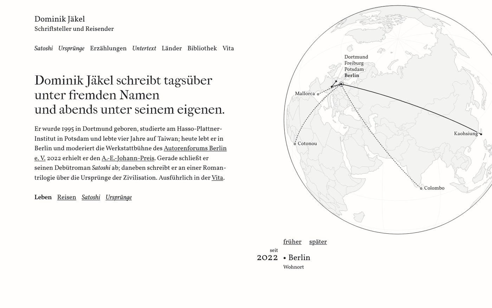
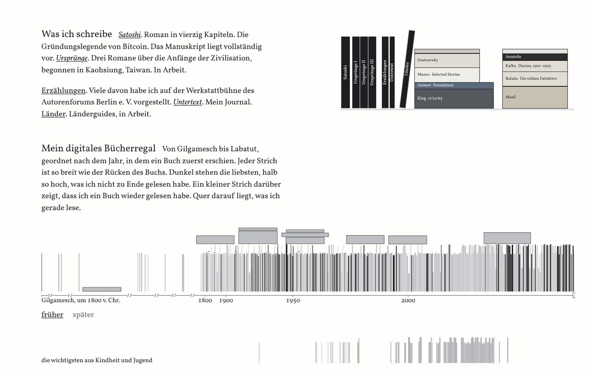
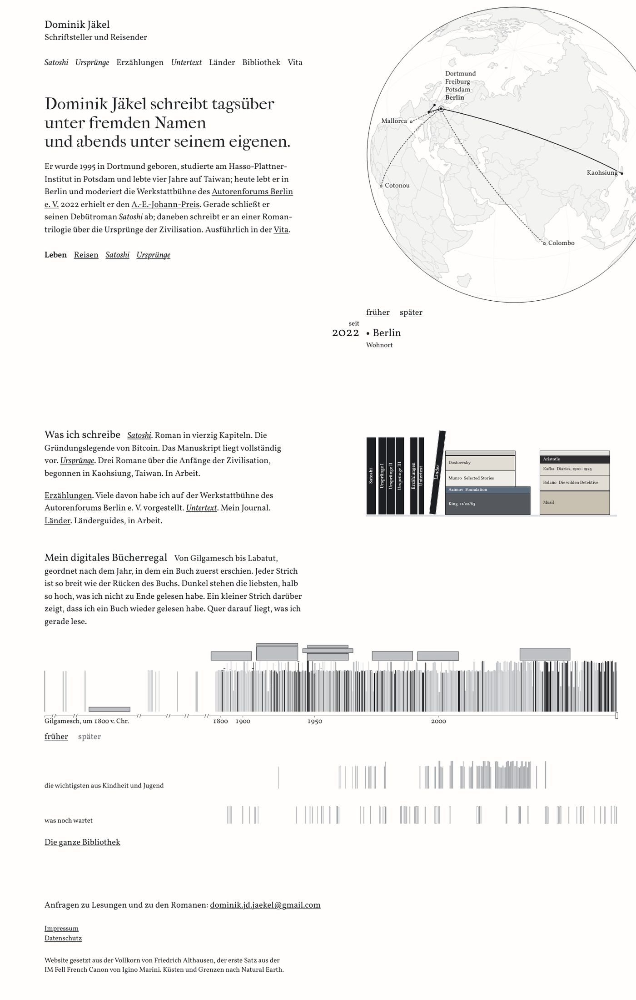
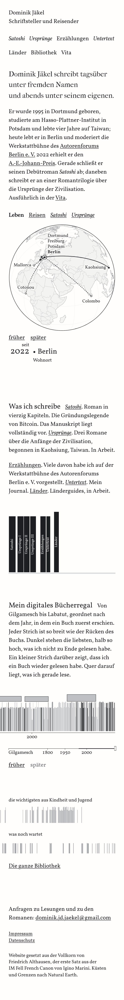

**Was sich ändert.** Der erste Bildschirm bleibt wie heute. Darunter liest sich die Startseite wie eine gesetzte Seite, ohne eigene Überschriftzeilen.

- „Was ich schreibe“ und „Mein digitales Bücherregal“ werden zum Auftakt ihres ersten Absatzes, im Satz heißt das Spitzmarke. Sie bleiben im Wortlaut und in der Größe einer Überschrift (23,75 px), stehen aber in der ersten Zeile, und der Text läuft dahinter weiter. Für Vorleseprogramme bleiben es Überschriften. Gestrichen ist keine. Deine Vorgabe V17 sagt, dass die Wörter bleiben und die Form ruhiger werden darf. Das ist hier der Fall.
- Das Werkverzeichnis steht in zwei Absätzen: die Romane, dann das Übrige. Die Titel bleiben unterstrichen und führen auf ihre Seite.
- Das Regalbild steht am Desktop rechts an der Kante der Kugel, oben bündig mit der ersten Zeile. Auf dem Telefon steht es unter dem Text, so fällt die freigehaltene Buchzeile in den Abstand zum nächsten Teil.
- Zwischen Textblöcken steht überall eine Zeile, zwischen Werk und Lektüre zwei, vor dem Fuß vier.

**Vorteile**
- Die deutlichste Abkehr von der Schablone (Punkt 1 und 6). Unter dem Globus gibt es keinen Block mehr, der wie ein Bauteil aussieht.
- Die Seite liest sich wie ein Buch, die Gliederung kommt aus dem Text selbst.
- Auf dem Telefon die kürzeste Fassung, 210 px kürzer als heute.

**Nachteile**
- Fünf Werke in zwei Absätzen lassen sich schlechter überfliegen. Am Zeilenanfang steht nicht mehr jedes Mal ein Titel, man muss lesen.
- Im Fließtext klingt „Das Manuskript liegt vollständig vor. *Ursprünge*. Drei Romane …“ wie ein Satz mit einem Bruchstück. Der Punkt hinter dem Titel war für eine Liste gemacht.
- Spitzmarken sind im Druck üblich, dort aber meist im Grad der Grundschrift, halbfett oder kursiv. In Überschriftgröße sind sie auch im Druck selten, im Netz noch seltener. Manche Leser halten sie für einen Fehler im Umbruch.
- Im Quelltext steht „Was ich schreibe“ jetzt hinter dem Regalbild. Vorleseprogramme und die Tabulatortaste erreichen die Bände des Regalbilds also vor der Überschrift ihres Teils.
- Der leere Platz neben der Tafel im ersten Bildschirm bleibt.

---

## Empfehlung: Variante 1 mit Legende und Fuß aus Variante 2

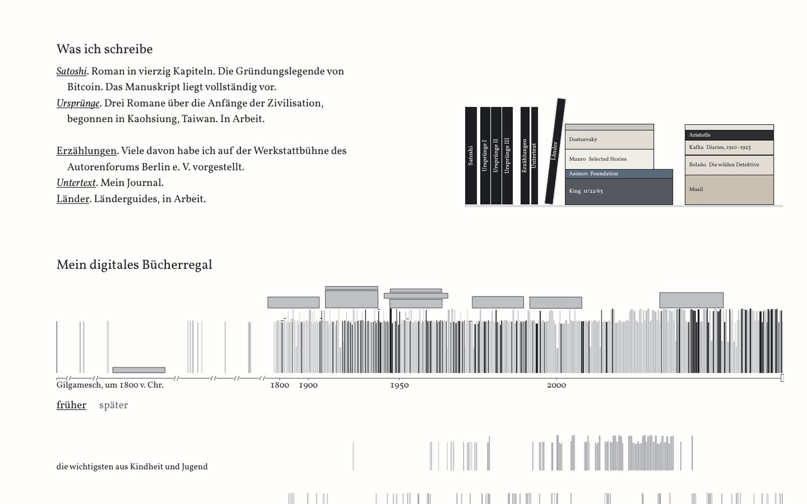
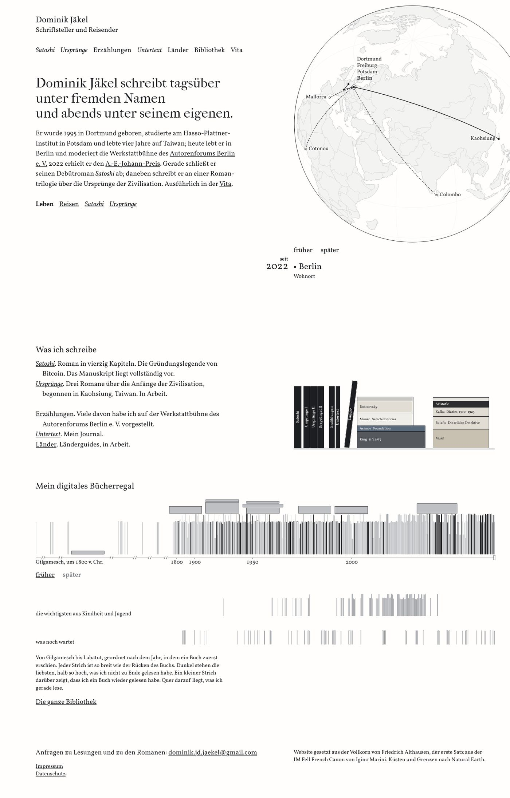
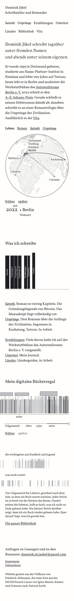

**Was sich ändert.** Der erste Bildschirm bleibt wie heute, die Wahl der Ebene steht weiter direkt unter der Kurzvita.

- Aus allen drei Varianten: Die Namen der Reihen stehen in ihrer Reihe, die freigehaltene Buchzeile zählt als Abstand, das Werkverzeichnis hat zwei Gruppen.
- Aus Variante 1: Die Einträge einer Gruppe stehen ohne Abstand untereinander, mit hängendem Einzug. Das Brett des Regalbilds steht auf der Zeile von „Länder“, die Buchzeile erscheint darunter und schiebt nichts. Die Überschriften stehen ¼ Zeile über ihrem Inhalt. Zwischen Werk und Lektüre bleiben drei Zeilen, damit die Buchzeile bis zum Band Platz hat (44 px bei 1280 und 1440, 72 px bei 1920).
- Aus Variante 2: Unter „Mein digitales Bücherregal“ folgt sofort das Band, der Absatz „Von Gilgamesch bis Labatut …“ steht darunter als Legende im Grad „klein“. Der Fuß steht vier Zeilen tiefer und am Desktop auf zwei Spalten, rechts das Kolophon an der Kante der Kugel.

Geprüft bei 1024 (nur die Reihen), 1280, 1440, 1920 und 390 px: dieselben Wörter wie heute, nur die Legende steht im Quelltext hinter dem Band. Ebenen, Zeitband, Regalbild und Fuß funktionieren, der Browser meldet keinen Fehler. Die Seite liegt als `index-empfehlung.html` neben den Varianten, gebaut mit `bauen.py` und `empfehlung.css` in `/tmp/claude-0/-home-user-Autorenwebsite/f47320ed-8ba8-501b-b8f6-90b4eb6d5a1c/scratchpad/rhythmus/pruef/werkzeuge/`. Sie nutzt `gemeinsam.css` und `reihen.js` der Varianten, `ebenentext.js` braucht sie nicht.
