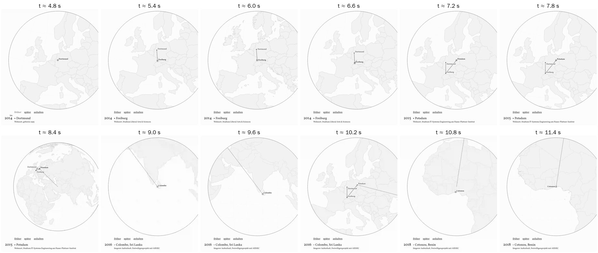
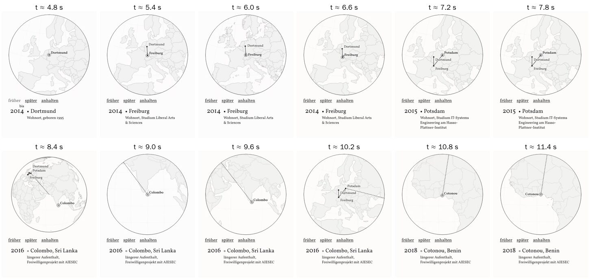
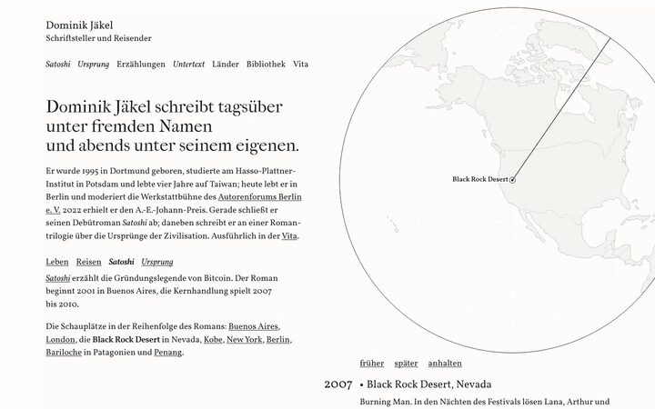
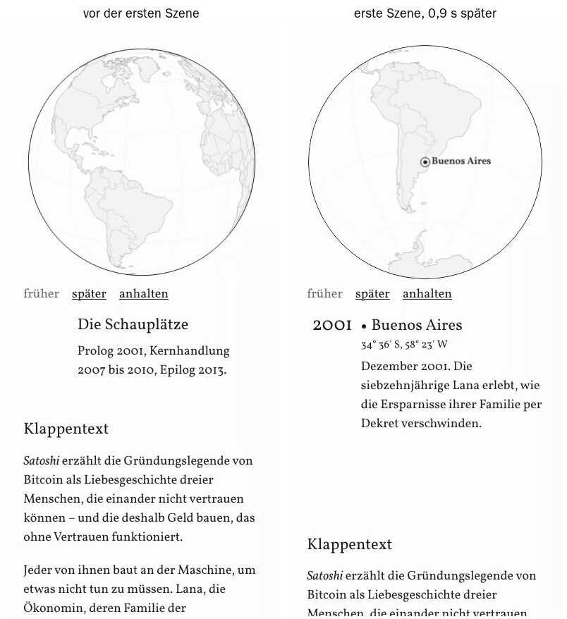

# Takt der Globen: Messung, Best Practices, Empfehlung

Stand: 21. Oktober 2026, abends. Gilt für Version C (`website-c/`). Grundlage ist deine Rückmeldung:

> „Takt kürzer, etwa eine Minute insgesamt. Eines was mir noch aufgefallen ist. Auf der Startseite. Entweder den Takt länger oder kurz halten. Aber dann nicht jedes Mal kurz die Details zeigen. Das sieht auch komisch aus. Da bitte auch nochmal nach best practices schauen. Und dann die Empfehlungen umsetzen“

Dazu gilt dein Nachtrag zu *Satoshi*: Die Zeitleiste der Orte und die Zeile „Weitere Schauplätze …“ fallen weg, der Globus steht direkt unter dem Aufhänger. Weiter gelten deine früheren Vorgaben: Die Linien wandern von Stadt zu Stadt. Beim ersten Sichtbarwerden läuft ein Einspieler, danach steuerst du selbst. Bei reduzierter Bewegung gibt es keinen Einspieler. Auf *Satoshi* läuft der Szenentext im Ablauf mit (K9).

Dieses Dokument ändert keinen Code. Es misst den heutigen Stand, fasst zusammen, wie gute Beispiele es machen, und empfiehlt Zahlen für die Umsetzung.

---

## Kurzfassung

1. **Startseite, Leben und *Ursprung*: kurz halten, ohne Details im Ablauf.** Im Einspieler und beim Abspielen zeigt die Tafel nur eine ruhige Zeile mit Jahr und Ort (bei *Ursprung* Band, Ort und Zeit). Art, Vermerk, Koordinaten und die Zeile zum Band erscheinen erst am Ende oder wenn du selbst einen Schritt machst.
2. **Leben:** Flug 1,0 s, Halt 0,8 s (heute 0,6 s), Rückweg eines Abstechers 0,8 s (heute 0,5 s). Jeder Ort steht 1,8 s da, ein Abstecher 2,6 s. Der ganze Einspieler dauert rund 18 s (heute 16 s).
3. ***Ursprung*:** Flug 1,6 s, Halt 1,4 s (heute 2,0 s). Jeder Ort steht 3,0 s da. Der ganze Einspieler dauert rund 14 s (heute 16 s).
4. ***Satoshi*, Seite und Ebene der Startseite:** Halt = 1,0 s + 0,3 s je Wort, mindestens 3 s, höchstens 9 s. Die zehn Halte dauern zusammen 50,0 s. Der Einspieler dauert 60,5 s, Abspielen 60,0 s (heute 118 s). Jeder Szenentext steht 3,9 bis 9,1 s da.
5. **Die Linie kommt zuerst, dann die Schrift.** Tafel, Punkt und Name wechseln, wenn die Linie am Ziel ist, nicht schon bei 55 % des Flugs. Der alte Text bleibt stehen, bis der neue da ist. Es gibt keinen leeren Moment und keine Überblendung.
6. **Kein Inhalt der Tafel steht im Ablauf kürzer als 1,5 s.** Deshalb beginnt jeder Ablauf mit der Tafel der ersten Station. Die Ruhetafel blitzt heute 0,6 bis 1,4 s auf, bevor die erste Station kommt („Satoshi, Roman“ mit dem Aufhänger, „I–III Ursprung“, „Die Schauplätze“). Das fällt weg.
7. **Die Tafel springt nicht und steht ganz im Bild.** Am Desktop bemisst sich die Kugel an der längsten Tafel. Bei 1440 × 900 liegt der Szenentext heute zum größten Teil unter dem Bildschirmrand. Auf dem Telefon hält die Tafel von *Satoshi* ihre Höhe vom Laden an. Heute wächst sie beim Start um 163 px und schrumpft am Ende wieder.
8. Neue Beschriftungen braucht es nicht. „früher“, „später“, „abspielen“, „anhalten“ und „noch einmal von vorn“ bleiben, wie sie sind.

---

## 1. Was heute passiert (gemessen)

**Methode.** Gemessen habe ich mit Playwright in Chromium, ohne Grafikkarte, bei 1440 × 900 und 390 × 844 (Telefon, Touch). Die Seiten liefen von einem lokalen Server. Ein Skript schrieb jeden Wechsel der Tafel mit Zeitstempel und Inhalt mit, dazu Beginn und Ende jedes Flugs. Daneben lief ein Video, aus dem die Bildfolgen unten stammen. Die Zeiten auf Desktop und Telefon weichen um höchstens 0,15 s voneinander ab.

### 1.1 Takt je Ablauf

| Ablauf | Flug | Halt | Tafel steht je Station | Gesamt |
|---|---|---|---|---|
| Startseite, Leben | 1,0 s, Rückweg eines Abstechers 0,5 s | 0,6 s | 1,6 s; Colombo und Cotonou 2,1 bis 2,2 s; Mallorca 2,7 s | 15,6 s, davor 0,6 s Pause |
| Startseite, *Satoshi* | 0,9 s | 3 s + 0,6 s je Wort, 6 bis 18 s | 7,0 bis 18,4 s; davor die Ruhetafel 0,6 s | 118,2 bis 118,4 s |
| Startseite, *Ursprung* | 1,6 s | 2,0 s | 3,6 s, Jerusalem 4,4 s; davor die Ruhetafel 0,9 s | 16,1 s |
| Startseite, Reisen | kein Ablauf | – | wechselt nur bei Klick | – |
| `satoshi.html` | 0,9 s | wie oben | 6,9 bis 18,3 s; davor „Die Schauplätze“ 0,9 bis 1,0 s | 118,1 bis 118,3 s |
| `ursprung.html` | 1,6 s | 2,0 s | 3,6 s; davor „I–III Ursprung“ 1,4 s | 16,1 s |

Die Tafel wechselt bei 55 % jedes Flugs, also während die Kugel noch dreht. Die Gesamtdauer zählt vom ersten Flug bis zum Ende des Überblicksflugs.

### 1.2 Das „Aufblitzen“ auf der Startseite

In der Ebene Leben wechselt die Tafel achtmal in 15,6 s. Jedes Mal kommen zugleich die große Jahreszahl, das Kartenzeichen, der Ort mit Land und eine Unterzeile mit Art und Vermerk. Die Unterzeile ist bis zu 67 Zeichen lang, etwa „Wohnort, Studium IT-Systems Engineering am Hasso-Plattner-Institut“. Nach 1,6 s ist das alles wieder weg.

| Station | Zeichen auf der Tafel | steht heute | Lesezeit bei 13 bis 15 Zeichen je Sekunde |
|---|---|---|---|
| bis 2014 Dortmund | 39 | 2,9 s (mit Vorlauf) | 2,6 bis 3,0 s |
| 2014 Freiburg | 54 | 1,6 s | 3,6 bis 4,2 s |
| 2015 Potsdam | 79 | 1,6 s | 5,3 bis 6,1 s |
| 2016 Colombo, Sri Lanka | 75 | 2,1 s | 5,0 bis 5,8 s |
| 2018 Cotonou, Benin | 71 | 2,2 s | 4,7 bis 5,5 s |
| 2018 Kaohsiung, Taiwan | 70 | 1,6 s | 4,7 bis 5,4 s |
| seit 2022 Berlin | 24 | 1,6 s | 1,6 bis 1,8 s |
| 2023 Mallorca | 33 | 2,7 s | 2,2 bis 2,5 s |

13 bis 15 Zeichen je Sekunde ist der Wert, mit dem ARD, ZDF, ORF und SRF Untertitel stehen lassen (Abschnitt 2.3). Die Tafel steht also an fünf von acht Orten nur ein Drittel bis die Hälfte der Zeit, die man zum Lesen bräuchte. Das ist das Aufblitzen. Man sieht, dass dort Text war, kann ihn aber nicht lesen.

Drei Dinge verstärken das:

- **Die Schrift kommt vor der Linie.** Bei 55 % des Flugs wechseln Tafel und Name, die Kugel dreht noch. Das Auge springt zur Tafel, bevor die Linie angekommen ist.
- **Tafel und Karte passen beim Rückweg nicht zusammen.** Nach Colombo und Cotonou fliegt die Kugel 0,5 s lang zurück nach Potsdam. Die Tafel sagt dabei noch „Colombo“. Der Rückweg ist doppelt so schnell wie der Hinflug, die Kugel schnellt zurück. Dabei wechselt die Vergrößerung jedes Mal zwischen 3,6-fach (Europa) und 2,4-fach.
- **Auf dem Telefon bricht die Unterzeile in ein bis drei Zeilen um.** Die Höhe der Tafel ist fest, aber der Textblock wird bei jedem Halt größer und wieder kleiner.

Beim Wählen der Ebenen *Satoshi* und *Ursprung* blitzt zusätzlich die Ruhetafel auf. „*Satoshi*, Roman“ mit dem Aufhänger (158 Zeichen) steht 0,6 s, „I–III Ursprung, Drei Bände …“ steht 0,9 s, dann kommt die erste Station. Auf `satoshi.html` steht „Die Schauplätze“ 0,9 bis 1,0 s, auf `ursprung.html` „I–III Ursprung“ 1,4 s.

### 1.3 *Satoshi*: zu lang, und der Text liegt teils unter dem Rand

- **Dauer.** Die zehn Halte dauern zusammen 108 s, der ganze Ablauf 118 s. Das gilt für den Einspieler und für „abspielen“, auf der Seite und in der Ebene der Startseite.
- **Startseite bei 1440 × 900.** Die Tafel beginnt bei 829 px und ist 129 px hoch, sie endet also bei 958 px. Von einem Szenentext ist im ersten Bildschirm nur die erste Zeile zu sehen. Die Kugel bemisst sich heute an der Tafel des Lebens, nicht an der längsten Tafel.
- **`satoshi.html` bei 1440 × 900.** Die Tafel endet bei 914 px. Beim längsten Text (Black Rock Desert) ist die dritte Zeile abgeschnitten.
- **`satoshi.html` auf dem Telefon.** In Ruhe ist die Tafel 95 px hoch. Mit dem Start des Ablaufs reserviert sie 258 px. Der Klappentext darunter springt 163 px nach unten und am Ende wieder nach oben.
- **Startseite auf dem Telefon.** Die Tafel ist je Ebene verschieden hoch (Leben 96, *Satoshi* 238, *Ursprung* 143, Reisen 95 px). Sie ändert sich nur, wenn du die Ebene wechselst. Das ist eine Folge deines Klicks und kein Fehler.

### 1.4 Was schon stimmt

- Die Steuerzeile zeigt im Ablauf von Anfang an „anhalten“. Ein Griff an die Kugel beendet den Einspieler.
- Vorleseprogramme hören im Einspieler nichts (`aria-live="off"`), bei einer Wahl schon.
- Bei reduzierter Bewegung gibt es keinen Einspieler. Die Tafel zeigt sofort den Endzustand: Berlin, „Die Schauplätze“ oder Jerusalem.
- Am Desktop hält die Tafel der Startseite in allen Ebenen dieselbe Höhe, im Ablauf springt nichts.
- Der Einspieler pausiert, wenn weniger als ein Fünftel der Kugel zu sehen ist.

---

## 2. Wie gute Beispiele es machen

Die Suche lief über WebSearch. Externe Seiten ließen sich hier fast nie direkt abrufen. Was folgt, stützt sich deshalb auf die Suchergebnisse und auf bekannte veröffentlichte Richtlinien, nicht auf eine Lektüre im Volltext. Für den *Guardian*, die *Washington Post* und *The Pudding* habe ich keine belastbare Beschreibung ihrer Kartenführungen gefunden. Sie fehlen unten deshalb.

### 2.1 Überblick in Bewegung, Details in Ruhe

- **Die *New York Times*, „The Subway Map“ (2019):** Die Animation folgt den Linien und bremst an jeder Station ab und beschleunigt wieder heraus. An jedem Halt erscheint ein Textkasten. Weiter geht es erst mit einem Tippen, der Leser bestimmt das Tempo.
- **Die *New York Times*, „Russia Left Behind“:** Die Route wächst mit dem Lesen. Der Text steht im Artikel, die Karte zeigt nur, wo man ist.
- **Esri Story Map Tour:** Fotos und Texte hängen an nummerierten Orten. Man geht der Reihe nach oder springt per Klick. Die Bildunterschriften sollen kurz sein. Automatisches Abspielen ist für Bildschirme ohne Bedienung gedacht, etwa im Museum, und hat dann einen Regler für das Tempo und eine Pause.
- **Google Earth Voyager und Touren in Google Earth:** Eine Tour fliegt von Ort zu Ort. Erst am Halt erscheint eine Karte mit Text. Flugzeit und Wartezeit am Ort sind getrennte Einstellungen.
- **Mayer, Segmenting-Prinzip:** Man lernt besser, wenn eine Animation in Abschnitte zerfällt, die man selbst weiterschaltet. Das zeigte sich in allen zehn veröffentlichten Vergleichen.
- **Tversky, Morrison und Bétrancourt (2002):** Animationen sind oft zu schnell und zu dicht, um sie zu erfassen. Interaktion, also Anhalten und Wiederholen, gleicht das aus.
- **Robertson und andere (2008), animierte Trends:** Animation eignet sich zum Vorführen, für die genaue Lektüre ist sie die schwächste Form.
- **NN/g, Progressive Disclosure:** Zuerst das Wenige, das fast alle brauchen, die Einzelheiten auf Abruf.

**Folgerung:** Im Ablauf genügt ein Name je Ort, die Einzelheiten kommen in Ruhe. Text, der lesbar mitlaufen soll, braucht seine Lesezeit.

### 2.2 Text, der von selbst weiterschaltet

- **NN/g zu Karussells, die von selbst weiterschalten** (über Yale, UNC und Smashing zitiert): Inhalte wechseln, bevor man fertig gelesen hat. Selbst sehr große Angebote werden übersehen, weil sie weiterlaufen. Wer automatisch weiterschaltet, braucht lange Standzeiten und eine Pause. Genannt werden 5 bis 7 s je Bild, eine Sekunde je drei Wörter oder eine Pause, solange die Maus darauf liegt.
- **WCAG 2.2.2 Pause, Stop, Hide (Stufe A):** Bewegung, die von selbst beginnt und länger als 5 s läuft, braucht einen Weg zum Anhalten. Für Inhalte, die sich in festen Abständen aktualisieren, gibt es keine 5-Sekunden-Ausnahme. Gibt es mehrere solche Elemente, genügt ein gemeinsamer Schalter.
- **WCAG 2.2.1 Timing Adjustable:** Text, der schneller weiterschaltet, als man lesen kann, ist eine Zeitgrenze. Sie ist zulässig, wenn man den Ablauf anhalten kann (2.2.2).
- **WAI-ARIA Authoring Practices, Karussell:** Solange es von selbst läuft, steht der Live-Bereich auf „off“. Bei einer Wahl des Nutzers steht er auf „polite“. Das Beispiel hält an, wenn der Fokus oder die Maus darauf liegt.

### 2.3 Wie lange kurzer Text stehen muss

- **Brysbaert (2019), 190 Studien:** Erwachsene lesen still im Schnitt 238 Wörter je Minute bei Sachtexten und 260 bei Erzähltexten. Das sind rund 4 Wörter je Sekunde, aber nur beim ununterbrochenen Lesen.
- **Untertitel-Standards von ARD, ORF, SRF und ZDF:** 13 bis 15 Zeichen je Sekunde, mindestens 1 s Standzeit. Untertitel kommen dem Fall Globus und Tafel am nächsten, denn auch dort wandert das Auge zwischen Bild und Text.
- **Netflix, Timed Text Style Guide:** mindestens 5/6 s und höchstens 7 s je Untertitel.
- **Untertitelforschung, „Sechs-Sekunden-Regel“:** Zwei volle Zeilen sollen 6 s stehen, das sind etwa 130 Wörter je Minute. In Studien mit Blickmessung war das bequem lesbar.
- **Aufmerksamkeit:** Plötzlich erscheinende Objekte ziehen den Blick auf sich (Yantis und Jonides). Jeder Wechsel der Tafel holt das Auge also von der Linie weg. Je öfter das in kurzer Zeit geschieht, desto unruhiger wirkt es.
- **Kurzer Blick:** Fahrzeugrichtlinien (NHTSA) begrenzen einen Blick weg vom Hauptgeschehen auf 2 s. Was in einen solchen Blick passen soll, muss aus wenigen Wörtern bestehen.

**Folgerung:** Jahr und Ort (2 bis 4 Wörter, rund 12 bis 25 Zeichen) sind in 1,5 bis 2 s lesbar. Eine Zeile mit Art und Vermerk (bis 79 Zeichen) braucht 5 bis 6 s. Ein Szenentext von *Satoshi* liest sich bei 0,25 s je Wort (Brysbaert) bis 0,46 s je Wort (Sechs-Sekunden-Regel).

### 2.4 Bewegung, Dauer, Ruhe

- **Material Design:** Übergänge der Oberfläche dauern 200 bis 400 ms, große bis etwa 375 ms. Die Dauer wächst mit der Strecke. Was verschwindet, darf schneller gehen. „Standard easing“ wirkt sachlich, lange betonte Kurven wirken stilisiert.
- **Apple Human Interface Guidelines:** Bewegung kurz und präzise halten. Man soll sie abbrechen können und nie auf sie warten müssen. Wichtige Information darf nicht nur in der Bewegung stecken. Bei „Bewegung reduzieren“ wird sie weniger.
- **Kamerafahrten auf Karten:** van Wijk und Nuij (2003) beschreiben den Flug mit dem geringsten Wahrnehmungsaufwand. `d3.interpolateZoom` setzt ihn um und schlägt eine Dauer nach der Weglänge vor. Mapbox `flyTo` nimmt als Krümmung 1,42, den Mittelwert aus der Nutzerstudie dazu. Unter `prefers-reduced-motion` springt die Karte, statt zu fliegen.
- **Platz reservieren (web.dev, CLS):** Für Inhalte, die nachkommen, wird von Anfang an der Platz des größten Falls reserviert. Ein leerer Platz klappt danach nicht wieder zu. Verschiebungen innerhalb von 0,5 s nach einer Eingabe des Nutzers zählen nicht als Sprung.
- **Reduzierte Bewegung (web.dev, WCAG 2.3.3):** Wer `prefers-reduced-motion` gesetzt hat, bekommt keine selbsttätige Bewegung.

---

## 3. Empfehlung

### 3.1 Startseite: kurz halten, ohne Details im Ablauf

**Entscheidung:** kurz halten. Für das Leben wäre das Gegenteil, also lange genug halten, um Art und Vermerk zu lesen, 5 bis 6 s je Ort. Der Einspieler dauerte dann rund 55 s. Das ist für eine Startseite zu lang, und der Reiz der wandernden Linie ginge verloren. Die Einzelheiten stehen weiter in der Tafel, sobald du selbst einen Schritt machst. Ausführlich stehen sie in der Vita.

**Was die Tafel wann zeigt, auf allen Globen gleich:**

| Zustand | Leben | *Ursprung* | *Satoshi* | Reisen |
|---|---|---|---|---|
| bevor der Einspieler läuft | die erste Station, nur die Kopfzeile | die erste Station, nur die Kopfzeile | die erste Szene mit Text | Überblick |
| im Einspieler und beim Abspielen | Jahr, Zeichen, Ort, Land (eine Zeile) | Band, Ort, Zeit („um 8000 v. Chr.“ klein dahinter) | Jahr, Ort, Szenentext | kein Ablauf |
| am Ende | Berlin mit „Wohnort“ | Jerusalem mit Landschaft und Zeile zum Band | Ruhetafel („*Satoshi*, Roman“ und Aufhänger, auf der Seite „Die Schauplätze“) | – |
| nach einem Schritt von Hand (früher, später, Klick) | ganze Tafel, sofort | ganze Tafel, sofort | ganze Tafel, sofort | Kontinent oder Land, bei Klick |
| reduzierte Bewegung | Endzustand | Endzustand | Ruhetafel | Überblick |

- Die Regel lautet: Was von selbst läuft, zeigt nur Jahr und Ort. Was du selbst wählst, zeigt alles. *Satoshi* ist die Ausnahme, denn dort sollen die Szenentexte mitlaufen (K9). Deshalb hält *Satoshi* so lange, dass man sie lesen kann (3.2).
- Im Ablauf bleibt der Platz für die Unterzeile frei. Die Tafel behält ihre Höhe, nur dieser Bereich ist leer. Die Kopfzeile ist nie leer. Die Art des Orts zeigt im Ablauf das Kartenzeichen: der gefüllte Punkt für einen Wohnort, der offene Kreis für einen längeren Aufenthalt.
- Abspielen auf Leben und *Ursprung* läuft wie der Einspieler: nur die Kopfzeile, derselbe Takt.
- Am Ende erscheinen die Einzelheiten einmal und bleiben stehen. Sie kommen unter der Kopfzeile hinzu und ersetzen nichts. Ein einzelner Wechsel, der bleibt, blitzt nicht auf.

**Takt Leben** (Werte in `FSeite.TAKT.leben`):

| | heute | neu |
|---|---|---|
| Pause vor dem ersten Flug | 0,6 s | 0,6 s |
| Flug | 1,0 s | 1,0 s |
| Halt | 0,6 s | 0,8 s |
| Rückweg eines Abstechers | 0,5 s | 0,8 s, mit der Vergrößerung des Abstechers |
| Überblick am Ende | 1,0 s | 1,0 s |
| Tafel steht je Ort | 1,6 s (Abstecher 2,1 s) | 1,8 s (Abstecher 2,6 s) |
| gesamt | 16,2 s | 18,4 s |

Rechnung: 0,6 + 8 × 1,0 + 8 × 0,8 + 3 × 0,8 + 1,0 = 18,4 s. Die Kopfzeile hat 16 bis 23 Zeichen und steht 1,8 s. Das sind höchstens 12,8 Zeichen je Sekunde, also unter dem Untertitelwert.

**Takt *Ursprung*** (Startseite und `ursprung.html`, `FSeite.TAKT.ursprung`):

| | heute | neu |
|---|---|---|
| Flug | 1,6 s | 1,6 s (bleibt langsamer, V23) |
| Halt | 2,0 s | 1,4 s |
| Tafel steht je Ort | 3,6 s | 3,0 s |
| gesamt | 16,7 s (mit 0,6 s Pause) | 14,2 s |

Rechnung: 0,6 + 4 × 1,6 + 4 × 1,4 + 1,6 = 14,2 s. Die Kopfzeile, etwa „I Göbekli Tepe um 8000 v. Chr.“, hat rund 30 Zeichen und steht 3,0 s, das sind 10 Zeichen je Sekunde. Auf `ursprung.html` stehen Landschaft und Zeile zum Band ohnehin im Text neben dem Globus.

**Reisen** bleibt ohne Ablauf. Die Tafel wechselt nur bei einem Klick, beim Zeigen nennt nur der Zettel das Land. Das ist schon heute so und passt zur Regel.

**Gleich auf allen Ebenen:** dieselbe Pause vor dem ersten Flug (0,6 s), dasselbe Easing, Tafelwechsel bei Ankunft. Jede Station steht mindestens 1,5 s, am Ende kommt der Überblick. Leben (18 s) und *Ursprung* (14 s) bleiben kurze Einspieler. *Satoshi* (60 s) ist der Ablauf zum Lesen.

### 3.2 *Satoshi*: rund 60 s für zehn Szenen

**Formel:** Halt = 1,0 s + 0,3 s je Wort des Szenentexts, mindestens 3,0 s, höchstens 9,0 s. Heute sind es 3 s + 0,6 s je Wort, mindestens 6 s, höchstens 18 s. Wörter zählt die Seite wie heute (`woerter`, getrennt an Leerzeichen).

| Nr. | Szene | Wörter | Zeichen | Halt heute | Halt neu | Text steht | Wörter je Minute | Zeichen je Sekunde |
|---|---|---|---|---|---|---|---|---|
| 1 | 2001 Buenos Aires | 14 | 106 | 11,4 s | 5,2 s | 6,1 s | 138 | 17,4 |
| 2 | 2007 London | 21 | 130 | 15,6 s | 7,3 s | 8,2 s | 154 | 15,9 |
| 3 | 2007 Black Rock Desert | 24 | 158 | 17,4 s | 8,2 s | 9,1 s | 158 | 17,4 |
| 4 | 2007 London | 10 | 64 | 9,0 s | 4,0 s | 4,9 s | 122 | 13,1 |
| 5 | 2007 Kobe | 9 | 57 | 8,4 s | 3,7 s | 4,6 s | 117 | 12,4 |
| 6 | 2008 New York | 16 | 91 | 12,6 s | 5,8 s | 6,7 s | 143 | 13,6 |
| 7 | 2008 Berlin | 12 | 90 | 10,2 s | 4,6 s | 5,5 s | 131 | 16,4 |
| 8 | 2009 Buenos Aires | 14 | 100 | 11,4 s | 5,2 s | 6,1 s | 138 | 16,4 |
| 9 | 2010 Bariloche | 2 | 17 | 6,0 s | 3,0 s | 3,9 s | – | 4,4 |
| 10 | 2013 Penang | 3 | 17 | 6,0 s | 3,0 s | 3,9 s | – | 4,4 |
| | **Summe** | **125** | **830** | **108,0 s** | **50,0 s** | | | |

- „Text steht“ ist der Halt plus der Flug zur nächsten Szene, denn der Text bleibt stehen, bis der nächste da ist. Bei der ersten Szene kommt der erste Flug hinzu (0,9 s), sie steht also 7,0 s.
- **Gesamt im Einspieler:** 0,6 s Pause + 10 × 0,9 s Flug + 50,0 s Halt + 0,9 s Überblick = **60,5 s**.
- **Gesamt beim Abspielen:** 10 × 1,0 s Flug + 50,0 s Halt = **60,0 s**. Abspielen endet in Penang, ohne Überblick.
- **Lesetempo:** 117 bis 158 Wörter je Minute, 12 bis 17 Zeichen je Sekunde. Das liegt zwischen der Sechs-Sekunden-Regel (130) und dem stillen Lesen (238). Bei den drei längsten Szenen liegt es an der Obergrenze von Netflix (17 Zeichen je Sekunde). Für ein Lesen ohne Hast ist das knapp, aber machbar, zumal „anhalten“ immer bereitsteht. Mehr Lesezeit geht bei etwa 60 s Gesamtdauer nicht.
- **Wenn es dir zu schnell ist:** 1,0 s + 0,35 s je Wort ergibt 55,6 s Halt und rund 66 s gesamt. Das wäre die einzige Zahl, die sich ändert.

**Wie Text kommt und geht:**

- **Direkter Wechsel bei Ankunft.** Jahr, Ort und Szenentext wechseln in einem Bild, zusammen mit Punkt und Name auf der Kugel, sobald die Linie am Ziel ist. Es gibt keine Überblendung. C erlaubt `transition` nur an zwei Stellen (7.3), und eine Überblendung zeigt einen Moment lang beide Texte halb.
- **Kein leerer Moment.** Der alte Text bleibt, während die Kugel zur nächsten Szene fliegt. Die Tafel ist nie leer.
- **Kein Vorspann.** Ein Ablauf beginnt sofort mit der ersten Szene in der Tafel. Die Ruhetafel steht nur vor dem ersten Mal, am Ende und in Ruhe.
- **Feste Höhe von Anfang an.**
  - Am Desktop bemisst sich die Kugel an der längsten Tafel, nicht an der mittleren (`satoshi.html`) oder an der des Lebens (Startseite). Bei 1440 × 900 muss die Unterkante der Tafel mit dem längsten Szenentext im Bild liegen. Heute liegt sie auf der Startseite bei 958 px, auf `satoshi.html` bei 914 px. Die Kugel wird dadurch etwas kleiner, auf der Startseite um grob 55 bis 60 px. Das misst die Umsetzung genau.
  - Auf dem Telefon reserviert `satoshi.html` die Höhe der längsten Szene vom Laden an und gibt sie am Ende nicht zurück. Der Klappentext springt dann weder beim Start noch am Ende. In Ruhe bleibt unter „Die Schauplätze“ Platz frei. Das ist der Preis, und web.dev empfiehlt ihn ausdrücklich.
- **Ohne Zeitleiste** (dein Nachtrag) nennen nur noch die Tafel und der Name auf der Kugel die jetzige Szene. Umso wichtiger ist, dass die Kopfzeile mit Jahr und Ort nie unter den Rand rutscht.

### 3.3 Damit die Bewegung ruhig und bewusst wirkt

1. **Erst die Linie, dann die Schrift.** Name, Punkt und Tafel wechseln, wenn der Flug zu Ende ist, heute geschieht das bei 55 %. Mit `d3.easeCubicInOut` steht die Kugel dann fast still, das Auge kann von der Linie zur Tafel wandern. Das gilt auf allen Globen.
2. **Mindeststandzeit 1,5 s** für jeden Inhalt der Tafel im Ablauf, eine prüfbare Regel. Die Untertitel-Standards verlangen 1 s, dazu kommt der Blickwechsel vom Globus.
3. **Ein Ablauf beginnt mit der ersten Station.** Beim Start setzt die Tafel sofort die erste Station. Der erste Flug ist nur die Kamerafahrt zum Startpunkt, ohne Linie. Kann ein Einspieler laufen, zeigt die Tafel schon vor ihm diese Station. Das beseitigt das Aufblitzen der Ruhetafel, heute 0,6 bis 1,4 s.
4. **Pause vor der ersten Bewegung: 0,6 s** nach dem ersten Bild der Kugel, wie heute. Die erste Station hält danach wie jede andere. Der Einflug des ersten Satzes (1,0 s) läuft daneben weiter. Er endet, bevor die erste Linie losgeht: 0,6 + 1,0 + 0,8 = 2,4 s.
5. **Rückweg der Abstecher: 0,8 s statt 0,5 s**, mit der Vergrößerung des Abstechers. Heute ist der Rückweg doppelt so schnell wie der Hinflug, und die Kugel zoomt dreimal zwischen 3,6- und 2,4-fach hin und her. Mit gleicher Vergrößerung auf dem Rückweg zoomt sie nur noch, wenn sie Europa verlässt und wenn sie für Berlin zurückkommt. Die Tafel bleibt auf dem Rückweg beim Abstecher: Hin und zurück gehören zu ihm.
6. **Easing und Flugdauer bleiben:** `d3.easeCubicInOut`, langsam an und langsam aus wie bei der NYT-U-Bahn. Die feste Flugdauer von 1,0 s bleibt (V26). Eine Dauer nach der Strecke (van Wijk und Nuij, `d3.interpolateZoom`) wäre die Alternative, falls lange Flüge wie Berlin nach Kaohsiung zu schnell wirken.
7. **Am Ende:** Überblicksflug in Flugdauer, dann der Endzustand mit den Einzelheiten. Das Steuerwort heißt „noch einmal von vorn“ (*Satoshi*: „abspielen“). Keine Schleife, kein Wiederholen von selbst.
8. **Anhalten, Vorleseprogramme, reduzierte Bewegung** bleiben wie heute. Damit sind WCAG 2.2.2 und die Karussell-Praxis der WAI erfüllt: „anhalten“ ist im Ablauf immer sichtbar, und im Ablauf meldet die Tafel nichts.
9. **Zur Wahl, nicht empfohlen für jetzt:**
   - Der Einspieler läuft nur einmal je Besuch. Wer von der Vita zurückkommt, sähe sofort den Endzustand mit „noch einmal von vorn“. Bewegung, die bei jedem Aufruf von selbst wiederkommt, ist der Kern der Kritik an Karussells. Dein „am Anfang ein Einspieler“ bliebe erfüllt. Sag Bescheid, wenn du es willst.
   - Der Ablauf von *Satoshi* hält an, solange die Maus auf der Tafel liegt (WAI-Beispiel). Das hilft beim Lesen, wirkt aber wie ein versteckter Schalter. Ich würde es nicht einbauen.

---

## 4. Hinweise für die Umsetzung

Hier steht nur, was sich ändert. Den Code ändert dieser Schritt nicht.

- `website-c/seite.js`, `TAKT`:
  - `leben`: `halt` 800, `rueckweg` 800, auf dem Rückweg die Vergrößerung des Abstechers.
  - `ursprung`: `halt` 1400.
  - `satoshiHalt` = max(3000, min(9000, 1000 + 300 × Wörter)).
  - Die Flüge bleiben: Leben 1000, *Ursprung* 1600, *Satoshi* 900 im Einspieler und 1000 beim Abspielen.
- `website-c/globus/kern.js`, `chronik`: Die Ankunft (Punkt, Name, `beiStation`) kommt am Ende des Flugs, nicht bei `e > .55`.
- `FSeite.ablauf`: Beim Start eines Ablaufs ab der ersten Station meldet er sie sofort (`beiStation(0, …)`), nicht erst nach dem ersten Flug. Die Seite erfährt aus `info.quelle` (`einspieler`, `abspielen`), dass sie die Kopfzeile setzen soll.
- Die Seiten setzen im Ablauf auf Leben und *Ursprung* nur die Kopfzeile, ohne `unter`, `daten`, `text`. Bei *Ursprung* steht die Zeit als `zusatz`. Am Ende und nach einem Schritt von Hand setzen sie die ganze Tafel. Für *Satoshi* bleibt die Tafel mit Text.
- Startseite: `tafelPlatz` bemisst die Kugel an allen Inhalten (`platz` = längster Inhalt aller Ebenen), nicht an `lebenAlle()`. `satoshi.html`: an der längsten Szene statt an der mittleren. Auf dem Telefon reserviert `satoshi.html` die längste Szene vom Laden an, ohne sie am Ende freizugeben.
- `docs/gestaltung-website-c.md` 6.5 und 7.2 brauchen die neuen Werte, ebenso der K9-Absatz in `docs/website-c.md`.
- **Beschriftungen:** keine neuen, keine geänderten.

## 5. Prüfliste nach der Umsetzung

Messen wie in Abschnitt 1, bei 1440 × 900 und 390 × 844:

- [ ] Leben: Einspieler 18,4 s ± 0,5 s. Im Ablauf zeigt die Tafel nur die Kopfzeile, „Wohnort“ erscheint erst am Ende.
- [ ] *Ursprung*, Startseite und Seite: 14,2 s ± 0,5 s. Kopfzeile mit Band, Ort und Zeit, die Einzelheiten erst am Ende.
- [ ] *Satoshi*, Startseite und Seite: Einspieler 60,5 s ± 1 s, Abspielen 60,0 s ± 1 s. An jeder Station steht der Szenentext.
- [ ] Kein Inhalt der Tafel steht im Ablauf kürzer als 1,5 s, auch nicht zu Beginn. Die Ruhetafel erscheint nicht zwischen Wahl und erster Station.
- [ ] Die Tafel wechselt im selben Bild wie Punkt und Name, und erst nach dem Ende des Flugs.
- [ ] Die Tafel ist im Ablauf nie leer. Ihre Höhe ändert sich im Ablauf und an seinem Ende nicht, auch auf dem Telefon auf `satoshi.html`.
- [ ] 1440 × 900: Die Tafel mit dem längsten Szenentext endet über 900 px, auf der Startseite und auf `satoshi.html`.
- [ ] Ein Schritt von Hand zeigt sofort die ganze Tafel. „anhalten“ hält an, ein Griff an die Kugel beendet den Einspieler.
- [ ] Reduzierte Bewegung: kein Einspieler, sofort der Endzustand, wie heute.

---

## Quellen

Gesucht wurde über WebSearch, die Seiten selbst ließen sich nicht abrufen. Wo nur Zweitquellen vorlagen, steht das dabei.

**Kartenführungen und Erzählungen mit Karten**
- NYT, „The Subway Map“ (2019): https://www.storybench.org/how-the-new-york-times-broke-down-the-history-of-the-nyc-subway-map/ und https://www-3.collection.cooperhewitt.org/objects/2318808848
- NYT, „Russia Left Behind“, Technik der wachsenden Route: https://source.opennews.org/articles/animating-maps-d3-and-topojson/ und https://mk.schoolofdata.org/2014/08/25/seven-ways-to-create-a-storymap/index.html
- Esri Story Map Tour, Bildunterschriften und automatisches Abspielen: https://www.esri.com/arcgis-blog/products/story-maps/mapping/add-links-to-captions-story-map-tour und https://www.esri.com/about/newsroom/arcwatch/make-a-map-tour-story-map
- Google Earth Voyager: https://venturebeat.com/2017/04/18/google-earth-relaunches-with-new-storytelling-and-exploration-features
- Google Earth, Touren (Flugzeit und Wartezeit am Ort): https://support.google.com/earth/answer/148174
- Mapbox, Erzählen mit Karten: https://www.mapbox.com/blog/interactive-storytelling-3d-maps-with-mapbox-gl-js-v2
- Mapbox `flyTo` (speed 1,2, curve 1,42, reduzierte Bewegung): https://docs.mapbox.com/mapbox-gl-js/example/flyto-options/ und https://docs.mapbox.com/mapbox-gl-js/api/properties
- d3 `interpolateZoom` (van Wijk und Nuij, empfohlene Dauer): https://d3js.org/d3-interpolate/zoom
- Reach und North zu van Wijk und Nuij: https://arxiv.org/pdf/1801.09358

**Automatisches Weiterschalten und Barrierefreiheit**
- NN/g zu Karussells, die von selbst weiterschalten (über Zweitquellen): https://www.nngroup.com/articles/auto-forwarding/ sowie https://usability.yale.edu/usability-best-practices/hero-imagescarousels, https://www.med.unc.edu/webguide/accessibility/carousels und https://www.smashingmagazine.com/2022/04/designing-better-carousel-ux
- NN/g, Video zu Karussells: https://www.nngroup.com/videos/carousels-websites-mobile-apps/
- WCAG 2.2.2 Pause, Stop, Hide: https://www.w3.org/WAI/WCAG22/Understanding/pause-stop-hide
- WCAG 2.2.1 Timing Adjustable: https://www.w3.org/WAI/WCAG22/Understanding/timing-adjustable.html
- WCAG 2.3.3 Animation from Interactions: https://w3c.github.io/wcag/understanding/animation-from-interactions
- WAI-ARIA Authoring Practices, Karussell: https://www.w3.org/WAI/ARIA/apg/patterns/carousel/examples/carousel-2-tablist/ und https://www.w3.org/WAI/tutorials/carousels/functionality/
- web.dev, Bewegung und Barrierefreiheit: https://web.dev/learn/accessibility/motion

**Lesezeit**
- Brysbaert (2019), „How many words do we read per minute?“: https://www.gwern.net/doc/psychology/linguistics/2019-brysbaert.pdf und https://www.bps.org.uk/research-digest/most-comprehensive-review-date-finds-average-persons-reading-speed-slower
- Untertitel-Standards von ARD, ORF, SRF und ZDF: https://www.schwerhoerigen-netz.de/fileadmin/user_upload/dsb/Dokumente/Information/Politik_Recht/Barrierefrei/UT-standards.pdf
- Netflix, Timed Text Style Guide, General Requirements: https://backlothelp.netflix.com/hc/en-us/articles/215758617
- Sechs-Sekunden-Regel und Blickmessung bei Untertiteln (Überblick aus den Suchtreffern): https://ueaeprints.uea.ac.uk/id/eprint/100082/1/6_Szarkowska_et_al.pdf und https://discovery-pp.ucl.ac.uk/id/eprint/10038976/1/084.2016.17.2.3.pdf
- NHTSA, Richtlinien zur Ablenkung (Blicke bis 2 s): https://nap.nationalacademies.org/read/26550/chapter/4

**Wahrnehmung und Lernen**
- Mayer, Segmenting-Prinzip: https://www.cambridge.org/core/books/multimedia-learning/segmenting-principle/37240877DDA0362355ADB39936027982
- Tversky, Morrison und Bétrancourt (2002), „Animation: can it facilitate?“: https://hci.stanford.edu/courses/cs448b/papers/Tversky_AnimationFacilitate_IJHCS02.pdf
- Heer und Robertson (2007), „Animated Transitions in Statistical Data Graphics“: https://idl.uw.edu/papers/animated-transitions
- Robertson und andere (2008), „Effectiveness of Animation in Trend Visualization“: https://faculty.cc.gatech.edu/~stasko/papers/infovis08-anim.pdf
- Plötzliches Erscheinen zieht den Blick an (Yantis und Jonides): https://www.ncbi.nlm.nih.gov/pmc/articles/PMC3868916/
- NN/g, Progressive Disclosure: https://www.nngroup.com/articles/progressive-disclosure/

**Bewegung in Oberflächen**
- Material Design, Dauer und Easing: https://m1.material.io/motion/duration-easing.html
- Apple Human Interface Guidelines, Motion: https://developer.apple.com/design/human-interface-guidelines/motion
- web.dev, Layoutsprünge vermeiden (CLS): https://web.dev/optimize-cls
