# Startseite und Satoshi: die weiße Fläche im ersten Bildschirm am Desktop

Stand: 23. Oktober 2026. Gilt für Version C (`website-c/index.html` und `website-c/satoshi.html`), nur für die breite Ansicht mit zwei Spalten (ab 62 rem, rund 1000 px Fensterbreite). Einzige Ausnahme ist die Wahl der Ebene auf der Startseite, die auch das Telefon betrifft. Grundlage sind deine Nachrichten:

> „Auch bei deiner neuen Variante ist in der Desktopversion hierunter relativ viel weiße Fläche. Wollen wir da vielleicht auch die Schrift größer machen, wie bei Satoshi?“
>
> „Man könnte noch blassgraue Sprungmarker machen … Hierunter. Also Klappentext etc …“
>
> „Also quasi Unterkapitel für jede Untergliederung. Dafür vielleicht das raus. … Oder wir untergliedern halt die digitale Bibliothek in die drei Abschnitte. … Aber ist dadurch wahrscheinlich überladen. … Oder einfach die Schrift größer. Und die beiden Unterkapitel?!“
>
> „Am Handybild stört mich nur das doppelte Leben / Reisen Satoshi / Ursprünge über den Globus auf der Startseite.“

## Kurz gesagt

Gute Buch- und Autorenseiten füllen die kürzere Spalte mit dem Werk, meist mit dem Inhaltsverzeichnis, nie mit größerer Schrift. Ein Verzeichnis der Abschnitte (Sprungmarken, also Verweise auf Stellen weiter unten auf derselben Seite) lohnt sich laut Recherche nur bei mehreren echten Abschnitten.

Auf *Satoshi* empfehle ich deshalb deine Sprungmarken, in Tinte statt Grau, mit einem Aufhänger, der bei hohen Fenstern bis 46 px mitwächst (Variante 7). Bei 1440 × 900 bleiben dann 130 statt 387 px frei, bei 1920 × 1080 rund 220 px. Zweite Wahl ist dieselbe Liste ohne wachsenden Aufhänger: weniger Code, bei 1440 rund 35 px weniger Gewinn. Grau würde ich die Marken nicht setzen, denn das einzige Grau mit genug Kontrast ist das des gesperrten „früher“ daneben, und dann lesen sie sich wie „nicht verfügbar“.

Auf der Startseite empfehle ich die größere Schrift für Satz und Kurzvita (Variante 1) und die Wahl der Ebene nur auf dem Telefon unter der Kugel. Zweite Wahl ist die Wahl überall unter der Kugel (Variante 2). Ehrlich: Das nimmt bei 1440 × 900 nur rund 100 px weg. Die Fläche verschwindet nur mit neuem Inhalt, am ehesten mit deinen Büchern neben der Kugel (Variante 6), die aber auf niedrigen Laptops bricht und die Wahl der Ebene kostet.

Zwei Sprungmarken auf der Startseite sehen so blass aus, wie du fürchtest. Das Bücherregal in drei Reihen als Marken ist wirklich überladen: fünf Einträge für zwei Abschnitte, und für die erste Reihe bräuchte es das neue Wort „gelesen“. Die Wahl der Ebene würde ich nicht streichen, sonst geht das Spiel mit den vier Welten auf einer Kugel verloren.

Die drei Urteile sind sich bei *Satoshi* einig. Auf der Startseite will eines die Wahl überall an der Kugel, zwei nur auf dem Telefon. Zwei würden die Kurzvita im Textgrad lassen; das teile ich nicht, weil die größere Schrift dann nur rund 20 px bringt.

Alle Varianten sind in Kopien gebaut und mit Chromium fotografiert, mit reduzierter Bewegung (die großen Sätze stehen dann sofort, die Kugel zeigt den Ruhestand). In `website-c/` ist nichts geändert. „Weiße Fläche“ misst links vom Ende des letzten Elements bis zur Oberkante der nächsten Überschrift („Was ich schreibe“ bzw. „Klappentext“), in CSS-Pixeln. Klick auf ein Bild öffnet es groß.

## Wie andere Seiten das lösen

Die Recherche konnte aus dieser Umgebung nur GitHub erreichen. Untersucht sind deshalb 13 Buch- und Autorenseiten, deren Quelltext offen liegt: zehn lokal ausgeliefert und fotografiert, drei nur aus dem Quelltext gelesen. Literarische Häuser wie die *Paris Review*, Stripe Press oder Suhrkamp waren nicht erreichbar.

**Die kürzere Spalte wird mit dem Werk gefüllt, nicht mit größerer Schrift.**

- [Eloquent JavaScript](https://eloquentjavascript.net/): links der Umschlag, rechts das Inhaltsverzeichnis im Lesegrad (20 px, Zeilen im Abstand 29 px). Die Liste endet 55 px über dem Fuß des Umschlags. Das deutlichste Vorbild.
- [Game Programming Patterns](https://gameprogrammingpatterns.com/): in der rechten Spalte das ganze Inhaltsverzeichnis, bis an den Bildschirmrand.
- [gwern.net](https://gwern.net/): über 900 px Breite steht das Inhaltsverzeichnis neben dem Abstrakt im ersten Bildschirm.
- [webtypography.net](https://webtypography.net/): auf den Unterseiten rechts die Abschnitte und Buchumschläge, die Spalte ist bis unten gefüllt.

**Sprunglisten stehen senkrecht, im Wortlaut der Überschriften, in Textfarbe.**

- [Crafting Interpreters](https://craftinginterpreters.com/a-map-of-the-territory.html): eine Liste der Abschnitte in einer festen linken Spalte. Blass ist sie nur, weil der Grund dunkel ist.
- [brandur.org](https://brandur.org/): rechts eine nummerierte Sprungliste ohne Überschrift darüber. Die Verweise stehen in Textfarbe, nur die Nummern sind grau.
- Nummern stehen nur dort, wo das Werk selbst nummeriert ist (2.1, 2.2). Gesperrte Etiketten wie „ON THIS PAGE“, Zier-Nummern 01/02/03 oder eine Leiste, die beim Scrollen mitläuft, kamen in keiner Seite vor.

**Sprunglisten gibt es fast nur am Desktop.**

- Crafting Interpreters blendet die Liste unter 1344 px in einen Knopf aus, brandur unter 768 px.
- [Wikipedia (Vector 2022)](https://www.mediawiki.org/wiki/Reading/Web/Desktop_Improvements) legt das Inhaltsverzeichnis auf kleinen Bildschirmen in einen Knopf neben den Titel.
- Keine der Seiten hatte ein zweites Bedienfeld oben, das Wörter der Hauptnavigation wiederholt. Das spricht dafür, die Wahl der Ebene auf dem Telefon nicht über der Kugel zu lassen.

**Wie viele Einträge.** Die Listen mit Abschnitten hatten vier bis sechs Einträge. Eine Liste mit zwei Einträgen habe ich nirgends gesehen.

**Leere wird geduldet, wenn sie ein ganzer Rand ist oder eine Titelseite.**

- [Tufte CSS](https://edwardtufte.github.io/tufte-css/): rechts rund 570 px frei, die Spalte für Randnotizen zieht sich die ganze Seite hinunter.
- [Resilient Web Design](https://resilientwebdesign.com/) und [SICP von Sarabander](https://sarabander.github.io/sicp/): der erste Bildschirm ist eine Titelseite.
- [webtypography.net](https://webtypography.net/), Startseite: Titel oben links, Verweise unten rechts, die Leere spannt sich über Eck.

**Quellen der Regeln.** Die Seiten der Nielsen Norman Group (NN/g) hat der Proxy abgewiesen. Ihren Inhalt kenne ich nur aus Suchzusammenfassungen, den Wortlaut nicht.

- NN/g, [In-Page Links for Content Navigation](https://www.nngroup.com/articles/in-page-links-content-navigation/) und [Table of Contents](https://www.nngroup.com/articles/table-of-contents/): Verzeichnisse lohnen bei langen Seiten mit klaren Abschnitten. Der Linktext soll der Überschrift entsprechen. Verweise auf derselben Seite nicht mit Verweisen auf andere Seiten mischen.
- NN/g, [Illusion of Completeness](https://www.nngroup.com/articles/illusion-of-completeness/): große Bildflächen und weite Lücken erzeugen einen „falschen Boden“, Leser glauben, die Seite sei zu Ende.
- [Queensland Design System, In-page navigation](https://www.designsystem.qld.gov.au/components/in-page-navigation) und [ICDS, Table of contents](https://design.sis.gov.uk/components/navigation/table-of-contents): kein Verzeichnis bei wenigen Abschnitten.
- [GOV.UK Contents list](https://github.com/alphagov/govuk_publishing_components/blob/main/app/views/govuk_publishing_components/components/docs/contents_list.yml) (selbst gelesen): ein eigener Navigationsbereich mit unsichtbarer Beschriftung für Vorleseprogramme.
- WCAG, [Kontrast 1.4.3](https://www.w3.org/WAI/WCAG22/Understanding/contrast-minimum.html) und [Zoom 1.4.4](https://www.w3.org/WAI/WCAG22/Understanding/resize-text.html) (selbst gelesen). Dazu [Utopia](https://utopia.fyi/blog/clamp/) und [Adrian Roselli](https://adrianroselli.com/2019/12/responsive-type-and-zoom.html) zu Schrift, die mit dem Fenster wächst: immer mit einem festen Anteil in rem, sonst bricht das Zoomen.
- Bringhurst über [webtypography.net 3.1.1](https://webtypography.net/3.1.1): wenige, verwandte Größen.

## Startseite

### Heute

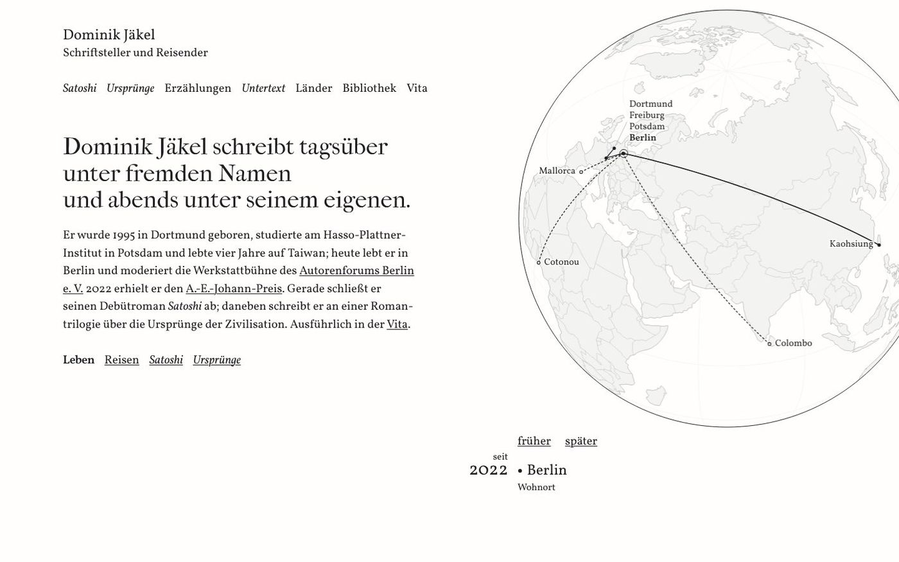
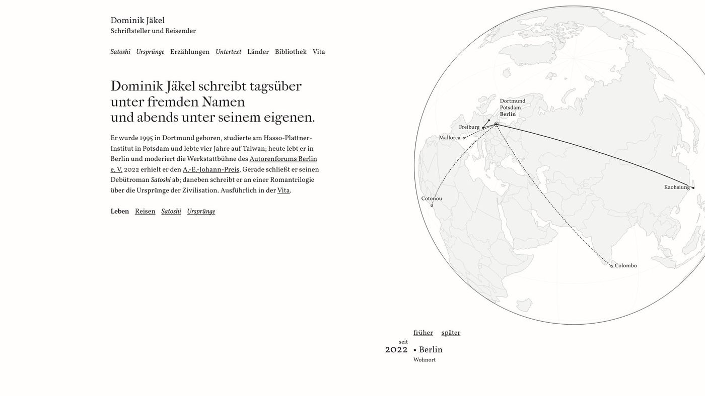

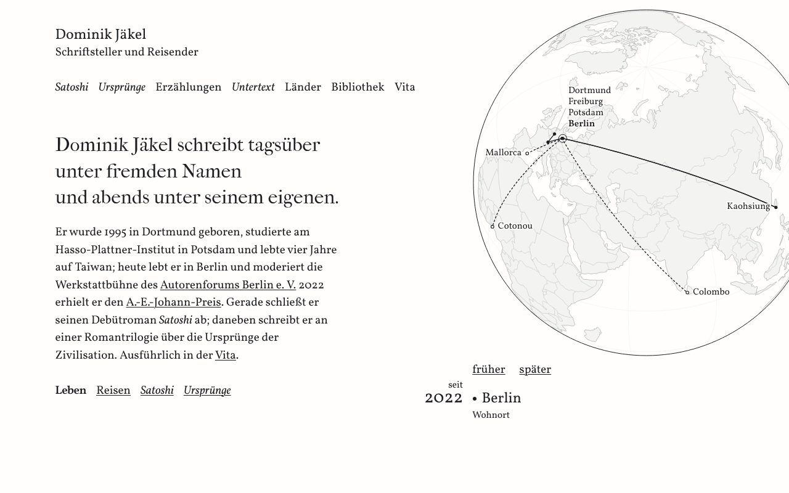
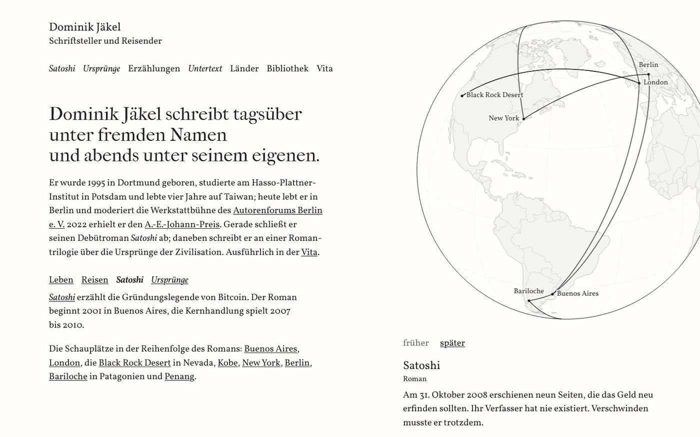

Links stehen erster Satz, Kurzvita und die Wahl der Ebene. Die linke Spalte endet ab 1440 px Breite immer an derselben Stelle (591). Die rechte wächst mit der Fensterhöhe, weil sich die Kugel nach der Höhe richtet. Darum wächst die Fläche mit dem Fenster: 223 px bei 1280 × 800, 380 bei 1440 × 900, 560 bei 1920 × 1080, 681 bei 2560 × 1440. In den Ebenen *Satoshi* und *Ursprünge* ist sie fast gefüllt.

### 1. Schrift größer, die Wahl bleibt links

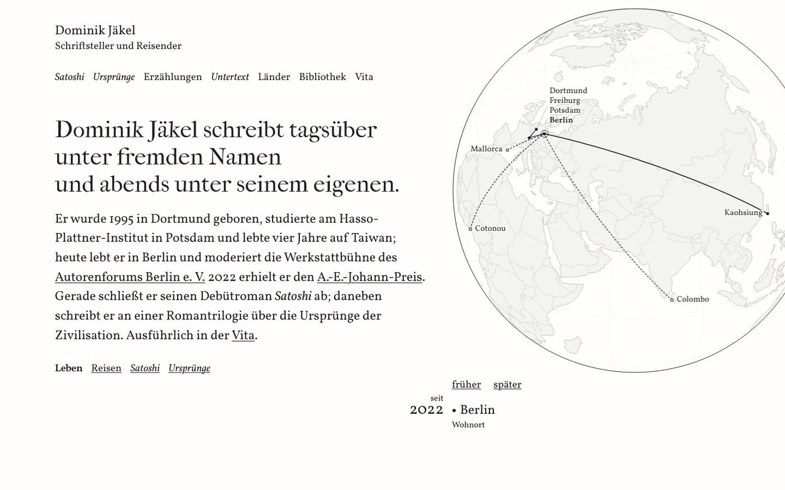

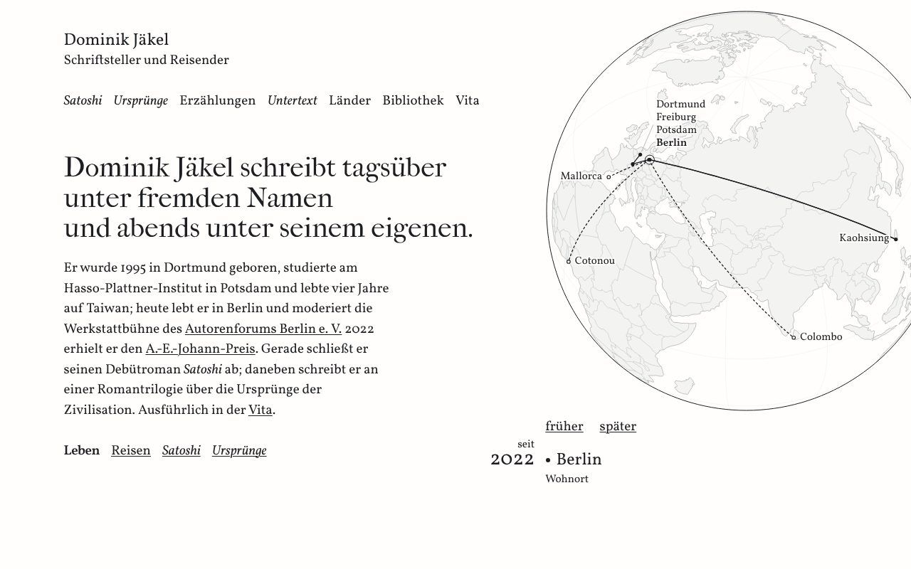
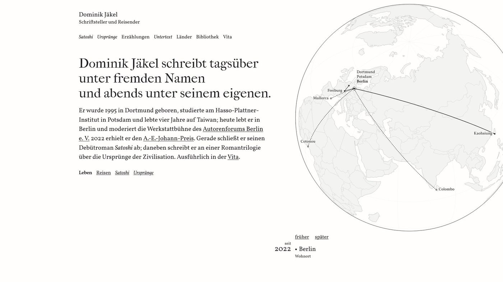

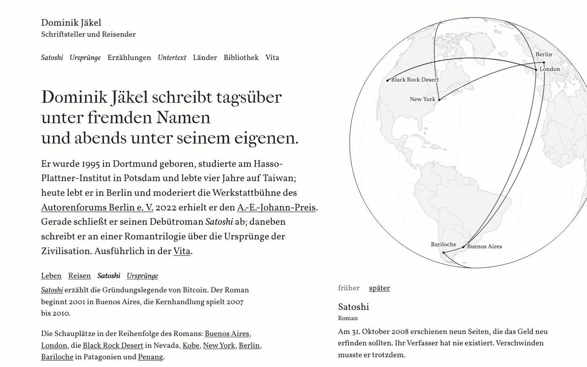

**Was sich ändert.** Der erste Satz wächst mit der Fensterhöhe, von 38 px (bei 768 px Höhe) bis höchstens 52 px. Er bricht weiter in seine drei Zeilen und hält immer mindestens 2,75 rem Abstand zur Kugel. Ab 832 px Fensterhöhe steht die Kurzvita im Grad Überschrift (23,75 px, eine Größe, die es auf der Website schon gibt). Die Wahl der Ebene bleibt links. Auf dem Telefon ändert sich nichts.

**Warum.** Das ist dein Vorschlag „einfach die Schrift größer“, so gut umgesetzt, wie es geht. Die Größe folgt einer Formel mit festem rem-Anteil (Utopia, Roselli), damit das Zoomen nicht bricht. Es entsteht keine neue Schriftgröße (sonst Rang 30, zu viele Schriftgrößen).

**Vorteile.** Die linke Spalte bekommt Gewicht gegen die Kugel und wirkt gesetzt wie ein Vorspann. Nichts Neues kommt auf die Seite. Die Kugel bleibt so groß wie auf *Satoshi*.

**Nachteile.** Die Fläche wird nur etwas kleiner. Bei fast quadratischen Fenstern (1280 × 1024, 1440 × 1080) wächst gar nichts, weil die Kugel dort die Breite nimmt. Zieht man das Fenster über 832 px Höhe, springt die Kurzvita sichtbar in den größeren Grad. In der Ebene *Satoshi* stehen drei Größen untereinander (43, 23,75 und 19 px). Allein löst die Variante deinen Einwand zum Telefon nicht.

**Aufwand.** Klein bis mittel, rund 35 Zeilen. Damit der Satz bei 1024 px nicht unter die Kugel läuft, braucht es eine angemeldete CSS-Variable (`@property`, ab Safari 16.4 und Firefox 128) und eine kleine Nachrechnung im Skript.

**Meine Verbesserungen.** Auf dem Telefon die Wahl der Ebene unter die Kugel legen, wie in Variante 2 (siehe „Die Wahl der Ebene“). Den ersten Satz wie auf *Satoshi* bei 46 px deckeln; bei 1920 kostet das ein paar Pixel Gewinn. Für ältere Browser ohne `@property` eine feste Breite als Rückfall setzen. Den Sprung der Kurzvita würde ich behalten, denn er bringt den größten Teil des Gewinns.

| Fenster | heute | Variante 1 |
|---|---|---|
| 1280 × 800 | 223 | 223 |
| 1366 × 768 | 219 | 219 |
| 1440 × 900 | 380 | 280 |
| 1536 × 864 | 344 | 280 |
| 1920 × 1080 | 560 | 474 |
| 2560 × 1440 | 681 | 595 |

*Weiße Fläche links bis „Was ich schreibe“, Ebene Leben, in px.*

### 2. Schrift größer, die Wahl unter der Kugel

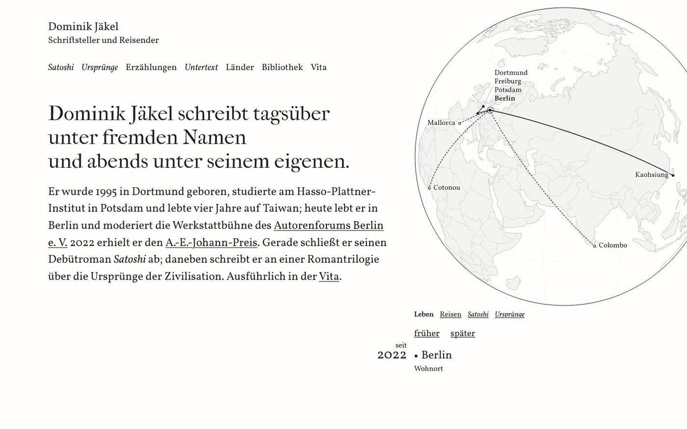

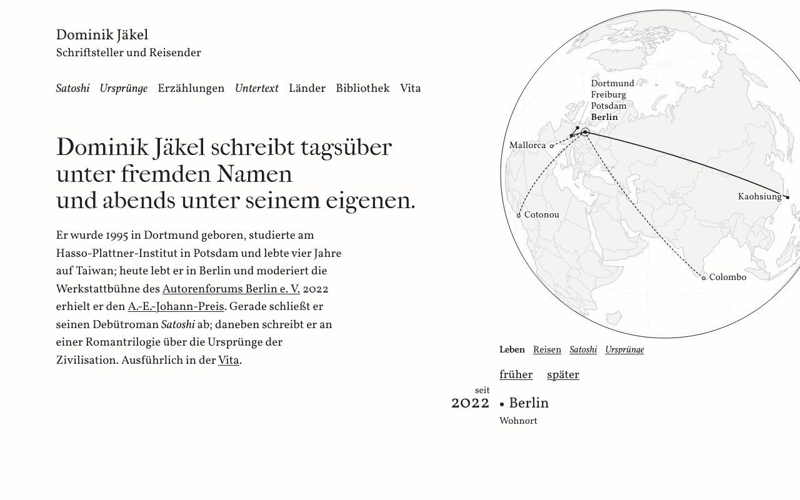
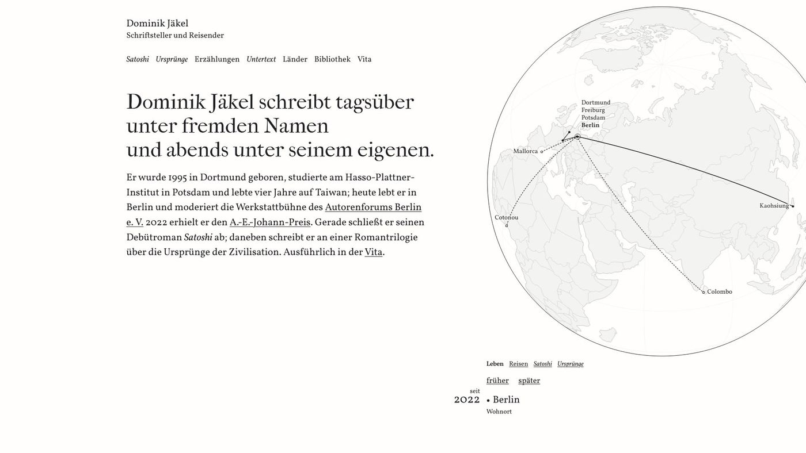

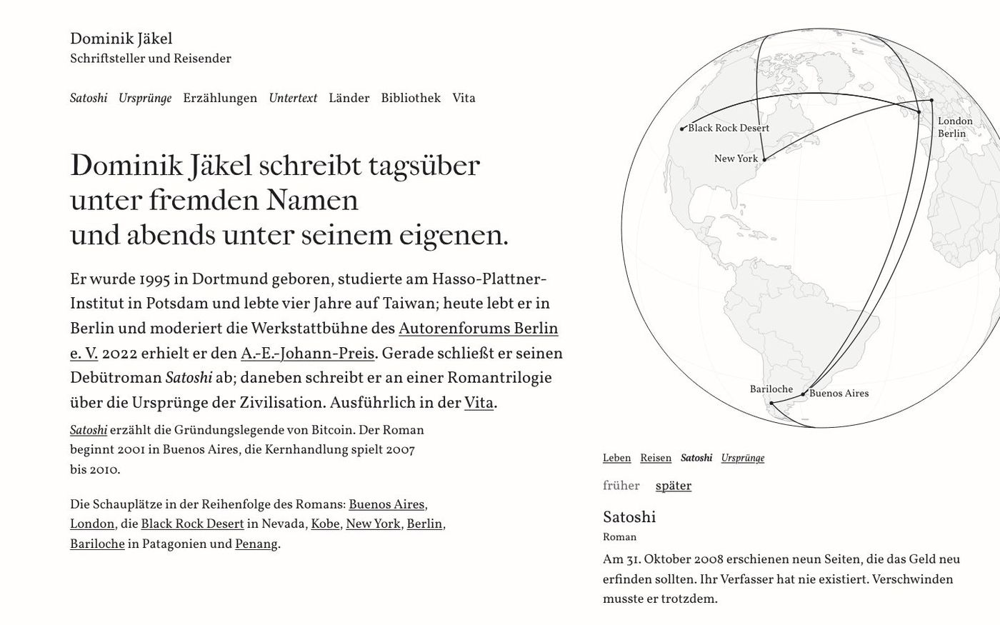

**Was sich ändert.** Die Schrift wie in Variante 1. Dazu wandert die Wahl der Ebene auf allen Breiten unter die Kugel, über „früher später“, im kleinen Grad wie eine Bildlegende. Der Text einer Ebene bleibt am Desktop links.

**Warum.** Das ist dein „Dafür vielleicht das raus“: Die Wahl steuert die Kugel und gehört deshalb an sie. Auf dem Telefon wiederholt sie heute direkt über der Kugel *Satoshi* und *Ursprünge* aus der Navigation, das ist Rang 33 (doppelte Information).

**Vorteile.** Dein Einwand zum Telefon ist gelöst, und das Spiel mit den vier Welten bleibt. In der Ebene *Satoshi* ist die linke Spalte am Desktop fast bis zur Tafel gefüllt.

**Nachteile.** Am Desktop braucht die Wahl unter der Kugel eine eigene Zeile, darum wird die Kugel rund 43 px kleiner. Der Gewinn der größeren Schrift ist dadurch fast ganz weg: 372 statt 380 px bei 1440. Bei 2560 ist die Fläche sogar 7 px größer. Die Kugel ist auf der Startseite dann kleiner als auf *Satoshi* (Rang 50, Unterschiede zwischen Unterseiten, leicht). Die Wahl steht rechts, ihr Text links, Ursache und Wirkung liegen weit auseinander. Der Text der Ebene rückt mit ¾ Zeile zu nah an die Kurzvita. Auf dem Tablet hochkant (820 × 1180) liegt die Wahl knapp unter dem Bildschirmrand.

**Aufwand.** Mittel, rund 51 Zeilen. Die Wahl wird im Skript in den Kasten unter der Kugel verschoben.

| Fenster | heute | Variante 2 |
|---|---|---|
| 1280 × 800 | 223 | 279 |
| 1366 × 768 | 219 | 276 |
| 1440 × 900 | 380 | 372 |
| 1536 × 864 | 344 | 336 |
| 1920 × 1080 | 560 | 531 |
| 2560 × 1440 | 681 | 687 |

*Weiße Fläche links bis „Was ich schreibe“, Ebene Leben, in px. Bei 1280 und 1366 wird sie größer, weil links die Zeile der Wahl fehlt und die Kurzvita dort im Textgrad bleibt.*

### 3. Schrift größer und zwei Sprungmarken

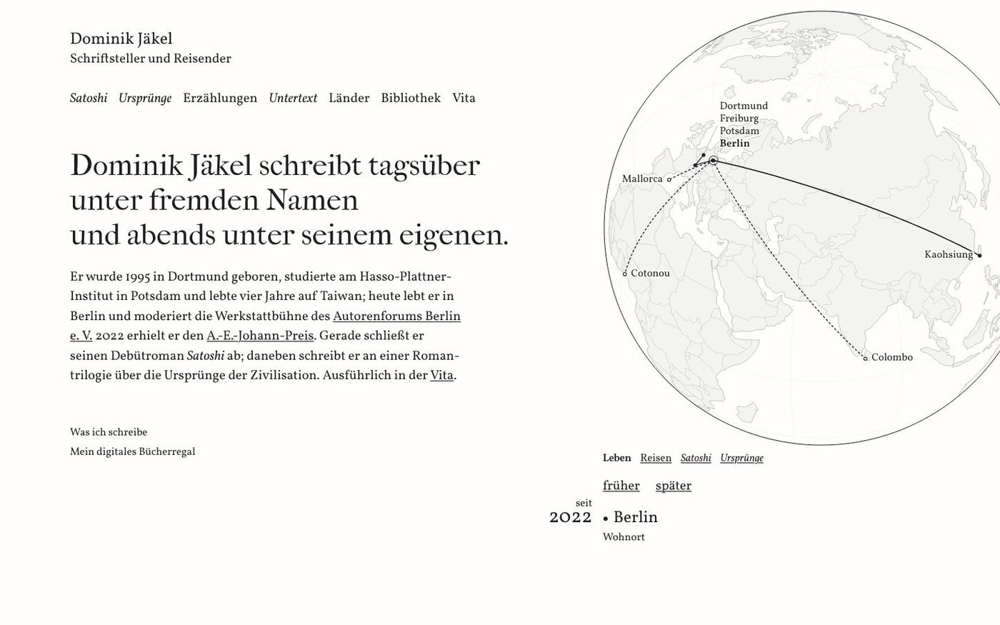

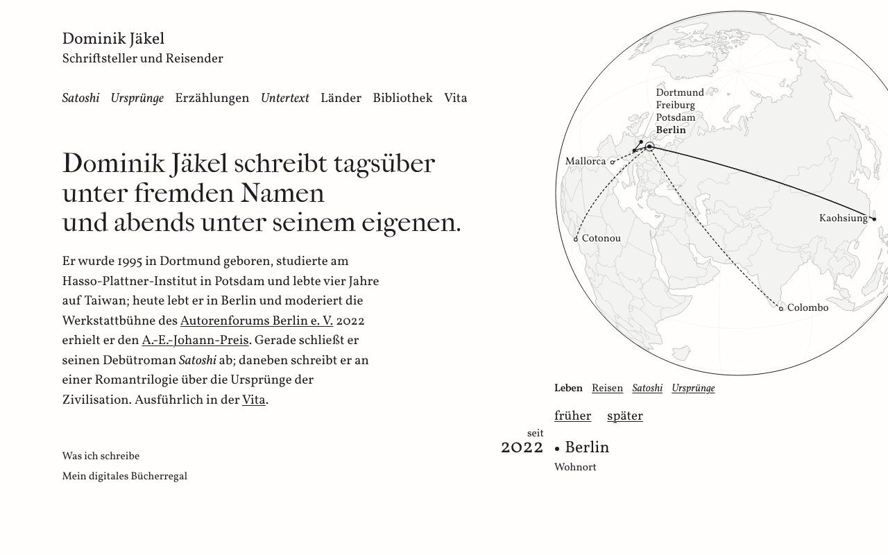
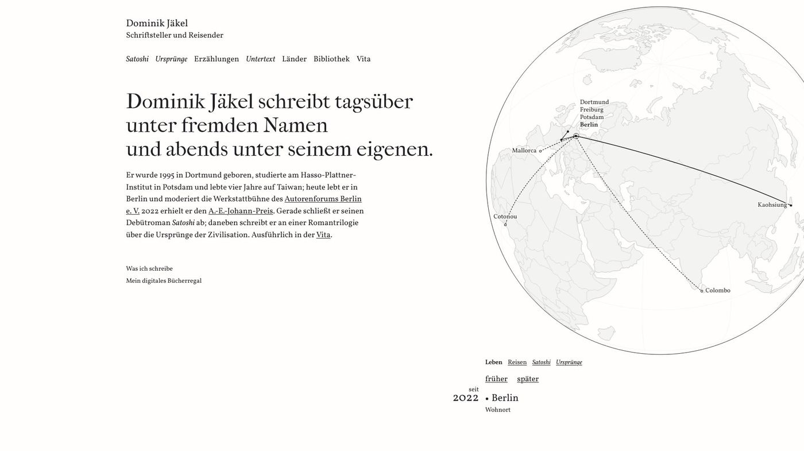

**Was sich ändert.** Der erste Satz wächst wie in Variante 1, die Kurzvita bleibt im Textgrad. Zwei Zeilen unter ihr stehen die beiden Überschriften der Seite als Sprungmarken, senkrecht, klein, in Tinte, in Ruhe ohne Unterstrich wie die Navigation. Die Wahl der Ebene steht wie in Variante 2 unter der Kugel. Nur am Desktop, und eine unsichtbare Beschriftung „Auf dieser Seite“ für Vorleseprogramme kommt dazu.

**Warum.** Dein „Schrift größer. Und die beiden Unterkapitel?!“. Die Marken sollen zeigen, dass unter dem ersten Bildschirm noch etwas kommt (NN/g, falscher Boden).

**Vorteile.** Die Sprünge funktionieren sauber, die Überschrift steht danach eine Zeile unter dem oberen Rand. Kein neues Wort, kein Grau. In den Ebenen *Satoshi* und *Ursprünge* ist der erste Bildschirm bei 1440 ausgewogen.

**Nachteile.** Zwei kleine Zeilen in einer leeren Fläche sehen genau so blass aus, wie du gefürchtet hast. Bei zwei Abschnitten raten NN/g, Queensland und ICDS von einem Verzeichnis ab. „Bücherregal“ steht nah bei „Bibliothek“ in der Navigation (Rang 33, abgeschwächt). Mit Navigation, Marken und Wahl stehen drei Bediengruppen im ersten Bildschirm. Ohne Unterstrich erkennt man die Marken nicht sofort als Verweise. Die Kugel wird kleiner wie in Variante 2.

**Aufwand.** Der größte Eingriff auf der Startseite, rund 73 Zeilen.

| Fenster | heute | Variante 3 |
|---|---|---|
| 1280 × 800 | 223 | 173 |
| 1366 × 768 | 219 | 198 |
| 1440 × 900 | 380 | 308 |
| 1536 × 864 | 344 | 272 |
| 1920 × 1080 | 560 | 467 |
| 2560 × 1440 | 681 | 623 |

*Weiße Fläche links bis „Was ich schreibe“, Ebene Leben, in px.*

### 4. Sprungmarken mit den Reihen des Bücherregals

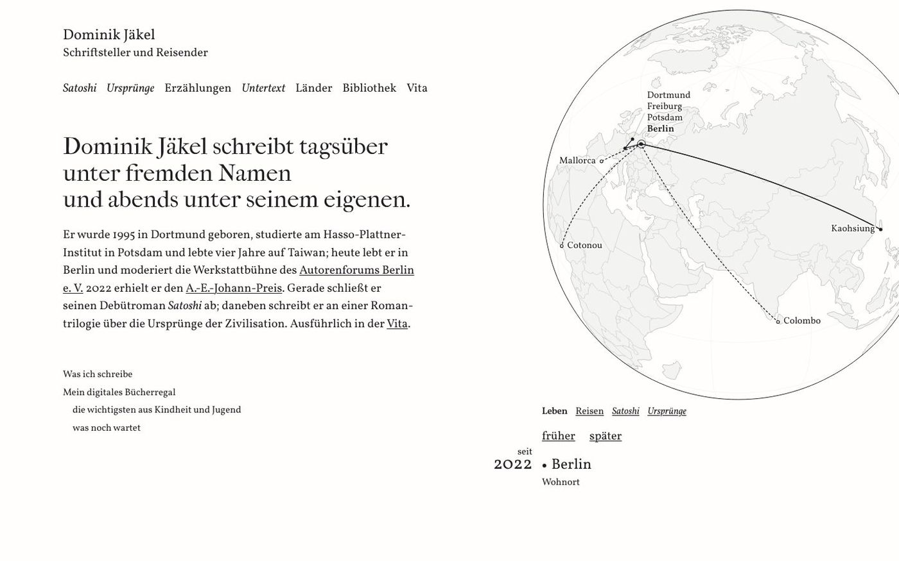

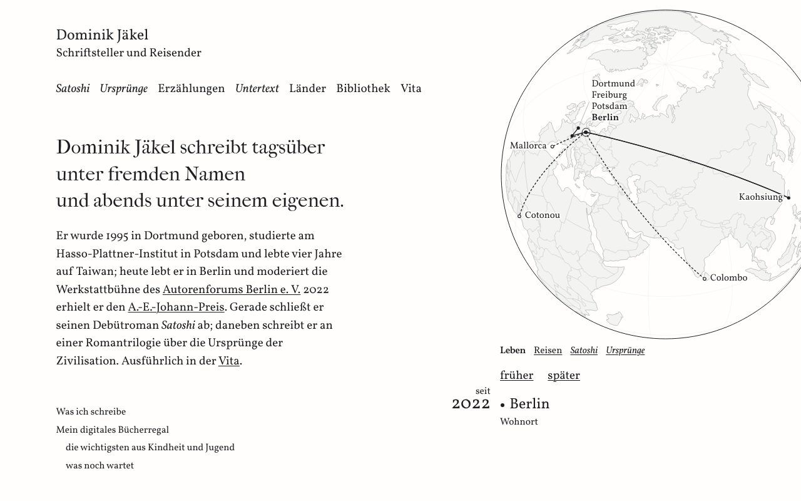
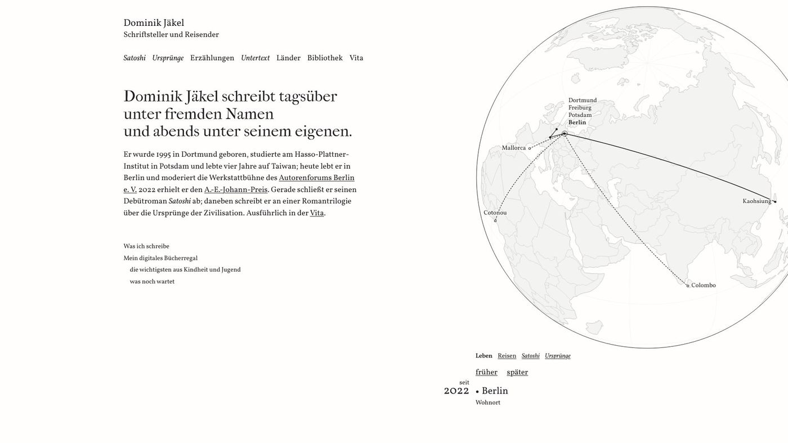

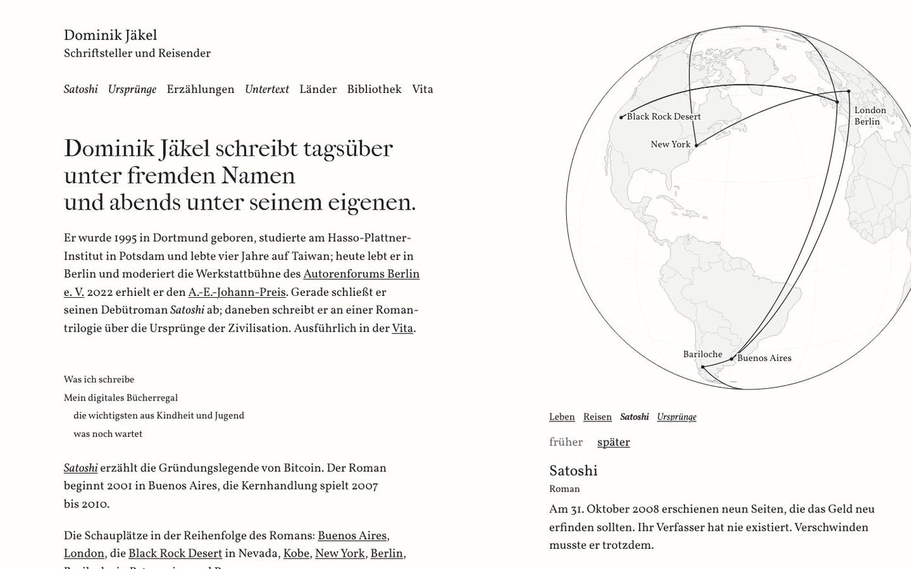

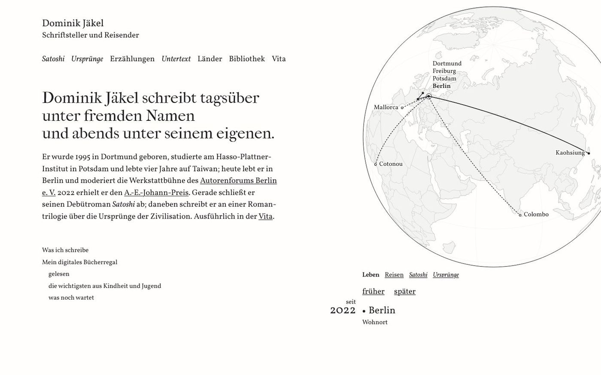

**Was sich ändert.** Die Schrift bleibt wie heute. Unter der Kurzvita steht ein kleines Verzeichnis: „Was ich schreibe“, „Mein digitales Bücherregal“ und eingerückt die Reihen „die wichtigsten aus Kindheit und Jugend“ und „was noch wartet“. Die erste Reihe hat auf der Seite keinen sichtbaren Namen. In der Fassung mit „gelesen“ käme deshalb ein neues sichtbares Wort dazu, das gegen unsere Regel verstößt. Die Wahl steht unter der Kugel.

**Warum.** Deine Idee, „die digitale Bibliothek in die drei Abschnitte“ zu untergliedern. Eingerückte Unterpunkte gibt es bei den Vorbildern dort, wo das Werk selbst gegliedert ist (Eloquent JavaScript, Crafting Interpreters).

**Vorteile.** Von den Varianten mit Marken füllt diese am meisten (bei 1440: 273 statt 380 px). Ohne Nummern und Etikett.

**Nachteile.** Das ist überladen, oder genauer überbaut: ein Verzeichnis, das mehr ordnet, als die Seite hergibt (nahe Rang 60, Buchkonventionen als Kulisse). Die Reihennamen sind unten kleine Beschriftungen, oben stehen sie gleichrangig neben Überschriften. Sie sind keine Überschriften, das spricht gegen NN/g. Die Sprünge zu ihnen landen nicht oben, weil die Seite dort zu Ende ist. Bei 1440 rutscht in der Ebene *Satoshi* die letzte Zeile unter den Rand, bei 1280 beginnen die Texte der Ebenen erst am Rand.

**Aufwand.** Mittel, rund 46 Zeilen.

| Fenster | heute | Variante 4 |
|---|---|---|
| 1280 × 800 | 223 | 116 |
| 1366 × 768 | 219 | 141 |
| 1440 × 900 | 380 | 273 |
| 1536 × 864 | 344 | 237 |
| 1920 × 1080 | 560 | 453 |
| 2560 × 1440 | 681 | 609 |

*Weiße Fläche links bis „Was ich schreibe“, Ebene Leben, in px, Fassung ohne „gelesen“.*

### 5. Ohne Wahl der Ebene, mit größerer Schrift

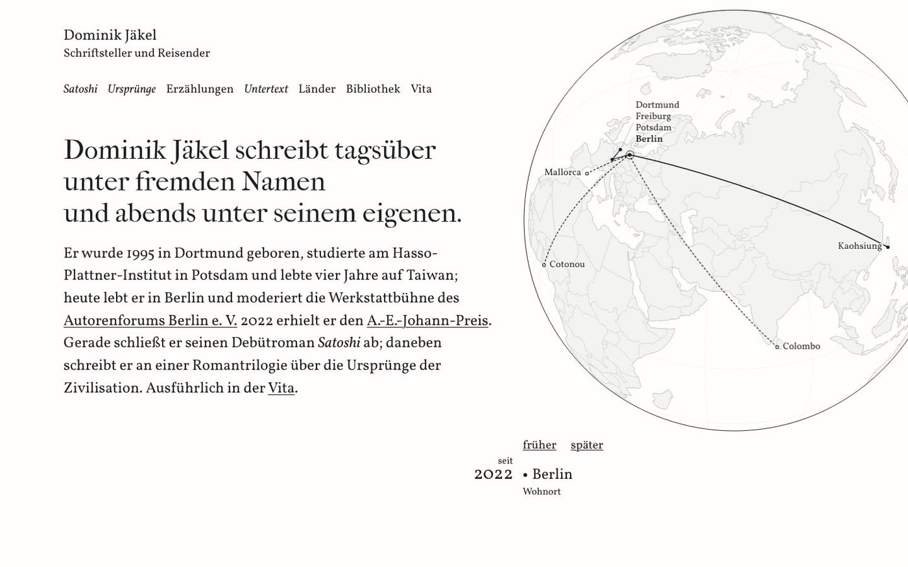

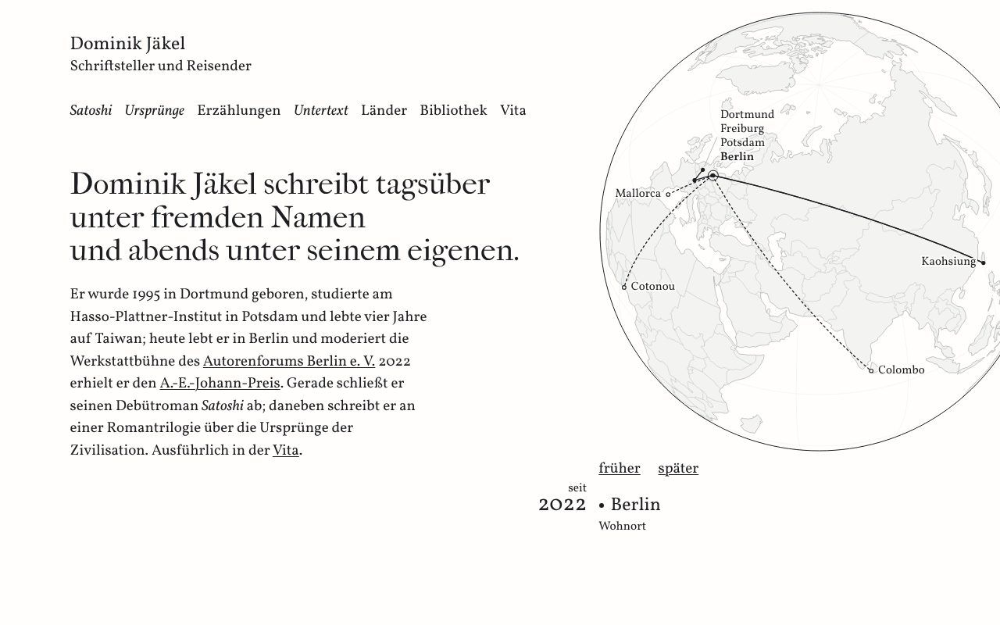
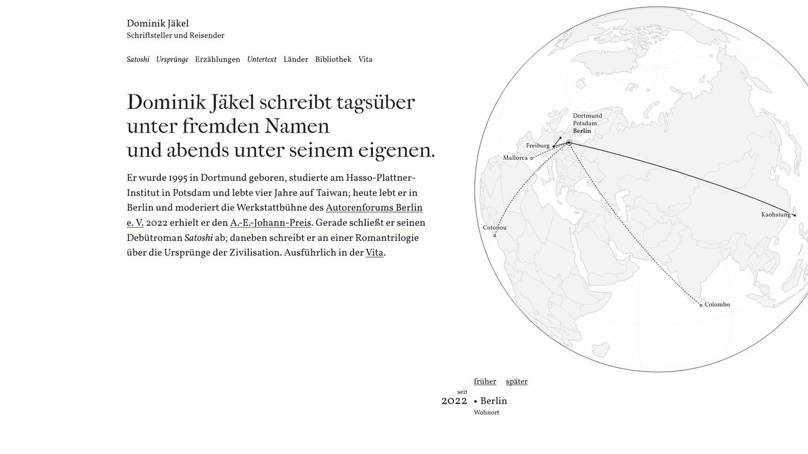

**Was sich ändert.** Die Wahl der Ebene und die Texte der Ebenen entfallen auf der Startseite, auf allen Breiten. Die Kugel zeigt nur noch das Leben. Die Schrift wie in Variante 1. Ein Bild in der Ebene *Satoshi* gibt es nicht, weil es die Ebene hier nicht mehr gibt.

**Warum.** Die zweite Lesart von „Dafür vielleicht das raus“. Reisen, *Satoshi* und *Ursprünge* haben eigene Seiten mit eigenem Globus (`laender.html`, `satoshi.html`, `ursprung.html`).

**Vorteile.** Auf dem Telefon die ruhigste Fassung: Die Kugel folgt direkt auf die Kurzvita, kein Wort steht doppelt, die Seite wird 40 px kürzer. Die Kugel bleibt groß.

**Nachteile.** Am Desktop wird die Fläche größer statt kleiner, weil mit der Wahl eine Zeile links fehlt. Die Startseite verliert ihren verspieltesten Moment: Wer heute auf *Satoshi* tippt, sieht auf derselben Kugel die Schauplätze des Romans. Die Kugel zeigt dann nur noch, was die Kurzvita daneben schon sagt.

**Aufwand.** Klein zum Ausprobieren, eine Regel blendet aus. Für einen echten Einbau müssen Wahl, Ebenentexte, ihre Abläufe im Skript und die reservierte Tafelhöhe wieder heraus, sonst bleibt toter Code liegen.

| Fenster | heute | Variante 5 |
|---|---|---|
| 1280 × 800 | 223 | 280 |
| 1366 × 768 | 219 | 276 |
| 1440 × 900 | 380 | 337 |
| 1536 × 864 | 344 | 337 |
| 1920 × 1080 | 560 | 531 |
| 2560 × 1440 | 681 | 652 |

*Weiße Fläche links bis „Was ich schreibe“, in px.*

### 6. Die eigenen Bücher neben der Kugel

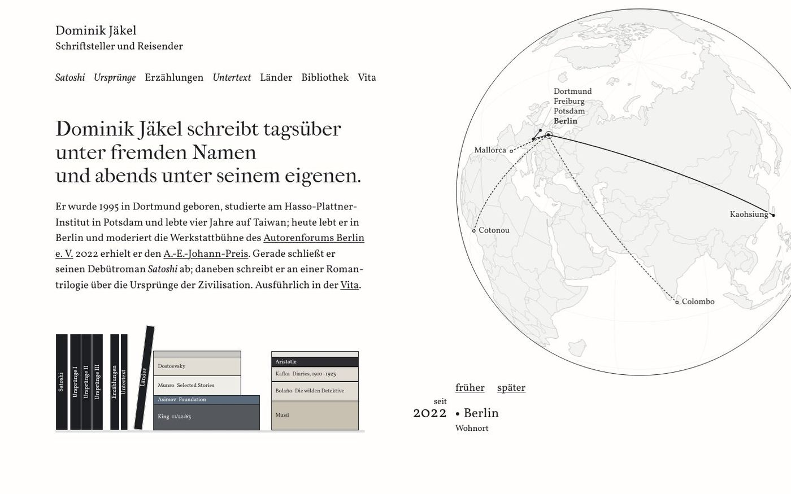

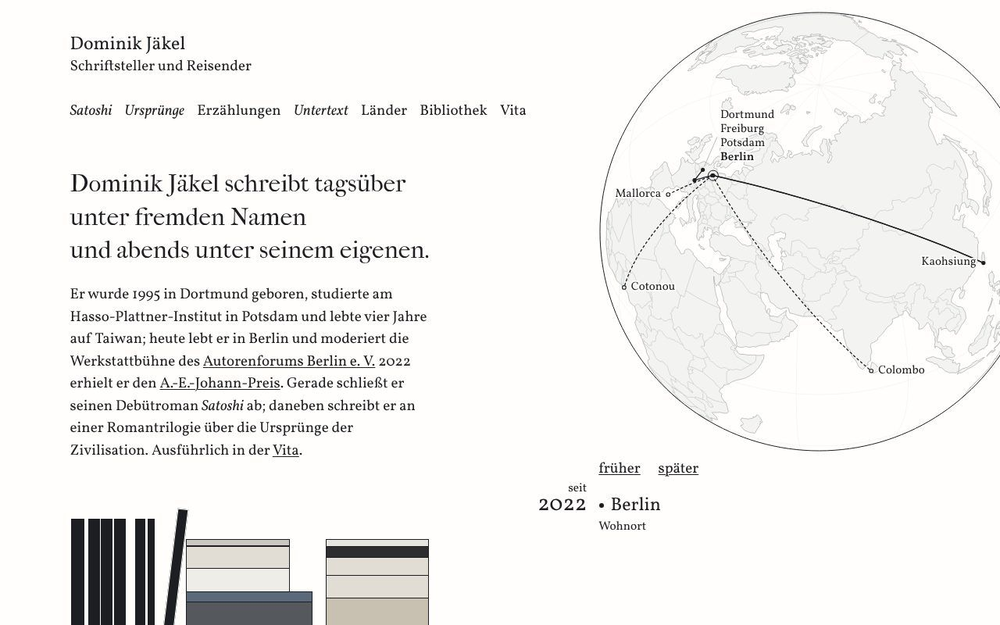
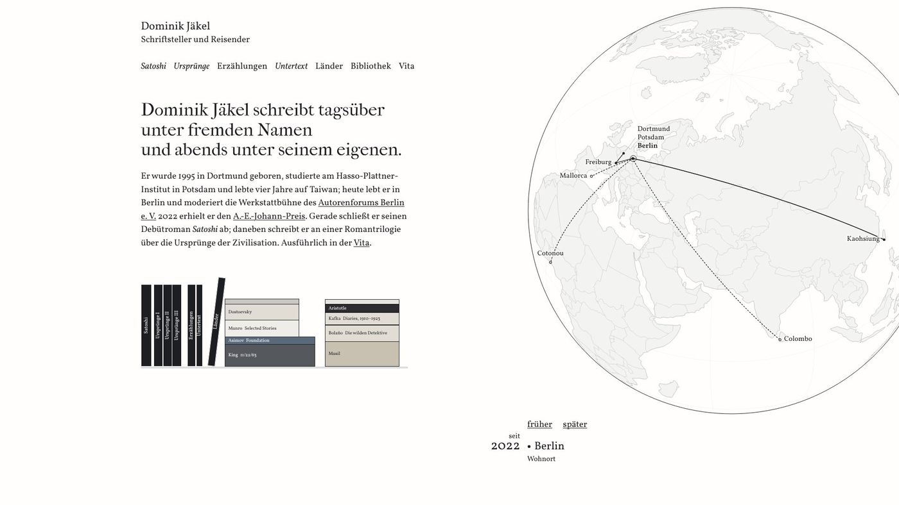

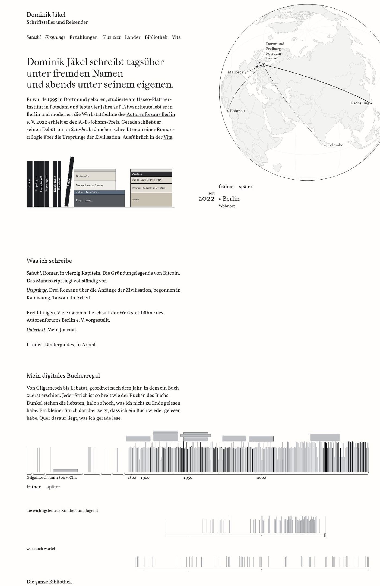

**Was sich ändert.** Am Desktop wandert das Regalbild aus „Was ich schreibe“ in die linke Spalte, zwei Zeilen unter die Kurzvita. Die Wahl der Ebene entfällt wie in Variante 5, sonst fiele ihr Text unter das Regal. Auf dem Telefon bleibt das Regal, wo es ist. Diese Variante war nicht deine Idee, sie kommt aus der Recherche. Ein Bild in der Ebene *Satoshi* gibt es nicht. Die Lücke im Zeitband im langen Bild behebt der andere Ablauf.

**Warum.** Die häufigste Lösung der Vorbilder: die kürzere Spalte mit dem Werk füllen (Eloquent JavaScript, Game Programming Patterns).

**Vorteile.** Die einzige Variante, bei der die Fläche bei 1440 × 900 und 1536 × 864 wirklich verschwindet. Ein Autor zeigt im ersten Bildschirm seine Bücher, das ist persönlich und verspielt. Bei 1920 ist es deutlich ruhiger als heute.

**Nachteile.** Auf den häufigen niedrigen Laptopfenstern (1366 × 768, 1280 × 800, 1024 × 768) schneidet der Bildschirmrand das Regal ab. Bei 1280 und 1024 tragen die Rücken keine Titel und wirken wie schwarze Balken. „Was ich schreibe“ hat danach eine leere rechte Hälfte, die Fläche ist also nur nach unten verschoben. Zwei Bilder im ersten Bildschirm (Rang 27, Prunkstück-Widget, hier doppelt). Die Wahl der Ebene geht verloren.

**Aufwand.** Mittel, rund 34 Zeilen, aber das Regal zieht beim Wechsel über 62 rem im Seitenbaum um. Das ist anfälliger als reines CSS.

| Fenster | heute | Variante 6 |
|---|---|---|
| 1280 × 800 | 223 | 121, Regal angeschnitten |
| 1366 × 768 | 219 | 121, Regal angeschnitten |
| 1440 × 900 | 380 | 183 |
| 1536 × 864 | 344 | 147 |
| 1920 × 1080 | 560 | 363 |
| 2560 × 1440 | 681 | 483 |

*Weiße Fläche links bis „Was ich schreibe“, in px. Davon sind 85 px der übliche Abstand über jedem Abschnitt.*

## Satoshi

### Heute

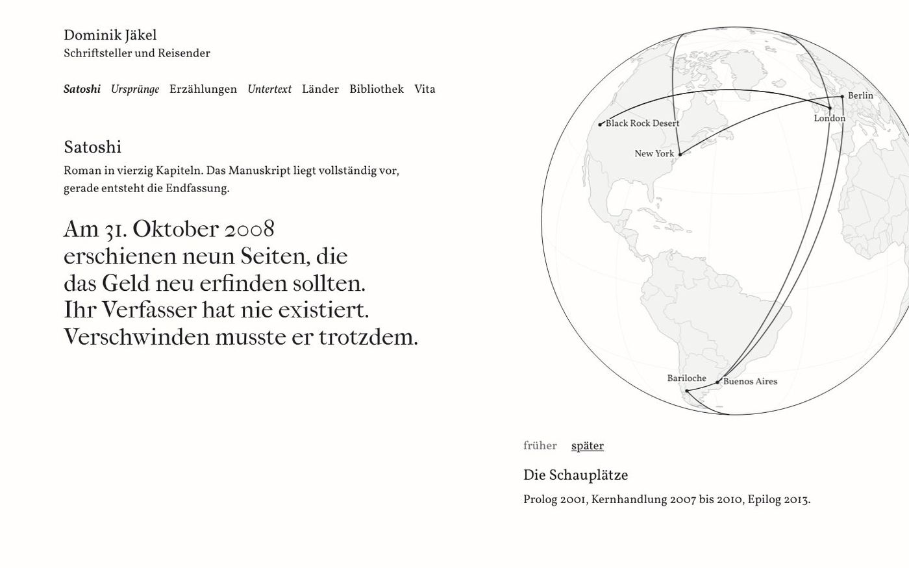
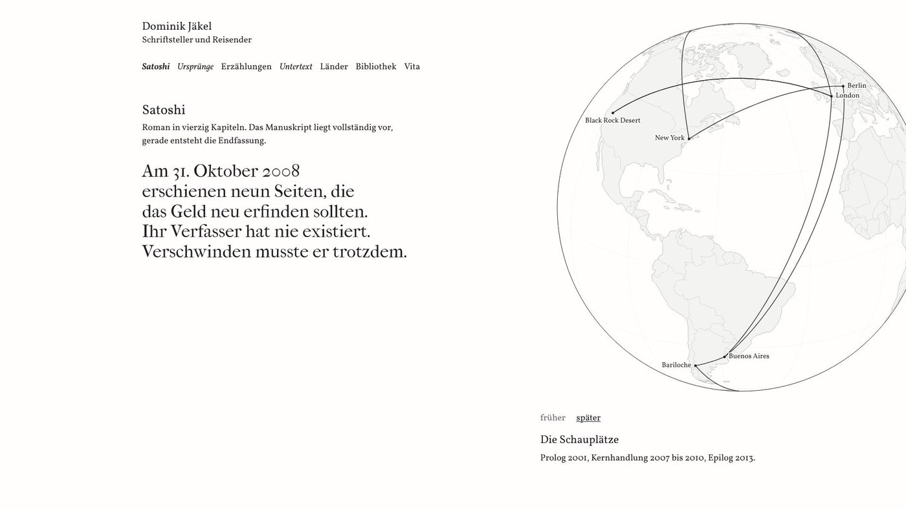

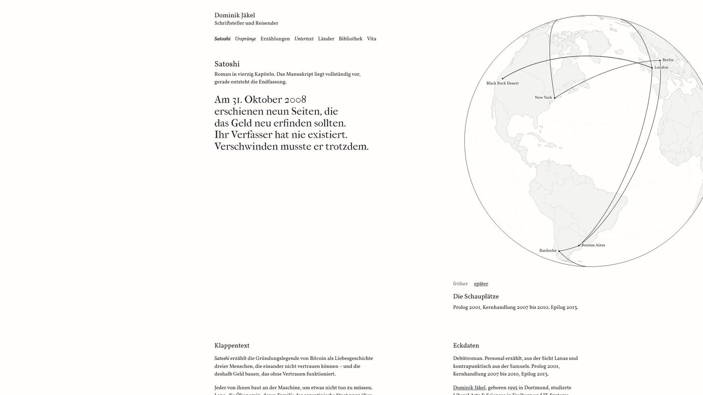

Links stehen Titelei und Aufhänger (Option B). Sie enden auf allen Breiten bei 556. Rechts stehen Kugel, „früher später“ und die Tafel. Die Fläche bis „Klappentext“: 287 px bei 1280 × 800, 387 bei 1440 × 900, 567 bei 1920 × 1080.

### 7. Sprungmarken in Tinte, der Aufhänger wächst mit

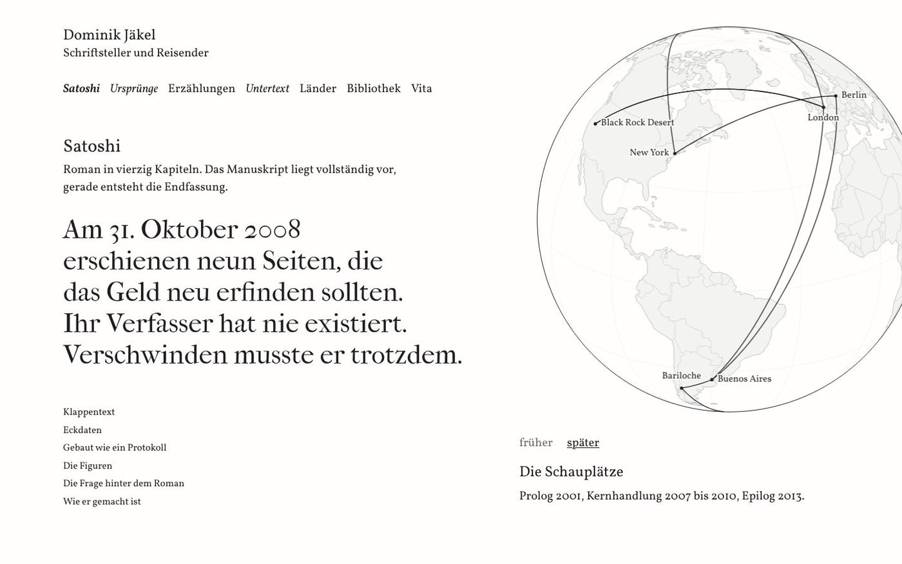

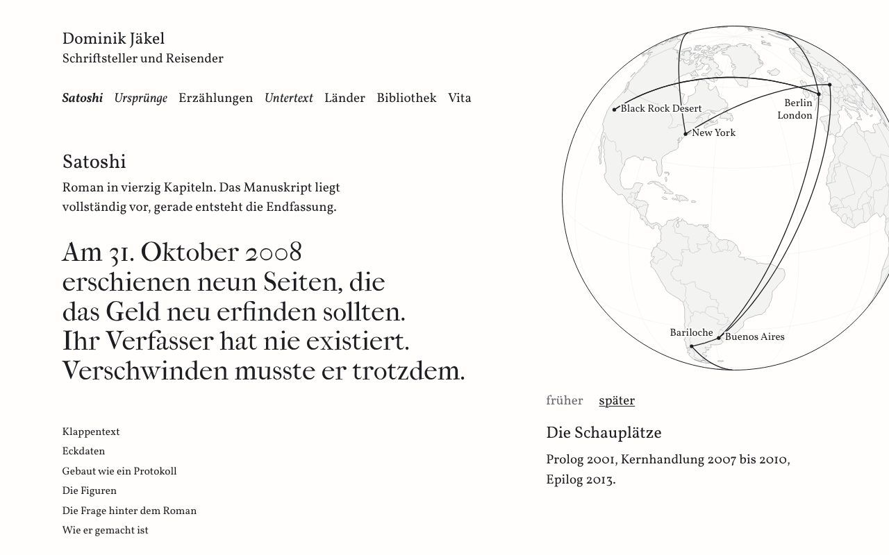
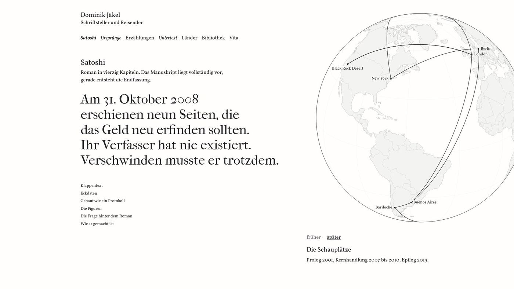

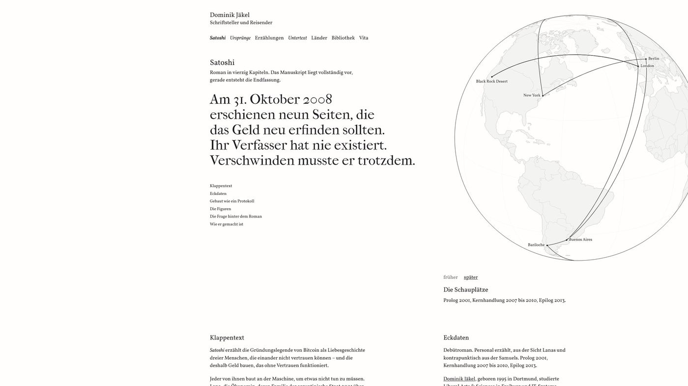

**Was sich ändert.** Zwei Zeilen unter dem Aufhänger stehen die sechs Überschriften der Seite untereinander: Klappentext, Eckdaten, Gebaut wie ein Protokoll, Die Figuren, Die Frage hinter dem Roman, Wie er gemacht ist. Klein (15,4 px), in Tinte, in Ruhe ohne Unterstrich, mit Unterstrich bei Maus und Tastatur, wie die Navigation. Ohne Nummern, ohne Etikett, ohne Hervorhebung beim Scrollen. Die Liste steht sofort da, nur der Aufhänger fliegt ein. Der Aufhänger wächst nach derselben Formel wie der erste Satz der Startseite, von 38 bis 52 px, und bleibt bei fünf Zeilen. Unsichtbar neu ist nur die Beschriftung „Auf dieser Seite“. Unter 62 rem ist die Liste ausgeblendet. Telefon und Tablet sind Pixel für Pixel gleich wie heute.

**Warum.** Deine Sprungmarken, in der Form der Vorbilder: senkrecht, Wortlaut der Überschriften, Textfarbe (Eloquent JavaScript, brandur). Die Seite erfüllt die Bedingungen von NN/g: lang, sechs klar getrennte Abschnitte, Linktext gleich Überschrift. „Leise“ wird die Liste durch Größe und Lage, nicht durch Grau. Damit vermeidet sie Rang 11 (grauer Nebentext mit wenig Kontrast) und Rang 29 (viele gleichrangige Grautöne), und ohne Etikett, Nummern und Mitlaufen auch Rang 1, 23 und 56.

**Vorteile.** Im Bild die beste Variante. Bei 1280 bis 1536 schließt die Fläche fast bis zur Tafel. „Klappentext“ verschiebt sich auf keiner Breite. Robust bei Zoom 125 % und ohne Skript. Der Kontrast in Tinte ist 16,5 : 1.

**Nachteile.** Bei 1920 und 2560 ist die Fläche nur gefasst, nicht weg (rund 220 und 340 px unter der Liste). Mit 50 px übertönt der Aufhänger den Titel „Satoshi“ (28,5 px), bei 1920 liest er sich fast wie die Überschrift. Ab 75 rem stehen „Klappentext“ und „Eckdaten“ nebeneinander, beide Marken springen an dieselbe Stelle. Die Liste folgt der Reihenfolge im Quelltext, auf der Doppelseite steht „Die Figuren“ aber rechts oben. Nach einem Sprung bleibt der Tastaturfokus am Seitenanfang, ein Vorleseprogramm liest die Überschrift nicht von selbst vor.

**Aufwand.** Mittel, rund 50 Zeilen. Davon gehört die Hälfte zur wachsenden Schrift. Ohne sie wären es rund 22.

**Meine Verbesserungen.** Den Aufhänger bei 46 px deckeln (`2.875rem`), auf der Startseite genauso. Die Überschriften bekommen `tabindex="-1"`, damit der Fokus nach dem Sprung dort landet. Formel und Liste gehören als gemeinsamer Baustein nach `stil.css` und `seite.js`, nicht kopiert in zwei Seiten. Das zweite Urteil schlägt vor, die Liste probehalber im Textgrad (19 px) zu setzen, wie ein Buchinhalt. Das ist einen Blick wert.

| Fenster | heute | Variante 7 |
|---|---|---|
| 1280 × 800 | 287 | 66 |
| 1366 × 768 | 255 | 63 |
| 1440 × 900 | 387 | 130 |
| 1536 × 864 | 351 | 94 |
| 1920 × 1080 | 567 | 275 |
| 2560 × 1440 | 687 | 395 |

*Weiße Fläche links bis „Klappentext“, in px.*

### 8. Blassgraue Sprungmarken

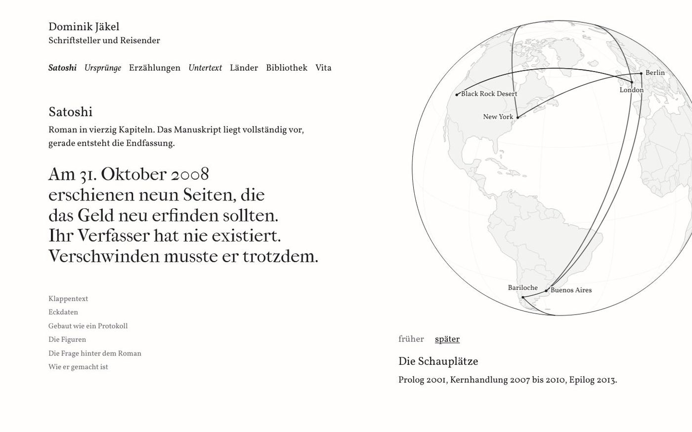

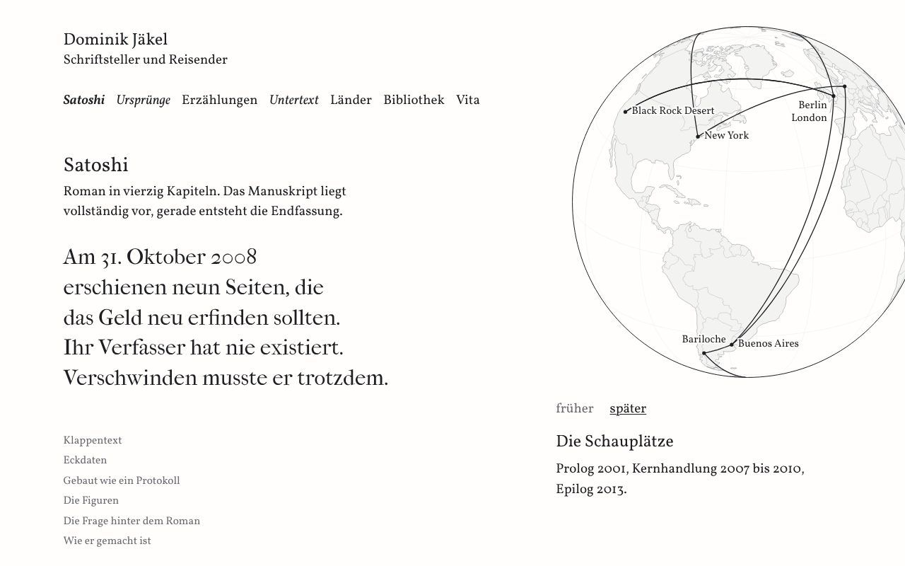

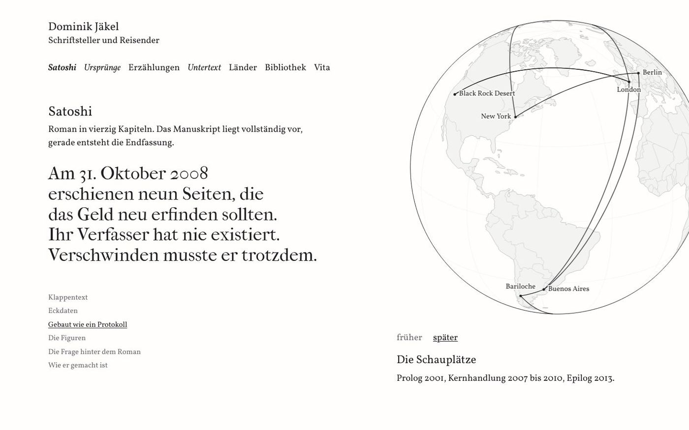

**Was sich ändert.** Dieselbe Liste wie in Variante 7, aber im blassesten Grau, das der Kontrast erlaubt (`--leise`, #6B6D72, 5,14 : 1). Beim Zeigen wird ein Eintrag Tinte und unterstrichen. Der Aufhänger bleibt bei 38 px.

**Warum.** Deine Idee wortgetreu: „blassgraue Sprungmarker … hierunter“. Noch blassere Töne der Seite fallen durch die Kontrastregel der WCAG (4,5 : 1).

**Vorteile.** Im Bild ruhig und zurückgenommen. Der Aufhänger und damit die Rangfolge von Titel und Aufhänger bleiben wie bei Option B. Der kleinste Eingriff mit Marken.

**Nachteile.** Das Grau ist dasselbe wie beim gesperrten „früher“ der Steuerzeile. Nebeneinander heißt das „nicht verfügbar“ (Rang 29), dazu Rang 11. Es bricht die Hausregel von C, „Grau nur für Zustände“ (Kopf von `stil.css`, Regel 4.2), und den Wortlaut von 6.20, „Farbe tritt nie beim Zeigen auf“. Grau und klein ergibt eher das „On this page“ einer Dokumentation als ein Buch. Bei 1920 und 2560 wirkt die graue Liste verloren.

**Aufwand.** Klein, rund 22 Zeilen.

| Fenster | heute | Variante 8 |
|---|---|---|
| 1280 × 800 | 287 | 66 |
| 1366 × 768 | 255 | 63 |
| 1440 × 900 | 387 | 166 |
| 1536 × 864 | 351 | 130 |
| 1920 × 1080 | 567 | 346 |
| 2560 × 1440 | 687 | 467 |

*Weiße Fläche links bis „Klappentext“, in px.*

### 9. Kugel kleiner, der Klappentext lugt in den ersten Bildschirm

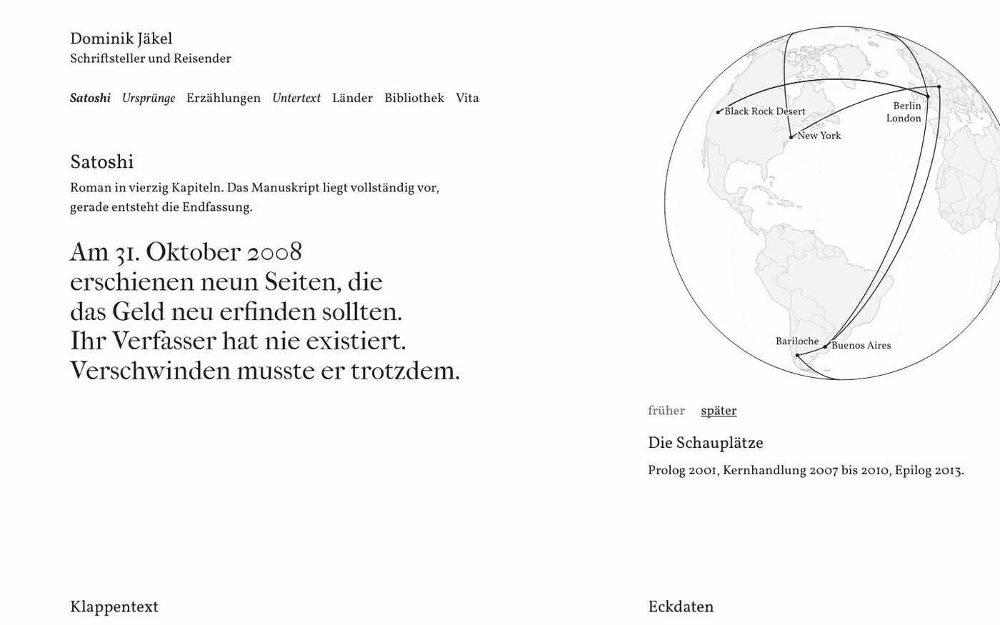

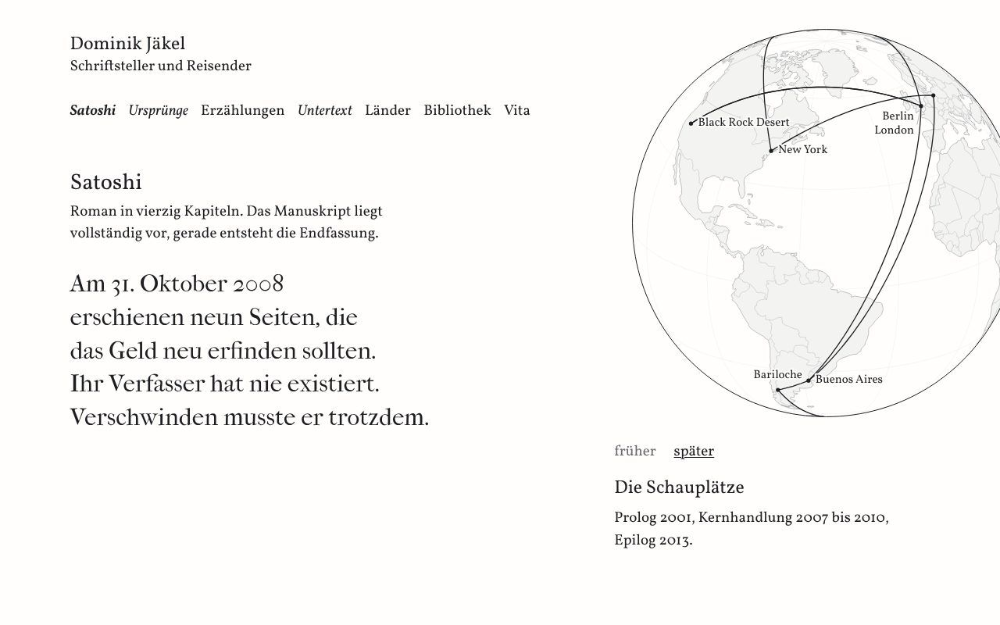
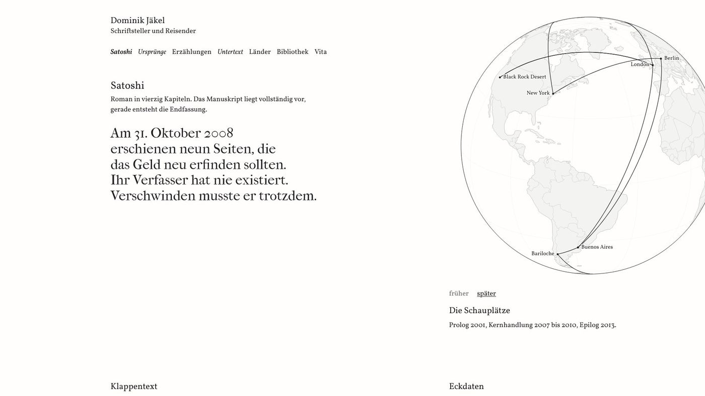

**Was sich ändert.** Die Kugel richtet sich nicht mehr nach der vollen Fensterhöhe. Ab rund 860 px Höhe bleibt sie drei Zeilen kleiner. Dann stehen „Klappentext“ und „Eckdaten“ schon im ersten Bildschirm. Keine Sprungmarken, der Aufhänger wie heute. Auch diese Variante war nicht deine Idee, sie kommt aus der Recherche.

**Warum.** NN/g, „Illusion of Completeness“: Die Seite soll sichtbar weitergehen, statt einen falschen Boden zu zeigen.

**Vorteile.** Die Fläche hat unten eine Kante. Nichts Neues kommt auf die Seite. Technisch die einfachste Variante.

**Nachteile.** Die Kugel ist auf dieser Seite der Inhalt und wird 10 bis 19 % kleiner. Die Fläche links bleibt groß (301 px bei 1440), rechts entsteht in Ruhe ein leeres Band in der reservierten Tafel. Bei 1280 × 800 und 1366 × 768 hilft die Variante gar nicht. Ein Browserfenster auf einem Bildschirm mit 900 px hat innen oft nur 800 px, dann greift sie auch dort nicht. Die Kugel wäre nur hier kleiner als auf den anderen Globusseiten (Rang 50).

**Aufwand.** Klein, 14 Zeilen CSS.

| Fenster | heute | Variante 9 |
|---|---|---|
| 1280 × 800 | 287 | 287 |
| 1366 × 768 | 255 | 255 |
| 1440 × 900 | 387 | 301, „Klappentext“ im Bild |
| 1536 × 864 | 351 | 265, „Klappentext“ im Bild |
| 1920 × 1080 | 567 | 481, „Klappentext“ im Bild |
| 2560 × 1440 | 687 | 687 |

*Weiße Fläche links bis „Klappentext“, in px.*

## Die Wahl der Ebene

Auf der Startseite steuert die Zeile „Leben Reisen *Satoshi* *Ursprünge*“, was die Kugel zeigt. Zu jeder Ebene außer Leben gibt es einen kurzen Text. Auf dem Telefon steht die Zeile heute direkt über der Kugel und wiederholt *Satoshi* und *Ursprünge* aus der Navigation, kursiv und unterstrichen wie diese. Sie liest sich wie ein zweites Menü.

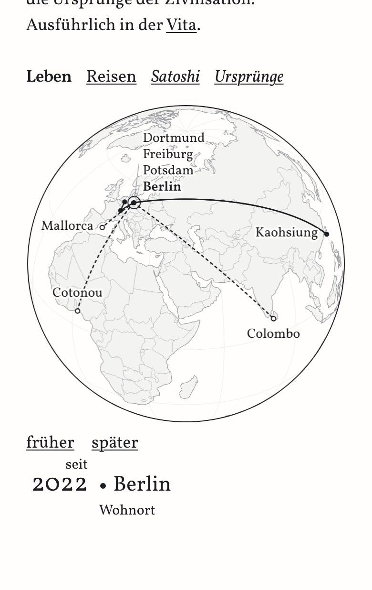
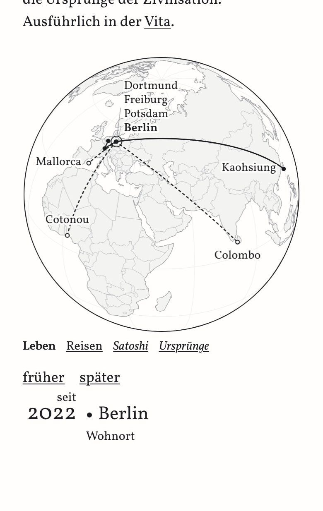

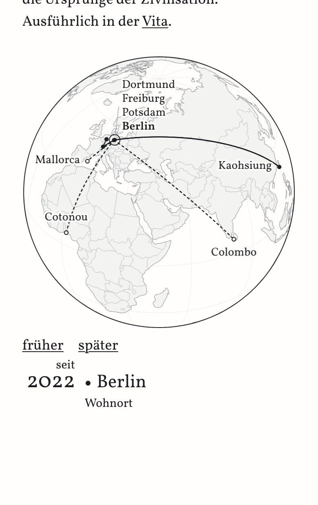

Am Desktop sehen die Fassungen so aus:

**Was verloren ginge, wenn sie wegfällt.** Das Spiel, auf einer Kugel zwischen vier Welten zu wechseln: das Leben, die bereisten Länder, die Schauplätze von *Satoshi* und die Orte der *Ursprünge*. Inhaltlich geht nichts Einmaliges verloren. Alles steht auf `laender.html`, `satoshi.html` und `ursprung.html`, jeweils mit eigenem Globus.

**Was gewonnen wird.** Unter der Kugel liest sich die Wahl als Legende der Abbildung und nicht mehr als zweites Menü. Ohne Wahl ist das Telefon am ruhigsten. Am Desktop hilft keine der beiden Fassungen gegen die weiße Fläche. Unter der Kugel kostet die Wahl dort rund 43 px Kugel und trennt sie von ihrem Text.

**Meine Empfehlung.** Behalten und nur unter 62 rem unter die Kugel legen, also auf Telefon und Tablet hochkant. Am Desktop bleibt sie links, über dem Text ihrer Ebene. So ist dein Einwand zum Telefon ganz gelöst, das Spiel bleibt, und am Desktop bleibt die Kugel so groß wie auf *Satoshi*. Diese Mischform ist noch nicht gebaut: Das Telefon sieht dann aus wie im Bild von Variante 2, der Desktop wie Variante 1. Beim Bau muss das Tablet hochkant (820 × 1180) geprüft werden, dort läge die Wahl knapp unter dem Bildschirmrand.

## Die Rangfolgen der drei Urteile

Die drei Urteile haben dieselben Bilder und Messwerte bewertet, jedes aus einem anderen Blick. Noten von 1 (schlecht) bis 10 (sehr gut).

**Startseite**

| Platz | Urteil 1: aus deinem Blick | Urteil 2: Gestaltung | Urteil 3: Technik |
|---|---|---|---|
| 1 | Schrift größer, Wahl an der Kugel (Var. 2), 7 | Schrift größer (Var. 1/2), 6 | Schrift größer (Var. 1/2), 7 |
| 2 | Bücher neben der Kugel (Var. 6), 6,5 | Ohne Wahl (Var. 5), 5 | Zwei Sprungmarken (Var. 3), 5 |
| 3 | Zwei Sprungmarken (Var. 3), 5 | Bücher neben der Kugel (Var. 6), 5 | Ohne Wahl (Var. 5), 4,5 |
| 4 | Ohne Wahl (Var. 5), 4 | Zwei Sprungmarken (Var. 3), 4 | Bücher neben der Kugel (Var. 6), 4 |
| 5 | Regalreihen als Marken (Var. 4), 3 | Regalreihen als Marken (Var. 4), 3 | Regalreihen als Marken (Var. 4), 3 |

Urteil 1 empfiehlt die Wahl auf allen Breiten unter der Kugel. Urteil 2 und 3 empfehlen sie nur auf dem Telefon unter der Kugel und die Kurzvita im Textgrad.

***Satoshi***

| Platz | Urteil 1: aus deinem Blick | Urteil 2: Gestaltung | Urteil 3: Technik |
|---|---|---|---|
| 1 | Marken in Tinte (Var. 7), 8 | Marken in Tinte (Var. 7), 7 | Marken in Tinte (Var. 7), 8 |
| 2 | Graue Marken (Var. 8), 6,5 | Graue Marken (Var. 8), 6 | Graue Marken (Var. 8), 6 |
| 3 | Kugel kleiner (Var. 9), 4 | Kugel kleiner (Var. 9), 4 | Kugel kleiner (Var. 9), 3,5 |

Alle drei wollen den Aufhänger in Variante 7 kleiner deckeln: Urteil 1 bei 48 px, Urteil 2 und 3 bei 46 px. Urteil 3 hält die wachsende Schrift für den schwächsten Teil, weil sie viel Code kostet und bei fast quadratischen Fenstern nichts bringt.
